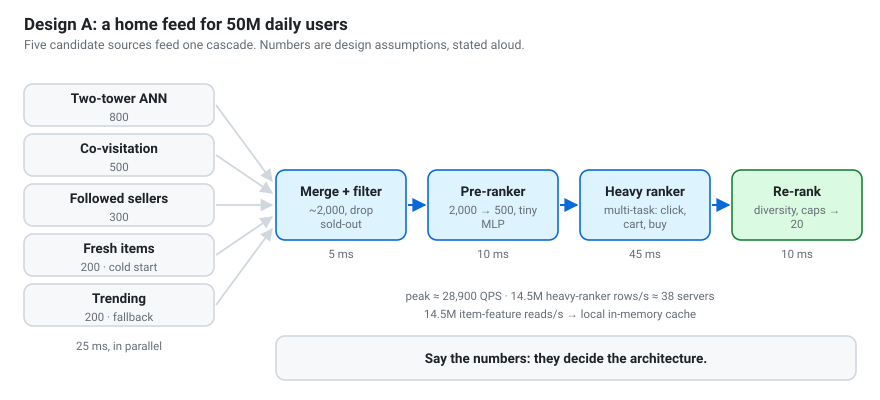
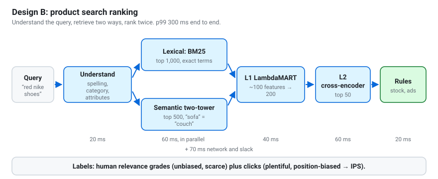

# Chapter 37 · Recommendation & search system design

*Part II · Prerequisites: Chapters 18, 21, 23–26, 29–30, 35 and 36 · Estimated time: reading ~60 min, lab ~90 min · Compute: CPU*

 · [Lab: notebook.ipynb](notebook.ipynb) · [Solutions](solutions.md)

## Learning objectives

After this chapter you should be able to:

1. Apply a ten-step design framework to recommendation and search problems, including the cascade-specific steps of candidate generation and ranking.
2. Carry out the capacity arithmetic of a ranking system: peak queries per second, candidates per stage, scoring load, servers, and embedding and index memory.
3. Choose an approximate nearest-neighbour index from a measured recall–latency curve, and explain how ANN cost scales with catalogue size.
4. Design a home-feed recommender and a product-search ranker end to end, including labels and position bias, freshness, serving, experimentation, monitoring and risks.
5. Explain lexical (BM25) and semantic retrieval, how each fails, and why search systems use both.
6. Recognise the common failure modes of design answers and the difference between mid-level and senior expectations.

## 37.1 Introduction

"Design the home feed" and "design product search" are the most common machine learning system design problems at large consumer companies. They are open-ended: there is no single correct answer, and an answer is judged by whether it proceeds in a structured way from the product goal to a system whose parts are justified, quantified and robust to failure. The material of Part II supplies all the parts — event logs and features (Chapters 19–22), learning from biased clicks (Chapters 23–24), retrieval (Chapters 25–26), experimentation (Chapters 29–30), serving and optimisation (Chapters 35–36). This chapter assembles them into two complete designs.

Section 37.2 extends the design framework of Chapter 18 for ranking systems. Sections 37.3 and 37.4 give the quantitative tools: capacity arithmetic and a measured ANN trade-off. Sections 37.5 and 37.6 present the two worked designs; Section 37.7 lists practice prompts and the common ways in which design answers fail. Every number in the worked designs is an **assumption stated for the design**, as it would be stated in an interview ("I will assume 50 million daily users; please correct me if that is wrong"), not a fact about any company.

## 37.2 The framework, extended for ranking systems

Chapter 18 introduced an eight-step framework for ML system design. Recommendation and search problems use the same steps with two additions, **candidate generation** and **ranking** as separate stages, because no system can afford to score the whole catalogue for each request (Chapter 35).

| # | Step | Minutes (of 40) | Ranking-specific questions |
|---|---|---|---|
| 1 | Clarify | 3–4 | Surface (feed, search, email)? Numbers of users, items and requests per day? Latency? How fast do new items arrive? |
| 2 | Metrics | 3 | North star (purchases, long-term engagement) versus proxies (CTR); offline metrics (NDCG, recall@K); guardrails (latency, diversity, seller fairness, complaints) |
| 3 | Data and labels | 4 | Implicit feedback (clicks, dwell, purchases, skips); position bias; exploration traffic; label delay; negative sampling |
| 4 | Features | 3 | User, item, user × item, context; real-time versus batch; point-in-time training sets |
| 5 | Candidate generation | 5 | Several sources; recall@K per source; cold start |
| 6 | Ranking | 5 | Pre-ranker → heavy multi-task ranker → re-ranking; loss and calibration |
| 7 | Serving | 5 | QPS, latency budget per stage, caching, fallbacks, feature reads, index updates |
| 8 | Experimentation | 4 | Randomisation unit, primary and guardrail metrics, interleaving, novelty and network effects |
| 9 | Monitoring | 3 | Fallback rates, feature freshness, score distributions, coverage, online–offline gap |
| 10 | Risks | 2 | Feedback loops, popularity bias, filter bubbles, abuse, privacy |

Two distinctions in step 2 recur throughout. The **north-star metric** is the outcome the business ultimately cares about (purchases per user per week); **proxy metrics** are faster or more measurable stand-ins (CTR) with known blind spots (CTR rewards sensational content). **Guardrail metrics** can block a launch but never justify one (Chapter 30). Naming the steps aloud lets the interviewer direct the discussion to the part they want to probe, usually steps 5–7.

## 37.3 Back-of-envelope capacity arithmetic

A design becomes concrete when its numbers are computed. Four formulas cover most ranking systems.

**Peak queries per second.**

$$
\text{QPS}_{\text{peak}} = \frac{\text{DAU} \times \text{requests per user per day}}{86{,}400} \times \text{peak factor}. \tag{37.1}
$$

With 50 million daily active users (DAU) making 20 requests each and a peak-to-average ratio of 2.5: $10^9$ requests per day, about 11,600 QPS on average and about 28,900 at peak. For mental arithmetic, $86{,}400 \approx 10^5$ seconds per day gives "about 30,000 at peak" to one significant figure.

**Scoring load and servers.**

$$
\text{rows/s} = \text{QPS} \times \text{candidates scored}, \qquad
\text{servers} = \left\lceil \frac{\text{rows/s}}{\text{rows/s per core} \times \text{cores} \times \text{utilisation}} \right\rceil. \tag{37.2}
$$

At 28,900 QPS and 500 candidates, the heavy ranker scores 14.5 million rows per second. At an assumed (to be measured) 20,000 rows per second per core, 32 cores per server and 60% target utilisation (Chapter 35 explained why servers are not run near saturation), that is $14.5\text{M} / 384{,}000 = 37.7$, so 38 servers. Halving either the number of candidates or the cost per row saves about 19 servers, which is the economic case for pre-rankers and for the techniques of Chapter 36.

**Embedding and index memory.** For $n$ vectors of dimension $d$ with $b$ bytes per number,

$$
\text{flat: } n\,d\,b, \qquad \text{HNSW: } n\,(d\,b + 2M \cdot 4), \qquad \text{IVF-PQ: } n\,(\text{code bytes} + 8), \tag{37.3}
$$

where $M$ is the HNSW connectivity parameter (the bottom layer stores up to $2M$ neighbours per node as 4-byte ids; upper layers add little) and IVF-PQ stores a compressed code plus an 8-byte id per vector. For 100 million items with 128-dimensional float32 embeddings: 51.2 GB flat, 76.8 GB with HNSW links ($M = 32$), and 7.2 GB with 64-byte product-quantisation codes. This single calculation changes the architecture: 51–77 GB does not fit comfortably on one commodity serving host together with everything else, while 7 GB does — at a cost in recall. Training adds further copies (the Adam optimiser keeps two moment estimates per parameter, so roughly three times the parameter memory), and serving adds replicas. Units must be stated: decimal gigabytes ($10^9$ bytes) differ from binary gibibytes ($2^{30}$) by 7.4%.

## 37.4 Choosing an ANN index from measurements

"We will use HNSW" is not a design decision; "we will choose the index type and its search parameter from a recall@10 versus latency curve at our target p99" is. The lab measures this curve for 100,000 clustered 64-dimensional unit vectors (synthetic, with overlapping clusters, which makes them harder than random vectors), single-threaded, with exact search as ground truth:

| Index | Setting | Recall@10 | Latency per query |
|---|---|---|---|
| exact (flat) | — | 1.00 | about 1.1 ms |
| IVF, 256 lists | nprobe 1 | about 0.80 | about 0.01 ms |
| IVF, 256 lists | nprobe 64 | about 0.99 | about 0.4 ms |
| HNSW, $M = 16$ | efSearch 16 | about 0.72 | about 0.04 ms |
| HNSW, $M = 16$ | efSearch 256 | about 0.96 | about 0.3 ms |

HNSW took about ten times longer to build than IVF. On these vectors IVF is better at every recall level; on other data HNSW often is. The conclusion is not that one index is superior, but that the choice must be measured on the system's own vectors.

**Scaling.** Exact search costs $O(nd)$ per query, so at 100 million items it would take about a second single-threaded. An IVF index partitions the vectors into `nlist` clusters and scans only the `nprobe` nearest clusters, costing about $O(n \cdot \text{nprobe}/\text{nlist} \cdot d)$; with $n = 100{,}000$, nlist 256 and nprobe 16, about 6,250 vectors are scanned instead of 100,000. HNSW navigates a layered proximity graph in roughly $O(\log n)$ hops. At 100 million items the index is **sharded** (5–20 million vectors per shard), shards are searched in parallel and merged, and the slowest shard determines the tail latency (Chapter 35, Equation 35.7).

> **Intuition.** Exact search reads every book spine in the library. IVF walks to the few shelves whose labels match best (`nprobe` is how many shelves); HNSW follows a chain of "see also" notes from book to book. *Where the analogy breaks down:* a book shelved just across a boundary is missed, which is why recall is below 1 and rises with `nprobe` or `efSearch`, at a latency cost that must be measured.

## 37.5 Worked design A: the home feed of a marketplace

*Prompt: "Design the home-feed recommendations for a marketplace app with 50 million daily active users."*

**1. Clarify.** An infinite-scroll feed of item cards on app open; about 20 pages per user per day, 20 items per page; 100 million active listings with about 2 million new ones per day (marketplace items sell out, so the catalogue changes quickly); 200 million monthly active users; p99 latency at most 200 ms at the client and 150 ms at the server. Out of scope, stated explicitly: ads blending, notifications, search.

**2. Metrics.** North star: purchases (or gross merchandise value) per user per week, with long-term retention as a slower guardrail. Online proxies: feed CTR, add-to-cart rate, purchases from the feed, session length — with CTR tied to purchases, since CTR alone rewards clickbait. Offline: recall@K per candidate source; NDCG@20 and calibrated log loss for the ranker, corrected for position bias with inverse propensity weighting (IPS, Chapter 23) or evaluated on exploration traffic. Guardrails: p99 latency, error and fallback rate, catalogue coverage, seller concentration (the share of impressions going to the top 1% of sellers), and the rate at which users hide items.

**3. Data and labels.** Impression logs with position, request id and model version; clicks, add-to-carts, purchases (delayed by up to days) and hides (explicit negatives). Each task has its own label: clicks are fast but noisy and position-biased; purchases are slow, sparse and most valuable; dwell time is in between. Because the logging policy decides which items receive labels, a small **exploration bucket** (for example 1% of requests with randomised order in the top slots) is kept to estimate position propensities and to evaluate without bias. Ranker negatives are shown-but-not-clicked items, not random catalogue items; retrieval uses in-batch or sampled negatives with the popularity correction of Chapter 26.

**4. Features.** User: long-term category, brand and price-band affinities (daily batch); the sequence of the last 50 interactions (streaming, real time); country and device. Item: category, price, seller quality, age, CTR and conversion rate by surface (hourly), image and text embeddings (computed at listing time). User × item: retrieval scores, co-visitation scores, "seen $N$ times without a click" (fatigue), price relative to the user's usual band. Context: time of day, page index, session depth. Training sets are built point-in-time from a log of the features *as served* at request time, which is the most reliable way to avoid training–serving skew (Chapter 21).

**5. Candidate generation (about 2,000 per request).**

| Source | Candidates | Purpose |
|---|---|---|
| Two-tower ANN with a user tower over the recent sequence | 800 | personalised, broad recall |
| Item-to-item co-visitation from recent clicks | 500 | strong short-term intent |
| Followed sellers and saved searches | 300 | explicit intent |
| Fresh items in the user's categories | 200 | cold start: new items receive impressions |
| Trending or popular by country | 200 | fallback and new users |

Candidates are merged and deduplicated, and sold-out or blocked items are removed *before* ranking, which saves ranker computation. Because the sources fail independently, losing one costs recall, not the page.

**6. Ranking.** A **pre-ranker** reduces 2,000 candidates to 500 with a cheap dot product or a tiny MLP, possibly distilled from the heavy ranker (Chapter 36). The **heavy ranker** is a multi-task network with a shared bottom and heads for $P(\text{click})$, $P(\text{add to cart})$ and $P(\text{purchase} \mid \text{click})$; the final score is a weighted combination whose weights are tuned by online experiments. Position is a training feature fixed to a constant at serving time (Chapter 35), or modelled by a separate position tower. **Re-ranking** applies diversity (a category cap or maximal marginal relevance), seller caps, a freshness boost, policy filters and deduplication across pages of the same session.

*Figure 37.1 — The home-feed cascade of design A. The heavy ranker receives 45 of the 150 ms because it sees only 500 items.*

**7. Serving.** Equations (37.1)–(37.3) give about 28,900 peak QPS, 14.5 million heavy-ranker rows per second (38 servers of 32 cores at the assumed throughput), 4 pre-ranker servers, about 14.5 million item-feature reads per second, 51 GB of float16 user embeddings, and 77 GB (HNSW) or 7 GB (IVF-PQ) for the item index. These numbers determine the architecture:

- **Feature reads dominate.** 14.5 million item-feature reads per second is why item features are held in a local in-memory cache on the ranker hosts (popular items recur across users), with only the user row read remotely.
- **The heavy ranker is the main cost**, so a better pre-ranker or a cheaper ranker is worth about 19 servers.
- **The item index needs sharding or compression:** HNSW across 4–8 shards with replicas, or IVF-PQ on one host with the top few hundred re-scored with exact vectors to recover recall.
- **Freshness:** 2 million new items per day must become retrievable within minutes, which requires an index that supports incremental additions (both HNSW and IVF do) plus a nightly rebuild, and a cold-start source.

A latency budget for the 150 ms server p99: request fan-in and user features 10 ms; retrieval sources in parallel 25 ms; merge and filter 5 ms; item features from the local cache 10 ms; pre-ranker 10 ms; heavy ranker 45 ms; re-ranking and rules 10 ms; logging and serialisation 10 ms; slack 25 ms. Fallbacks: a ranker timeout serves the pre-ranker order; a retrieval-source timeout drops that source (with a counter); a total failure serves a cached trending list per country.

**8. Experimentation.** A/B tests randomised by **user** (feeds have carry-over within a user), run for one to two weeks to cover weekly cycles and novelty effects, with purchases per user as the primary metric, the guardrails of step 2, and CUPED on pre-period purchases for power (Chapter 30). Team-draft interleaving screens many ranker candidates with roughly 10–100 times less traffic before the A/B test. **Marketplace interference** must be considered: if treatment users buy more of a scarce item, control users see it sold out. If this matters, seller-side metrics or switchback and cluster designs are used (Chapter 29).

**9. Monitoring.** Per-stage latency and fallback rates; each source's contribution to the final page; feature freshness (the age of the newest value per feature family); score distributions and calibration (predicted against observed CTR by decile, daily); coverage and seller concentration; the online–offline gap after each launch.

**10. Risks.** Feedback loops (only shown items receive labels, so popular items become more popular; exploration counters this); filter bubbles (diversity constraints, measured); seller fairness (new sellers need impressions); fake engagement (bot clicks poisoning co-visitation; filter by account quality); privacy (interaction sequences are sensitive; retention limits apply).

## 37.6 Worked design B: product search ranking

*Prompt: "Design the ranking for product search in the same marketplace."*

**1. Clarify.** 50 million DAU × 3 searches per day = 150 million searches per day: about 1,700 QPS on average and about 5,000 at peak (search traffic is more peaked than the feed, factor 3). p99 at most 300 ms end to end, including the text-index call. 100 million multilingual listings with structured attributes (brand, size, colour). Query traffic is highly skewed: the top 10,000 queries (the **head**) account for about 30% of traffic, and the **long tail** consists of queries seen once.

**2. Metrics.** North star: purchase conversion per search session and revenue per search. Proxies: CTR@k, time to first click, **reformulation rate** and **zero-result rate** (both strong signals of failure), abandonment. Offline: NDCG@10 on **human-graded relevance** (exact, substitute, complement, irrelevant) and IPS-weighted NDCG on clicks and purchases for engagement. Guardrails: latency, zero-result rate, seller concentration.

**3. Data and labels.** Two label sources with different failure modes. Human relevance ratings are unbiased with respect to position but expensive (a few hundred thousand query–item pairs, sampled to cover the tail). Behavioural labels (clicks, add-to-carts, purchases) are plentiful but position-biased and exist only for shown items. Position propensities are estimated from randomisation (swapping adjacent results in a small slice of traffic), and the ranker is trained with IPS-weighted LambdaMART (Chapters 23–24), or with position modelled explicitly and fixed at serving.

**4. Query understanding.** Before retrieval: normalisation and spelling correction; tokenisation per language; **query classification** into the category taxonomy (trained on purchase logs); **attribute extraction** with a sequence tagger ("red nike running shoes size 10" → colour, brand and size filters); synonym expansion; and intent detection (navigational, such as a store name, versus exploratory, such as "gift for a runner").

**5. Retrieval (about 1,500 candidates).** Two retrievers run in parallel.

- **Lexical retrieval** uses an inverted index scored by **BM25** over title, attribute and description fields, filtered by the extracted attributes; top 1,000. For one query term $t$ and document $D$,

$$
\operatorname{score}(t, D) = \operatorname{IDF}(t) \cdot \frac{f(t, D)\,(k_1 + 1)}{f(t, D) + k_1\left(1 - b + b\,\frac{\lvert D \rvert}{\text{avgdl}}\right)}, \tag{37.4}
$$

  summed over the query's terms. Here $f(t, D)$ is the number of occurrences of $t$ in $D$, $\lvert D \rvert$ the document length, avgdl the average length, $\operatorname{IDF}(t)$ the inverse document frequency (rare terms count more), and typically $k_1 \approx 1.2$, $b \approx 0.75$. Repeated occurrences help with diminishing returns controlled by $k_1$, and long documents are penalised through $b$. *Example:* with IDF 2.0, three occurrences in a document of average length give $2.0 \times 3 \times 2.2 / (3 + 1.2) = 3.14$; ten occurrences give only 3.9. Lexical retrieval is precise for exact terms, model numbers and brands.
- **Semantic retrieval** uses a two-tower model with a query encoder and an item encoder over title, attributes and image embedding, trained on query–purchase pairs; ANN top 500. It handles vocabulary mismatch ("sofa" and "couch") and the long tail.

For head queries, results are also cached and refreshed hourly.

> **Intuition.** Lexical retrieval is a book's index: exact, fast and blind to synonyms. Semantic retrieval is a librarian who knows that "couch" means "sofa", but may hand over a similar model when one exact part number was requested. *Where the analogy breaks down:* real systems blur the two (synonym expansion in BM25, keyword features in the neural model).

**6. Ranking.** The first stage (L1) is LambdaMART over about 100 features: BM25 per field, semantic similarity, the query–category match probability, attribute matches, price relative to the query's typical price, item CTR and conversion **for this query** and overall, seller quality, item age, and personal features such as brand affinity. The top 200 go to a second stage (L2), a **cross-encoder** that reads query and item text jointly — more accurate than a two-tower model because it can attend across the pair, but too expensive for more than about 50 items, and distilled to fit the budget. Business rules follow: out-of-stock filtering, ad slots and diversity for ambiguous queries.

**Freshness.** New listings have no engagement features, so their CTR features are smoothed towards a category prior (as in Chapter 35's smoothed item CTR), and a small, capped freshness boost or exploration slot gives them impressions. Index updates must be near real time, because sold items must disappear quickly.

**7. Serving.** A p99 budget of 300 ms: query understanding 20 ms; lexical and semantic retrieval in parallel 60 ms; feature fetch 30 ms; L1 40 ms; L2 on 50 items 60 ms; rules and ads 20 ms; network and slack 70 ms. Fallbacks: an L2 timeout serves L1 order; a semantic-retrieval failure falls back to lexical retrieval only; a query-understanding failure passes the raw query to BM25.

*Figure 37.2 — The search cascade of design B. The two retrievers fail in opposite ways (exact terms versus vocabulary mismatch), which is the reason to run both.*

**8. Experimentation.** Interleaving is the main tool for comparing search rankers, because it is sensitive and needs little traffic; launches are confirmed by A/B tests randomised by user; and human-rated side-by-side evaluations catch relevance changes that engagement metrics do not show (for example, removing offensive results for a rare query).

**9–10. Monitoring and risks.** Zero-result and reformulation rates per query segment (head, torso, tail; language); latency per stage; drift in the query mix (seasonal queries). Risks include keyword-stuffing spam listings (field-level features and quality models), popularity feedback loops on head queries, sensitive queries that need policy filters, and human relevance labels drifting away from what users want.

## 37.7 Practice prompts and failure modes

### 37.7.1 Practice prompts

The lab lists six prompts, to be practised one per day, timed (40 minutes, aloud, recorded), each with what a complete answer covers beyond the framework:

1. **Short-video feed:** watch time and completion as labels, and their bias towards long videos; sequence models over recent views; feedback within minutes and online learning; creator cold start; an exploration budget; integrity filters before ranking.
2. **Ads click-through prediction:** calibration matters because bids are multiplied by predicted CTR in an auction; log loss rather than AUC alone; delayed conversions; negative down-sampling and recalibration; budget pacing; auction effects on metrics.
3. **"People you may know":** graph candidates (friends of friends, shared groups), sparse positive labels, privacy, abuse, asymmetric acceptance, and network effects that require cluster randomisation.
4. **Push notifications:** uplift rather than CTR (would the user have opened the app anyway?), volume caps and fatigue, unsubscribes as a hard guardrail, send-time optimisation, long-term holdout groups.
5. **Query autocomplete:** tries or finite-state transducers for latency under 50 ms (Chapter 34), popularity with personalisation and trending, filtering offensive suggestions, evaluation by keystrokes saved and downstream search success.
6. **"Similar items":** co-visitation versus content embeddings, substitutes versus complements, cold start via content, evaluation by add-to-cart from the module, avoiding near-duplicates, batch precomputation versus online computation.

### 37.7.2 Common failure modes

| Failure | Typical symptom | Remedy |
|---|---|---|
| Model first | proposing an architecture in the second minute | clarify and set metrics first; name a baseline |
| One-stage system | scoring the whole catalogue per request | a cascade with numbers per stage |
| CTR as the goal | optimising clicks only | north star, proxies and guardrails; multi-task heads |
| Ignoring position bias | training and evaluating on raw clicks | exploration traffic, IPS, or position as a feature |
| No numbers | "it should be fast" | QPS, candidates, milliseconds per stage, GB of embeddings |
| No cold start | new users and items silently receive nothing | popularity and fresh sources, content features, exploration |
| Offline-only evaluation | "NDCG went up, so launch" | A/B or interleaving, guardrails, novelty, online–offline gap |
| No failure handling | a single path with no fallbacks | timeouts and fallbacks per stage, counted and alerted |
| Monologue | fifteen minutes without checking in | signpost each step; ask where to go deeper |
| Listing names | five model names, no trade-offs | one choice per stage with the criterion that decided it |

**Levels of expectation.** In generic terms (not any company's ladder), a mid-level answer gets the cascade and metrics right and can implement each component. A senior answer also prioritises (what to build first and why), quantifies trade-offs, anticipates organisational and operational issues (ownership of the feature store, rollback procedures, on-call load) and states what evidence would change the design.

## Key terms

| Term | Definition |
|---|---|
| North-star metric | The business outcome the system ultimately serves, such as purchases per user per week. |
| Proxy metric | A faster or more measurable stand-in for the north star, with known blind spots. |
| Candidate source | One retrieval method that proposes items for ranking. |
| Pre-ranker | A cheap model that reduces thousands of candidates to hundreds. |
| Multi-task ranker | One network with several output heads predicting different outcomes. |
| Peak QPS | Queries per second at the busiest time of day. |
| Peak factor | The ratio of peak to average traffic. |
| Sharding | Splitting an index or table across machines and querying the parts in parallel. |
| IVF / HNSW | ANN indexes based on clustering with probing / on a layered proximity graph. |
| Product quantisation (PQ) | Compressing vectors into short codes by quantising sub-vectors separately. |
| BM25 | A lexical relevance score combining term frequency with saturation, inverse document frequency and length normalisation. |
| Inverted index | A map from each term to the documents containing it. |
| Query understanding | Processing a search query (correction, classification, attribute extraction) before retrieval. |
| Cross-encoder | A model that reads query and item jointly; accurate but expensive. |
| Head / tail queries | Frequent queries that account for much of the traffic / rare queries seen few times. |
| Cold start | The absence of history for new users or items. |
| Exploration bucket | A small share of traffic served with randomised ordering to estimate bias and evaluate without it. |

## Summary

1. Ranking-system designs follow a ten-step framework that separates candidate generation from ranking, because no system can score the whole catalogue per request.
2. Capacity arithmetic (Equations 37.1–37.3) turns a design into numbers: about 28,900 peak QPS, 14.5 million ranker rows per second and 51–77 GB of index memory for the home-feed assumptions; these numbers decide caching, sharding and the value of pre-rankers.
3. ANN indexes are chosen from a measured recall–latency curve on the system's own vectors; in the lab IVF beat HNSW at every recall level, which need not hold elsewhere.
4. The home-feed design combines five candidate sources, a pre-ranker, a multi-task heavy ranker and re-ranking within a 150 ms budget, with exploration traffic for position bias and user-level A/B tests that account for marketplace interference.
5. The search design adds query understanding and runs lexical (BM25, Equation 37.4) and semantic retrieval in parallel, followed by LambdaMART and a cross-encoder on the top 50.
6. Freshness and cold start require dedicated sources, smoothed features and incremental index updates.
7. Typical failures are starting with the model, omitting numbers, optimising CTR alone, ignoring position bias and failure handling, and evaluating only offline.

## Exercises

The exercises are in the lab, [notebook.ipynb](notebook.ipynb); worked answers are in [solutions.md](solutions.md).

1. **Exercise 1 · `embedding_memory_gb`.** Memory in decimal gigabytes of a dense table of vectors.
2. **Exercise 2 · `qps`.** Peak QPS from daily active users, requests per user and the peak factor, plus a mental estimate to one significant figure.
3. **Exercise 3 · Written design.** A one-page design for the short-video feed, ads CTR prediction or similar items, in the ten-step structure, with a capacity table of labelled assumptions, a latency budget, two candidate sources and their failure modes, labels and bias correction, the online experiment and the two most serious risks; then a timed ten-minute presentation.

Checkpoint questions ask you to design candidate generation for a feed, estimate the capacity of a larger feed and identify the number that changes the architecture, compare lexical and semantic retrieval, explain and correct position bias in search, test a ranker in a marketplace with shared inventory, and describe post-launch monitoring and alerts.

## Further reading

- Covington, P., Adams, J. and Sargin, E. (2016). Deep neural networks for YouTube recommendations. *Proceedings of RecSys 2016*.
- Yi, X. et al. (2019). Sampling-bias-corrected neural modeling for large corpus item recommendations. *Proceedings of RecSys 2019*.
- Manning, C. D., Raghavan, P. and Schütze, H. (2008). *Introduction to Information Retrieval*. Cambridge University Press. Chapters on index construction, scoring and evaluation.
- Robertson, S. and Zaragoza, H. (2009). The probabilistic relevance framework: BM25 and beyond. *Foundations and Trends in Information Retrieval*, 3(4), 333–389.
- Malkov, Y. A. and Yashunin, D. A. (2020). Efficient and robust approximate nearest neighbor search using hierarchical navigable small world graphs. *IEEE Transactions on Pattern Analysis and Machine Intelligence*, 42(4), 824–836.
- Jégou, H., Douze, M. and Schmid, C. (2011). Product quantization for nearest neighbor search. *IEEE Transactions on Pattern Analysis and Machine Intelligence*, 33(1), 117–128.
- Huyen, C. (2022). *Designing Machine Learning Systems*. O'Reilly.

**Next:** [Chapter 38 · Final evaluation & mock loop](../ch38-final-evaluation-and-mock-loop/README.md)
