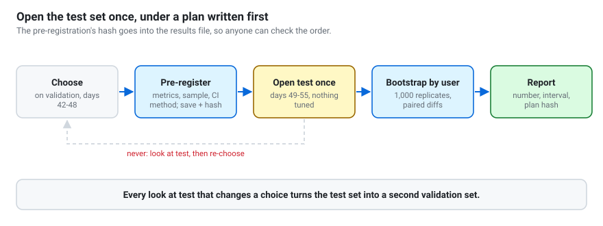
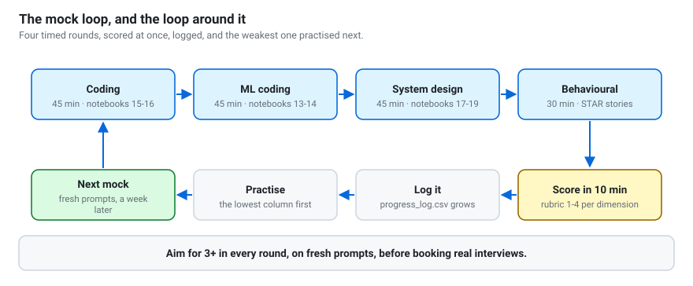

# Chapter 38 · Final evaluation & mock loop

*Part II · Prerequisites: Chapters 23, 24, 29, 30 and 35–37 · Estimated time: reading ~50 min, lab ~90 min (plus about three hours for one full mock loop) · Compute: CPU*

 · [Lab: notebook.ipynb](notebook.ipynb) · [Solutions](solutions.md)

## Learning objectives

After this chapter you should be able to:

1. Explain why a test set may be used only once, and write a pre-registration that fixes the system, data, metrics, uncertainty method and success criterion before any test result exists.
2. Evaluate a ranking system on held-out time through several lenses — true relevance, raw clicks, IPS-corrected clicks and retrieval recall — and explain why they disagree.
3. Estimate position propensities from randomised traffic under the position-based click model, and use inverse propensity scoring to correct a biased conclusion.
4. Compute grouped bootstrap intervals and paired differences, and explain the design effect that makes row-level intervals too narrow.
5. Report a result in one sentence with its interval, method and caveat.
6. Run and score a four-round mock interview loop, keep a progress log, and calibrate against mid-level and senior expectations.

## 38.1 Introduction

Since Chapter 19 the last week of the ShopStream logs (days 49–55) has been held back. Every choice — features, models, cascade configuration, business rules — was made on the training weeks (days 0–41) and the validation week (days 42–48). This chapter opens the test week once, under a plan written before the first test number is computed, so that nothing observed can change what is claimed.

The chapter has two halves. The first (Sections 38.2–38.6) is a final evaluation that brings together the main methodological themes of Part II: separating choice from assessment, position bias and its correction (Chapters 23–24), uncertainty at the correct unit (Chapters 29–30) and the cascade of Chapter 35. Its central result is a reversal: on logged clicks the old policy appears better than the new ranker, and after correcting for position bias the order reverses and agrees with the simulator's ground truth. The second half (Sections 38.7–38.8) applies the same discipline to interview preparation: a timed, scored mock loop with a progress log.

## 38.2 Validation for choosing, test for reporting

**Why the test set is used once.** Any decision informed by a test result turns the test set into a validation set. If several systems are evaluated on the test set and the best is reported, the reported value is the maximum of several noisy estimates, which is biased upwards: selection on noise. The validation set exists to absorb that selection; the test set provides one unbiased estimate of the chosen system.

In the lab every choice is made on the validation week. With the product's category cap of 3 (a product decision fixed in advance), catalogue NDCG@10 on validation is 0.71 for the cascade, 0.63 for ANN-only retrieval and 0.40 for popularity; without the cap it is 0.875, 0.79 and 0.39. The cascade is better in both settings, so it is the system taken to the test week. (The cascade numbers match Chapter 35 exactly; ANN-only with the cap is higher than Chapter 35's 0.58 because here it retrieves 300 neighbours, giving the cap more items to backfill with.)

## 38.3 Pre-registration

A **pre-registration** is a short document written and saved *before* the test data are scored. It fixes:

- the system and its configuration, including what is frozen and what is refreshed;
- the data window and the sample (with its random seed);
- the primary metric and every secondary metric, with exact definitions (cutoff $k$, relevance source, caps);
- the uncertainty method (resampling unit, number of replicates, seed);
- the comparisons and the criterion for success;
- the rule that nothing changes afterwards.

In the lab the serving state is rebuilt from days 0–48 for the test week, as production would refresh it, while the ranker's weights stay frozen. The primary metric is catalogue NDCG@10 against true relevance with the cap of 3, on 2,000 test requests sampled with a fixed seed, comparing the cascade with popularity and ANN-only. The secondary metrics are NDCG@10 on clicks, IPS-corrected DCG@10 with propensities estimated from training-day random traffic, and retrieval recall@100. Uncertainty is given by 95% percentile intervals from a bootstrap over users (1,000 replicates).

The pre-registration file's **hash** (a short fingerprint that changes if any byte of the file changes) is stored with the results, so that a reviewer can verify that the plan predates the numbers. The lab's test cell refuses to run without the file, and a plan is never silently rewritten: if a deviation is necessary, a new, dated plan with the reason is written, and both are reported. In industry the same function is served by an experiment design document or the "success criteria" section of a launch review; in science it is the registered report. The purpose in every case is to prevent the analysis from being chosen after the result is known (the "garden of forking paths" of Chapter 30).

*Figure 38.1 — The evaluation procedure. The dashed path from the test result back to choosing is the one step the procedure forbids; the hash makes it detectable.*

> **Intuition.** Pre-registration is calling the shot in pool: "eight ball, corner pocket" before striking. Sinking a ball that was not called does not count, however good it looked. *Where the analogy breaks down:* a plan cannot anticipate everything; a necessary deviation is recorded in a new, dated plan and reported alongside the original.

## 38.4 Propensities from randomised traffic

### 38.4.1 The position-based model

The **position-based click model** (Chapter 23) assumes that a click requires two independent events: the user **examines** position $k$, with probability $\theta_k$ that depends only on the position, and finds the item relevant, with probability that depends only on the item:

$$
P(\text{click} \mid \text{item}, k) = \theta_k \cdot P(\text{relevant} \mid \text{item}). \qquad (38.1)
$$

ShopStream's hidden examination model is a power law, $\theta_k = (1 + k)^{-\eta}$ with $\eta = 0.9$ and $k = 0, 1, \dots$ the position index; position index 4 is examined $5^{-0.9} = 0.235$ times as often as the top.

### 38.4.2 Estimation

In logged traffic, position and relevance are confounded: the policy puts the items it believes most relevant at the top. In **randomised** traffic (5% of ShopStream's requests show items in uniformly random order) the average relevance is the same at every position, so by Equation (38.1) the click-through rate at position $k$ is proportional to $\theta_k$. Dividing by the CTR at the top gives the propensities relative to position 0. Using training-day random traffic keeps the test week untouched.

In the lab, 89,480 random impressions (8,948 per position) give raw ratios that fall from 1 to about 0.1, with noise in the tail (positions 6 and 7 are out of order because each has only about 250 clicks). Fitting the power law gives $\eta \approx 0.88$ against the hidden 0.9, within about 0.02 of the truth at every position. On real data there is no hidden truth for comparison, which is why estimates are smoothed by a parametric fit and exploration traffic is kept running continuously.

## 38.5 Opening the test week

### 38.5.1 Primary metric and retrieval

The test week contains 336,250 impressions in 33,625 requests from 8,457 users (CTR 0.138). Catalogue NDCG@10 with the cap of 3 is 0.715 for the cascade, 0.635 for ANN-only, 0.38 for popularity and 0.41 for the logged policy: the validation ordering holds.

Retrieval recall@100 is 0.63 measured against each user's true top 10, but only 0.30 measured against the items users actually clicked. Both numbers are correct; they measure different things. Clicked items were selected by the *logging policy* from its own candidate pool, so recall against clicked items partly measures agreement with the old system, and a retriever that surfaces different (possibly better) items is penalised. This is **exposure bias**. Recall against logged clicks is usually the only version available in practice, and it must be reported with that caveat, preferably alongside an exploration-traffic or exposure-corrected version.

### 38.5.2 The reversal

The lab then re-ranks the 10 items shown in each of about 32,000 logged policy requests by three orderings and scores each through three lenses:

| Ordering | NDCG@10 on clicks | IPS-DCG@10 | True DCG@10 |
|---|---|---|---|
| logging policy | 0.760 | 1.92 | 1.95 |
| LightGBM ranker | 0.664 | 2.22 | 2.26 |
| random | 0.529 | 1.86 | 1.90 |

On raw clicks, the old policy is best by a wide margin. This is position bias: the items the policy put at the top were examined, so they received the clicks, and any other ordering moves clicked items down. **Inverse propensity scoring** reverses the conclusion and agrees with the truth. Each click is weighted by the inverse of the examination probability of the position where it was *logged*, and discounted by the rank the *new* ordering gives it:

$$
\widehat{\text{DCG}}_{\text{IPS}} = \sum_{i \,\in\, \text{clicked}} \frac{1}{\theta_{k_i^{\text{logged}}}} \cdot \frac{1}{\log_2(1 + r_i^{\text{new}})}. \qquad (38.2)
$$

**Why it works.** Under Equation (38.1), the click indicator $c_i$ of an item logged at position $k_i$ has expectation $\theta_{k_i} P(\text{relevant}_i)$, so

$$
\mathbb{E}\!\left[\frac{c_i}{\theta_{k_i}}\right] = P(\text{relevant}_i), \qquad (38.3)
$$

and the weighted clicks are unbiased estimates of relevance, provided the propensities are correct and positive. *Example:* a click logged at position index 4 ($\theta = 0.235$) counts as $1/0.235 = 4.26$ clicks; if the new ordering places the item first, it contributes 4.26 to the DCG.

IPS is not perfect. In the lab it is a little below the true DCG because the estimated propensities are not exact. Its variance is higher than that of raw metrics, because small propensities produce large weights; weights are therefore often **clipped** (for example at $1/0.05$), which introduces a small bias, and the clipping is reported. IPS can credit only items that were shown, and it relies on the examination model (it ignores, for example, effects of trust in the top position). It nevertheless points in the right direction, and raw clicks do not. This table is the central result of Part II.

> **Intuition.** IPS is like a survey in which people near the door are asked far more often than people at the back: to estimate the whole room, each answer is weighted by the inverse of the chance that the person was asked. *Where the analogy breaks down:* a tiny propensity means a huge weight, so one lucky click can dominate; weights are clipped and the clipping reported.

## 38.6 Uncertainty by user

### 38.6.1 The grouped bootstrap

Requests from the same user are correlated (same tastes, same activity), so the unit of resampling must be the **user**, the unit that carries the correlation. The **grouped bootstrap** (Exercise 1) draws as many users as there are, with replacement, computes the statistic over all rows of the drawn users (a user drawn twice counts twice), repeats this $B$ times, and takes the 2.5th and 97.5th percentiles as a 95% interval. It can be vectorised by precomputing per-user sums and counts, so that each replicate is a ratio of two sums over the drawn users.

A row-level bootstrap treats correlated rows as independent and gives intervals that are too narrow. With $m$ rows per user and **intra-class correlation** $\rho_{\text{ICC}}$ between two rows of the same user, the variance of a mean is inflated by the design effect of Chapter 29:

$$
\operatorname{Var}_{\text{grouped}} \approx \operatorname{Var}_{\text{iid}} \cdot \big(1 + (m - 1)\,\rho_{\text{ICC}}\big). \qquad (38.4)
$$

*Example:* four requests per user with $\rho_{\text{ICC}} = 0.2$ multiply the variance by 1.6, so the correct interval is $\sqrt{1.6} = 1.26$ times wider than the row-level one. Averaging per-user means instead of rows is not a remedy: it weights a user with one request like a user with fifty, which estimates a different quantity. If users themselves interact (marketplaces, social graphs), even users are not independent, and larger clusters are needed.

### 38.6.2 Paired differences

When two systems are scored on the same requests, their errors are correlated, and the variance of the difference is

$$
\operatorname{Var}(A - B) = \operatorname{Var}(A) + \operatorname{Var}(B) - 2\operatorname{Cov}(A, B). \qquad (38.5)
$$

With unit variances and correlation 0.9 the variance of the difference is 0.2 rather than 2, an interval about $\sqrt{10} \approx 3.2$ times narrower than the comparison of two separate intervals would suggest. Differences are therefore bootstrapped directly, resampling users and computing both systems on the same draw.

### 38.6.3 Results

On the test week the primary-metric intervals are about ±0.006–0.011: cascade 0.715 [0.709, 0.721], ANN-only 0.635 [0.629, 0.641], popularity 0.38 [0.37, 0.39]. They do not overlap, so the pre-registered success criterion is met. The paired differences, ranker minus policy, are −0.096 [−0.100, −0.092] for NDCG on clicks (entirely below zero), +0.29 [0.28, 0.31] for IPS-DCG and +0.31 [0.309, 0.315] for true DCG (both entirely above zero).

A one-sentence report gives the estimate, its interval and method, and the caveat: *"On the held-out test week, the cascade's catalogue NDCG@10 was 0.715 (95% CI 0.709–0.721, bootstrap over users) versus 0.635 for embedding retrieval alone; on logged traffic raw clicks favour the incumbent policy, but after inverse-propensity correction with propensities from randomised traffic the ranker is ahead by 0.29 DCG (0.28–0.31), in line with the simulator's ground truth of 0.31."*

The evaluation has known weaknesses, which should be stated when it is presented: the primary metric uses simulator truth, which does not exist in practice (human relevance labels are the closest substitute); there is one test week, so no seasonality; the ranker was trained on logged candidates but serves retrieval candidates, a distribution shift; the propensities assume position-only examination; and the latency figures of Chapter 35 come from one process shared with its load generator.

## 38.7 The mock interview loop

An interview loop for ML engineers at a large technology company usually consists of four to six interviews in one day. The lab's mock covers the four core rounds, back to back and timed:

| Round | Minutes | Format | Material |
|---|---|---|---|
| 1 · Coding | 45 | one or two data-structure and algorithm problems, explained while coding | Chapters 33–34 |
| 2 · ML coding | 45 | implement and test an ML method or metric from scratch | Chapters 31–32, 23–24 |
| 3 · ML system design | 45 | one open prompt, at a whiteboard | Chapters 35–37 |
| 4 · Behavioural | 30 | three or four STAR stories with follow-up questions | Chapter 18 |

A mock is useful only under four conditions: a real timer, no notes, a partner or a recording, and **scores written down within ten minutes** of finishing. The lab draws prompts at random for each round and writes a plan and a **rubric** with **anchors** — short descriptions of what each score from 1 (missing or wrong) to 4 (strong) means for each dimension — so that scores are comparable over time. Each round's scores are appended to a progress log that only grows. The log is read as a date × round table; the following week's practice goes to the lowest column, and the target before booking real interviews is a score of at least 3 in every round on fresh prompts.

*Figure 38.2 — The mock loop. The cycle of scoring, logging and targeted practice around the rounds is what makes the mock informative.*

The project itself is the material for a **project deep-dive**, a round in which the candidate presents a system and defends its decisions. Exercise 2 asks for a three-minute walkthrough of the Part II system: the problem and metric, the data and its main bias, the cascade with one number per stage, the evaluation method, the headline result with its interval, and one next step. A walkthrough that names the bias before the result and closes with a reasoned next step shows judgement as well as results.

## 38.8 Levels of expectation

Expectations differ by level. Stated generically (every company's ladder differs, and the table is for calibration, not for labelling oneself):

| Round | Mid-level answer | A senior answer adds |
|---|---|---|
| Coding | a correct solution with complexity stated, after some hints | the optimal approach found independently, clean code, edge cases and tests unprompted, clear trade-off discussion |
| ML coding | a correct implementation that runs, with basic tests | numerical stability, vectorisation, tests against a reference, failure modes and behaviour at scale |
| ML system design | a sensible cascade, standard metrics, a model per stage | leads the discussion; numbers (QPS, latency, memory); label bias and feedback loops; experimentation and rollout; prioritisation; what evidence would change the design |
| Behavioural | clear STAR stories about the candidate's own tasks | scope beyond own tasks (influence, mentoring, cross-team work), measurable impact, honest reflection on mistakes, judgement under ambiguity |
| Project deep-dive | explains what was built and the metric | defends every decision against alternatives, knows the system's limits and the evaluation's biases, and what to do next |

The Part II project was designed to provide material at the senior level for the deep-dive: a cascade with measured stage latencies (Chapter 35), an optimisation table (Chapter 36), a design with numbers (Chapter 37), and a pre-registered held-out evaluation in which correcting position bias reverses a naive conclusion (this chapter).

## Key terms

| Term | Definition |
|---|---|
| Validation set / test set | Data used for choosing among systems / data opened once to report the chosen system. |
| Selection on noise | The upward bias of reporting the best of several noisy estimates. |
| Pre-registration | A saved plan of what will be measured and what counts as success, written before the results exist. |
| Hash | A short fingerprint of a file that changes if any byte changes. |
| Position-based click model | A model in which a click requires examination (depending on position) and relevance (depending on the item). |
| Propensity (examination probability) | The probability that a user examines a given position. |
| Exploration (randomised) traffic | Requests served in random order so that position effects can be measured. |
| Inverse propensity scoring (IPS) | Weighting each click by the inverse of its position's examination probability to remove position bias. |
| Weight clipping | Capping IPS weights to reduce variance at the cost of a small bias. |
| Exposure bias | Bias arising because only items shown by the logging policy can receive feedback. |
| Grouped bootstrap | A bootstrap that resamples whole groups (users) rather than rows. |
| Intra-class correlation | The correlation between two observations from the same group. |
| Paired difference | A comparison of two systems on the same units, so that shared noise cancels. |
| Percentile interval | The interval between the 2.5th and 97.5th percentiles of bootstrap replicates. |
| Mock loop | A timed rehearsal of the interview rounds, scored against a rubric. |
| Rubric anchors | Descriptions of what each score means, making scores comparable over time. |

## Summary

1. The test set is opened once; every choice is made on validation, so the reported number is not biased by selection on noise.
2. A pre-registration fixes system, data, metrics, uncertainty method and success criterion before scoring, and its hash is stored with the results.
3. Under the position-based model (Equation 38.1), CTR by position in randomised traffic estimates the examination propensities; the lab recovered $\eta \approx 0.88$ against the hidden 0.9.
4. On logged clicks the old policy appeared best (NDCG 0.760 against 0.664); IPS (Equations 38.2–38.3) reversed the order (1.92 against 2.22) in agreement with the truth (1.95 against 2.26).
5. Recall against clicked items (0.30) and against true relevance (0.63) differ because of exposure bias.
6. Uncertainty is computed by resampling users; row-level intervals are too narrow by the design effect (Equation 38.4), and paired differences (Equation 38.5) are much tighter than separate intervals.
7. A result is reported with its interval, method and caveat, and the evaluation's weaknesses are stated.
8. A mock loop is useful only when timed, scored against anchored rubrics within minutes, logged, and followed by practice on the weakest round.

## Exercises

The exercises are in the lab, [notebook.ipynb](notebook.ipynb); worked answers are in [solutions.md](solutions.md).

1. **Exercise 1 · `bootstrap_ci_grouped`.** A vectorised grouped bootstrap returning the overall mean and a 95% percentile interval, resampling groups with replacement.
2. **Exercise 2 · Three-minute walkthrough (written).** A timed script presenting the Part II system, its evaluation and its headline result with an interval.

The lab also runs the mock loop itself and creates the progress log. Checkpoint questions ask why the test set is used once and what a pre-registration contains; why the old policy can win on clicks and how to decide otherwise before an A/B test; how propensities are estimated and what IPS's weaknesses are; why the bootstrap unit is the user; which recall figure to report; and for the walkthrough together with the weakest part of the evaluation.

## Further reading

- Joachims, T., Swaminathan, A. and Schnabel, T. (2017). Unbiased learning-to-rank with biased feedback. *Proceedings of WSDM 2017*.
- Wang, X., Golbandi, N., Bendersky, M., Metzler, D. and Najork, M. (2018). Position bias estimation for unbiased learning to rank in personal search. *Proceedings of WSDM 2018*.
- Craswell, N., Zoeter, O., Taylor, M. and Ramsey, B. (2008). An experimental comparison of click position-bias models. *Proceedings of WSDM 2008*.
- Efron, B. and Tibshirani, R. J. (1993). *An Introduction to the Bootstrap*. Chapman & Hall.
- Hastie, T., Tibshirani, R. and Friedman, J. (2009). *The Elements of Statistical Learning*, 2nd ed. Springer. Sections 7.2 and 7.10 (test error and the use of validation data).
- Kohavi, R., Tang, D. and Xu, Y. (2020). *Trustworthy Online Controlled Experiments*. Cambridge University Press.
- Nosek, B. A., Ebersole, C. R., DeHaven, A. C. and Mellor, D. T. (2018). The preregistration revolution. *Proceedings of the National Academy of Sciences*, 115(11), 2600–2606.

**Next:** [Part III · Deep Learning and Large-Scale Systems](../../part3-deep-learning-systems/README.md)
