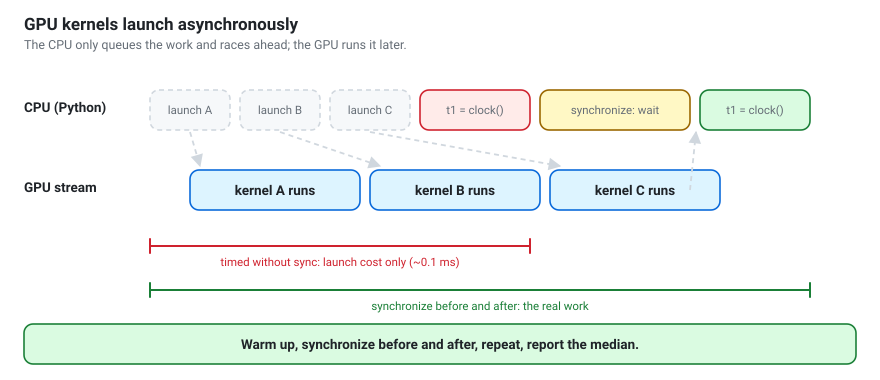
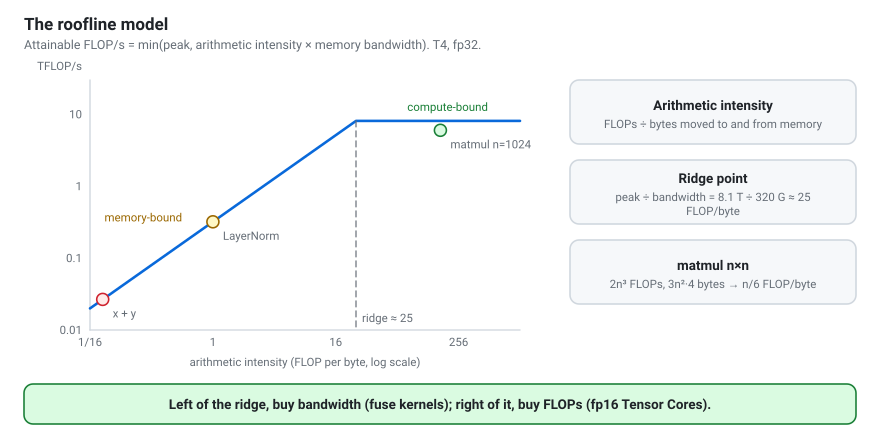
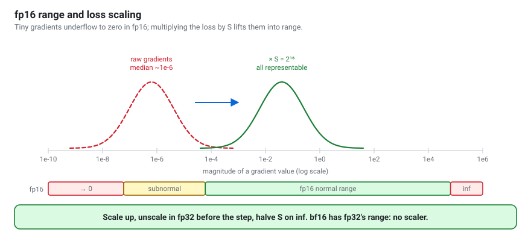
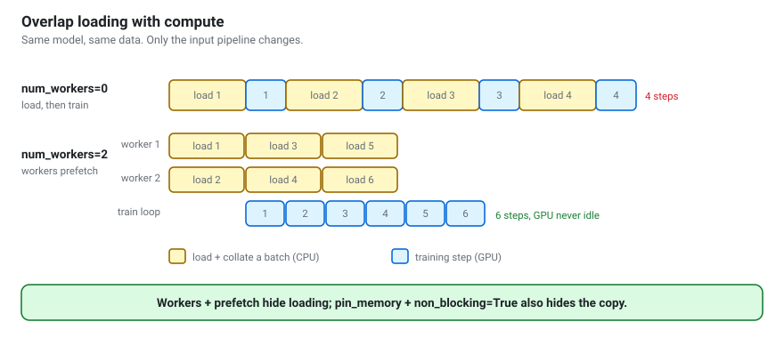

# Chapter 39 · GPU fundamentals & profiling

*Part III · Prerequisites: Chapters 27, 36 · Estimated time: reading ~45 min, lab ~90 min · Compute: T4 GPU (runs on CPU with a reduced budget)*

 · [Lab: notebook.ipynb](notebook.ipynb) · [Solutions](solutions.md)

## Learning objectives

After this chapter you should be able to:

1. Describe how a GPU executes work: streaming multiprocessors, warps, kernels, streams and asynchronous launches.
2. Explain why asynchronous execution changes how GPU code must be timed, and write a correct timing function (warm-up, synchronisation on both sides, median of repeats).
3. Count the floating-point operations of a matrix multiply and convert a measured time into achieved FLOP/s.
4. Compute the arithmetic intensity of an operation and use the roofline model to classify it as memory-bound or compute-bound.
5. Explain when fp16 autocast speeds up a T4, why fp16 training needs a loss scaler and why bf16 does not.
6. Read a `torch.profiler` table, distinguish self time from total time, and name the bottleneck it shows.
7. Diagnose an input-pipeline bottleneck and remove it with worker processes, prefetching and pinned memory.

## 39.1 Introduction

Parts I and II trained models whose cost was dominated by data handling and
modelling choices; the hardware rarely mattered. Deep learning at scale
reverses this. A transformer fine-tuning run can take hours, a pre-training run
weeks, and the same code can run at 5% or at 60% of what the hardware can do.
The difference is almost never visible from reading the model code. It becomes
visible only through measurement.

Most performance questions reduce to three:

1. **Is the hardware busy?** If the GPU is idle for part of each training step,
   something else (data loading, Python, synchronisation) sets the pace.
2. **Is it busy with useful arithmetic?** A GPU can be fully occupied moving bytes
   between its memory and its cores while doing very little arithmetic.
3. **If not, what is it waiting for?** The answer decides the remedy: more data
   loader workers, fused kernels, a larger batch, lower precision.

To answer these questions we need two things: a simple but correct model of how
a GPU executes work (Sections 39.2 and 39.3), and measuring tools that respect that
model (Sections 39.4 to 39.7). The chapter ends with the most common real-world
bottleneck, the input pipeline (Section 39.8).

**What was measured in this course, and what was not.** The course's
verification runs are CPU-only (2 threads, to resemble Colab's two virtual CPUs).
All numbers in this chapter that are described as "measured" come from those CPU runs.
Statements about a T4 GPU are either specification-sheet values (peak FLOP/s,
bandwidth, memory size) or expectations derived from them; they were **not measured**
in this course. When you run the lab on a T4, it prints the GPU numbers for you.

## 39.2 How a GPU executes code

A CPU has a small number of powerful cores (2 on Colab, 8–64 on a workstation),
each designed to finish *one* thread quickly: large caches, branch prediction,
out-of-order execution. A GPU makes the opposite trade. It has many simple cores
and is organised to keep *thousands* of threads in flight, hiding the latency of
each memory access by switching to other threads that are ready to run.

| Concept | What it is | On a T4 (specification) |
|---|---|---|
| Streaming multiprocessor (SM) | an independent processor with its own registers, shared memory / L1 cache and schedulers | 40 SMs |
| CUDA core | an fp32 arithmetic lane inside an SM | 64 per SM, 2,560 in total |
| Tensor Core | a unit that performs small matrix multiply-accumulates (fp16 inputs, fp16 or fp32 accumulation) | 320; ~65 TFLOP/s fp16 vs ~8.1 TFLOP/s fp32 |
| Warp | 32 threads that execute the same instruction together (SIMT); divergent branches are serialised | — |
| Kernel | one function launched on a grid of thread blocks; each block runs on one SM | every PyTorch operation launches at least one |
| Device memory | the GPU's own DRAM | 16 GB GDDR6, ~320 GB/s |
| PCIe link | the connection between host (CPU) memory and device memory | Gen3 ×16, ~16 GB/s theoretical |

From the programmer's side, the important abstraction is the **CUDA stream**: an
ordered queue of kernels. When PyTorch executes `c = a @ b` on CUDA tensors, the
Python thread does not compute anything. It asks the CUDA driver to append a
matrix-multiply kernel to the current stream and returns immediately. The GPU
works through the queue in order, in the background. The CPU waits for the GPU only
when it needs a result on the host: `.item()`, `.cpu()`, `print(tensor)`, a
data-dependent shape such as `nonzero()`, or an explicit `torch.cuda.synchronize()`.

*Figure 39.1 — Asynchronous launch. The CPU enqueues kernels A, B and C in microseconds and continues; the GPU executes them later. A clock read without synchronisation (red) measures only the launches; a clock read after `synchronize` (green) covers the work.*

Three consequences follow:

* **Asynchrony changes timing.** Reading the clock immediately after a GPU call
  measures the launch, not the computation.
* **Launch overhead is real.** Each kernel launch costs a few microseconds of CPU
  time. A model built from thousands of small operations can be limited by Python
  and launch overhead rather than by the GPU. Such a workload is called
  *overhead-bound* (or launch-bound, or CPU-bound).
* **Bandwidth and arithmetic are separate resources.** A T4 can perform roughly
  25 fp32 FLOPs (or about 200 fp16 Tensor-Core FLOPs) in the time it takes to read
  one byte from device memory. Operations that do little arithmetic per byte cannot
  use that arithmetic capacity (Section 39.6).

## 39.3 Host-to-device transfers

Before a kernel can read data, the data must be in device memory. Copying a tensor
from host RAM crosses the PCIe link. A normal host tensor lives in *pageable*
memory, which the operating system may move or swap; the driver therefore first
copies it into a page-locked staging buffer and then transfers it by direct memory
access (DMA). A **pinned** (page-locked) host tensor skips the staging copy, and,
combined with `.to("cuda", non_blocking=True)`, the transfer is queued on the
stream like a kernel, so it can overlap with computation.

Two practical conclusions follow. First, copying one batch per step is cheap: 64 MB
at roughly 12 GB/s is about 5 ms. Second, copying the whole dataset every step,
or moving activations back and forth with `.cpu()` inside the training loop, is
expensive, and every `.cpu()` is also a synchronisation point. On a T4 one should
expect roughly 3–6 GB/s for pageable and 10–13 GB/s for pinned copies; this is an
expectation, not a measurement from this course (on a CPU runtime there is no
transfer to measure).

## 39.4 Timing GPU code correctly

A correct timing procedure follows directly from Section 39.2:

1. **Warm up.** The first calls pay one-off costs: creating the CUDA context,
   selecting a cuBLAS algorithm, cuDNN autotuning (with `benchmark=True`), growing
   the caching allocator, filling CPU caches. Call the function a few times before
   timing.
2. **Synchronise before starting the clock**, so that work queued earlier is not
   attributed to the function being timed.
3. **Synchronise before stopping the clock**, so that the function's own kernels
   have finished.
4. **Repeat** the measurement many times.
5. **Report the median**, which is robust to the occasional slow call caused by
   another process on the machine; report the spread (minimum, maximum or
   interquartile range) when it matters.

Use `time.perf_counter()`, a monotonic high-resolution clock, rather than
`time.time()`. On a GPU, CUDA events (`torch.cuda.Event(enable_timing=True)`)
measure elapsed time on the device's own clock and avoid host jitter;
`torch.utils.benchmark.Timer` implements warm-up, synchronisation and statistics.

In the lab's CPU run, a 1024 × 1024 matmul took 13–21 ms (2 threads) both with
and without synchronisation, because CPU operations are synchronous. This is
precisely why the bug survives: code written and tested on a laptop gives
correct timings without `synchronize`, and the same code reports microseconds
for large models once it runs on a GPU.

## 39.5 Throughput: FLOPs and achieved FLOP/s

The product of an $m \times k$ matrix $A$ and a $k \times n$ matrix $B$ has $mn$
entries. Each entry is a dot product of length $k$: $k$ multiplications and $k$
additions. The total floating-point operation count is therefore

$$
\text{FLOPs}(A_{m\times k} B_{k\times n}) = 2\,m\,n\,k ,
\tag{39.1}
$$

which for square $n \times n$ matrices is $2n^3$. (A fused multiply-add counts as
two FLOPs.) Dividing by the measured time gives the **achieved FLOP/s**; dividing
achieved by peak FLOP/s gives the **utilisation** of the arithmetic units.

Equation (39.1) generalises to neural networks. A linear layer applied to a batch
of $B$ token vectors costs $2 B\, d_{\text{in}} d_{\text{out}}$ FLOPs forward. The
backward pass computes two matrix products of the same size (the gradient with
respect to the input and with respect to the weights), so about twice that. A full
training step therefore costs roughly $6 \times \text{parameters} \times \text{tokens}$
FLOPs, the rule used for language-model compute budgets in Chapter 48.

**Worked example.** $2 \cdot 1024^3 \approx 2.15\times 10^9$ FLOPs. At 13 ms this is
$2.15\times10^9 / 0.013 \approx 0.17$ TFLOP/s, inside the 0.13–0.26 TFLOP/s range
the lab measured on CPU for $n \ge 1024$.

What to expect on hardware: small matrices underuse a GPU, because there are not
enough independent output tiles to occupy 40 SMs and the time is dominated by the
launch. On a T4, fp32 throughput should rise with $n$ to a plateau of roughly 4–7
TFLOP/s from $n \approx 2048$, below the 8.1 TFLOP/s specification because sustained
clock rates under the 70 W power limit are lower than boost clocks (not measured in
this course). On a CPU the curve is less regular: small matrices fit in cache, and
individual sizes can dip on a shared machine. This is why repeated measurement and
re-running surprising results are part of the method.

## 39.6 Arithmetic intensity and the roofline model

Every operation reads some bytes from memory, performs some arithmetic, and writes
some bytes back. Its **arithmetic intensity** is the ratio

$$
I = \frac{\text{FLOPs performed}}{\text{bytes moved to and from memory}} \quad [\text{FLOP/byte}].
\tag{39.2}
$$

Two examples fix the idea:

* **Elementwise add** `x + y` in fp32: one FLOP per element; read two 4-byte values,
  write one, 12 bytes. $I = 1/12$.
* **Square matmul** in fp32: $2n^3$ FLOPs on at least $3n^2$ values of 4 bytes, so
  $I = 2n^3 / 12n^2 = n/6$. For $n = 1024$, $I \approx 171$. In fp16 each value is two
  bytes and $I = n/3$.

The byte count for the matmul is an idealised minimum (each matrix read or written
once). Real kernels tile the matrices through shared memory and caches and move more
bytes, so their effective intensity at device memory is lower.

The **roofline model** (Williams, Waterman & Patterson, 2009) combines intensity
with the two hardware limits:

$$
P_{\text{attainable}} = \min\!\big(P_{\text{peak}},\; I \cdot B_{\text{mem}}\big),
\qquad I^{\star} = \frac{P_{\text{peak}}}{B_{\text{mem}}} .
\tag{39.3}
$$

Here $P_{\text{peak}}$ is the peak arithmetic rate (FLOP/s), $B_{\text{mem}}$ the
memory bandwidth (bytes/s), and $I^{\star}$ the **ridge point**. An operation with
$I < I^{\star}$ is **memory-bound**: it cannot run faster than memory can feed it,
however much arithmetic capacity the chip has. An operation with $I > I^{\star}$ is
**compute-bound**.

*Figure 39.2 — The roofline for a T4 in fp32 (specification values). Elementwise add and LayerNorm lie on the sloped memory roof; a large matmul reaches the flat compute roof. The position of an operation on the horizontal axis is fixed by its mathematics before anything is run.*

**Worked example (T4 specification, fp32).** $I^{\star} = 8.1\times10^{12} / 320\times10^9 \approx 25$
FLOP/byte; for fp16 Tensor Cores, $65 / 0.32 \approx 200$ FLOP/byte. An fp32 add can reach
at most $320\times10^9/12 \approx 27$ GFLOP/s, about 0.3% of peak. A LayerNorm, with
intensity near 1, can reach at most 0.32 TFLOP/s. A matmul is compute-bound once
$n/6 > 25$, i.e. $n \gtrsim 150$.

**What the lab measured on CPU.** On the same CPU, the add moved 5–9 GB/s of memory
traffic (0.4–0.8 GFLOP/s), while the matmul reached about 130–270 GFLOP/s: some
300 times more useful arithmetic per second (315–346× in our runs). The rough ridge
point estimated from these two measurements was 25–30 FLOP/byte. The memory-bound /
compute-bound distinction is therefore not specific to GPUs; it holds on any processor
whose arithmetic is faster than its memory.

**Consequences.** Since memory-bound operations are limited by bytes moved, the
remedy is to move fewer bytes, not to add arithmetic capacity:

* **Kernel fusion.** `gelu(x @ W + b)` executed as three separate kernels writes the
  intermediate result to device memory and reads it back twice. A fused kernel, as
  produced by `torch.compile` (Chapter 40), reads it once.
* **FlashAttention** (Dao et al., 2022) computes attention without ever writing the
  $L \times L$ score matrix to device memory; the softmax over that matrix is the
  memory-bound part of attention.
* **Lower precision** halves the bytes per element, which doubles the intensity of
  the same computation.

## 39.7 Reduced precision on a T4

The T4's Tensor Cores operate on fp16 (and int8) inputs only; fp32 matmuls run on the
much slower CUDA cores. The specification gives roughly 65 TFLOP/s for fp16 Tensor
Cores against 8.1 TFLOP/s for fp32, a factor of about eight. fp16 also halves the
bytes per element, so memory-bound operations speed up as well.

`torch.autocast(device_type="cuda", dtype=torch.float16)` runs matmuls and
convolutions in fp16 while keeping numerically sensitive operations (softmax,
reductions, losses) in fp32. The weights remain fp32 and are cast on the fly.

The difficulty with fp16 is its narrow exponent range. The smallest normal positive
fp16 number is about $6\times10^{-5}$; many gradient values are smaller and **underflow**
to zero. A **gradient scaler** multiplies the loss by a large factor $S$ before the
backward pass, so every gradient is multiplied by $S$ and stays representable. Before
the optimiser step the gradients are divided by $S$; if any of them is infinite or
NaN, the step is skipped and $S$ is reduced. **bf16** has the same 8-bit exponent as
fp32 and therefore the same range, so it needs no scaler, at the cost of fewer
mantissa bits. The T4 does not support bf16; Ampere and later GPUs do.
The course helpers `scaleml.device.autocast` and `amp_dtype` choose the right type for
the hardware they find.

*Figure 39.3 — fp16 underflow and loss scaling. On a logarithmic axis, raw gradients centred near $10^{-6}$ fall partly below fp16's normal range (subnormal or zero); multiplying the loss by $S = 2^{16}$ shifts the whole distribution into the representable range without changing its shape. Chapter 48 returns to mixed precision when counting bytes per parameter.*

On a T4 one should expect autocast fp16 matmuls at roughly 20–45 TFLOP/s for large $n$,
against 4–7 TFLOP/s in fp32 (not measured in this course). The lab skips this
measurement on CPU, where autocast uses bf16 and rarely speeds anything up.

## 39.8 Profiling a training step

A timer answers *how long*; a profiler answers *where*. `torch.profiler` records every
operator, its input shapes (with `record_shapes=True`), its CPU time and, on a GPU,
the time of the kernels it launched. Two columns must be distinguished:

* **Self time**: time spent in the operator itself, excluding the operators it calls.
* **Total time**: self time plus the time of all children.

Sorting by self time finds the operators that actually consume time; sorting by total
time finds the high-level phases (forward, backward, optimiser) that contain them. User
labels added with `record_function("forward")` appear as rows and make the phases
explicit.

**What the lab found on CPU.** For a small multilayer perceptron (5.3M parameters) trained
with AdamW, the matrix multiplications (`aten::mm`, `aten::addmm`) were the two largest
rows, together 30–45% of self CPU time. The next block of rows (`sqrt`, `div`, `mul_`,
`addcdiv_`, `lerp_`, `addcmul_`, `add_`) is the AdamW update, and together it took about as
much time as the matrix multiplications (roughly 40% of the total). The reason is the
roofline: the optimiser touches every parameter several times with a few FLOPs each,
which is memory-bound elementwise work. On a GPU, `torch.optim.AdamW(..., fused=True)` or
the default multi-tensor (`foreach`) implementation combines these into a few kernels.
The per-phase sums in our runs were roughly 180 ms forward, 180 ms backward and 230 ms
for the optimiser over five steps. The common rule of thumb "backward ≈ 2 × forward" did
not hold for this small model on a CPU; this is a reason to profile rather than reason
from rules alone.

Two further features are useful in practice. `key_averages(group_by_input_shape=True)`
splits rows by input shape, which exposes a single unusually shaped operation.
`export_chrome_trace("trace.json")` writes a timeline that can be opened in
`chrome://tracing` or Perfetto. In a GPU trace, **gaps** between kernels on the device
timeline are the clearest evidence that the GPU is waiting for the CPU: for data, for
Python, or for a synchronisation.

**Reading a profile.** A disciplined reading proceeds in three steps: (1) compare total
GPU time with wall time to see how busy the device was; (2) find the rows with the
largest self time on the CPU and on the GPU; (3) look for synchronisation calls
(`cudaStreamSynchronize`, `aten::item`) that stop the CPU from running ahead. Exercise 4
in the lab applies this procedure to a constructed table.

## 39.9 The input pipeline

The most common bottleneck in practice is not on the GPU at all: it is the data loader.
With the default `num_workers=0`, the main Python process reads, decodes and collates
each batch *between* training steps, so loading and computation never overlap. With
`num_workers=k`, $k$ worker processes prepare batches in parallel, each keeping up to
`prefetch_factor` (default 2) batches queued ahead of the training loop.

*Figure 39.4 — Loading and computation without workers (top) and with two prefetching workers (bottom). The model is unchanged; the second timeline completes more steps only because loading overlaps training.*

A simple model of one epoch with $n_b$ batches, load time $t_{\text{load}}$ per batch and
compute time $t_{\text{step}}$ per batch is

$$
T_{\text{epoch}} \approx n_b\,(t_{\text{load}} + t_{\text{step}}) \;\; (\text{no workers}),
\qquad
T_{\text{epoch}} \approx n_b \max\!\Big(\frac{t_{\text{load}}}{k},\; t_{\text{step}}\Big) \;\; (k \text{ workers}).
\tag{39.4}
$$

Without workers the two times add; with $k$ workers they overlap and the slower of the
two sets the pace. Adding workers helps until $t_{\text{load}}/k \le t_{\text{step}}$
and not beyond.

**Worked example (the lab's experiment).** 384 examples, batch 32, so $n_b = 12$; loading
takes 3 ms per example (96 ms per batch) and the simulated step 50 ms. Equation (39.4)
predicts $12 \times 146$ ms ≈ 1.75 s with no workers, and $12 \times \max(48, 50)$ ms = 0.6 s
with two workers. The lab measured 1.85–1.86 s with no workers, 1.37–1.40 s with one worker
(one worker needs 96 ms per batch, more than the 50 ms step) and 0.80–0.83 s with two
workers, the difference from 0.6 s being worker start-up.

**The knobs.**

* `num_workers`: Colab has two virtual CPUs, so more than two workers rarely helps there;
  on a training server a common starting point is the number of physical cores per GPU.
  Each worker holds a copy of the dataset object and takes time to start;
  `persistent_workers=True` keeps workers alive between epochs.
* `prefetch_factor`: hides variation in loading time, but only if workers keep up *on
  average*. If one batch takes longer to load than one step takes to compute, even with
  all workers, the remedy is cheaper loading: tokenise or decode once and cache the
  result, move augmentation to the GPU, store data in a format read in large blocks.
* `pin_memory=True` plus `.to(device, non_blocking=True)`: both are required for an
  asynchronous copy that overlaps the previous step's kernels. Neither does anything on a
  CPU-only runtime.

**Diagnose before changing.** Time one epoch that only iterates the loader (no model) and
one that reuses a single cached batch (no loader). If the first is close to the full epoch
time, the input pipeline is the bottleneck. On a T4 the issue becomes more severe: a GPU
step for a small model can take a few milliseconds, so a loader that needs 100 ms per batch
would leave the GPU idle more than 95% of the time. This follows from Equation (39.4); it
was not measured.

## 39.10 A checklist for low GPU utilisation

When `nvidia-smi` reports low utilisation, the causes can be checked in a fixed order:

1. **Input pipeline.** Time the loader alone; check `num_workers` and per-core CPU usage.
2. **Synchronisation in the loop.** `.item()`, `.cpu()`, printing, `nonzero`: visible as
   `cudaStreamSynchronize` rows and gaps in the trace. Log every $N$ steps instead.
3. **Too little work per kernel.** Small batches or small layers give many short
   kernels with gaps between them; increase the batch, fuse operations
   (`torch.compile`), or capture the step as a CUDA graph.
4. **Unoverlapped copies.** Pageable memory or missing `non_blocking=True`.

Note that `nvidia-smi` utilisation is the fraction of time during which *any* kernel is
running, not how busy the SMs are; 100% utilisation can still mean inefficient kernels.

## Key terms

| Term | Definition |
|---|---|
| Kernel | A function executed by the GPU on many threads; every PyTorch operation launches at least one. |
| Streaming multiprocessor (SM) | An independent processor on the GPU with its own registers, cache and schedulers; a T4 has 40. |
| Warp | A group of 32 GPU threads that execute the same instruction together. |
| CUDA stream | An ordered queue of kernels and copies executed by the GPU in sequence. |
| Asynchronous launch | The CPU enqueues a kernel and continues without waiting for its result. |
| Synchronise | Make the CPU wait until all queued GPU work has finished (`torch.cuda.synchronize()`). |
| FLOP/s | Floating-point operations per second; the rate of arithmetic. |
| Memory bandwidth | Bytes per second that can move between device memory and the cores. |
| Arithmetic intensity | FLOPs performed per byte moved to or from memory (Equation 39.2). |
| Roofline | The bound $\min(P_{\text{peak}}, I \cdot B_{\text{mem}})$ on attainable FLOP/s (Equation 39.3). |
| Ridge point | The intensity $P_{\text{peak}}/B_{\text{mem}}$ separating memory-bound from compute-bound operations. |
| Memory-bound / compute-bound | Limited by bytes moved / limited by arithmetic. |
| Tensor Core | A GPU unit for small matrix multiply-accumulates in reduced precision. |
| Autocast | Automatic execution of selected operations in reduced precision. |
| Gradient scaler | Multiplies the loss so fp16 gradients do not underflow; unscales before the step. |
| Overhead-bound | Limited by Python and kernel-launch costs rather than by GPU work. |
| Self time / total time | Time in an operator excluding / including the operators it calls. |
| Pinned memory | Page-locked host memory from which the GPU can copy asynchronously. |
| Worker, prefetch | Background processes that prepare batches ahead of use, and the number of batches queued. |

## Summary

1. GPU work is asynchronous: the CPU enqueues kernels on a stream and continues. Timing without synchronisation measures launches, not computation.
2. Correct timing needs warm-up, synchronisation before and after the timed region, repetition, and the median.
3. A matmul costs $2mnk$ FLOPs (Equation 39.1); a training step costs about six FLOPs per parameter per token.
4. Arithmetic intensity (Equation 39.2) and the roofline (Equation 39.3) decide whether an operation is memory-bound or compute-bound before anything is run. Elementwise operations, normalisation and optimiser updates are memory-bound; large matmuls are compute-bound.
5. Memory-bound work is accelerated by moving fewer bytes: fusion, FlashAttention-style algorithms, lower precision.
6. On a T4, fp16 Tensor Cores provide roughly eight times the fp32 peak; fp16 training needs a gradient scaler, bf16 does not, and the T4 has no bf16.
7. A profiler sorted by self time locates the costly operators; trace gaps reveal a waiting GPU.
8. The input pipeline is the most frequent bottleneck; worker processes overlap loading with computation up to the point where loading keeps pace (Equation 39.4).
9. In this course all measured numbers come from a CPU; T4 figures are specifications or expectations.

## Exercises

The exercises are in the lab, [notebook.ipynb](notebook.ipynb); worked answers are in
[solutions.md](solutions.md).

1. **`time_fn`** (graded): implement warm-up, synchronised per-call timing and the median.
2. **`tflops`** (graded): convert an $n \times n$ matmul time into achieved TFLOP/s.
3. **`arithmetic_intensity`** (graded): FLOPs per byte, with input validation.
4. **Reading a profiler table** (open-ended): identify the bottleneck in a constructed
   profile of an image classifier, give the evidence, and propose two changes in order.

The checkpoint questions at the end of the lab ask you to explain, without notes: the
timing error of an unsynchronised measurement; the roofline classification of LayerNorm and
of a large matmul; why fp16 needs a loss scaler; how to investigate 30% GPU utilisation;
the data-loader settings; and the name and remedies of an overhead-bound workload.

## Further reading

- S. Williams, A. Waterman and D. Patterson (2009). "Roofline: an insightful visual performance model for multicore architectures." *Communications of the ACM* 52(4).
- D. B. Kirk and W. W. Hwu. *Programming Massively Parallel Processors: A Hands-on Approach.* Morgan Kaufmann (several editions). The standard introduction to the CUDA execution model.
- P. Micikevicius et al. (2018). "Mixed Precision Training." *ICLR 2018.* The origin of loss scaling.
- T. Dao, D. Y. Fu, S. Ermon, A. Rudra and C. Ré (2022). "FlashAttention: Fast and Memory-Efficient Exact Attention with IO-Awareness." *NeurIPS 2022.*
- PyTorch documentation: "CUDA semantics" (asynchronous execution, streams, pinned memory) and the `torch.profiler` reference and tutorial.
- PyTorch documentation: "Automatic Mixed Precision package – torch.amp" and the `torch.utils.data` reference (workers, `pin_memory`).
- NVIDIA. *Tesla T4 GPU datasheet* (peak throughput and memory specifications).

**Next:** [Chapter 40 · Training efficiency & memory](../ch40-training-efficiency-and-memory/README.md)
