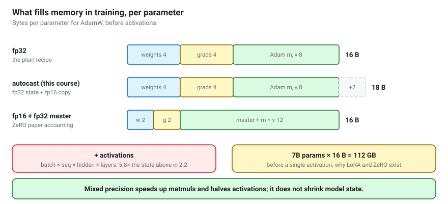
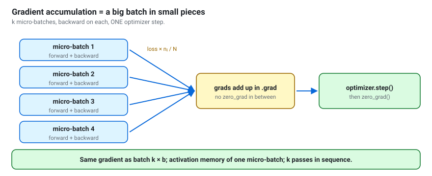
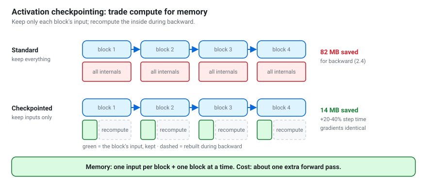

# Chapter 40 · Training efficiency & memory

*Part III · Prerequisites: Chapters 27, 39 · Estimated time: reading ~45 min, lab ~90 min · Compute: T4 GPU (runs on CPU with a reduced budget)*

[](https://colab.research.google.com/github/berdakh/MLBOOTCAMP/blob/main/part3-deep-learning-systems/ch40-training-efficiency-and-memory/notebook.ipynb) · [Lab: notebook.ipynb](notebook.ipynb) · [Solutions](solutions.md)

## Learning objectives

After this chapter you should be able to:

1. List what occupies device memory during a training step and compute the bytes per parameter for weights, gradients and optimiser state, with and without mixed precision.
2. Estimate the activation memory of a transformer and explain how it scales with batch size, sequence length, hidden size and depth.
3. Verify memory estimates by measurement: summed tensor sizes and saved-tensor hooks on any device, and the CUDA allocator's counters on a GPU.
4. Implement gradient accumulation that reproduces the gradient of a large batch exactly, including micro-batches of unequal size.
5. Explain activation checkpointing as a trade of computation for memory and predict its cost.
6. Describe what `torch.compile` does, when it helps and what its operational risks are.
7. Debug an out-of-memory error methodically, distinguishing a peak from a leak.

## 40.1 Introduction

Chapter 39 measured *time*. This chapter measures *memory*, which is usually the
first hard limit one meets when training deep models. A T4 has 16 GB of device
memory. A model that needs 17 GB does not run slowly; it does not run at all. The
error message, `CUDA out of memory`, says nothing about which part of the
computation is responsible, and the remedies differ completely depending on the
answer.

The chapter proceeds from accounting to techniques. Section 40.2 lists what lives
in memory and computes the fixed cost per parameter. Section 40.3 estimates the
activation memory, which depends on the data rather than on the model alone,
and checks the estimate by measurement. Sections 40.4 to 40.6 present three
techniques, each of which reduces a specific term: gradient accumulation and
activation checkpointing reduce activations, while `torch.compile` reduces time
by fusing memory-bound operations. Section 40.7 assembles a procedure for
debugging out-of-memory errors. Section 40.8 states the Adam update precisely,
since its state is the largest fixed term.

The model throughout is `tinygpt`, the small decoder-only transformer that Chapter
41 builds from scratch. On the CPU budget it has 929,536 parameters (embedding
width 128, 4 layers) and is trained on batches of 32 sequences of 64 tokens; on a
T4 the GPU budget gives width 512, 8 layers (about 26M parameters) and batches of
64 × 128. All measured numbers below come from the course's CPU runs; statements
about a T4 are expectations, not measurements.

## 40.2 What fills memory during training

During a training step, four kinds of data occupy device memory:

1. **Weights.** In fp32, 4 bytes per parameter.
2. **Gradients.** One per weight, in the same precision: 4 bytes per parameter.
3. **Optimiser state.** Plain SGD keeps none; SGD with momentum keeps one buffer
   (4 bytes); Adam and AdamW keep running estimates of the first and second moments
   of each gradient (8 bytes).
4. **Activations.** Every intermediate tensor computed in the forward pass that the
   backward pass will need, kept from the moment it is computed until backward uses
   it.

In addition there is overhead that cannot be removed: the CUDA context
(about 0.3–0.5 GB), workspaces for cuBLAS and cuDNN, and fragmentation of the
caching allocator.

The first three terms depend only on the number of parameters $\Psi$ and form the
**model state**:

```math
M_{\text{state}} = \Psi\,\big(b_w + b_g + b_{\text{opt}}\big),
\qquad (40.1)
```

where $b_w$, $b_g$ and $b_{\text{opt}}$ are the bytes per parameter for weights,
gradients and optimiser state.

**Mixed precision does not reduce the model state.** With `torch.autocast`, the
approach used in this course and in most PyTorch code, parameters, gradients and
optimiser state remain fp32. Matrix multiplications run in fp16; autocast caches an
fp16 copy of each weight for the forward pass (2 more bytes per parameter); and the
activations, which are now fp16, roughly halve. Frameworks that store fp16 weights
and gradients together with an fp32 "master" copy of the weights, as in the ZeRO
paper's accounting (Rajbhandari et al., 2020), arrive at $2 + 2 + (4 + 4 + 4) = 16$
bytes per parameter for Adam: the same total distributed differently.

| Optimiser | fp32 (bytes/param) | autocast (bytes/param) |
|---|---|---|
| SGD | 8 | 10 |
| SGD with momentum | 12 | 14 |
| Adam / AdamW | 16 | 18 |



*Figure 40.1 — Bytes per parameter for AdamW under three accountings. The Adam moments alone equal the weights and gradients together; mixed precision moves bytes between the categories without reducing the total.*

**Worked example.** Full fine-tuning of a 7-billion-parameter model with AdamW
needs $7\times10^9 \times 16\ \text{B} = 112$ GB for the model state alone, before any
activation; with autocast, $7\times10^9 \times 18\ \text{B} \approx 126$ GB. No single GPU in
common use holds this. The arithmetic explains why parameter-efficient fine-tuning
(Chapter 44) and sharded optimisers (ZeRO and FSDP, Chapter 48) exist: each removes
part of the 16 bytes per parameter.

**Checking the accounting.** The lab compares Equation (40.1) with the sum of the
sizes of the actual tensors after one AdamW step (every parameter, every `.grad`,
every tensor in `optimizer.state`). They agree exactly: 16.00 bytes per parameter, i.e.
$929{,}536 \times 16 \approx 14.9\times10^6$ bytes (the lab prints 3.5, 3.5 and 7.1 MB for
weights, gradients and optimiser state, in units of $2^{20}$ bytes). One detail matters for the count: `tinygpt` uses
**weight tying**, so the output projection shares its matrix with the token embedding.
`model.parameters()` yields the shared tensor once, so it is stored, differentiated
and optimised once.

## 40.3 Activation memory

The model state is fixed by the architecture. Activation memory, by contrast,
depends on how much data passes through the model in one step, and for typical
batch sizes it is the larger term.

### Counting

Consider one decoder layer with hidden size $h$ and $a$ attention heads, processing
$B$ sequences of $T$ tokens. Each token produces a fixed number of hidden-sized
tensors that backward needs: the inputs and outputs of the two LayerNorms, the query,
key and value projections, the attention output, and the input and output of the GELU
in the four-times-wider MLP. In the course's model this amounts to about $16h$ values
per token per layer. In addition, the attention probabilities form a $T \times T$ matrix
per head, i.e. $`a\,T`$ values per token per layer.

A widely used version of this count, from the Megatron-LM work of Korthikanti et al.
(2022), assumes fp16 activations and stored dropout masks and gives

```math
M_{\text{act}} \approx L \cdot B \cdot T \cdot \big(34\,h + 5\,a\,T\big)\ \text{bytes},
\qquad (40.2)
```

where $L$ is the number of layers. The expression is linear in depth, batch size and
hidden size, and **quadratic in sequence length** through the attention term.

**Worked example.** A 12-layer model with $h = 768$, $a = 12$, sequence length 1024
and batch 8: per token per layer, $34 \cdot 768 + 5 \cdot 12 \cdot 1024 = 87{,}552$ bytes.
Multiplied by $8 \times 1024 = 8{,}192$ tokens and 12 layers, this gives about 8.6 GB,
70% of it from the $T^2$ term. Fused attention kernels such as FlashAttention avoid
storing the attention matrix and remove most of that term.

### Measuring

Activations can be measured on any device. Autograd calls a *pack hook* for every
tensor it saves for the backward pass; `torch.autograd.graph.saved_tensors_hooks`
installs such a hook. The course helper `prof.SavedActivations` sums the unique
storage it sees, excluding the parameters.

The lab varies the number of layers and finds that each extra layer adds 18.0 MB,
exactly what the estimate predicts. A fixed part of 9.9 MB remains, most of it the
log-softmax of the `batch × seq × vocab` logits that cross-entropy saves. With a
50,000-token vocabulary (as in GPT-2) and long sequences, that one tensor can reach
several gigabytes, which is why language-model trainers compute the loss in chunks.

For one full step on the CPU budget, activations took 82 MB against 14 MB for
weights, gradients and AdamW state, a ratio of 5.8. Even a very small model with a
moderate batch is dominated by activations. **Batch size and sequence length are
therefore the first memory controls**, not the choice of optimiser.

On a GPU, `torch.cuda.max_memory_allocated()` reports the allocator's peak. On a T4
one should expect the peak to exceed the estimate by roughly 10–50%, because of
temporaries (attention scores before the softmax, intermediate tensors of the backward
pass) and allocator rounding (not measured in this course). `memory_reserved()` is
higher still, since the caching allocator keeps freed blocks for reuse; this is normal
behaviour, not a leak.

## 40.4 Gradient accumulation

Suppose a batch of 256 examples does not fit in memory but a batch of 32 does.
Gradient accumulation runs $k = 8$ micro-batches, calls `backward()` on each
**without** zeroing the gradients (so they add up in `.grad`), and then takes one
optimiser step. Activation memory is that of one micro-batch. The cost is
parallelism: $k$ sequential passes instead of one parallel pass, with the same total
FLOPs.

For the accumulated gradient to equal the large-batch gradient, each micro-batch must
be weighted correctly. Let micro-batch $i$ contain $n_i$ examples, let $\bar\ell_i$ be
its mean loss, and let $N = \sum_i n_i$. The mean loss over all $N$ examples is
$`\sum_i (n_i/N)\,\bar\ell_i`$. Because the gradient is linear,

```math
g = \nabla_\theta \frac{1}{N}\sum_{j=1}^{N}\ell_j = \sum_{i=1}^{k} \frac{n_i}{N}\, \nabla_\theta \bar{\ell}_i .
\qquad (40.3)
```

When all micro-batches have the same size, $n_i/N = 1/k$ and the familiar rule
"divide the loss by $k$" is correct. With unequal sizes it is not: micro-batches of 8
and 24 examples need weights 0.25 and 0.75, whereas dividing by $k = 2$ gives 0.5 and
0.5 and therefore a different gradient.



*Figure 40.2 — Gradient accumulation. Each micro-batch runs forward and backward; the weighted gradients add up in `.grad`; one optimiser step and one `zero_grad()` follow per large batch.*

The lab compares accumulated and large-batch gradients and finds a maximum difference
of 5.6e-09, i.e. floating-point rounding from a different summation order, against
gradient entries of order $10^{-2}$.

**When equivalence fails.** The equality in Equation (40.3) depends on the loss being
a mean over independent examples. It fails:

* with **BatchNorm**, whose statistics are computed per micro-batch;
* when micro-batches of **unequal size** are divided by $k$;
* when the loss is a mean over **tokens** of variable-length sequences but weighted
  per example (weight by token counts instead);
* when **random** operations such as dropout draw different masks;
* when the learning-rate schedule counts micro-steps instead of optimiser steps.

A further pitfall concerns memory: summing the micro-batch losses and calling
`backward()` once after the loop gives the correct gradient but keeps all micro-batch
graphs alive at once, which removes the memory saving.

## 40.5 Activation checkpointing

Gradient accumulation reduces activations by processing fewer examples at a time.
**Activation checkpointing** (also called gradient checkpointing or rematerialisation;
Chen et al., 2016) reduces them for the same batch, by recomputation. For a
checkpointed block, the forward pass keeps only the block's *input* and discards its
internal activations. During the backward pass, the block's forward computation is run
again from the stored input to recreate the activations just before they are needed.



*Figure 40.3 — Standard training (top) keeps every block's internal activations; checkpointing (bottom) keeps one input per block and recomputes the interior during backward.*

**Cost model.** Let $F$ be the cost of one forward pass. A backward pass costs about
$2F$, because each linear layer needs two matrix products (gradient with respect to the
input and with respect to the weights). Checkpointing every block adds one more
forward pass:

```math
F + 2F \;\longrightarrow\; F + 2F + F = \tfrac{4}{3}\,(F + 2F).
\qquad (40.4)
```

The theoretical time overhead is therefore about 33%. Memory falls from "all internal
activations of every layer" to "one input per layer plus one layer's internals at a time".
Gradients are unchanged, since the same computation is repeated exactly.

**Measured.** On the CPU budget, saved activations fell from 82.0 MB to 13.9 MB (83%
less; what remains is one input per block and the logits), the forward-plus-backward
time rose by 23% and 40% in two runs (CPU timings on a shared machine are noisy), and the
gradients were identical. The saved-tensor count measures what stays alive *between*
forward and backward. The true peak with checkpointing also includes one block's
activations while that block is recomputed, so on a GPU the peak should fall by less
than the saved-activation ratio suggests (not measured in this course).

**Placement.** Block boundaries of a transformer are the natural checkpoints: storing the
residual stream between blocks is cheap, while the inside of a block holds the large
tensors. Checkpointing every block gives the largest saving; every $k$-th block is a
compromise. *Selective* checkpointing keeps tensors that are expensive to recompute
(attention outputs) and recomputes cheap ones (the MLP). In Hugging Face Transformers,
`model.gradient_checkpointing_enable()` checkpoints every block. The memory freed is
usually spent on a larger batch or longer sequences.

## 40.6 `torch.compile`

`torch.compile(model)` captures the Python code of the model as a graph (TorchDynamo),
then generates fused kernels for that graph (TorchInductor: Triton kernels on GPU,
C++/OpenMP on CPU); optionally it also captures CUDA graphs
(`mode="reduce-overhead"`), which replay a whole step with one launch. The first call
is slow because compilation happens then; later calls with the same input shapes reuse
the compiled code.

From Chapter 39 one can predict where the gains come from: fusing memory-bound
elementwise operations (LayerNorm, GELU, softmax, residual additions) so their data is
read once, and removing Python and launch overhead. Large matrix multiplications already
run at library speed and gain little.

**Measured.** On CPU, compiling the training step took about 25 s the first time (8 s on
re-runs, when Inductor's on-disk cache already held the kernels), and the compiled step
ran at 0.95–1.09 times the speed of eager execution. For this small model on CPU the
matmuls dominate and there is little to fuse. The *break-even point*, the number of steps
needed to recover the compilation time, does not exist without a speed-up.

**Expected on a T4 (not measured).** Transformer training commonly gains 1.2–2× from fused
normalisation, activation and softmax kernels and fewer launches, with compilation taking a
minute or more.

**Operational risks.** Compilation time; recompilation whenever input shapes change (pad
to a few fixed lengths, or pass `dynamic=True`; `TORCH_LOGS=recompiles` reports
recompilations); *graph breaks*, where unsupported Python silently falls back to eager
execution; harder debugging; version-specific bugs; and missing toolchains (a C++
compiler on CPU, a supported GPU for Triton). Production code therefore keeps an eager
fallback and tests the compiled model's numerical output against eager.

## 40.7 Debugging an out-of-memory error

The procedure below orders the checks from the most informative to the most invasive.

1. **Read the message.** It states how much memory was requested, how much PyTorch has
   allocated and how much is reserved but unused. If reserved memory greatly exceeds
   allocated memory, the problem is *fragmentation*; the setting
   `PYTORCH_CUDA_ALLOC_CONF=expandable_segments:True` often helps.
2. **Decide between a leak and a peak.** Print `torch.cuda.memory_allocated()` at the
   start of every step. If it grows from step to step, something keeps tensors alive (a
   *leak*). If it is flat and one step exceeds the limit, the problem is a *peak*.
3. **Reduce a peak**, cheapest remedy first: a smaller micro-batch with gradient
   accumulation (Section 40.4); mixed precision (halves activations); shorter sequences;
   activation checkpointing (Section 40.5); a smaller or 8-bit optimiser state or LoRA
   (Chapter 44); sharding with FSDP or ZeRO (Chapter 48).
4. **Out of memory in evaluation only.** Usually a missing `torch.no_grad()` or
   `torch.inference_mode()`, so evaluation builds autograd graphs, or a larger evaluation
   batch size.
5. **After an OOM inside a notebook**, the failed step's tensors may still be referenced by
   the exception traceback or by variables such as `loss`. Delete them, call `gc.collect()`
   and `torch.cuda.empty_cache()`, or restart the runtime. Note that `empty_cache()` only
   returns *unused cached* blocks to the driver; it never frees live tensors and does not
   reduce the memory training needs.
6. **Find the large tensors.** `torch.cuda.memory_summary()` gives a table;
   `torch.cuda.memory._record_memory_history()` records a timeline that can be viewed with
   PyTorch's memory visualiser.

**The most common leak.** Accumulating the loss *tensor* for logging, `total += loss`,
instead of the number, `total += loss.item()`, keeps every step's autograd graph
reachable through `total`, and with it every step's activations. The lab reproduces this
on CPU: 0 B of activations remain alive after five steps with `.item()`, about 100 MB
without it (five steps of about 20 MB each for a batch of 8). On a GPU this produces the
pattern "memory grows every step until it runs out". Related mistakes are appending
outputs or losses to a list, or storing predictions without `.detach().cpu()`.

## 40.8 The Adam update and its state

Since Adam's state is the largest fixed term in Equation (40.1), it is worth stating the
update precisely. With gradient $g_t$ at step $t$, learning rate $\eta$, decay rates
$\beta_1$ (typically 0.9) and $\beta_2$ (typically 0.999), a small constant $\epsilon$
(about $10^{-8}$) and weight decay $\lambda$, AdamW (Loshchilov & Hutter, 2019) computes

```math
\begin{aligned}
m_t &= \beta_1 m_{t-1} + (1-\beta_1)\, g_t, \qquad v_t = \beta_2 v_{t-1} + (1-\beta_2)\, g_t^2, \\
\hat m_t &= \frac{m_t}{1-\beta_1^{\,t}}, \qquad \hat v_t = \frac{v_t}{1-\beta_2^{\,t}}, \\
\theta_t &= \theta_{t-1} - \eta \Big( \frac{\hat m_t}{\sqrt{\hat v_t} + \epsilon} + \lambda\, \theta_{t-1} \Big).
\end{aligned}
\qquad (40.5)
```

The first moment $m_t$ is a running average of the gradient (momentum); the second moment
$v_t$ is a running average of its square (a per-parameter scale). These are the two
buffers that cost 8 bytes per parameter. The bias corrections $\hat m_t$, $\hat v_t$ undo the
initialisation of $m$ and $v$ at zero. AdamW applies the weight decay directly to the
parameters ("decoupled"), rather than adding $\lambda\theta$ to the gradient as Adam with
L2 regularisation does.

**A consequence for the first step.** At $t = 1$, $\hat m_1 = g_1$ and $\hat v_1 = g_1^2$, so
the update is $`\eta\,g_1/\lvert g_1\rvert = \eta \mathrm{sign}(g_1)`$ (ignoring $\epsilon$
and decay): every weight moves by the full learning rate, whatever the size of its
gradient. This is one reason for learning-rate warm-up. The lab verifies this: the first
update was 0.1003–0.1022 for every weight with learning rate 0.1 (the excess is the decay
term), and a manual implementation of Equation (40.5) matched `torch.optim.AdamW` to
float32 rounding (2.4e-07) over three steps.

## Key terms

| Term | Definition |
|---|---|
| Parameter count ($\Psi$) | The number of trainable scalars in a model. |
| Model state | Weights, gradients and optimiser state; proportional to $\Psi$ (Equation 40.1). |
| Optimiser state | Per-parameter buffers kept between steps; for Adam, the first and second moments. |
| Activations | Forward-pass tensors saved for the backward pass; proportional to batch × sequence length × depth. |
| Mixed precision (autocast) | Running selected operations in fp16 or bf16 while keeping master weights and sensitive operations in fp32. |
| Weight tying | Sharing one matrix between the token embedding and the output projection. |
| Micro-batch | One of the pieces into which a large batch is split. |
| Gradient accumulation | Summing weighted gradients of several micro-batches before one optimiser step. |
| Activation checkpointing | Storing only block inputs and recomputing block internals during backward. |
| Caching allocator | PyTorch's GPU allocator, which keeps freed blocks reserved for reuse. |
| Fragmentation | Free memory split into blocks too small for the requested allocation. |
| Peak vs leak | One step that needs too much memory vs memory that grows from step to step. |
| Kernel fusion | Combining several operations into one kernel so data is read from memory once. |
| Graph break | A point where `torch.compile` cannot capture the code and falls back to eager execution. |
| OOM | Out of memory: an allocation larger than the free device memory. |

## Summary

1. Training memory consists of weights, gradients, optimiser state and activations, plus fixed framework overhead.
2. With AdamW, the model state costs 16 bytes per parameter in fp32 and 18 with PyTorch autocast; mixed precision does not reduce it. A 7B model needs 112 GB before activations.
3. Activation memory grows linearly with batch, hidden size and depth and quadratically with sequence length through attention (Equation 40.2); for typical batches it dominates (5.8 times the model state in the lab's CPU run).
4. Estimates should be verified by measurement; saved-tensor hooks make this possible on any device.
5. Gradient accumulation reproduces the large-batch gradient exactly if each micro-batch is weighted by $n_i/N$ (Equation 40.3); it fails with BatchNorm, unequal sizes divided by $k$, or per-token losses weighted per example.
6. Activation checkpointing removes most activation memory (83% in the lab) for about one extra forward pass (Equation 40.4).
7. `torch.compile` helps memory-bound and overhead-bound models; it has compilation and recompilation costs and needs an eager fallback.
8. Out-of-memory errors are debugged by first separating leaks from peaks, then reducing the specific term responsible.

## Exercises

The exercises are in the lab, [notebook.ipynb](notebook.ipynb); worked answers are in
[solutions.md](solutions.md).

1. **`training_memory_bytes`** (graded): bytes for weights, gradients and optimiser state for
   a given optimiser, with and without mixed precision.
2. **`accumulated_step`** (graded): gradient accumulation over micro-batches of different
   sizes that reproduces the full-batch gradient.
3. **Fitting a 1.3B model on a T4** (open-ended): compute the model-state memory, decide
   whether any technique of this chapter makes full fine-tuning fit in 16 GB, and propose an
   alternative.

The checkpoint questions ask about the memory of a 7B model, the scaling of activation
memory, the conditions for exact gradient accumulation, the placement and cost of
checkpoints, the diagnosis of a growing-memory job, and the benefits and risks of
`torch.compile`.

## Further reading

- S. Rajbhandari, J. Rasley, O. Ruwase and Y. He (2020). "ZeRO: Memory Optimizations Toward Training Trillion Parameter Models." *SC20.*
- T. Chen, B. Xu, C. Zhang and C. Guestrin (2016). "Training Deep Nets with Sublinear Memory Cost." arXiv:1604.06174.
- V. Korthikanti et al. (2022). "Reducing Activation Recomputation in Large Transformer Models." arXiv:2205.05198.
- D. P. Kingma and J. Ba (2015). "Adam: A Method for Stochastic Optimization." *ICLR 2015.*
- I. Loshchilov and F. Hutter (2019). "Decoupled Weight Decay Regularization." *ICLR 2019.*
- J. Ansel et al. (2024). "PyTorch 2: Faster Machine Learning Through Dynamic Python Bytecode Transformation and Graph Compilation." *ASPLOS 2024.*
- PyTorch documentation: "Understanding CUDA Memory Usage", `torch.utils.checkpoint`, and the `torch.compile` tutorials.

**Next:** [Chapter 41 · A transformer from scratch](../ch41-transformer-from-scratch/README.md)
