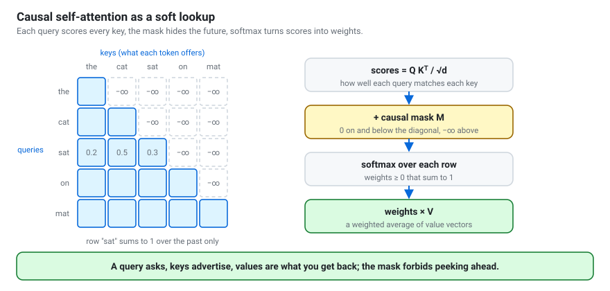
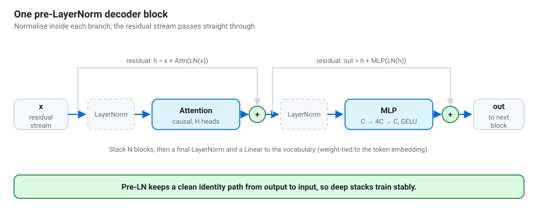
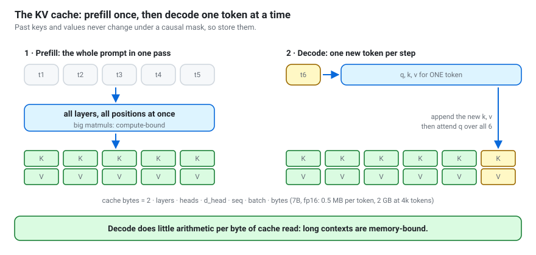

# Chapter 41 · A transformer from scratch

*Part III · Prerequisites: Chapters 28, 39, 40 · Estimated time: reading ~50 min, lab ~90 min · Compute: T4 GPU (runs on CPU with a reduced budget)*

[](https://colab.research.google.com/github/berdakh/MLBOOTCAMP/blob/main/part3-deep-learning-systems/ch41-transformer-from-scratch/notebook.ipynb) · [Lab: notebook.ipynb](notebook.ipynb) · [Solutions](solutions.md)

## Learning objectives

After this chapter you should be able to:

1. Derive and implement causal multi-head self-attention, and explain the role of the queries, keys, values, the $\sqrt{d}$ scaling and the mask.
2. Test a causal mask with a perturbation test.
3. Assemble a pre-LayerNorm decoder block with residual connections and weight tying, and explain why this arrangement trains stably.
4. Predict the loss of a freshly initialised language model and use the prediction as a test.
5. Train a character-level language model and interpret its training and validation loss and perplexity.
6. Generate text with greedy decoding, temperature and top-k sampling, and explain the effect of each.
7. Implement a key–value (KV) cache, verify that it does not change the output, and analyse its time and memory cost.

## 41.1 Introduction

The transformer (Vaswani et al., 2017) is the architecture behind essentially all current
language models, and increasingly behind models for vision, audio and biological sequences.
For an engineer the transformer is not a black box to be imported: questions such as "why is
generation slow for long prompts?", "why did the loss collapse to almost zero?" or "how much
memory does serving need per user?" can only be answered by reasoning about the
architecture's internals.

This chapter builds a small decoder-only transformer, of the GPT family (Radford et al.,
2019), in which every line can be explained. It is trained to predict the next character of
Shakespeare's plays. The task is small enough to train on a CPU in about a minute, yet it
exercises every component of a large model: embeddings, masked attention, residual stream,
normalisation, a language-modelling loss, sampling, and the KV cache that makes generation
practical.

The order of the chapter follows the data through the model: tokens (Section 41.2),
attention (41.3), the decoder block (41.4), the loss and its value at initialisation (41.5),
training (41.6), sampling (41.7), and finally the KV cache (41.8) and the complexity of
generation (41.9). The model code is in
[`src/scaleml/tinygpt.py`](../../src/scaleml/tinygpt.py), which is worth reading alongside this
text.

All measured numbers come from the course's CPU run with the CPU budget: a 64-wide, 2-layer
model trained for 1,500 steps. The GPU budget (256 wide, 4 layers, 4,000 steps) was not run in
this course; statements about it are expectations.

## 41.2 Characters as tokens

A language model operates on a sequence of integer **tokens**. Here each character is one
token. The vocabulary is the set of distinct characters in the corpus: 65 for the
1,115,394-character Tiny Shakespeare file (newline, space, punctuation, upper- and lower-case
letters). Real models use subword tokenisers (Chapter 42), which make English sequences roughly
four times shorter and the vocabulary much larger; a character model keeps the focus on the
architecture.

The validation set is the last 10% of the text, held out as one *contiguous* block (1,003,854
training and 111,540 validation tokens). A random split of overlapping windows would place
nearly identical windows in both sets and make the validation loss meaningless; this is the
sequence-data version of the leakage problem from Chapter 5.

Training examples are random windows of $T$ consecutive tokens (the *context length*, or
`block_size`). The target for each position is the next token, so the target sequence is the
input shifted by one. A single window of length $T$ therefore gives $T$ prediction problems at
once.

## 41.3 Causal self-attention

### Queries, keys and values

Let $X \in \mathbb{R}^{T\times C}$ hold the $C$-dimensional vectors of $T$ tokens. Three learned
linear maps produce, for each token, a **query** (what the token is looking for), a **key**
(what it offers for matching) and a **value** (what it passes on if selected):
$Q = XW^Q$, $K = XW^K$, $V = XW^V$. Scaled dot-product attention is

$$
\operatorname{Attention}(Q, K, V) = \operatorname{softmax}\!\Big(\frac{Q K^\top}{\sqrt{d_k}} + M\Big)\, V ,
\tag{41.1}
$$

where $d_k$ is the dimension of each query and key, the softmax is applied to each row, and
$M$ is the **causal mask**: $M_{ij} = 0$ if $j \le i$ and $M_{ij} = -\infty$ otherwise. Row $i$ of
the result is a weighted average of the value vectors, with weights given by how well query $i$
matches each key.

The mask is what makes next-token training valid. Without it, position $t$ could attend to
token $t+1$, which is the very token it must predict, and the training loss would fall to almost
zero without the model learning anything usable. Because the masked entries are $-\infty$ *before*
the softmax, they become exactly zero after it.



*Figure 41.1 — Causal attention for a five-token sequence. Entries above the diagonal are set to $-\infty$ before the softmax, so each row is a probability distribution over the current and earlier positions only.*

**Worked example.** Query $(1, 0)$, keys $(1, 0)$ and $(0, 1)$, $d_k = 2$: the scaled scores are
$1/\sqrt2 \approx 0.707$ and $0$; the softmax weights are $0.67$ and $0.33$.

### Why divide by $\sqrt{d_k}$

If the entries of a query and a key are independent with zero mean and unit variance, their dot
product is a sum of $d_k$ such products and has variance $d_k$, so standard deviation $\sqrt{d_k}$:
8 for $d_k = 64$. Scores spread over $\pm 16$ make the softmax nearly one-hot, and the gradient of
a saturated softmax is nearly zero. Dividing by $\sqrt{d_k}$ restores unit variance and keeps the
softmax in its sensitive range at initialisation.

### Multiple heads

A single attention computes one weighted average per token. **Multi-head attention** splits the
$C$ channels into $H$ heads of $d_k = C/H$ channels each, runs Equation (41.1) independently in
each head, concatenates the results and mixes them with an output projection $W^O$:

$$
\operatorname{MHA}(X) = \operatorname{Concat}(\text{head}_1, \dots, \text{head}_H)\, W^O, \qquad
\text{head}_i = \operatorname{Attention}(X W_i^Q, X W_i^K, X W_i^V).
\tag{41.2}
$$

Different heads can learn different relations (the previous token, the start of the current
word, a matching quotation mark) at the same total cost as one wide head. With $C = 64$ and
$H = 4$, $d_k = 16$, and the four matrices $W^{Q}, W^{K}, W^{V}, W^{O}$ hold $4C^2 = 16{,}384$
parameters per layer, independent of $H$.

In the lab (Exercise 1), attention is implemented as a pure function: one matrix `w_qkv` of
shape $C \times 3C$ produces Q, K and V together; they are split into heads, attended with the mask,
merged and projected. The grader also runs a **perturbation test**: changing the token at position
4 must not change the outputs at positions 0–3.

## 41.4 The decoder block

The model `TinyGPT` is the following stack:

```
tokens ─► token embedding + position embedding
       ─► N × Block:  x = x + Attention(LayerNorm(x))
                      x = x + MLP(LayerNorm(x))        # MLP: Linear(C→4C), GELU, Linear(4C→C)
       ─► LayerNorm ─► Linear(C→vocab) whose weight is the token embedding (weight tying)
```



*Figure 41.2 — A pre-LayerNorm decoder block. The residual paths above the row pass through no normalisation and no weight matrix, so the block's output is always its input plus two corrections.*

The design choices each have a reason:

* **Residual stream.** Each block reads the running vector $x$ and *adds* its output to it. One
  can think of $x$ as a shared record passed down the stack: attention lets a token copy
  information from earlier tokens; the MLP transforms the token's own information. Nothing is
  overwritten, and gradients reach early layers directly through the additions.
* **LayerNorm.** For each token separately,
  $$
  \operatorname{LN}(x) = \gamma \odot \frac{x - \mu}{\sqrt{\sigma^2 + \epsilon}} + \beta, \qquad
  \mu = \frac{1}{C}\sum_c x_c, \quad \sigma^2 = \frac{1}{C}\sum_c (x_c - \mu)^2 ,
  \tag{41.3}
  $$
  with learned scale $\gamma$ and shift $\beta$ (Ba, Kiros & Hinton, 2016). For $x = (1, 2, 3)$,
  $\mu = 2$, $\sigma^2 = 2/3$, and the normalised output is about $(-1.22, 0, 1.22)$.
* **Pre-LN rather than post-LN.** The original transformer normalised *after* the residual
  addition, $x = \operatorname{LN}(x + f(x))$, so the residual path passes through every
  LayerNorm. Deep post-LN stacks have badly scaled gradients near the input and need careful
  learning-rate warm-up. Pre-LN, $x = x + f(\operatorname{LN}(x))$, keeps a clean identity path
  from output to input, and deep stacks train stably (Xiong et al., 2020). Pre-LN requires one
  final LayerNorm before the output layer.
* **Weight tying.** The output layer, which maps $C$-dimensional vectors to vocabulary logits,
  reuses the token-embedding matrix (Press & Wolf, 2017). This saves a $V \times C$ matrix and, on
  small data, usually gives equal or better perplexity, since a token's input and output
  representations are learned from the same signal.
* **Initialisation** follows GPT-2: weights drawn from $\mathcal{N}(0, 0.02^2)$, with the output
  projections of residual branches further scaled by $1/\sqrt{2L}$, so that the variance of the
  residual stream does not grow with the number of layers $L$.

On the CPU budget the model has 108,352 parameters, 100,096 of them outside the embeddings.

**Testing the mask on the full model.** The lab repeats the perturbation test on the whole model:
it changes the token at position 32 of a sequence and compares logits. The change was exactly 0
(or about $10^{-7}$) before position 32 and clearly non-zero (about 0.8 in our run) from position 32
on. This one test catches the most harmful transformer bug, a leaky mask, which otherwise appears
only as a suspiciously low training loss and a model that generates meaningless text.

## 41.5 The loss and its value at initialisation

The model outputs **logits** $z \in \mathbb{R}^V$ for every position; the softmax turns them into a
distribution over the next token. The training loss is the average **cross-entropy** of the true
next tokens, and **perplexity** is its exponential:

$$
\mathcal{L} = -\frac{1}{N} \sum_{t=1}^{N} \log p_\theta\big(x_{t+1} \mid x_{\le t}\big), \qquad
\operatorname{PPL} = e^{\mathcal{L}} .
\tag{41.4}
$$

Perplexity has a direct reading: a model with perplexity $P$ is as uncertain, on average, as a
uniform choice among $P$ options.

**A test before training.** A freshly initialised model with small weights outputs nearly uniform
probabilities, so its loss should be close to $\ln V$. For $V = 65$, $\ln 65 \approx 4.17$ and the
perplexity is 65. The lab measured about 4.19. A loss far *above* $\ln V$ indicates confident wrong
predictions (initial weights too large, or a missing $\sqrt{d_k}$). A loss far *below* $\ln V$
before any training indicates a bug, most often a leaky mask or targets that are not shifted.

A second reference point is the **unigram baseline**: the cross-entropy of predicting every
character from its overall frequency, ignoring context. Here it is about 3.3 (3.347). A model must
beat it to have learned anything about context.

## 41.6 Training

Training uses the course loop `scaleml.train.train`: AdamW (Chapter 40), linear warm-up followed
by cosine decay of the learning rate, gradient clipping at norm 1.0, and fp16 autocast with a
gradient scaler on a T4 (Chapter 39; a no-op on CPU). Each "epoch" is a fixed number of random
windows.

**Measured (CPU budget).** The training loss fell from about 2.6–2.7 (average over the first 250
steps) to about 1.7, and the validation loss ended near 1.83 (1.833), in 35–60 s at roughly
50,000–90,000 training tokens per second. A validation loss of 1.83 corresponds to a perplexity of
$e^{1.83} \approx 6.2$: the model is, on average, as uncertain as a choice among six characters,
against 65 at initialisation and $e^{3.35} \approx 28$ for the unigram model.

**Expected on a T4 (not measured).** The GPU budget should reach a validation loss around 1.5 in a
few minutes, with samples containing mostly real words and plausible speaker names.

The saved checkpoint `tinygpt.pt` holds the configuration, the vocabulary and the weights. That
is enough to generate text but not to *resume* training, which also requires the optimiser and
scheduler state (`scaleml.train.save_checkpoint` stores them).

## 41.7 Generating text: greedy decoding, temperature and top-k

Generation is autoregressive: compute the logits for the last position, choose a token, append it,
repeat. The choice of token is a design decision.

* **Greedy decoding** takes the most likely token. It is deterministic and, for open-ended text,
  tends to fall into loops: once a phrase is the most likely continuation of itself, the loop
  reinforces itself.
* **Temperature** $\tau$ rescales the logits before the softmax:
  $$
  p_i = \frac{e^{z_i/\tau}}{\sum_j e^{z_j/\tau}} .
  \tag{41.5}
  $$
  $\tau < 1$ sharpens the distribution, $\tau > 1$ flattens it, and $\tau \to 0$ approaches
  greedy decoding. For logits $(2, 1, 0)$ the probabilities are $(0.665, 0.245, 0.090)$ at $\tau = 1$
  and $(0.867, 0.117, 0.016)$ at $\tau = 0.5$.
* **Top-k** keeps only the $k$ largest logits and sets the rest to $-\infty$ before sampling. It
  removes the long tail of individually unlikely tokens which, taken together, are sampled
  surprisingly often and produce errors.
* **Top-p (nucleus) sampling** (Holtzman et al., 2020) keeps the smallest set of tokens whose
  cumulative probability reaches $p$. Unlike top-k it adapts: few candidates when the model is
  confident, many when it is not.

In the lab's CPU run, greedy decoding quickly repeated the same phrase; temperature 0.8 with
top-k 10 produced text with the shape of the plays (capitalised speaker names followed by a colon,
line breaks, short words, many misspellings); temperature 1.5 without top-k was noticeably more
garbled.

## 41.8 The KV cache

Without a cache, generating token $t+1$ re-runs the whole model on all $t$ previous tokens. Yet,
because of the causal mask, the keys and values of earlier positions never change when later tokens
are appended. A **KV cache** stores, for every layer, the keys and values of all tokens processed so
far. Generation then proceeds in two phases:

* **Prefill:** the prompt is processed in one parallel pass, and the keys and values of every prompt
  token are written to the cache.
* **Decode:** each step computes the query, key and value of *one* new token, appends the key and
  value to the cache, and attends over the cache. The mask must use the new token's absolute
  position (`past + i` in `tinygpt.py`).



*Figure 41.3 — Prefill and decode with a KV cache. Prefill is one large parallel pass; decoding is a long series of small passes, each of which reads the whole cache.*

**Correctness first.** A cache is an optimisation and must not change results. The lab compares greedy
generation with and without the cache: the tokens are identical, and the logits differ by about
$10^{-6}$–$10^{-5}$ (9.4e-06), the effect of a different floating-point summation order.

**Speed (measured on CPU).** With an untrained model of the same shape but a 512-token context and an
8-token prompt, the cache was faster at every length, and the gap grew with the number of generated
tokens: 2.1–2.2× at 64 tokens, 3.5–4.6× at 256 and 3.8–5.0× at 500 (single timings on a shared CPU, so
roughly ±30%). Without a cache, throughput fell from about 850–1,100 to about 300 tokens per second as
the context grew. With the cache it also fell at long lengths, for two reasons: attention over the
cache still grows with context, and this simple implementation concatenates the cache at every step
(copying it), whereas production code pre-allocates it.

**Memory.** The cache holds a key and a value per layer, head, channel, position and sequence:

$$
\text{bytes} = 2 \cdot L \cdot H \cdot d_{\text{head}} \cdot T \cdot B \cdot b ,
\tag{41.6}
$$

with $L$ layers, $H$ heads of $d_{\text{head}}$ channels, $T$ positions, $B$ sequences and $b$ bytes per
number. For the toy model this is 512 KB. For a 7B model ($L = 32$, $H = 32$, $d_{\text{head}} = 128$)
in fp16 it is $2 \cdot 32 \cdot 4096 \cdot 2 = 0.5$ MB **per token**, about 2 GB for a single
4,096-token sequence. Serving systems are designed around this number (Chapter 50 covers paged KV
caches and continuous batching). *Multi-query attention* (Shazeer, 2019) shares one key–value head among
all query heads, and *grouped-query attention* (Ainslie et al., 2023) shares one per group of heads;
both shrink the cache by the sharing factor with little loss of quality.

On a T4 one would expect a similar trend for this tiny model, with absolute rates limited by
kernel-launch overhead (dozens of small kernels per token); for real language models the cache is what
makes generation practical (not measured in this course).

## 41.9 The cost of attention and of generation

Let $n$ be the sequence length and $d$ the hidden size.

* **One forward pass over $n$ tokens.** The projections (Q, K, V, output) and the MLP cost
  $O(n d^2)$; the scores $QK^\top$ and the weighted sum cost $O(n^2 d)$. The attention matrix needs
  $O(H n^2)$ memory if it is materialised; FlashAttention avoids storing it, though the FLOPs remain
  $O(n^2 d)$.
* **Generating $n$ tokens without a cache.** Step $t$ re-processes $t$ tokens, so the totals are
  $O(n^2 d^2)$ for projections and MLP and $O(n^3 d)$ for attention.
* **With a cache.** Step $t$ processes one token, $O(d^2)$, and attends over $t$ cached keys, $O(td)$.
  The totals become $O(n d^2)$ and $O(n^2 d)$: a whole factor of $n$ is removed from both.

The cache moves the cost from arithmetic to memory traffic. Each decode step performs about two
FLOPs per parameter (a matrix–vector product) but must read all the weights and the entire cache from
memory, an arithmetic intensity of about one FLOP per byte: far to the left of the ridge point in the
roofline of Chapter 39. Batching many sequences raises the intensity for the weights, which are read
once for the whole batch, but not for the cache, since every sequence has its own. This is why
long-context generation is limited by memory bandwidth rather than by FLOPs.

## Key terms

| Term | Definition |
|---|---|
| Token, vocabulary | The unit the model reads (here a character) and the set of all such units (65 here). |
| Embedding | A learned vector looked up for each token id and each position. |
| Query, key, value | Three learned projections of each token: what it seeks, what it offers for matching, and what it passes on. |
| Attention head | One attention computation on a slice of $C/H$ channels. |
| Causal mask | $-\infty$ added to scores of future positions so that a token cannot attend to later tokens. |
| Perturbation test | Changing one input token and checking that no earlier output changes. |
| Residual stream | The running vector that each block reads and adds its output to. |
| LayerNorm | Per-token normalisation to zero mean and unit variance, followed by a learned scale and shift. |
| Pre-LN / post-LN | Normalisation inside the residual branch / after the residual addition. |
| Weight tying | Using the token-embedding matrix as the output projection. |
| Logits | Unnormalised scores over the vocabulary. |
| Cross-entropy, perplexity | Average negative log-probability of the true next token, and its exponential. |
| Unigram baseline | The loss of predicting each token from its overall frequency, ignoring context. |
| Temperature, top-k, top-p | Logit rescaling before softmax; keeping the $k$ most likely tokens; keeping the smallest set with probability mass $p$. |
| KV cache | Stored keys and values of earlier tokens, so each new token is processed once. |
| Prefill, decode | Processing the prompt in one pass; generating one token per step. |
| MQA / GQA | Sharing key–value heads across all / groups of query heads to shrink the KV cache. |

## Summary

1. Attention (Equation 41.1) is a softmax-weighted average of values, with weights from query–key dot products scaled by $1/\sqrt{d_k}$ to keep the softmax unsaturated.
2. The causal mask makes next-token training valid; a perturbation test verifies it, and a leaky mask shows up as an implausibly low loss.
3. A pre-LN decoder block adds attention and MLP corrections to a residual stream; the unobstructed identity path is what makes deep stacks train stably.
4. The loss at initialisation should be about $\ln V$ (4.17 for 65 characters); this is a cheap test run before training.
5. On the CPU budget, a 108k-parameter model reached a validation loss of 1.83 (perplexity about 6) in about a minute, well below the unigram baseline of 3.35.
6. Greedy decoding loops; temperature, top-k and top-p trade diversity against errors.
7. A KV cache removes a factor of $n$ from the cost of generating $n$ tokens without changing the output (2–5× faster in the lab's CPU run), at a memory cost of Equation (41.6) per sequence.
8. Generation with a cache is memory-bandwidth-bound; MQA and GQA reduce the cache, and serving systems are built around its size.

## Exercises

The exercises are in the lab, [notebook.ipynb](notebook.ipynb); worked answers are in
[solutions.md](solutions.md).

1. **`causal_self_attention`** (graded): multi-head causal attention as a pure function, checked against
   a reference and with a perturbation test.
2. **`top_k_sample`** (graded): temperature and top-k sampling with a reproducible generator.
3. **Attention complexity and the KV cache** (open-ended): the time and memory cost of attention, of
   generation with and without a cache, and why long-context generation is bandwidth-bound.

The checkpoint questions ask you to explain the attention formula term by term, pre-LN versus post-LN,
how to investigate an implausibly low training loss, the sampling controls, the KV cache and its
memory cost, and the reasons for weight tying.

## Further reading

- A. Vaswani et al. (2017). "Attention Is All You Need." *NeurIPS 2017.*
- A. Radford, J. Wu, R. Child, D. Luan, D. Amodei and I. Sutskever (2019). "Language Models are Unsupervised Multitask Learners." OpenAI technical report (GPT-2).
- J. L. Ba, J. R. Kiros and G. E. Hinton (2016). "Layer Normalization." arXiv:1607.06450.
- R. Xiong et al. (2020). "On Layer Normalization in the Transformer Architecture." *ICML 2020.*
- O. Press and L. Wolf (2017). "Using the Output Embedding to Improve Language Models." *EACL 2017.*
- A. Holtzman, J. Buys, L. Du, M. Forbes and Y. Choi (2020). "The Curious Case of Neural Text Degeneration." *ICLR 2020.*
- N. Shazeer (2019). "Fast Transformer Decoding: One Write-Head is All You Need." arXiv:1911.02150; J. Ainslie et al. (2023). "GQA: Training Generalized Multi-Query Transformer Models from Multi-Head Checkpoints." *EMNLP 2023.*
- I. Goodfellow, Y. Bengio and A. Courville (2016). *Deep Learning.* MIT Press. Chapters 6, 8 and 10 for the background on optimisation and sequence models.

**Next:** [Chapter 42 · Pretrained transformers & tokenisation](../ch42-pretrained-transformers-and-tokenization/README.md)
