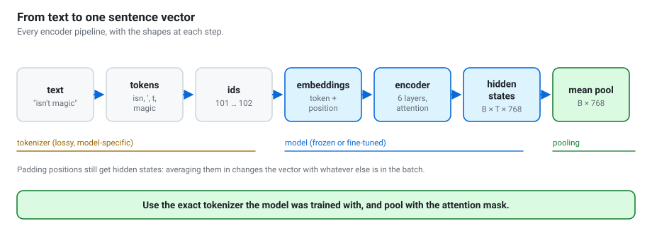
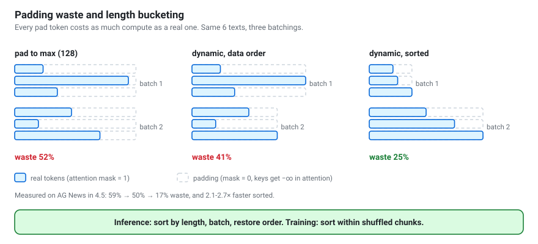

# Chapter 42 · Pretrained transformers & tokenisation

*Part III · Prerequisites: Chapters 39, 41 · Estimated time: reading ~45 min, lab ~90 min · Compute: T4 GPU (runs on CPU with a reduced budget)*

[](https://colab.research.google.com/github/berdakh/MLBOOTCAMP/blob/main/part3-deep-learning-systems/ch42-pretrained-transformers-and-tokenization/notebook.ipynb) · [Lab: notebook.ipynb](notebook.ipynb) · [Solutions](solutions.md)

## Learning objectives

After this chapter you should be able to:

1. Explain subword tokenisation (WordPiece and byte-level BPE), special tokens, and the practical consequences of tokenisation for cost and behaviour.
2. Build a batch correctly: padding, attention masks, truncation, and the correct padding side for encoders and for decoders used in generation.
3. Run a pretrained encoder, interpret its hidden states, and pool them into a sentence embedding with CLS or mask-aware mean pooling.
4. Explain why pooling must ignore padding and how the opposite produces train/serve skew.
5. Measure inference throughput as a function of batch size and sequence length.
6. Reduce padding waste with dynamic padding and length bucketing, and quantify the effect.
7. Load third-party models safely and reproducibly: model cards and licences, safetensors, pinned revisions and remote code.

## 42.1 Introduction

Chapter 41 trained a transformer from scratch. In practice this is rare: one downloads a model
pretrained on a large corpus and adapts it. The model itself is then well tested; the risk lies
in the code that connects it to the data. A wrong tokeniser, padding on the wrong side, an average
that includes padding positions, a silently truncated document or a model file that changed on
the server: each of these produces a working system with degraded output, and none raises an
error.

This chapter treats that connecting code systematically, following a text on its way to a vector:
tokenisation (Section 42.2), batching (42.3), the encoder and pooling (42.4). It then turns to
cost, since embedding large corpora is often the most expensive step of a retrieval or
classification system: throughput (42.5) and padding waste (42.6). It ends with safe and
reproducible loading (42.7).

The lab uses `distilbert/distilbert-base-uncased` (Apache-2.0, 66.4M parameters; Sanh et al., 2019)
as the encoder, the tokeniser of `openai-community/gpt2` (MIT) for comparison, and a sample of AG
News for realistic text lengths. Both models are pinned to a fixed revision. Measured numbers come
from the course's CPU run with two threads; T4 statements are expectations.



*Figure 42.1 — From text to a sentence vector. The tokeniser and the pooling step lie outside the model, and both can silently change the result.*

## 42.2 Subword tokenisation

A tokeniser maps text to a sequence of integer ids from a fixed vocabulary. Two simple choices are
unsatisfactory. A **word-level** vocabulary cannot represent words not seen when it was built,
and must be very large to cover a language. A **character-level** vocabulary (Chapter 41) covers
everything but makes sequences long, and attention cost grows with sequence length. **Subword**
tokenisers take the middle path: frequent words are single tokens, rare words are split into
frequent pieces.

* **WordPiece** (used by BERT and DistilBERT) has a fixed vocabulary, 30,522 entries for this
  checkpoint, chosen to maximise the likelihood of the training corpus. Continuation pieces are
  marked `##`. This checkpoint is *uncased*: it lower-cases the text and strips accents before
  splitting.
* **Byte-level BPE** (Sennrich et al., 2016, in the byte-level form of GPT-2 and most current
  language models) starts from the 256 possible bytes and repeatedly merges the most frequent
  adjacent pair, here up to 50,257 tokens. Because every string is a sequence of bytes, any input
  can be encoded and nothing is ever "unknown". The symbol `Ġ` marks a leading space.

**What the lab shows.** For one test sentence, DistilBERT produced 24 lower-cased WordPieces (for
example `un ##bel ##ie ##va ##bly` and `202 ##4`) wrapped in the special tokens `[CLS]` (id 101) and
`[SEP]` (id 102). Decoding gave back lower-cased text with altered spacing (`isn ' t`): the WordPiece
pipeline is *lossy*. GPT-2 needed 17 pieces, kept case and spaces (`Ġunbelievably`, `Ġ2024`) and
decoded to exactly the input. On a sample of AG News headlines, both tokenisers used 24 tokens for 22
words. The common rule of thumb "one token is about three quarters of a word" comes from mixed web
text; it does not hold for every domain.

**Consequences.**

* Length limits and costs are counted in **tokens**, not words.
* Numbers, source code, non-English text and specialised vocabulary split into many more pieces, so
  they cost more and fit less content into the same context.
* Piece boundaries are statistical, not linguistic (`2024` → `202`, `##4`), which is one reason why
  language models are weak at arithmetic and spelling.
* A model works only with the exact tokeniser it was trained with. A different tokeniser gives
  different ids, and the model receives a different input.

## 42.3 Batches: padding, attention masks and truncation

Tensors are rectangular, so all sequences in a batch must have the same length. Shorter sequences
are **padded** with a pad token, and an **attention mask** $`m_t \in \{0, 1\}`$ marks real tokens (1) and
padding (0). Inside every attention layer the mask is applied to the keys:

```math
\text{score}_{ij} \;\leftarrow\; \text{score}_{ij} + (1 - m_j)\cdot(-\infty) ,
\qquad (42.1)
```

so after the softmax a padded key receives weight exactly zero from every query. For scores
$(1.0, 0.5, 2.0)$ and mask $(1, 1, 0)$ the softmax is taken over the first two entries only, giving
$(0.62, 0.38, 0)$. Note that padded positions still *have* hidden states; the mask only stops other
positions from attending to them. This becomes important in Section 42.4.

Sequences longer than the model's limit (512 positions for DistilBERT) must be **truncated**, or the
model fails. Truncation keeps the final `[SEP]`. Two padding strategies exist:

* **Dynamic padding** (`padding=True`): pad to the longest sequence *in this batch*.
* **Fixed padding** (`padding="max_length"`): pad every batch to `max_length`. This wastes computation
  and is justified only when fixed shapes are needed, as by some compilers and accelerators.

**Padding side.** Encoders such as BERT pad on the right. Decoder-only models used for *generation*
must pad on the **left**: generation continues from the last position, which must therefore be a real
token in every row. With right padding, short rows would continue from padding, and the positions of
new tokens would be wrong. GPT-2 has no pad token; the usual solution is to reuse its end-of-text token
as padding, which the attention mask makes harmless.

In the lab, a batch of three sentences padded dynamically had shape `(3, 13)` (the longest row, with
`[CLS]` and `[SEP]`, had 13 tokens); the shorter rows were padded with id 0 and their masks ended in
zeros, whereas the GPT-2 batch had its zeros on the left.

## 42.4 Hidden states and pooling

`AutoModel` returns the encoder without any task-specific head. Its `last_hidden_state` has shape
`(batch, seq, 768)`: one *contextual* vector per token, i.e. a vector that depends on the whole input,
not only on the token. With `output_hidden_states=True` the model also returns the embeddings and the
output of every layer (seven tensors for DistilBERT's six layers). Lower layers tend to encode lexical
information, upper layers more contextual and task-related information.

Many applications need **one vector per text**, obtained by **pooling** the token vectors:

* **CLS pooling** takes the vector at position 0. It is meaningful only if training made that vector
  summarise the input, as BERT's next-sentence objective or fine-tuning a classifier on it does
  (Devlin et al., 2019). DistilBERT was distilled without the next-sentence objective.
* **Mean pooling** averages the token vectors, **using the attention mask**:

```math
\mathbf{s} = \frac{\sum_{t=1}^{T} m_t\, \mathbf{h}_t}{\sum_{t=1}^{T} m_t} ,
\qquad (42.2)
```

where $\mathbf h_t$ is the hidden state at position $t$ and $m_t$ the mask. Sentence-embedding models
(Reimers & Gurevych, 2019) are trained with this pooling. In code, the denominator must be guarded
against zero, so that an empty row gives a zero vector rather than NaN.

**Why the mask matters.** A naive mean over all positions includes the hidden states of padding.
With hidden values 2 and 4 for two real tokens and 100 for a pad position, the masked mean is 3 and the
naive mean 35.3. In the lab, the naive mean of a sentence padded inside a batch had cosine similarity
only 0.85 with the same sentence encoded alone, whereas the masked mean matched to 6.1e-07. A model
whose embedding of a text depends on what else is in the batch gives different answers online (batch
of one) and offline (large padded batches). This is a typical form of **train/serve skew**, the
problem studied in Chapter 11.

**Comparing CLS and mean pooling.** Similarity between embeddings is usually measured by **cosine
similarity**,

```math
\cos(\mathbf a, \mathbf b) = \frac{\mathbf a \cdot \mathbf b}{\lVert \mathbf a \rVert \, \lVert \mathbf b \rVert} ,
\qquad (42.3)
```

the cosine of the angle between the vectors, which ignores their lengths. On a small hand-made set of
related and unrelated sentence pairs (a sanity check, not a benchmark), CLS pooling gave mean cosine
0.96 for related and 0.90 for unrelated pairs (a gap of 0.06); mean pooling gave 0.89 and 0.69 (a gap of
0.20). Two observations follow. First, absolute cosine values from a raw encoder mean little: its
embeddings occupy a narrow cone, so everything looks similar (Ethayarajh, 2019). Second, mean pooling
separated the two groups about three times more clearly. Good sentence embeddings nonetheless come from
models *trained* for similarity (Chapters 45 and 46), and a classifier on the CLS vector works well only
after fine-tuning (Chapter 43).

## 42.5 Inference throughput

**Throughput** (sequences or tokens per second) rises with batch size until the hardware is
saturated, after which it flattens while the latency of each batch keeps growing. The cost per sequence
grows with length: linearly for the projections and MLPs ($O(Td^2)$), quadratically for attention scores
($O(T^2 d)$), which become significant only when $T$ approaches the hidden size $d$ or exceeds it.

**Measured (CPU, 2 threads).** Batch size 1 at 64 tokens was the least efficient, at about 1,300
tokens/s; batch sizes 8 and 32 reached about 1,900–2,000 tokens/s and the curve flattened, since two
cores saturate quickly. At batch 16, tokens per second stayed roughly constant (2,100–2,500) from 16 to
128 tokens, so the time per batch grew about linearly with length: at these lengths the quadratic
attention term is small next to the MLPs.

**Expected on a T4 (not measured).** Tens of thousands of tokens per second with fp16 autocast, and a
much larger benefit from batching: batch 1 leaves most of the GPU idle, while batches of 32–128 sequences
of 128 tokens fill it. Attention's quadratic cost should become visible at 512 tokens.

## 42.6 Padding waste and length bucketing

Every pad position costs as much computation as a real token. The fraction of wasted positions is

```math
\text{waste} = 1 - \frac{\sum_i \ell_i}{\sum_{\text{batches } b} \lvert b \rvert \cdot \max_{i \in b} \ell_i} ,
\qquad (42.4)
```

where $\ell_i$ is the length of text $i$ and $\lvert b\rvert$ the number of rows in batch $b$. For six texts
with 370 real tokens padded to 128, $6 \times 128 = 768$ positions are computed and the waste is
$`1 - 370/768 = 52\%`$; after sorting by length into two batches of three, $3 \cdot 45 + 3 \cdot 120 = 495$
positions are computed and the waste is 25%.



*Figure 42.2 — The same six texts batched three ways. Only the grouping of rows changes; the wasted (dashed) area shrinks when similar lengths share a batch.*

**Length bucketing** groups texts of similar length into the same batch. For a fixed number of batches,
cutting the length-sorted order into consecutive groups minimises the waste: any batch that mixes a
short and a long text can exchange the short one for a longer text from a batch of shorter texts without
raising either batch's maximum.

**Measured (CPU).** The sampled AG News texts were 24–128 tokens long (median 50). Padding everything
to 128 wasted 59% of positions; dynamic padding in the data's own order still wasted 50%, because almost
every batch of 32 contained one long text; sorting by length reduced the waste to 17%. The running time
followed the number of positions: 10.4–13.5 s, 8.4–8.8 s and 5.0 s, so dynamic padding was 1.2–1.5 times
and sorted batching 2.1–2.7 times faster than fixed padding. The model and the data were identical in all
three cases. On a T4 the same ordering is expected, with a smaller relative gain for short texts and a
larger one at long lengths (not measured).

**Training versus inference.** At inference time one can sort freely and restore the original order of
the outputs afterwards. For training, sorting the whole dataset is harmful: batches would contain
similar-length texts in the same order every epoch, which biases the gradient steps, and length is often
correlated with the label. The standard compromise is to shuffle, take a large chunk (for example 50–100
batches' worth), sort within the chunk, cut batches, and shuffle the batches (Hugging Face's
`group_by_length=True`). A further variant, **token-budget batching**, lets the number of rows vary so
that rows × maximum length stays roughly constant, which keeps memory use flat.

## 42.7 Loading models safely and reproducibly

A model downloaded from a public hub is a third-party dependency and should be treated as one.

* **Model card and licence.** Before using a model in a product, read its card (Mitchell et al., 2019):
  intended use, training data, known biases and limitations, evaluation, and licence. DistilBERT
  (Apache-2.0) and GPT-2 (MIT) are permissive; many models are research-only, non-commercial or carry use
  restrictions, and the licence of a training dataset can restrict the model trained on it.
* **Safetensors.** Legacy `pytorch_model.bin` files are Python pickles, and loading a pickle can execute
  arbitrary code. `.safetensors` files contain only tensors and a JSON header: loading cannot execute
  code, and the file can be memory-mapped for fast loading. With `use_safetensors=True`, loading fails
  instead of falling back to a pickle. In the lab, each repository offered four weight files (safetensors,
  the PyTorch pickle, TensorFlow and Flax formats).
* **Revision pinning.** `from_pretrained(name)` fetches the current state of the `main` branch, which the
  owner can change at any time. Pinning a commit hash (`revision=...`) for both model and tokeniser makes
  results reproducible; a change of revision should be handled like a dependency upgrade, with a fresh
  evaluation.
* **Remote code.** `trust_remote_code=True` runs Python code from the model repository on your machine. It
  should stay off unless that code has been reviewed, and then the revision must be pinned.

For production use, a further step is to mirror approved model files, with card and licence, into an
internal model registry, so that serving does not depend on the public hub; to gate promotion on an
offline evaluation; and to record model and tokeniser versions with every prediction log (Chapters 15
and 55).

## Key terms

| Term | Definition |
|---|---|
| Subword tokenisation | Splitting text into frequent pieces: common words whole, rare words in parts. |
| WordPiece | A subword vocabulary chosen by corpus likelihood; continuation pieces marked `##` (BERT). |
| Byte-level BPE | A subword vocabulary built by merging frequent byte pairs; lossless, no unknown tokens (GPT-2). |
| Special tokens | Tokens with a structural role, such as `[CLS]`, `[SEP]` and `[PAD]`. |
| Token id | The integer index of a token in the vocabulary; what the model receives. |
| Padding | Filler tokens that make all rows of a batch the same length. |
| Attention mask | 1 for real tokens, 0 for padding; masked keys receive $-\infty$ before the softmax. |
| Truncation | Cutting sequences longer than the model's limit. |
| Hidden state | The contextual vector that the encoder outputs for each token. |
| Pooling | Turning per-token vectors into one vector per text (CLS or mask-aware mean). |
| Cosine similarity | The cosine of the angle between two vectors, from −1 to 1. |
| Padding waste | The fraction of computed positions that are padding (Equation 42.4). |
| Length bucketing | Grouping texts of similar length into the same batch. |
| Safetensors | A weight format that stores only tensors, so loading cannot execute code. |
| Revision pinning | Loading a model at a fixed commit hash. |
| Model card | Documentation of a model's intended use, data, evaluation, limitations and licence. |

## Summary

1. Subword tokenisers bound the vocabulary while covering any input; WordPiece can be lossy, byte-level BPE is lossless. Costs and limits are counted in tokens, and unusual text costs more tokens.
2. A model must be used with its own tokeniser; a different tokeniser changes the input silently.
3. Padding makes batches rectangular; the attention mask (Equation 42.1) gives padded keys zero weight. Decoders used for generation pad on the left.
4. Mean pooling must use the mask (Equation 42.2); otherwise embeddings depend on batch composition, producing train/serve skew (cosine 0.85 in the lab instead of identity).
5. Raw encoder embeddings are anisotropic; mean pooling separated related from unrelated pairs better than CLS, but sentence embeddings should come from models trained for similarity.
6. Throughput rises with batch size until the hardware saturates; at short lengths the cost per token is dominated by the MLPs.
7. Padding waste (Equation 42.4) can matter more than model optimisations: length bucketing cut it from 59% to 17% and the time by 2.1–2.7× in the lab.
8. Third-party models are dependencies: read the card and licence, load safetensors, pin revisions, avoid unreviewed remote code.

## Exercises

The exercises are in the lab, [notebook.ipynb](notebook.ipynb); worked answers are in
[solutions.md](solutions.md).

1. **`mean_pool`** (graded): mask-aware mean pooling that returns zeros, not NaN, for an empty row.
2. **`bucket_by_length`** (graded): group indices into the minimum number of batches with padding waste no
   worse than sorting and chunking.
3. **Reviewing a semantic-search pipeline** (open-ended): list the correctness, cost, reproducibility and
   safety problems of a described embedding service, with a fix for each.

The checkpoint questions cover subword tokenisation and its failure modes, the attention mask and padding
side, the choice of pooling, maximising throughput for embedding 100 million documents, safe loading in
production, and diagnosing an accuracy drop after a dependency upgrade.

## Further reading

- R. Sennrich, B. Haddow and A. Birch (2016). "Neural Machine Translation of Rare Words with Subword Units." *ACL 2016.*
- J. Devlin, M.-W. Chang, K. Lee and K. Toutanova (2019). "BERT: Pre-training of Deep Bidirectional Transformers for Language Understanding." *NAACL 2019.*
- V. Sanh, L. Debut, J. Chaumond and T. Wolf (2019). "DistilBERT, a distilled version of BERT: smaller, faster, cheaper and lighter." arXiv:1910.01108.
- N. Reimers and I. Gurevych (2019). "Sentence-BERT: Sentence Embeddings using Siamese BERT-Networks." *EMNLP 2019.*
- K. Ethayarajh (2019). "How Contextual are Contextualized Word Representations?" *EMNLP 2019.*
- M. Mitchell et al. (2019). "Model Cards for Model Reporting." *FAT\* 2019.*
- Hugging Face documentation: Transformers "Padding and truncation", the Tokenizers library, and the safetensors format.

**Next:** [Chapter 43 · Fine-tuning a classifier](../ch43-fine-tuning-a-classifier/README.md)
