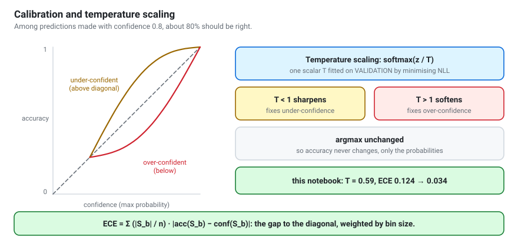

# Chapter 43 · Fine-tuning a classifier

*Part III · Prerequisites: Chapters 7, 8, 9, 42 · Estimated time: reading ~45 min, lab ~90 min · Compute: T4 GPU (runs on CPU with a reduced budget)*

 · [Lab: notebook.ipynb](notebook.ipynb) · [Solutions](solutions.md)

## Learning objectives

After this chapter you should be able to:

1. Build two inexpensive, strong baselines for text classification: TF-IDF with logistic regression, and a linear probe on frozen encoder embeddings.
2. Fully fine-tune a pretrained encoder with a classification head, choosing learning rate, warm-up, gradient clipping and early stopping for good reasons.
3. Organise training, validation and test data so that every decision is made on validation data and the test set is read once.
4. Judge whether a difference in accuracy is larger than its sampling error.
5. Measure calibration with the expected calibration error and a reliability table, and correct it with temperature scaling.
6. Perform error analysis with a confusion matrix and the most confident mistakes, and derive actions from it.
7. Explain when a simple baseline is the better production choice.

## 43.1 Introduction

A statement such as "we fine-tuned BERT and obtained 94% accuracy" is not yet a result. To interpret it
one needs to know what a simple bag-of-words model achieves on the same split, what the frozen encoder
achieves with only a linear layer on top, whether the validation data used for decisions was separate
from the test data, whether the difference between models exceeds the noise of the test set, and
whether the predicted probabilities can be used as probabilities. This chapter fine-tunes a pretrained
encoder with that evidence in place.

The approach is a ladder of models of increasing cost (Section 43.2): TF-IDF with logistic regression
(43.3), a linear probe on frozen embeddings (43.4) and full fine-tuning (43.5). The comparison of the
three (43.6) is followed by calibration (43.7) and error analysis (43.8), and the chapter closes with the
production decision (43.9). The methods themselves are those of Part I (model selection in Chapter 7,
calibration in Chapter 8, error analysis in Chapter 9), now applied to a deep model.

**Data and budget.** AG News (Zhang, Zhao & LeCun, 2015) contains news snippets in four balanced topics:
World, Sports, Business and Sci/Tech. The model is `distilbert/distilbert-base-uncased`, pinned to a
revision. The CPU budget, used for all measured numbers in this chapter, has 1,275 training, 225 validation
and 500 test examples, 64-token inputs and a single epoch. This budget demonstrates the *method*; it
understates what fine-tuning achieves. The GPU budget (17,000 / 3,000 / 4,000 examples, 128 tokens, two
epochs) was not run in this course, and statements about it are expectations.

## 43.2 Three splits and a ladder of models

**Why three splits.** Every decision made by looking at a number is fitted to the data that produced the
number: the learning rate, the epoch at which to stop, the calibration temperature, the choice of model.
Such decisions must use **validation** data, carved from the training data. The **test** split is read
once, at the end, for the numbers that are reported. If the epoch is chosen by test accuracy, the
reported accuracy is the maximum over many noisy measurements and is biased upwards; this is the most
common way in which fine-tuning results are inflated without anyone intending it.

**A ladder of models.** The three models answer different questions:

| Model | What is trained | What it tells you |
|---|---|---|
| TF-IDF + logistic regression | a linear model on word and bigram weights | how much of the task is solvable from surface vocabulary |
| Linear probe | a linear model on frozen encoder embeddings | how much the pretrained representation already encodes |
| Full fine-tuning | every weight of the encoder and a new head | how much is gained by adapting the representation to the task |

Each rung is more expensive than the previous one in training time, inference cost and operational
complexity. A higher rung is justified only if its gain is larger than the noise and worth its cost.
Chapter 44 adds an intermediate rung, parameter-efficient fine-tuning.

## 43.3 Baseline 1: TF-IDF and logistic regression

TF-IDF represents a text by the counts of its words and word pairs, each multiplied by the **inverse
document frequency**, so that terms frequent in a text but rare in the corpus receive large weights.
In one common form, the weight of term $w$ in document $d$ is

$$
\text{tfidf}(w, d) = \text{tf}(w, d) \cdot \log \frac{N}{\text{df}(w)} ,
\qquad (43.1)
$$

where $\text{tf}(w,d)$ is the count of $w$ in $d$, $N$ the number of documents and $\text{df}(w)$ the number
of documents containing $w$ (libraries add smoothing and normalise each vector to unit length). A logistic
regression on these vectors is fast to train, predicts in microseconds on a CPU, and its weights can be
read per term. It is the number any deep model must beat by enough to justify its cost.

**Measured (CPU budget).** The regularisation strength $C$ was chosen on validation data (validation
accuracy was 0.86–0.87 for every value tried; $C = 3.0$ was selected), the vocabulary had about 8,000
unigrams and bigrams, fitting took under a second, and test accuracy was **0.822** (macro-F1 0.821). With
17,000 training examples, TF-IDF with logistic regression typically reaches about 0.89–0.90 on AG News.

## 43.4 Baseline 2: a linear probe on frozen embeddings

A **linear probe** keeps the pretrained encoder frozen, embeds every text once (with mask-aware mean
pooling, Chapter 42) and trains only a logistic regression on the embeddings. It measures how much of the
task the pretrained representation already solves, and it is also a common production pattern: one shared
embedding service serving many inexpensive task-specific heads.

**Measured (CPU budget).** At 64 tokens, 20% of the texts were truncated. Embedding 2,000 texts took 56 s
(36 texts/s on two otherwise idle CPU threads). The probe reached 0.893 validation and **0.858 test**
accuracy (macro-F1 0.858). A frozen encoder that has never seen the task, combined with a linear layer,
outperformed TF-IDF on this small training set, because its representation was learned from far more text
than the 1,275 training examples.

## 43.5 Full fine-tuning

**Architecture.** `AutoModelForSequenceClassification` places a freshly initialised head on the pretrained
encoder; for DistilBERT this is a linear layer, ReLU, dropout and a final linear layer applied to the
`[CLS]` position. The loading report lists the head's weights as missing, which is expected. All weights,
67.0M here, are then trained with the course's loop, `scaleml.train.train`.

**Hyperparameters and their reasons.**

* **Small learning rate (AdamW, $5\times10^{-5}$).** Pretrained weights lie in a good region of parameter
  space; typical fine-tuning learning rates are $10^{-5}$ to $10^{-4}$, ten to a hundred times below
  from-scratch values. A learning rate such as $10^{-3}$ overwrites what pre-training learned, an effect
  called **catastrophic forgetting**.
* **Warm-up, then cosine decay.** The learning rate rises linearly from near zero over the first 10% of
  steps. The new head starts random and produces large, noisy gradients that flow back into the encoder;
  warm-up lets the head settle before the encoder receives large updates (see also the first-step
  behaviour of Adam derived in Chapter 40).
* **Gradient clipping** at norm 1.0, and **fp16 autocast with a gradient scaler** on a CUDA GPU (Chapter 39).
* **Early stopping** on validation accuracy: evaluate after every epoch, keep the best weights, and stop
  after `patience` epochs without improvement. With the CPU budget's single epoch it only records and
  restores; with two epochs on the GPU budget it can act.

These choices follow the practice established for transfer learning in NLP (Howard & Ruder, 2018; Devlin et
al., 2019). Fine-tuning results also vary noticeably between random seeds, often by half a point to a point
of accuracy (Mosbach et al., 2021), which matters when comparing models.

**Measured (CPU budget).** 40 optimiser steps took about 135 s (about 9 examples/s; 443 s when other jobs
shared the CPU, so time is the least reproducible number in the lab). The training loss fell from about 1.27
(mean over the first 10 steps) to about 0.46 (last 10 steps), and validation accuracy after the single epoch
was about 0.90. One epoch on 1,275 short examples is far from convergence. On a T4 the GPU budget (about 530
steps) should finish in a few minutes, with training loss well below 0.3 and validation accuracy around
0.92–0.94 (not measured).

## 43.6 Comparing the models

**Measured test accuracy (CPU budget):** TF-IDF + LR 0.822, linear probe 0.858, fine-tuned **0.872** (macro-F1
equal to accuracy to three decimals, because the classes are balanced).

Whether these differences are meaningful depends on the sampling error of the test set. For an accuracy
$\hat p$ measured on $n$ independent examples,

$$
\operatorname{SE}(\hat p) = \sqrt{\frac{\hat p\,(1 - \hat p)}{n}} .
\qquad (43.2)
$$

For $\hat p = 0.872$ and $n = 500$, $\operatorname{SE} \approx 0.015$. The gap between TF-IDF and the two
DistilBERT models (0.04–0.05) is several standard errors. The gap between the probe and the fine-tuned model
(0.014) is about one standard error, so this CPU run does not show that fine-tuning beats the probe. When two
models are evaluated on the *same* examples, a **paired** test is more sensitive than comparing two separate
intervals: McNemar's test on the examples where exactly one model is correct (Dietterich, 1998), or a paired
bootstrap of the accuracy difference. With the GPU budget, fine-tuning is expected to be clearly ahead (around
0.93–0.94 against roughly 0.88–0.90 for the two baselines; not measured).

Because the classes are balanced, accuracy and macro-F1 agree here. In general **macro-F1**,

$$
F_1 = \frac{2PR}{P + R}, \qquad \text{macro-}F_1 = \frac{1}{C} \sum_{c=1}^{C} F_{1,c} ,
\qquad (43.3)
$$

averages the per-class harmonic mean of precision $P$ and recall $R$ with equal weight per class, so that
rare classes count as much as frequent ones.

## 43.7 Calibration

A classifier is **calibrated** if, among the examples to which it assigns probability 0.9, about 90% are
correctly classified. Calibration matters whenever a probability is *used* rather than only its argmax: a
threshold that sends uncertain cases to human review, ranking by expected value, combining models, or
abstaining. Calibration complements accuracy and does not replace it: a model that always predicts the base
rate (0.25 for each of four balanced classes) is perfectly calibrated and useless.

**Expected calibration error.** Partition the $n$ predictions into $B$ equal-width bins $S_1, \dots, S_B$ by
confidence (the largest predicted probability). In each bin compare the accuracy $\operatorname{acc}(S_b)$ with
the mean confidence $\operatorname{conf}(S_b)$:

$$
\operatorname{ECE} = \sum_{b=1}^{B} \frac{\lvert S_b \rvert}{n} \, \big\lvert \operatorname{acc}(S_b) - \operatorname{conf}(S_b) \big\rvert .
\qquad (43.4)
$$

For example, 100 predictions at confidence 0.9 with accuracy 0.8 and 100 at confidence 0.6 with accuracy 0.65
give $\tfrac12(0.1) + \tfrac12(0.05) = 0.075$. ECE has known weaknesses: it depends on the number of bins, it is
biased upwards for small samples (with 500 test examples, its sampling error is a few hundredths), and it
looks only at the top label. A **reliability table** (the data behind a reliability diagram) lists accuracy and
confidence per bin and shows the *direction* of miscalibration.

**Measured (CPU budget).** The three models were miscalibrated in different directions. TF-IDF + LR was strongly
**under**-confident (mean confidence 0.62 against accuracy 0.82, ECE 0.21), because L2 regularisation shrinks its
weights. The probe was slightly **over**-confident (0.93 against 0.86, ECE 0.08). The briefly fine-tuned model
was **under**-confident (0.75 against 0.87, ECE 0.12): every bin from 0.7 upwards was more accurate than its
confidence, for example confidence 0.83 with accuracy 0.98.

**Temperature scaling** (Guo et al., 2017) is the standard one-parameter correction. All logits $\mathbf z$ are
divided by a scalar $T > 0$ before the softmax, and $T$ is chosen to minimise the negative log-likelihood on
validation data:

$$
\mathbf p = \operatorname{softmax}(\mathbf z / T), \qquad
T^{\star} = \arg\min_{T > 0} \; -\frac{1}{n_{\text{val}}} \sum_{i \in \text{val}} \log \operatorname{softmax}(\mathbf z_i / T)_{y_i} .
\qquad (43.5)
$$

$T > 1$ softens over-confident predictions and $T < 1$ sharpens under-confident ones. Because every logit is divided
by the same positive number, the order of the classes, and hence the argmax and the accuracy, cannot change. For
logits $(2, 0)$ the top probability is 0.881 at $T = 1$, 0.731 at $T = 2$ and 0.982 at $T = 0.5$. In practice one
optimises $\log T$, which removes the positivity constraint.

*Figure 43.1 — Reliability diagram. An under-confident model lies above the diagonal and an over-confident one below it; temperature scaling with $T < 1$ or $T > 1$ moves each towards the diagonal without reordering predictions.*

**Measured (CPU budget).** The fitted temperature was $T = 0.59$ (below 1: sharpen, since this under-trained model
was under-confident). On the test set, NLL fell from 0.487 to 0.427 and ECE from 0.124 to 0.034, with accuracy
unchanged at 0.872. A model fine-tuned for several epochs to near-zero training loss is more often
**over**-confident ($T > 1$), as Guo et al. reported for modern networks; this is expected on the GPU budget but was
not measured. In either case the procedure is the same: fit $T$ on validation data, check ECE and NLL on test, and
refit after every retraining.

## 43.8 Error analysis

Aggregate metrics say *how much* is wrong; error analysis says *what to do next*. Two views are useful.

* **The confusion matrix** shows which pairs of classes are confused. In the CPU run the largest off-diagonal cells
  were Business predicted as Sci/Tech (19) and World predicted as Business (13), while Sports was almost never
  confused. Articles about technology companies are both business and technology news; articles about economic
  policy are both world and business news.
* **The most confident mistakes** are often label noise or genuinely ambiguous inputs rather than model failures. In
  the CPU run (64 errors out of 500), the most confident "mistakes" (calibrated confidence 0.97) were Olympic
  swimming and cricket stories labelled World, for which the model's prediction, Sports, is arguably correct.

The actions that follow from error analysis are rarely "use a larger model". In order: read a sample of the errors
for the dominant confusion and decide whether they are model errors or label ambiguity; revise the task definition
(clearer labelling guidelines, a multi-label formulation, or merging classes the product does not need to separate);
only then collect more data for the confusable pair, or route low-confidence predictions to review.

## 43.9 The production decision

The CPU numbers make the trade-off concrete. TF-IDF + LR fitted in about a second and predicts in microseconds on a
CPU; DistilBERT embedded 36 texts per second on two CPU threads. A service that classifies 50 million articles per
day must handle about 580 per second on average, more at peak. A linear model needs a few CPU cores for this; a
transformer needs a GPU fleet, or distillation and quantisation (Chapter 49).

The baseline is the better choice when the measured gap is within the product's tolerance or within noise, when
latency and cost budgets are tight, when the model must be interpretable and correctable term by term, or when the
vocabulary drifts quickly and frequent, inexpensive retraining matters more than peak accuracy. Fine-tuning is worth
its cost when the gap is significant and valuable. A common compromise is a **cascade**: the inexpensive model handles
the predictions on which it is confident, and only uncertain cases go to the expensive model. The reliability table of
the inexpensive model is what sizes such a cascade, which is one more reason to calibrate. The evidence to collect is a
larger test set with a paired significance test, per-class errors, the cost per thousand predictions on the target
hardware, and finally an online A/B test (Chapter 29).

## Key terms

| Term | Definition |
|---|---|
| TF-IDF | Term counts weighted by inverse document frequency (Equation 43.1). |
| Linear probe | A linear classifier trained on frozen embeddings. |
| Fine-tuning | Continuing to train a pretrained model, usually all its weights, on a new task. |
| Classification head | The layers added on top of an encoder to produce class logits. |
| Catastrophic forgetting | Loss of pretrained knowledge caused by too large updates during fine-tuning. |
| Warm-up | Increasing the learning rate from near zero over the first steps. |
| Early stopping | Keeping the weights of the best validation epoch and stopping when validation stops improving. |
| Validation vs test data | Data used for decisions vs data read once for reporting. |
| Standard error | The sampling standard deviation of an estimate such as accuracy (Equation 43.2). |
| Paired test | A test comparing two models on the same examples (McNemar, paired bootstrap). |
| Macro-F1 | The unweighted mean over classes of per-class F1 (Equation 43.3). |
| Calibration | Agreement between predicted probabilities and observed frequencies of correctness. |
| ECE | Expected calibration error: bin-weighted mean gap between accuracy and confidence (Equation 43.4). |
| Reliability table / diagram | Accuracy against confidence per bin. |
| Temperature scaling | Dividing logits by one scalar fitted on validation NLL (Equation 43.5). |
| NLL | Negative log-likelihood, the cross-entropy of the true class. |
| Confusion matrix | Counts of true class against predicted class. |
| Cascade | A cheap model that defers uncertain cases to an expensive one. |

## Summary

1. A fine-tuning result is interpretable only against baselines, with decisions made on validation data and the test set read once.
2. TF-IDF with logistic regression and a linear probe are inexpensive baselines; on the CPU budget they reached 0.822 and 0.858 test accuracy against 0.872 for fine-tuning.
3. Fine-tuning uses small learning rates with warm-up to avoid catastrophic forgetting, together with clipping, mixed precision on a GPU and early stopping on validation data.
4. A 500-example test set has a standard error of about 0.015 on accuracy; the probe–fine-tuning gap in the CPU run was within noise. Paired tests are the right tool for comparing models.
5. Different models can be miscalibrated in opposite directions; ECE and a reliability table reveal this.
6. Temperature scaling fitted on validation data corrected calibration (ECE 0.124 → 0.034) without changing accuracy.
7. Error analysis showed topic overlap and label noise, not model failure, as the main source of errors; the remedies are in the task definition and data.
8. The inexpensive baseline is often the right production choice; a cascade combines both models.

## Exercises

The exercises are in the lab, [notebook.ipynb](notebook.ipynb); worked answers are in [solutions.md](solutions.md).

1. **`expected_calibration_error`** (graded): ECE with equal-width bins, empty bins skipped.
2. **`fit_temperature`** (graded): the temperature that minimises validation NLL, within 2% of a reference.
3. **When a TF-IDF baseline is the right production choice** (open-ended): use the lab's measurements to argue the
   decision for a service classifying 50 million articles per day, with at least four factors and the evidence you
   would collect.

The checkpoint questions cover the three models of the ladder, learning rate and warm-up, the source of model-selection
data, ECE and its weaknesses, the significance of a 1.5-point gain on 500 examples, and the next actions after error
analysis.

## Further reading

- J. Howard and S. Ruder (2018). "Universal Language Model Fine-tuning for Text Classification." *ACL 2018.*
- J. Devlin, M.-W. Chang, K. Lee and K. Toutanova (2019). "BERT: Pre-training of Deep Bidirectional Transformers for Language Understanding." *NAACL 2019.*
- M. Mosbach, M. Andriushchenko and D. Klakow (2021). "On the Stability of Fine-tuning BERT: Misconceptions, Explanations, and Strong Baselines." *ICLR 2021.*
- C. Guo, G. Pleiss, Y. Sun and K. Q. Weinberger (2017). "On Calibration of Modern Neural Networks." *ICML 2017.*
- T. G. Dietterich (1998). "Approximate Statistical Tests for Comparing Supervised Classification Learning Algorithms." *Neural Computation* 10(7).
- X. Zhang, J. Zhao and Y. LeCun (2015). "Character-level Convolutional Networks for Text Classification." *NeurIPS 2015* (the AG News benchmark).
- C. D. Manning, P. Raghavan and H. Schütze (2008). *Introduction to Information Retrieval.* Cambridge University Press. Chapter 6 for TF-IDF.

**Next:** [Chapter 44 · Parameter-efficient fine-tuning](../ch44-parameter-efficient-fine-tuning/README.md)
