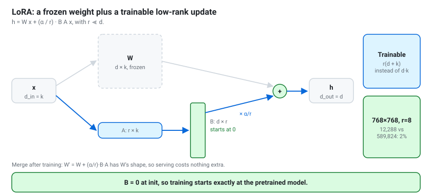
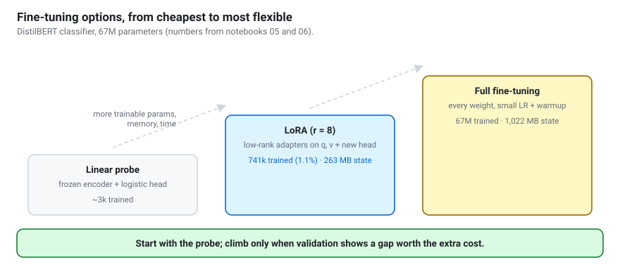

# Chapter 44 · Parameter-efficient fine-tuning

*Part III · Prerequisites: Chapters 40, 43 · Estimated time: reading ~40 min, lab ~90 min · Compute: T4 GPU (runs on CPU with a reduced budget)*

[](https://colab.research.google.com/github/berdakh/MLBOOTCAMP/blob/main/part3-deep-learning-systems/ch44-parameter-efficient-fine-tuning/notebook.ipynb) · [Lab: notebook.ipynb](notebook.ipynb) · [Solutions](solutions.md)

## Learning objectives

After this chapter you should be able to:

1. Explain which parts of fine-tuning memory scale with the number of *trained* parameters and which with the number of *stored* parameters.
2. Derive LoRA, including the zero initialisation of $B$ and the $\alpha/r$ scaling, and implement it as a module.
3. Inject adapters into selected layers of a pretrained model and count trainable parameters.
4. Compare a linear probe, LoRA and full fine-tuning on accuracy, trainable parameters, memory and time, and judge which differences are real.
5. Reproduce a hand-written LoRA with the `peft` library and verify that the two agree.
6. Merge adapters into the base weights for serving, and explain what merging gains and loses.
7. Describe how one base model can serve many adapters, and the trade-offs between merged and multi-adapter serving.

## 44.1 Introduction

Full fine-tuning (Chapter 43) updates every weight of the pretrained model. This has two costs. During
training, every parameter needs a gradient and optimiser state, which for AdamW in fp32 is 16 bytes per
parameter (Chapter 40). After training, every task has its own full copy of the model: a thousand
customer-specific variants of a 7-billion-parameter model would occupy a thousand times 14 GB in fp16.

**Parameter-efficient fine-tuning** (PEFT) keeps the pretrained weights frozen and trains a small number of
new or selected parameters. The best-known method, **LoRA** (low-rank adaptation; Hu et al., 2022), adds a
trainable low-rank correction next to selected weight matrices. It typically trains well under 1% of the
parameters, produces adapter files of a few megabytes, and allows one frozen base model to serve many tasks.
Earlier PEFT methods include adapter layers inserted between transformer sub-layers (Houlsby et al., 2019) and
learned prefixes for the attention keys and values (Li & Liang, 2021).

The chapter first establishes where the memory goes (Section 44.2), then derives LoRA (44.3) and its placement
in a transformer (44.4). Section 44.5 compares the probe, LoRA and full fine-tuning on one budget; 44.6 checks
the implementation against `peft`; 44.7 and 44.8 cover merging and multi-adapter serving; 44.9 discusses
QLoRA and the choice of method.

The lab uses DistilBERT on AG News, as in Chapter 43, with an even smaller CPU budget (640 training and 300 test
examples, 64 tokens, one epoch), since four training runs must fit in a few minutes. Accuracies on this budget
are low and noisy. All measured numbers come from CPU runs; T4 numbers are expectations.

## 44.2 Where fine-tuning memory goes

Training memory consists of weights, gradients, optimiser state and activations (Chapter 40). The crucial
observation is that these terms scale with different counts. Every weight must be *stored* for the forward pass,
but only *trained* weights need gradients and optimiser state. With $\Psi_{\text{total}}$ stored parameters at
$b_w$ bytes each and $\Psi_{\text{trained}}$ trained parameters,

```math
M \approx b_w\, \Psi_{\text{total}} + 16\, \Psi_{\text{trained}} + M_{\text{act}} ,
\qquad (44.1)
```

where 16 bytes per trained parameter is the fp32 AdamW figure of Chapter 40. (Counting the trained weights
in both terms overstates $M$ slightly; the error is negligible when $\Psi_{\text{trained}} \ll \Psi_{\text{total}}$.)

**Worked example.** DistilBERT with a classification head has 67.0M parameters. The lab computes 1,021.7 MB of
model state for full fine-tuning (about $67\text{M} \times 16$ B, in units of $2^{20}$ bytes) and 263.1 MB for the
LoRA run, almost all of it the frozen fp32 weights (about $67\text{M} \times 4$ B). For a 7B model the difference decides
whether training fits on one GPU at all: 104 GB against 13 GB of weights, and QLoRA (Section 44.9) stores the
frozen base in 4 bits, about 3.5 GB.

Freezing does **not** remove activation memory. The backward pass must still propagate gradients through every
layer above the lowest adapter, so attention, GELU and LayerNorm activations stay. One part does shrink: a frozen
linear layer does not need its *input* saved, since no weight gradient is computed for it.

## 44.3 LoRA

**The hypothesis.** Aghajanyan et al. (2021) showed that fine-tuning a pretrained language model can succeed
within a surprisingly low-dimensional subspace of parameter space, and Hu et al. (2022) observed that the weight
*change* during fine-tuning has low intrinsic rank. LoRA therefore constrains the change $\Delta W$ of a weight
matrix $W_0 \in \mathbb R^{d \times k}$ to be a product of two thin matrices:

```math
h = W_0 x + \Delta W x = W_0 x + \frac{\alpha}{r}\, B A x, \qquad
A \in \mathbb{R}^{r \times k},\; B \in \mathbb{R}^{d \times r},\; r \ll \min(d, k).
\qquad (44.2)
```

$W_0$ is frozen; only $A$ and $B$ are trained. Each design choice has a reason.

* **$B$ is initialised to zero**, so $\Delta W = 0$ at the start and the adapted model computes exactly what the
  pretrained model computed. Training starts from the good pretrained solution rather than from a random
  perturbation of it.
* **$A$ is initialised randomly** (Kaiming-uniform, as in `peft`). If both matrices were zero, the gradient with
  respect to $B$, $\partial L/\partial B = (\partial L/\partial h)(Ax)^\top$, would be zero and nothing would
  train.
* **The factor $\alpha/r$** keeps the size of the update roughly independent of the rank, so the rank can be
  changed without retuning the learning rate much. With $\alpha = 16$ and $r = 8$ the update is $`2\,BAx`$.

**Parameter count.** A LoRA adapter on one layer has

```math
r\,(d + k) \quad\text{trainable parameters, instead of}\quad d\,k .
\qquad (44.3)
```

For a $768 \times 768$ projection and $r = 8$ this is $8 \cdot 1536 = 12{,}288$ instead of $589{,}824$, about 2%.



*Figure 44.1 — A LoRA layer. The input passes through the frozen weight and, in parallel, through the thin trainable path $A$ then $B$; because $B$ starts at zero, the detour initially adds nothing.*

One way to picture this is as a transparent overlay on a large painting: the overlay is described by a few
strokes in each direction rather than by every pixel, and it starts fully transparent. The picture is apt for
adapting existing knowledge. It is less apt when the task requires genuinely new knowledge, such as a new
language or a domain with unfamiliar vocabulary; a low-rank update may then be insufficient, and a higher rank or
full fine-tuning performs better.

In the lab (Exercise 1) LoRA is implemented as a module `LoRALinear` that wraps a pretrained `nn.Linear`, freezes
its weight and bias, and adds the scaled low-rank path. The grader checks that the output equals the base layer's
output at initialisation.

## 44.4 Placing adapters in a transformer

Following the original paper, the lab adapts the attention **query** and **value** projections (`q_lin` and
`v_lin` in DistilBERT): 12 wrapped layers, two in each of six blocks. The adapters hold
$12 \times 8 \times (768 + 768) = 147{,}456$ parameters. The new classification head (a $768 \times 768$ layer and a
$768 \times 4$ layer, with biases) has 593,668 parameters and must be trained fully, because it starts random. In
total 741,124 of 67,104,004 parameters are trainable (1.10%), and most of them belong to the head, not the
adapters. The maximum logit difference from the base model at initialisation was exactly zero, as the zero
initialisation of $B$ requires.

Adapting all linear layers (q, k, v, output and the MLP projections) at a similar parameter budget usually gives
better results than adapting only q and v (Dettmers et al., 2023). The rank is best chosen by a small sweep
(for example 4, 8, 16, 64) on validation data, together with the learning rate, stopping when accuracy saturates.

## 44.5 Linear probe, LoRA and full fine-tuning on one budget

The lab trains three variants on the same data, sequence length and number of steps, and adds the linear probe of
Chapter 43. What differs is *what* is trained and the learning rate: $5\times10^{-5}$ for full fine-tuning and
$5\times10^{-4}$ for LoRA. Adapters start at zero and are low-dimensional, so they need larger steps, typically
about ten times those of full fine-tuning.

On a GPU, peak memory is read from `torch.cuda.max_memory_allocated`. A CPU has no such counter, so the lab
*estimates* memory: parameter, gradient and AdamW bytes by arithmetic, plus activation bytes **measured** with
saved-tensor hooks for one training batch.



*Figure 44.2 — The fine-tuning ladder. Each step up multiplies what is trained and stored; the question is whether accuracy rises with it.*

**Measured (CPU budget).** Accuracies and memory were identical across runs; times varied with the load on the
machine (epoch times are the range over three runs on a shared four-core machine; ms/step is the median from the
last run).

| Method | Trainable parameters | Test accuracy | s/epoch | ms/step | Memory (estimate) |
|---|---|---|---|---|---|
| Linear probe | 3,076 | 0.833 | 18–32 | – | 253 MB |
| LoRA, $r = 4$ | 667,396 | 0.830 | 37–101 | ~1,800 | 771 MB (505 MB activations) |
| LoRA, $r = 8$ | 741,124 | 0.837 | 36–102 | ~1,750 | 773 MB (505 MB activations) |
| Full fine-tuning | 66,956,548 | 0.847 | 57–82 | ~2,850 | 2,016 MB (739 MB activations) |

**Interpretation.**

* **Accuracy.** With 300 test examples the standard error of an accuracy near 0.84 is about 0.02, and all four
  accuracies lie within about one standard error of each other. This budget cannot rank the methods. With more
  data, LoRA usually comes within about a point of full fine-tuning on classification tasks of this kind.
* **Memory.** LoRA needed about 38% of the estimated memory of full fine-tuning. Most of the saving is the gradient
  and AdamW state of the frozen weights (about 770 MB). Activations shrank far less (739 → 505 MB), for the reason
  given in Section 44.2. At 67M parameters the saving is modest; at 7B it decides feasibility.
* **Time.** A LoRA step was about 1.6 times faster than a full fine-tuning step. LoRA skips the weight-gradient
  matrix products of the frozen layers (about half of the backward FLOPs, a third of the step) and the AdamW update
  of 67M parameters, but it still computes activation gradients through every layer. On a GPU the gain should be
  smaller, because the optimiser step is cheap relative to the matrix products there.
* **Measurement.** Whole-epoch wall times on a shared machine are unreliable; in one run LoRA epochs were even
  slower than full fine-tuning. Repeated steps measured back to back, as in the ms/step column, are steadier
  (Chapter 39).

**Expected on a T4 (not measured).** With the GPU budget (10,000 examples, 128 tokens, fp16 autocast), LoRA and full
fine-tuning should both reach about 0.90–0.93 test accuracy, with the probe lower; LoRA's peak memory should be a few
hundred MB lower at batch 64 (activations dominate both), and its epochs roughly 20–35% faster.

## 44.6 The same with `peft`

The Hugging Face `peft` library implements LoRA and related methods (DoRA, IA³, prefix tuning) for any
`transformers` model. Its configuration maps one-to-one onto the hand-written version: `r`, `lora_alpha`,
`target_modules`, and `modules_to_save` for layers trained fully alongside the adapters. For sequence classification
`peft` saves only `classifier` by default; DistilBERT's head also contains `pre_classifier`, so both must be listed,
or the second layer of the head would stay at its random initialisation.

`peft` reported 741,124 trainable parameters, the same count as the hand-written version, and with identical weights
the outputs agreed exactly. Its "all params" figure (67,697,672) is larger by 593,668 because `modules_to_save` keeps a
trainable *copy* of the head next to the frozen original. Writing the method by hand and then matching a library
exactly is a useful way to confirm one's understanding of both.

## 44.7 Merging adapters

After training, the update can be folded into the frozen weight:

```math
W' = W_0 + \frac{\alpha}{r}\, B A .
\qquad (44.4)
```

$W'$ has the original shape, so the merged model is an ordinary model and serves exactly as fast as the base model:
the two extra matrix products per adapted layer disappear. The price is flexibility: a merged copy serves one task,
and switching adapters requires un-merging, which is exact only in the precision in which the merge was done.
Merging in fp16 or int8 adds rounding error, so merges should be done in fp32.

**Measured (CPU).** After merging, no `LoRALinear` layers remained and the maximum logit difference was about
$10^{-6}$, since $`W_0 x + s\,B(Ax)`$ and $(W_0 + sBA)x$ sum in a different order; `peft`'s `merge_and_unload` gave the
same result. A batch of 32 took 790–890 ms unmerged and 800–810 ms merged, no difference beyond noise, because the
rank-8 products are small next to the 768-wide ones. The overhead of unmerged adapters shows up mainly as extra kernel
launches, which matter more for small batches on a GPU and for models with many adapted layers.

## 44.8 Serving many adapters on one base model

An adapter is small. In the lab, the saved adapter file was 2.83 MB (0.56 MB of LoRA matrices; the rest is the
$768 \times 768$ head layer), against 256 MB for the full model. A thousand tasks would cost 250 GB as full copies and
2.8 GB as adapters plus one base model. Three serving patterns follow:

* **Swap per request batch.** Keep the base in GPU memory and load the adapter for the current tenant (`peft`:
  `load_adapter(..., adapter_name=...)` and `set_adapter(name)`). Simple, and adequate when each tenant's traffic is
  bursty.
* **Mixed-adapter batches.** Run the shared base matrix product once for the whole batch, then a batched, *gathered*
  low-rank product in which each row uses its own tenant's $A$ and $B$ (S-LoRA, Sheng et al., 2023; similar kernels in
  Punica and vLLM). Throughput stays close to that of the base model while thousands of adapters are served; adapters
  live in CPU memory and are paged into the GPU on demand.
* **Merge** only when one adapter serves almost all traffic and justifies dedicated replicas.

The trade-off is therefore: merged adapters give the lowest latency per request but one task per replica; unmerged
multi-adapter serving has slightly slower kernels but one fleet for all tenants, and adapters can be deployed, rolled
back and A/B tested independently of the base model.

## 44.9 QLoRA and choosing a method

**QLoRA** (Dettmers et al., 2023) stores the frozen base model in 4 bits (the NF4 data type), computes in 16-bit
precision, and trains LoRA adapters on top; it also uses paged optimisers to absorb memory spikes. By Equation (44.1),
the first term for a 7B model falls from about 14 GB in fp16 to about 3.5 GB, so fine-tuning a 7B model fits on a 16 GB
GPU. Gradient checkpointing (Chapter 40) complements it by reducing the activation term.

The choice among methods follows the same ladder as Chapter 43:

* A **linear probe** suffices when frozen features already separate the classes, when many tasks share one embedding
  service, or when labelled data is very scarce.
* **LoRA** is appropriate when the representation must adapt but memory, storage or many-task serving matter.
* **Full fine-tuning** is justified with abundant data, a large domain shift, the budget to pay for it, and a need for
  the last point of quality.

Whichever is chosen, the comparison with full fine-tuning should be checked on slices, not only on average. If
fine-tuning data was truncated to short sequences, for example, adapters never saw long contexts, and quality on long
production inputs may suffer although the benchmark average is unchanged.

## Key terms

| Term | Definition |
|---|---|
| PEFT | Parameter-efficient fine-tuning: training a small number of new or selected parameters. |
| Frozen parameter | A weight used in the forward pass but never updated. |
| LoRA | Learning a low-rank correction $\frac{\alpha}{r}BA$ next to a frozen weight matrix (Equation 44.2). |
| Rank $r$ | The inner dimension of $B$ and $A$; the number of independent directions the update can use. |
| $\alpha$ | A scale applied as $\alpha/r$ so that the update size is roughly independent of $r$. |
| Target modules | The linear layers that receive adapters. |
| Adapter | The small set of trained weights that turns a base model into a task-specific model. |
| `modules_to_save` | Layers that `peft` trains fully alongside the adapters, such as a new head. |
| Merge | Folding $\frac{\alpha}{r}BA$ into $W_0$ after training (Equation 44.4). |
| QLoRA | LoRA on a base model stored in 4 bits. |
| Multi-adapter serving | One base model in memory, a different adapter per request or tenant. |
| Intrinsic dimension | The dimension of the smallest parameter subspace in which fine-tuning succeeds. |

## Summary

1. Weights must be stored, but only trained weights need gradients and optimiser state (Equation 44.1); freezing 99% of a model removes almost all of the latter but not the activations.
2. LoRA adds a trainable low-rank correction $\frac{\alpha}{r}BA$ to frozen weights; $B = 0$ at initialisation makes training start from the pretrained model.
3. A rank-8 adapter on a $768 \times 768$ projection trains 2% of its parameters; in the lab, most trainable parameters were in the new classification head.
4. On the small CPU budget, probe, LoRA and full fine-tuning were within noise of each other (0.830–0.847); LoRA used about 38% of the memory and its steps were about 1.6 times faster.
5. A hand-written LoRA and `peft` agreed exactly once the whole head was listed in `modules_to_save`.
6. Merging removes all serving overhead at the cost of one task per model copy; unmerged adapters allow one base model to serve many tenants.
7. Adapters are megabytes; batched multi-adapter kernels serve thousands of them on one base model.
8. QLoRA stores the base in 4 bits and makes fine-tuning a 7B model feasible on a 16 GB GPU.

## Exercises

The exercises are in the lab, [notebook.ipynb](notebook.ipynb); worked answers are in [solutions.md](solutions.md).

1. **`LoRALinear`** (graded): a LoRA wrapper around a frozen `nn.Linear`, identical to the base layer at initialisation.
2. **`merge_lora`** (graded): the merged weight $W + \frac{\alpha}{r}BA$, without modifying $W$ in place.
3. **Fine-tuning a 7B model for 40 customers** (open-ended): choose between full fine-tuning, LoRA and QLoRA using the memory
   arithmetic, choose modules and rank, design serving for the 40 variants, and plan the evaluation of quality loss.

The checkpoint questions cover LoRA's parameter count and initialisation, the memory LoRA does and does not save, the choice
of layers and rank, when a probe suffices, merged versus unmerged serving of 1,000 adapters, and diagnosing poor results on
long inputs.

## Further reading

- E. J. Hu et al. (2022). "LoRA: Low-Rank Adaptation of Large Language Models." *ICLR 2022* (arXiv:2106.09685, 2021).
- N. Houlsby et al. (2019). "Parameter-Efficient Transfer Learning for NLP." *ICML 2019.*
- X. L. Li and P. Liang (2021). "Prefix-Tuning: Optimizing Continuous Prompts for Generation." *ACL 2021.*
- A. Aghajanyan, L. Zettlemoyer and S. Gupta (2021). "Intrinsic Dimensionality Explains the Effectiveness of Language Model Fine-Tuning." *ACL 2021.*
- T. Dettmers, A. Pagnoni, A. Holtzman and L. Zettlemoyer (2023). "QLoRA: Efficient Finetuning of Quantized LLMs." *NeurIPS 2023.*
- Y. Sheng et al. (2023). "S-LoRA: Serving Thousands of Concurrent LoRA Adapters." arXiv:2311.03285.
- Hugging Face PEFT documentation (`LoraConfig`, `get_peft_model`, `merge_and_unload`, multiple adapters).

**Next:** [Chapter 45 · Embeddings & semantic search](../ch45-embeddings-and-semantic-search/README.md)
