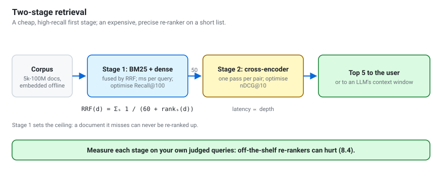

# Chapter 45 · Embeddings & semantic search

*Part III · Prerequisites: Chapters 24, 26, 42 · Estimated time: reading ~50 min, lab ~90 min · Compute: T4 GPU (runs on CPU with a reduced budget)*

 · [Lab: notebook.ipynb](notebook.ipynb) · [Solutions](solutions.md)

## Learning objectives

After this chapter you should be able to:

1. Define the retrieval metrics nDCG@k and Recall@k, explain which one matters for a first-stage retriever, and explain the effect of unjudged documents.
2. Derive and implement BM25, explaining the roles of idf, $k_1$ and $b$, and implement it efficiently as a sparse index.
3. Build a dense retriever from a sentence encoder (mean pooling and L2 normalisation) and measure its embedding throughput.
4. Search with FAISS using exact and approximate (HNSW) indexes, and measure the trade-off between recall, latency and memory.
5. Compare lexical and dense retrieval query by query and explain where each is better.
6. Combine rankings with reciprocal rank fusion and judge whether the improvement exceeds the evaluation noise.
7. Plan the evaluation, index and re-embedding costs of replacing a lexical search system with a dense or hybrid one.

## 45.1 Introduction

Retrieval is the first stage of search engines, recommender systems, question answering and
retrieval-augmented language-model applications. From a collection of millions of items it selects the few hundred
that the more expensive later stages will ever see. Whatever it misses is lost for every later stage, so its quality
bounds the quality of the whole system. Chapters 25 and 26 treated retrieval for recommendations with learned user
and item vectors; this chapter treats retrieval of *text* by text.

Two families of methods exist. **Lexical** retrieval matches the words of the query against the words of the
documents, through an inverted index; its standard scoring function is BM25. **Dense** (or "semantic") retrieval
maps queries and documents to vectors with a neural encoder and searches for nearest neighbours. The claim that
dense retrieval is "better" is common, and it is often wrong for a given collection. This chapter builds both, and a
hybrid of the two, and evaluates them on a public benchmark with relevance judgements, so that the claim can be
tested.

**Data and model.** BEIR SciFact (Wadden et al., 2020; Thakur et al., 2021) contains 5,183 scientific abstracts and
1,109 scientific claims as queries, with relevance judgements for 809 training and 300 test queries (about 1.1
relevant documents per test query, at most 5). Claims and their supporting abstracts often use different wording
("aspirin" against "acetylsalicylic acid"), which is difficult for lexical matching, and the specialised vocabulary is
difficult for a general embedding model. The encoder is `sentence-transformers/all-MiniLM-L6-v2` (22.7M parameters,
384-dimensional embeddings), loaded with `transformers` alone. On the CPU budget, documents are cut to their first
128 tokens; on a GPU the lab uses 256. Both search the full corpus. All measured numbers come from the CPU run.

## 45.2 Measuring retrieval quality

For each query a system returns a ranked list of documents. The **qrels** (query relevance judgements) state which
documents are relevant to which query, here with grade 1; other collections use graded relevance, such as 0–3.

**nDCG@k** (normalised discounted cumulative gain; Järvelin & Kekäläinen, 2002) rewards relevant documents near the
top. With $rel_i$ the relevance of the document at rank $i$,

$$
\operatorname{DCG@}k = \sum_{i=1}^{k} \frac{rel_i}{\log_2(i + 1)}, \qquad \operatorname{nDCG@}k = \frac{\operatorname{DCG@}k}{\operatorname{IDCG@}k},
\tag{45.1}
$$

where IDCG@$k$ is the DCG of the best possible ordering for that query, so that nDCG lies between 0 and 1. A single
relevant document found at rank 3 gives $1/\log_2 4 = 0.5$; at rank 1 it gives 1.0. nDCG@10 is BEIR's headline metric:
it rewards placing the answer *first*, which is what a user, or a language model with a limited context window, sees.

**Recall@k** is the fraction of relevant documents that appear anywhere in the top $k$:

$$
\operatorname{Recall@}k = \frac{\lvert \text{relevant} \cap \text{top-}k \rvert}{\lvert \text{relevant} \rvert} .
\tag{45.2}
$$

For a **first-stage** retriever whose output is re-ranked (Chapter 46), Recall@k at the re-ranking depth is what matters:
a document not retrieved cannot be re-ranked upwards, while the order within the top $k$ is the re-ranker's job.

**Unjudged documents** count as non-relevant. Both metrics are therefore lower bounds, and a system that retrieves
relevant documents that nobody judged is penalised (*pooling bias*). Chapter 46 returns to this problem as "false
negatives".

**Compare only on the same corpus.** The lab runs BM25 on the full corpus (nDCG@10 0.667, Recall@100 0.886) and on a
1,200-document sub-corpus (0.770 and 0.937). Removing distractor documents inflated nDCG@10 by 10 points. Numbers
obtained on different corpora must never be compared.

## 45.3 Lexical retrieval: BM25

BM25 (Robertson & Zaragoza, 2009) scores a document by the query terms it contains, with two corrections to raw counts.
**Term-frequency saturation**: the tenth occurrence of a term adds less evidence than the first. **Length
normalisation**: long documents contain more words and match more query terms by chance. The score is

$$
\operatorname{BM25}(q, d) = \sum_{t \in q} \operatorname{idf}(t)\, \frac{f(t,d)\,(k_1 + 1)}{f(t,d) + k_1 \big(1 - b + b\, \lvert d \rvert / \text{avgdl}\big)}, \qquad
\operatorname{idf}(t) = \ln\!\Big(1 + \frac{N - n_t + 0.5}{n_t + 0.5}\Big),
\tag{45.3}
$$

where $f(t,d)$ is the count of term $t$ in document $d$, $\lvert d \rvert$ the document length in tokens, avgdl the average
length, $N$ the number of documents and $n_t$ the number of documents containing $t$. The sum runs over the distinct query
terms. The parameter $k_1$ (typically 1.2) sets how quickly counts saturate, and $b$ (typically 0.75) how strongly length
is normalised: $b = 0$ ignores length, $b = 1$ normalises fully. The idf shown is Lucene's variant, which is never negative.

**Worked example.** With $N = 1000$, $n_t = 10$, a document of average length and $k_1 = 1.2$: $\operatorname{idf} = \ln(1 +
990.5/10.5) = 4.56$. With $f = 3$ occurrences the term contributes $4.56 \times 3 \cdot 2.2 / (3 + 1.2) = 7.16$. With ten times as
many occurrences, $f = 30$, it contributes $9.64$: only 35% more. The ceiling is $\operatorname{idf}\cdot(k_1 + 1) = 10.0$.

**Implementation.** Scoring every document in a Python loop (Exercise 1) is adequate for a test, not for a corpus. The
course's `BM25Index` precomputes the weight of every (term, document) pair once into a sparse matrix, so a query costs one
sparse row selection and a sum: an inverted index in miniature. Its tokeniser is deliberately simple (lower-case
alphanumeric tokens without stop-words, no stemming).

**Measured (CPU).** A vocabulary of about 36,000 terms, an index built in under a second, about 0.2 ms per query, and
**nDCG@10 0.667, Recall@100 0.886**, close to the published BEIR figure for BM25 on SciFact (0.665) despite the simpler
tokeniser.

## 45.4 Dense retrieval with a bi-encoder

A **bi-encoder** maps queries and documents *independently* to vectors. Documents are therefore embedded once, offline,
and a query costs one encoder call plus a nearest-neighbour search. `all-MiniLM-L6-v2` was trained contrastively on about
a billion sentence pairs to place related texts close together in cosine similarity (Chapter 46 explains this training).
Its pipeline is the one built in Chapter 42: a transformer, mask-aware mean pooling, and **L2 normalisation**. With unit
vectors, the inner product equals the cosine similarity:

$$
\operatorname{sim}(\mathbf q, \mathbf d) = \frac{\mathbf q \cdot \mathbf d}{\lVert \mathbf q \rVert\, \lVert \mathbf d \rVert} = \mathbf q \cdot \mathbf d \quad \text{if } \lVert \mathbf q \rVert = \lVert \mathbf d \rVert = 1 .
\tag{45.4}
$$

Normalisation matters in practice: an index built for inner product on unnormalised vectors favours documents with large
norms, regardless of direction.

**Measured (CPU).** The 5,183 documents were embedded in about two minutes (41–48 documents/s, 5,200–6,100 tokens/s on two
threads); 98% of abstracts were cut at 128 tokens. A query cost about 4 ms when batched. On a T4 the full corpus at 256
tokens should take roughly 10–30 seconds with fp16 autocast (not measured).

Embedding is the offline cost of dense retrieval, and it is paid again for the *entire corpus* every time the encoder
changes. Queries must always be embedded with the same model version as the index; mixing versions silently destroys
retrieval quality.

## 45.5 Exact and approximate nearest-neighbour search

**Exact search** (FAISS `IndexFlatIP`) compares the query with every vector, at $O(Nd)$ cost per query: for $N = 50{,}000$
vectors of dimension $d = 384$, about $1.9\times10^7$ multiply-adds. It has perfect recall and is adequate up to a few million
vectors on a GPU, or when latency is not critical. Its cost grows linearly with the collection.

**Approximate nearest-neighbour (ANN)** search gives up a little recall for much lower latency. **HNSW** (hierarchical
navigable small-world graphs; Malkov & Yashunin, 2020) builds a multi-layer proximity graph: the sparse upper layers act like
motorways that take a query quickly to the right region, and the dense bottom layer like side streets that lead to the
nearest neighbours. A query walks the graph greedily, at roughly $O(\log N)$ cost. Two parameters control it: `M`, the number
of links per node (more memory and build time, higher recall), and `efSearch`, the size of the candidate list kept during a
query (more latency, higher recall). HNSW needs no training; the graph is built as vectors are added.

**Measured (CPU).** On the real corpus both searches took well under a millisecond per query (exact 0.14 ms, HNSW 0.06 ms),
HNSW's top 10 agreed with exact search 99% of the time, and nDCG@10 was the same to two decimals (0.622 against 0.619). On
50,000 synthetic vectors (the real embeddings plus noise, renormalised), building the HNSW graph took about 6 s, exact search
cost 1.6–2.0 ms per query, and HNSW cost 0.04, 0.10 and 0.33 ms at `efSearch` 16, 64 and 256, with recall@10 relative to exact
search of 0.88, 0.975 and 0.996 (latencies varied by about ±20% between runs).

An ANN index is thus a dial between **recall, latency and memory**, and its recall must be measured against exact search on
one's own data. HNSW adds about $2M$ neighbour ids per vector and needs build time. For billion-scale collections, **IVF-PQ**
indexes partition the space into clusters (IVF) and compress each vector into a short code by **product quantisation** (Jégou
et al., 2011), trading further recall for a large reduction in memory; candidates can be re-scored with full vectors.

**Memory arithmetic.** 50 million vectors of 384 float32 values occupy $50\times10^6 \times 384 \times 4 \approx 77$ GB, before any
graph. With 48–64-byte PQ codes they occupy 2.4–3.2 GB.

## 45.6 Lexical against dense, query by query

Averages hide structure, so the lab compares the two systems on each of the 300 test queries. BM25 was better on about 80,
dense retrieval on about 70, and about 150 were tied (mostly queries on which both were perfect or both failed). The query
with BM25's largest advantage was a claim with a rare exact term ("1/2000 in UK have abnormal PrP positivity"): "PrP" anchors
the lexical match, while for a general encoder it is just another token. The query with dense retrieval's largest advantage
paraphrased its abstract ("methionine restriction may activate miRNAs" against an abstract about "microRNAs" in "stress
responses").

The general pattern is: **BM25 is better when the query shares rare, exact terms with the relevant document** (gene and drug
names, identifiers, numbers) and when the domain's vocabulary was not seen by the encoder; **dense retrieval is better when the
query paraphrases the document**. The two kinds of errors are largely different, which is why combining the systems works.

## 45.7 Hybrid retrieval with reciprocal rank fusion

Adding BM25 scores to cosine similarities is not straightforward: BM25 scores are unbounded and their distribution differs per
query, whereas cosines lie in $[-1, 1]$. Any per-query score normalisation is fragile. **Reciprocal rank fusion** (Cormack,
Clarke & Büttcher, 2009) uses only ranks, which are comparable across systems:

$$
\operatorname{RRF}(d) = \sum_{s} \frac{1}{k + \operatorname{rank}_s(d)}, \qquad k = 60 \text{ by convention},
\tag{45.5}
$$

where the sum runs over the systems $s$ that retrieved $d$, and ranks start at 1. A document ranked high by either system
receives a large contribution, agreement between systems is rewarded, and $k$ limits the dominance of the very top ranks. For
example, ranks 1 and 3 give $1/61 + 1/63 = 0.03227$, and ranks 2 and 2 give $2/62 = 0.03226$: consistent agreement is worth as
much as one first place. A document missing from one system's truncated list simply receives no contribution from it.

**Measured (CPU).**

| System | nDCG@10 | Recall@100 |
|---|---|---|
| BM25 | 0.667 | 0.886 |
| Dense (MiniLM, 128 tokens) | 0.622 | 0.919 |
| Dense, HNSW | 0.619 | 0.916 |
| Hybrid (RRF) | **0.681** | **0.954** |

On nDCG@10 BM25 was better than the general-purpose dense model, by 0.045; dense retrieval had the better Recall@100. The hybrid
was best on both metrics. Its nDCG@10 gain over BM25 (+0.014), however, had a 95% bootstrap interval that included zero (−0.011 to
+0.037), so it is not established by this test set; its gain over dense retrieval (+0.059, interval +0.028 to +0.089) and its
Recall@100 of 0.954 are clear. For a first stage feeding a re-ranker, the recall gain is what counts.

On a T4, the dense model should improve with 256-token documents, since most abstracts exceed 128 tokens; published results for
this model on SciFact are around 0.64–0.65 nDCG@10, still at or below BM25 (not measured in this course).

RRF can also hurt: when one system is much worse than the other, fusion adds its noise; and since only ranks are used,
information in large score margins (a very confident top result) is discarded. A learned fusion is then an alternative.

## 45.8 The two-stage architecture and what comes next

*Figure 45.1 — Two-stage retrieval. This chapter builds the first stage (lexical, dense and fused retrieval, optimised for recall); Chapter 46 adds the second stage, a cross-encoder re-ranker optimised for the order of the top results.*

The results of this chapter lead to a practical rule: no single first stage is best everywhere, and a general-purpose embedding
model has not seen every domain's vocabulary. Before replacing a lexical system, one should measure on one's own queries, in
slices (frequent and rare queries, queries with exact identifiers, misspellings, long natural-language queries), and estimate the
index memory and re-embedding costs. In most cases a hybrid is the safer deployment, validated by an online experiment. Chapter 46
presents the two main ways to improve dense retrieval further: fine-tuning the bi-encoder on in-domain pairs, and re-ranking with
a cross-encoder.

## Key terms

| Term | Definition |
|---|---|
| Corpus | The collection of documents to search. |
| Qrels | Relevance judgements: the (query, relevant document) pairs used for evaluation. |
| Lexical retrieval | Retrieval by matching the words of the query, through an inverted index. |
| Inverted index | A map from each term to the documents containing it. |
| idf | Inverse document frequency; rare terms receive larger weights. |
| BM25 | A lexical score with saturating term counts and length normalisation (Equation 45.3). |
| Dense retrieval, bi-encoder | Encoding queries and documents independently into vectors and searching by similarity. |
| L2 normalisation | Scaling each vector to unit length, so that inner product equals cosine. |
| Exact search | Comparing the query with every vector. |
| ANN | Approximate nearest-neighbour search, trading recall for latency. |
| HNSW | A layered proximity graph searched greedily; `M` sets links per node, `efSearch` the candidate list size. |
| IVF-PQ | An ANN index combining cluster partitioning with product-quantised vector codes. |
| nDCG@k | Position-discounted gain of the top $k$, normalised by the ideal ordering (Equation 45.1). |
| Recall@k | The fraction of relevant documents in the top $k$ (Equation 45.2). |
| Pooling bias | Underestimation of systems that retrieve relevant but unjudged documents. |
| RRF | Reciprocal rank fusion, summing $1/(k + \text{rank})$ over systems (Equation 45.5). |
| Hybrid retrieval | Combining lexical and dense results. |

## Summary

1. The first stage determines which documents later stages can see; Recall@k at the re-ranking depth is its key metric, while nDCG@10 measures the order users see.
2. Unjudged documents count as non-relevant, so metrics are lower bounds, and results on different corpora are not comparable (a sub-corpus inflated BM25's nDCG@10 by 10 points).
3. BM25 weights rare terms by idf, saturates repeated terms through $k_1$ and normalises length through $b$; on SciFact it reached nDCG@10 0.667.
4. A bi-encoder embeds documents once, offline; the cost is paid again for the whole corpus whenever the encoder changes.
5. HNSW search is a recall–latency–memory dial; on 50,000 vectors it reached recall@10 0.975 while being 16–20 times faster than exact search.
6. BM25 is better for rare exact terms and unfamiliar vocabulary; dense retrieval for paraphrases. The general-purpose dense model was worse than BM25 on nDCG@10 for scientific claims.
7. Reciprocal rank fusion combines systems through ranks alone; the hybrid reached Recall@100 0.954, a clear gain, while its nDCG@10 gain over BM25 was within noise.

## Exercises

The exercises are in the lab, [notebook.ipynb](notebook.ipynb); worked answers are in [solutions.md](solutions.md).

1. **`bm25_scores`** (graded): BM25 with Lucene's idf, summed over distinct query terms.
2. **`reciprocal_rank_fusion`** (graded): fuse ranked lists of different lengths, with ties broken by first appearance.
3. **Replacing BM25 product search with semantic search** (open-ended): a plan for 50 million product descriptions covering offline
   evaluation slices, the index and its memory, re-embedding cost, and the choice between dense-only and hybrid retrieval.

The checkpoint questions cover BM25's parameters, why only bi-encoders can index a corpus offline, the choice of metric for a first stage,
index choices at 1M, 100M and 10B vectors, when RRF helps and hurts, and the design of retrieval for an internal LLM assistant.

## Further reading

- S. Robertson and H. Zaragoza (2009). "The Probabilistic Relevance Framework: BM25 and Beyond." *Foundations and Trends in Information Retrieval* 3(4).
- C. D. Manning, P. Raghavan and H. Schütze (2008). *Introduction to Information Retrieval.* Cambridge University Press. Chapters 1–8 (inverted indexes, scoring, evaluation).
- K. Järvelin and J. Kekäläinen (2002). "Cumulated Gain-Based Evaluation of IR Techniques." *ACM Transactions on Information Systems* 20(4).
- N. Thakur, N. Reimers, A. Rücklé, A. Srivastava and I. Gurevych (2021). "BEIR: A Heterogeneous Benchmark for Zero-shot Evaluation of Information Retrieval Models." *NeurIPS 2021 Datasets and Benchmarks.*
- D. Wadden et al. (2020). "Fact or Fiction: Verifying Scientific Claims." *EMNLP 2020* (SciFact).
- Y. A. Malkov and D. A. Yashunin (2020). "Efficient and Robust Approximate Nearest Neighbor Search Using Hierarchical Navigable Small World Graphs." *IEEE TPAMI* 42(4).
- H. Jégou, M. Douze and C. Schmid (2011). "Product Quantization for Nearest Neighbor Search." *IEEE TPAMI* 33(1); J. Johnson, M. Douze and H. Jégou (2021). "Billion-Scale Similarity Search with GPUs." *IEEE Transactions on Big Data* (FAISS).
- G. V. Cormack, C. L. A. Clarke and S. Büttcher (2009). "Reciprocal Rank Fusion Outperforms Condorcet and Individual Rank Learning Methods." *SIGIR 2009.*

**Next:** [Chapter 46 · Contrastive training & re-ranking](../ch46-contrastive-training-and-reranking/README.md)
