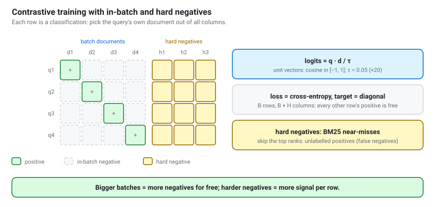
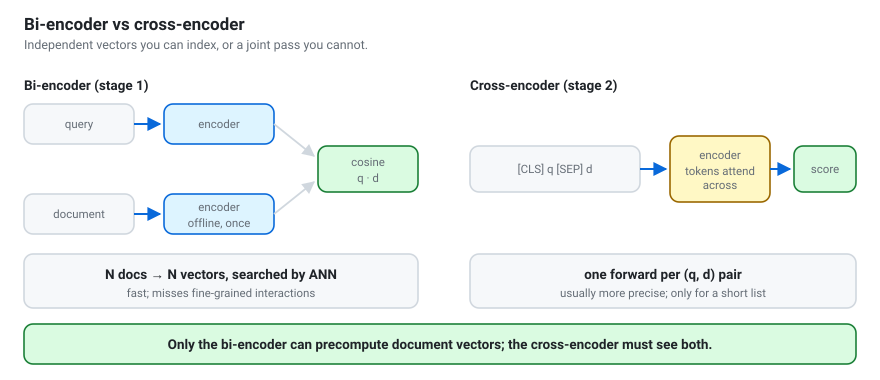

# Chapter 46 · Contrastive training & re-ranking

*Part III · Prerequisites: Chapters 23, 26, 45 · Estimated time: reading ~45 min, lab ~90 min · Compute: T4 GPU (runs on CPU with a reduced budget)*

 · [Lab: notebook.ipynb](notebook.ipynb) · [Solutions](solutions.md)

## Learning objectives

After this chapter you should be able to:

1. Write the InfoNCE loss with in-batch and hard negatives, and explain the role of the temperature and the batch size.
2. Fine-tune a bi-encoder on training queries and evaluate it on disjoint test queries, with a bootstrap confidence interval over queries.
3. Mine hard negatives with a first-stage retriever and explain false negatives and how to limit them.
4. Explain how a cross-encoder differs from a bi-encoder and why it can only re-rank a short list.
5. Build a quality-against-latency table for re-ranking depth and interpret it, including the case in which re-ranking hurts.
6. Reason quantitatively about a two-stage retrieval system: latency budgets, inference volume and cost.

## 46.1 Introduction

Chapter 45 found that a general-purpose embedding model was worse than BM25 at ranking scientific abstracts for scientific
claims. There are two standard remedies. The first adapts the **bi-encoder** to the domain by training it on in-domain
(query, relevant document) pairs with a **contrastive** loss. The second adds a **cross-encoder re-ranker**, a model that reads
query and document together and re-orders the top candidates of the first stage. Both are standard parts of production search
and retrieval-augmented generation systems, and both have costs that must be quantified: training data and re-indexing for the
first, inference volume and latency for the second.

The chapter derives the contrastive loss (Section 46.2), discusses training data and its traps (46.3) and hard negatives (46.4),
evaluates fine-tuning with confidence intervals (46.5), introduces cross-encoders (46.6), and ends with the two-stage trade-off
(46.7) and the use of search logs as training data (46.8).

**Data and budget.** The lab uses BEIR SciFact again. Training uses only queries from the qrels *train* split (809 queries) and
evaluation only the *test* split (300 queries); the two query sets are disjoint. They do share 181 relevant documents (claims about
the same paper), which is not leakage of test labels but one reason why in-domain training transfers. Because the corpus is embedded
three times, the CPU budget searches a **1,200-document sub-corpus** (every abstract relevant to a test query plus random others)
with documents cut at 128 tokens, trains on a subset of pairs for one epoch, and re-ranks for a subset of test queries. Fewer
distractors make every score higher than on the full corpus (Chapter 45): on this sub-corpus BM25 reaches nDCG@10 0.770 and the
base MiniLM 0.760. Comparisons are valid only within the chapter. The GPU budget (full corpus, all pairs, all test queries) was not
run in this course.

## 46.2 Contrastive learning and the InfoNCE loss

A bi-encoder should place a query's embedding closer to the embedding of its relevant document than to those of other documents.
Consider a batch of $B$ (query, positive document) pairs with unit-norm embeddings $\mathbf q_i$ and $\mathbf d_i$. For query $i$,
the positives of the *other* queries in the batch serve as negatives at no extra cost: these are **in-batch negatives**. Additional
**hard negatives** can be appended as further document rows $\mathbf d_{B+1}, \dots, \mathbf d_N$. The **InfoNCE** loss (van den Oord
et al., 2018) treats each query as an $N$-way classification problem whose correct class is its own positive:

$$
\mathcal{L} = -\frac{1}{B} \sum_{i=1}^{B} \log \frac{\exp(\mathbf q_i \cdot \mathbf d_i / \tau)}{\sum_{j=1}^{N} \exp(\mathbf q_i \cdot \mathbf d_j / \tau)} .
\qquad (46.1)
$$

Here $\mathbf q_i \cdot \mathbf d_j$ is a cosine similarity in $[-1, 1]$ and $\tau$ is the **temperature**. In matrix form, the loss is the
cross-entropy of the $B \times N$ similarity matrix divided by $\tau$, with targets $0, 1, \dots, B-1$, i.e. the diagonal of the first
$B$ columns.

*Figure 46.1 — The InfoNCE similarity matrix. Each row is a classification problem with one target (the diagonal); the other in-batch positives are free negatives, and appended columns hold hard negatives.*

**The temperature.** Without $\tau$ (that is, $\tau = 1$), logits confined to $[-1, 1]$ give a softmax too flat to learn from. A small $\tau$
sharpens it and concentrates the gradient on the negatives closest to the query. Consider two candidates with cosines 0.8 (positive) and
0.3 (negative). At $\tau = 1$ the logits are 0.8 and 0.3 and the loss is $\ln(1 + e^{-0.5}) = 0.47$: the model is still pushed. At $\tau =
0.05$ (the value used here, a "scale" of 20, as in the training of `all-MiniLM-L6-v2`) the logits are 16 and 6 and the loss is
$\ln(1 + e^{-10}) \approx 5\times10^{-5}$: this pair is solved, and the gradient goes to rows whose negatives are close. Too small a
temperature makes training unstable and punishes false negatives severely.

**The batch size.** With $N$ candidates, a model that guesses uniformly has loss

$$
\mathcal{L}_{\text{uniform}} = \ln N ,
\qquad (46.2)
$$

for example $\ln 32 = 3.47$ for a batch of 16 with 16 hard negatives. More candidates make each classification harder and the softmax
over the batch a better approximation of the softmax over the whole corpus. This is why contrastive training at scale uses batches of
thousands, together with memory-saving techniques such as GradCache (Gao et al., 2021). The same loss appears in contrastive learning for
images (Chen et al., 2020) and in the two-tower recommenders of Chapter 26.

## 46.3 Fine-tuning the bi-encoder

The training pairs are (claim, relevant abstract) for every judged pair in the train qrels; the abstracts come from the full corpus, and the
test queries are never seen. Training uses the course loop with AdamW at learning rate $2\times10^{-5}$, warm-up and cosine decay, gradient
clipping and, on a GPU, fp16 autocast.

**A trap of in-batch negatives.** If two queries in a batch share a positive document, that document is the answer for one query and, at the
same time, a "negative" for the other. Batches must therefore be built without repeated documents.

**Measured (CPU).** 320 pairs from 301 training queries, 20 batches of 16, 20 steps in 31–68 s. The logged loss fell from about 0.42 to about
0.17, far below $\ln 16 = 2.77$: the base model already separates most in-batch pairs, because random negatives are easy. Test nDCG@10 was 0.765
and Recall@100 0.983.

## 46.4 Hard negatives and false negatives

Random in-batch negatives are mostly easy, for example an abstract on astrophysics against a claim about T cells: the loss on them is already
near zero and they teach little. **Hard negatives** are documents that a retriever ranks highly but that are not labelled relevant. Mining them
with BM25 adds lexical near-misses, which a semantic model must learn to tell apart from true matches (Karpukhin et al., 2020; Xiong et al., 2021).

**False negatives.** "Not labelled relevant" does not mean "irrelevant". Relevance judgements are incomplete, and the documents a retriever ranks
*highest* are the ones most likely to be unlabelled positives. Training to push them away teaches the model the wrong thing. In the lab, for 15%
of training queries BM25's highest-ranked unlabelled document was a judged positive of some *other* claim, i.e. topically on target. Common
mitigations are:

* skip the top few ranks (`skip_top`; the lab skips three) or sample from a rank window (for example ranks 10–100);
* drop candidates that a cross-encoder scores as relevant ("denoised" hard negatives, as in RocketQA; Qu et al., 2021);
* use only one hard negative per query, and de-duplicate near-identical documents.

**Measured (CPU).** With one hard negative per query, each batch carried 16 extra documents, a step was slower (20 steps in 51–91 s), and the loss
was higher (about 0.89 falling to 0.48): hard negatives are indeed harder. Test nDCG@10 was 0.760 and Recall@100 0.977.

## 46.5 Did fine-tuning help? Confidence intervals over queries

Differences in a ranking metric must be compared with the variation across queries. The **paired bootstrap** resamples the $n$ test queries with
replacement $b$ times; in each resample it computes the mean difference between systems A and B,

$$
\Delta^{\star(b)} = \frac{1}{n} \sum_{i \in \text{sample } b} \big(m_A(i) - m_B(i)\big),
\qquad (46.3)
$$

and the 2.5th and 97.5th percentiles of the $\Delta^{\star}$ values form a 95% confidence interval (Efron & Tibshirani, 1993). If the interval
contains zero, the change is not established. The lab uses 2,000 resamples.

**Measured (CPU, 1,200-document sub-corpus).**

| System | nDCG@10 | Recall@100 | Δ nDCG@10 vs base (95% CI) |
|---|---|---|---|
| BM25 | 0.770 | 0.937 | +0.010 (−0.033 to +0.052) |
| Dense: base MiniLM | 0.760 | 0.980 | |
| Dense: in-batch fine-tuning | 0.765 | 0.983 | +0.006 (−0.004 to +0.016) |
| Dense: hard-negative fine-tuning | 0.760 | 0.977 | +0.000 (−0.011 to +0.012) |

On the CPU budget neither fine-tuning run measurably changed retrieval quality: every interval contains zero. Twenty steps on 320 pairs with a
small learning rate barely move a model pre-trained on about a billion pairs, and the sub-corpus leaves little room for improvement. This is the
expected outcome of so small a budget, not evidence that contrastive fine-tuning does not work. With the GPU budget one would expect a clearer
gain from in-domain fine-tuning, typically a few nDCG@10 points, with hard negatives adding a further point or two when false negatives are
controlled (not measured). Whatever the size of the gain, the workflow is the important part: train on training queries, measure on held-out
queries, and report an interval over queries.

## 46.6 Cross-encoder re-ranking

A **cross-encoder** passes `[CLS] query [SEP] document [SEP]` through one transformer and outputs a relevance score from the `[CLS]` position
(Nogueira & Cho, 2019). Query and document tokens attend to each other in every layer, so the model can compare them term by term in context.
This is usually more accurate than comparing two independent vectors, *provided the model was trained for the same notion of relevance*. But
nothing can be precomputed: scoring costs one forward pass **per (query, candidate) pair**. Scoring a corpus of $N$ documents would cost $N$ passes
per query, so a cross-encoder can only re-rank a short list produced by an inexpensive first stage.

*Figure 46.2 — Bi-encoder (left) and cross-encoder (right). The bi-encoder's document side can be computed offline; the cross-encoder needs a full forward pass for every (query, document) pair.*

**The experiment.** The first stage is RRF fusion of BM25 and the hard-negative bi-encoder, chosen in advance rather than by looking at test scores.
Its top 50 candidates are re-ranked to various depths with `cross-encoder/ms-marco-MiniLM-L-6-v2`, a public re-ranker trained on MS MARCO web search
questions (Nguyen et al., 2016).

**Measured (CPU, 30 test queries).** A pair took 24–41 ms on two threads. The first stage already had every relevant document in its top 50 (a ceiling
of 1.000).

| Re-ranking depth | nDCG@10 | ms per query |
|---|---|---|
| 0 (first stage only) | 0.840 | 0 |
| 10 | 0.773 | 250–640 |
| 20 | 0.768 | 480–850 |
| 50 | 0.757 | 1,230–1,910 |

**The re-ranker made the ranking worse**, and the deeper it re-ranked, the worse. With 30 queries each nDCG value has a standard error of several
points, but a separate check pointed in the same direction: re-ranking BM25's top 20 on the full corpus for 60 test queries, with 192 or 512 tokens,
also lowered nDCG@10 (0.764 → 0.727 and 0.743). The model was checked on the sanity pair from its model card (a relevant passage scored +8.8, an
irrelevant one −11.2), so this is not a bug. The likely explanation is a **mismatch in the notion of relevance**: the model was trained to judge
whether a web passage answers a search question, whereas SciFact pairs claims with abstracts that support **or refute** them. An off-the-shelf
re-ranker is a hypothesis to test on one's own judged queries, not a guaranteed gain; fine-tuning it on in-domain pairs (the training qrels, exactly
as in Section 46.3) is the usual remedy.

On a T4 one would expect a 50-candidate batch to be scored in a few tens of milliseconds with fp16, well under a millisecond per pair (not measured);
the quality question is unchanged and must be answered on all 300 test queries.

## 46.7 The two-stage trade-off

| | Bi-encoder (stage 1) | Cross-encoder (stage 2) |
|---|---|---|
| Input | query and document separately | the (query, document) pair together |
| Precomputation | all document vectors, offline | none |
| Cost per query | one encoder call plus ANN search (milliseconds), nearly independent of corpus size | depth × one forward pass |
| Quality | good recall, coarse ordering | best ordering of a short list, if trained in-domain |
| Cost of a new model version | re-embed the whole corpus | none for the corpus |

The re-ranking depth is the main control. For a re-ranker that helps, quality rises with depth only while the first stage still has relevant
documents to bring up (its Recall@depth is the ceiling), whereas latency rises linearly:

$$
\text{latency} \approx \frac{\text{depth} \times t_{\text{pair}}}{\text{parallelism}}, \qquad
\text{pair inferences per second} = \text{QPS} \times \text{depth} .
\qquad (46.4)
$$

**Worked example.** With a 100 ms p99 latency budget and about 1 ms per pair on a GPU, a 50-deep re-rank fits. At 1,000 queries per second it
requires 50,000 cross-encoder passes per second, so the re-ranker's GPU fleet, not the ANN index, dominates the cost of the system. Two common
responses are to re-rank less deeply under load, and to **distil** the cross-encoder into the bi-encoder by training the first stage on the second
stage's scores (Hofstätter et al., 2020), which recovers part of the quality without the latency.

## 46.8 Training data from search logs

Judged relevance data is expensive, so production systems often train retrievers on logs: (query, clicked document) pairs as positives, documents
shown but skipped (or random documents) as negatives, and dwell time or conversions as stronger signals. Logs carry the biases studied in Chapter 23:
**position bias** (top results receive clicks because they are on top), **presentation bias** (only documents the old system retrieved can be clicked,
a feedback loop), popularity bias, and false negatives (relevant documents never shown). Remedies include randomised exploration traffic,
inverse-propensity weighting (Joachims et al., 2017) and a separately judged evaluation set.

A fine-tuned bi-encoder is not deployable merely because offline nDCG improved. The whole corpus must be re-embedded and re-indexed (vectors from
different model versions are not comparable), queries and index must use the same version, latency and index size must be checked, every slice must
be verified for regressions, and new documents need a backfill plan and the system a rollback path, before an online A/B test decides.

## Key terms

| Term | Definition |
|---|---|
| Contrastive learning | Training that pulls matching pairs together and pushes non-matching pairs apart. |
| Positive pair | A query and a document known to be relevant to it. |
| In-batch negatives | The other queries' positives in the same batch, used as negatives. |
| Hard negative | A document ranked highly by a retriever but not labelled relevant. |
| False negative | A supposed negative that is actually relevant but was never judged. |
| InfoNCE | Cross-entropy over scaled similarities, with the true pair as target (Equation 46.1). |
| Temperature $\tau$ | The divisor of similarities before the softmax; small values sharpen it. |
| Paired bootstrap | Resampling test queries to obtain an interval for a metric difference (Equation 46.3). |
| Cross-encoder | A transformer that reads query and document together and outputs a relevance score. |
| Re-ranking depth | The number of first-stage candidates the re-ranker scores. |
| Domain mismatch | A difference between the notion of relevance a model was trained for and the one needed. |
| Distillation | Training an inexpensive model to imitate the scores of an expensive one. |
| Position / presentation bias | Clicks caused by rank, and clicks restricted to what was shown. |

## Summary

1. InfoNCE (Equation 46.1) trains a bi-encoder as an $N$-way classification over the batch; in-batch negatives are free, and hard negatives are appended as extra columns.
2. The temperature focuses learning on close negatives; larger batches approximate the full-corpus softmax better.
3. Batches must not repeat a document, or a positive becomes a negative.
4. Hard negatives mined with BM25 are informative but often contain false negatives (15% of mined candidates in the lab); skipping the top ranks or filtering with a cross-encoder limits the damage.
5. Fine-tuning must be evaluated on disjoint test queries with intervals over queries; on the CPU budget no fine-tuning effect was established.
6. A cross-encoder is accurate only for the notion of relevance it was trained on; the MS MARCO re-ranker lowered SciFact nDCG@10 (0.840 → 0.757 at depth 50 on 30 queries).
7. Re-ranking cost grows linearly with depth and query rate (Equation 46.4) and often dominates the cost of a two-stage system; distillation is the usual compromise.
8. Training data from logs carries position and presentation bias, and a new bi-encoder requires re-indexing the whole corpus before deployment.

## Exercises

The exercises are in the lab, [notebook.ipynb](notebook.ipynb); worked answers are in [solutions.md](solutions.md).

1. **`info_nce_loss`** (graded): the differentiable InfoNCE loss with $N \ge B$ documents.
2. **`mine_hard_negatives`** (graded): skip the top ranks and return the first $n$ non-positive ids in rank order.
3. **Fixing a RAG assistant's retrieval** (open-ended): decide between fine-tuning the bi-encoder on click logs, adding a cross-encoder and a hybrid
   first stage, with expected effects, costs, risks and offline and online evaluation.

The checkpoint questions cover the InfoNCE loss and temperature, hard and false negatives, why a cross-encoder cannot be a first stage and how to pick
the depth, what must happen before a better bi-encoder is deployed, training data from logs, and a latency budget for a two-stage system at 1,000
queries per second.

## Further reading

- A. van den Oord, Y. Li and O. Vinyals (2018). "Representation Learning with Contrastive Predictive Coding." arXiv:1807.03748.
- V. Karpukhin et al. (2020). "Dense Passage Retrieval for Open-Domain Question Answering." *EMNLP 2020.*
- L. Xiong et al. (2021). "Approximate Nearest Neighbor Negative Contrastive Learning for Dense Text Retrieval." *ICLR 2021.*
- Y. Qu et al. (2021). "RocketQA: An Optimized Training Approach to Dense Passage Retrieval for Open-Domain Question Answering." *NAACL 2021.*
- R. Nogueira and K. Cho (2019). "Passage Re-ranking with BERT." arXiv:1901.04085.
- S. Hofstätter, S. Althammer, M. Schröder, M. Sertkan and A. Hanbury (2020). "Improving Efficient Neural Ranking Models with Cross-Architecture Knowledge Distillation." arXiv:2010.02666.
- T. Joachims, A. Swaminathan and T. Schnabel (2017). "Unbiased Learning-to-Rank with Biased Feedback." *WSDM 2017.*
- B. Efron and R. J. Tibshirani (1993). *An Introduction to the Bootstrap.* Chapman & Hall.

**Next:** [Chapter 47 · Distributed data parallel](../ch47-distributed-data-parallel/README.md)
