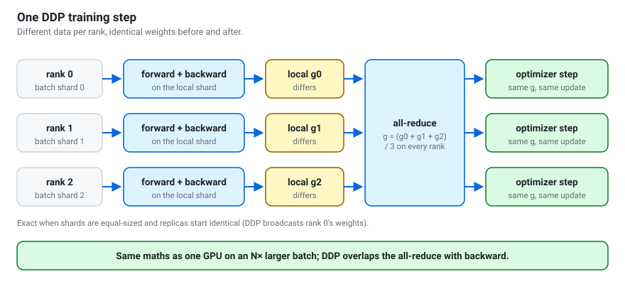
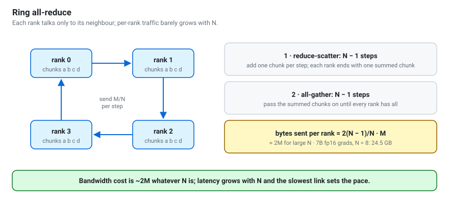

# Chapter 47 · Distributed data parallel

*Part III · Prerequisites: Chapters 27, 39, 40 · Estimated time: reading ~50 min, lab ~90 min · Compute: T4 GPU (runs on CPU with a reduced budget; the distributed parts use CPU processes either way)*

 · [Lab: notebook.ipynb](notebook.ipynb) · [Solutions](solutions.md)

## Learning objectives

After this chapter you should be able to:

1. Launch a multi-process job with `torchrun` and explain rank, local rank, world size, process group and backend.
2. Use the collective operations (`all_reduce`, `broadcast`, `all_gather`, `barrier`) and explain why every rank must call every collective in the same order.
3. Show that averaging gradients across ranks reproduces single-process training on the combined batch, and name the conditions under which the equivalence breaks.
4. Explain what `DistributedDataParallel` adds to a hand-written gradient average: broadcast, bucketing, overlap, `no_sync()`.
5. Shard data with `DistributedSampler`, and explain the `set_epoch` bug and the padding the sampler adds.
6. Log and checkpoint from rank 0 only, and recover from a failed rank by resuming from a checkpoint.
7. Derive the communication volume of a ring all-reduce, estimate scaling efficiency, and say when data parallelism stops scaling.

## 47.1 Introduction

Large models are trained on many GPUs. The most common way to use several GPUs is **data parallelism**: every GPU holds a full
copy of the model, processes a different part of each batch, and the gradients are averaged before every optimiser step. Typical
practical questions are "what does DDP actually do?", "why is my 8-GPU job only 5.5 times faster?" and "what happens when a node
fails?". They can be answered precisely with a small amount of mathematics and a small amount of code.

Free Colab offers one GPU, so the lab runs **several processes on one machine** with the `gloo` backend, which communicates CPU
tensors. The code is the code one would run on a cluster: on GPUs one changes the backend to `nccl`, assigns each process its own
device, and launches on more machines. **The chapter therefore separates three kinds of statements.** Correctness results (that
synchronised replicas agree with single-process training, that a resumed job reproduces an uninterrupted one) were *measured* with
real multi-process code on CPU. Communication timings were measured with gloo on one CPU machine and say nothing about GPU
interconnects. All multi-GPU speed figures are *arithmetic with stated assumptions*; none was measured in this course.

The chapter proceeds from the mechanics of processes and collectives (Sections 47.2–47.3) to the mathematics of gradient averaging
(47.4), a real training script and what DDP adds (47.5), data sharding (47.6), failures and restarts (47.7), and finally the cost of
communication and the limits of data parallelism (47.8–47.9).

## 47.2 Processes, ranks and the process group

Data parallelism uses **one process per GPU**. Every process runs the *same script*, and behaviour differs only through the process's
identity; this style is called SPMD (single program, multiple data). Each process

* has a **rank**, a number from 0 to world size − 1 that is unique across all machines, and a **local rank**, its index on its own
  machine, which selects its GPU (`torch.cuda.set_device(local_rank)`);
* joins a **process group** through `dist.init_process_group(backend)`. Joining is a *rendezvous* through a key-value store at
  `MASTER_ADDR:MASTER_PORT`; afterwards the processes can run collective operations.

The **backend** is the library that moves the bytes: **NCCL** for GPU tensors (using NVLink, PCIe or InfiniBand), **gloo** for CPU
tensors (TCP or shared memory), and rarely MPI. The launcher **`torchrun`** starts the processes and sets the environment variables
`RANK`, `LOCAL_RANK`, `WORLD_SIZE`, `MASTER_ADDR` and `MASTER_PORT`; the option `--standalone` means "a single machine, choose a free
port".

Collectives cannot be demonstrated from the notebook's process alone, so the lab writes small scripts to disk and launches them with
`torchrun`, an arrangement that also mirrors production practice.

## 47.3 Collective operations

A **collective** is an operation that every rank in the group must call. The four used here are:

| Collective | Effect | Lab example (4 ranks with values 1, 2, 3, 4) |
|---|---|---|
| `all_reduce` | every rank contributes a tensor; every rank receives the sum (or max, …) | sum 10, max on ranks 0–3 = 3 |
| `broadcast` | one rank's tensor is copied to all | `[0.0, 10.0, 20.0]` from rank 0 |
| `all_gather` | every rank receives every rank's tensor | `[0, 1, 4, 9]` (squares of the ranks) |
| `barrier` | every rank waits until all have arrived | rank 0 waited about 0.9 s, rank 3 almost nothing |

Two rules follow from the semantics.

**Every rank must call every collective, in the same order.** If one rank skips an `all_reduce`, for example because the call sits inside
`if rank == 0:`, the other ranks wait for it forever. This is a **hang**, the most common distributed bug, and it produces no error
message. Worse, the skipped call can be matched with a *different* later collective on the other ranks, corrupting both. Code that runs on
rank 0 only must therefore never contain a collective.

**Cost depends on message size.** A collective has a fixed cost per call (latency) and a cost per byte (bandwidth). Two measures are
customary: *algorithm bandwidth* (algbw), message bytes divided by time, and *bus bandwidth* (busbw), algbw multiplied by $2(N-1)/N$, the
traffic each link actually carried in a ring (Section 47.8); NVIDIA's `nccl-tests` report the same two numbers. In the lab's CPU
measurement with gloo, a 4 KB all-reduce took about 0.3 ms with two ranks and 3–5 ms with four, and a 16 MB all-reduce about 12 ms and 21 ms
(bus bandwidth about 1.2 GB/s; these numbers vary with machine load). Small messages are pure latency, which grows with the number of ranks;
large ones approach a bandwidth limit. On real GPU systems NCCL over NVLink moves hundreds of GB/s, and over PCIe or Ethernet 10–50 GB/s
(datasheet figures, used as assumptions in Section 47.8; not measured).

## 47.4 Data parallelism is gradient averaging

Let a global batch of $B$ examples be split into $N$ equal shards of $b = B/N$ examples, one per rank, and let the loss be a mean over
examples. Rank $r$ computes the gradient of its own mean loss, $g_r = \nabla_\theta \frac{1}{b}\sum_{j \in \text{shard } r} \ell_j$. Then

$$
g = \nabla_\theta \frac{1}{B} \sum_{j=1}^{B} \ell_j = \frac{1}{N} \sum_{r=1}^{N} g_r .
\tag{47.1}
$$

If the gradients are **summed by an all-reduce and divided by $N$**, every rank holds exactly the full-batch gradient, applies the same
optimiser step to the same weights, and the replicas remain identical. That is the whole of data parallelism: the same mathematics, on more
hardware. For example, shards with gradients 0.2 and 0.4 give 0.3 on both ranks, which is what one process obtains on the concatenated batch.

*Figure 47.1 — One data-parallel step. Ranks differ before the all-reduce (different data, different gradients) and are identical after it.*

**Conditions for exactness.** Equation (47.1) assumes:

* **equal shard sizes** — with unequal shards the "average of averages" is not the global average (the lab's uneven split of 8 and 24
  examples gave a gradient difference of 6.3e-02, against about $10^{-8}$ for equal shards); `DistributedSampler` pads the data to guarantee
  equality (Section 47.6);
* **identical initial replicas** — DDP **broadcasts rank 0's weights** when it wraps the model;
* **a loss that is a mean over independent examples** — **BatchNorm** breaks this, because each rank computes statistics on its own shard
  (`SyncBatchNorm` restores the equivalence at a communication cost), as do per-token losses normalised per rank by a variable token count.

Random augmentation or dropout with different masks per rank is statistically harmless but means the result is not bit-identical to a
single-process run. The larger global batch itself is a change of the training recipe (Section 47.9).

## 47.5 A real data-parallel script, and what DDP adds

The lab's training script trains a small classifier on synthetic data with two processes, in three modes:

* `none` — no communication; each rank trains its own replica on its own shard. The replicas *diverge*: this is what happens when
  synchronisation is forgotten.
* `manual` — broadcast rank 0's initial weights, then after every `backward()` all-reduce each gradient and divide by the world size: DDP
  written by hand.
* `ddp` — wrap the model in `torch.nn.parallel.DistributedDataParallel`.

Each rank deliberately initialises its replica with a different seed, so that the broadcast is visibly necessary. The script also follows
production habits: `DistributedSampler` with `set_epoch`, **logging on rank 0 only**, a **checkpoint written by rank 0** at the end of every
epoch followed by a `barrier()`, a global loss computed with `all_reduce`, and resumption from the checkpoint. On a GPU cluster one changes
`"gloo"` to `"nccl"`, calls `torch.cuda.set_device(local_rank)`, moves model and batches to that device, and passes `device_ids=[local_rank]`
to DDP; nothing else changes.

**Measured (CPU, 2 ranks, 48 SGD steps).** The loss fell over three epochs (1.32 → 1.04 → 0.84). Comparing final parameters:

| Mode | Rank 0 against rank 1 | Against single-process training on the combined batch |
|---|---|---|
| `none` | about 0.6 (replicas diverged) | about 0.07 |
| `manual` | 0.0 (identical) | about 6e-08 |
| `ddp` | 0.0 (identical) | about 6e-08 |

The synchronised replicas are bit-identical with each other, since every rank applies the same averaged gradient to the same weights, and
agree with single-process training up to floating-point rounding from a different summation order.

**What DDP adds** to the manual loop is engineering (Li et al., 2020):

* **Gradient buckets.** Gradients are grouped into buckets of about 25 MB (`bucket_cap_mb`). Autograd hooks mark each gradient as ready; when
  a bucket is complete, DDP launches an asynchronous all-reduce for it while backward continues with earlier layers. Communication thus
  **overlaps** computation, and there is one large all-reduce per bucket instead of one small one per tensor.
* **`no_sync()`** suppresses the all-reduce for gradient accumulation (Chapter 40): only the last micro-batch of each optimiser step is
  synchronised.
* **Checks**, for example that every parameter received a gradient (`find_unused_parameters`).

## 47.6 Sharding the data: `DistributedSampler`

`DistributedSampler` gives each rank a disjoint slice of a shuffled index list. The shuffle uses a generator seeded with `seed + epoch`, where
the epoch is whatever was last passed to `sampler.set_epoch(epoch)`. Indices are then padded, by repeating indices from the start of the list,
to a multiple of the world size, and rank $r$ receives every $N$-th index starting at $r$.

**The `set_epoch` bug.** If `set_epoch` is never called, every epoch uses the same order. Nothing fails; training is simply worse, because the
same mini-batches appear in the same order every epoch. It is one of the most common DDP bugs precisely because it produces no error. The lab
shows identical orders across epochs without the call, and different ones with it, while the two ranks never share an index within an epoch.

**Padding.** With 10 examples on 4 ranks, the ranks receive `[0, 4, 8]`, `[1, 5, 9]`, `[2, 6, 0]` and `[3, 7, 1]`: indices 0 and 1 are used twice.
The padding ensures that every rank runs the same number of steps; otherwise ranks with fewer batches would stop calling all-reduce and the
others would hang. For training a few duplicates are harmless. For **evaluation** they bias the metric: either gather predictions together
with their indices and remove duplicates, evaluate on one rank for small sets, or use `drop_last=True`, which drops the tail instead.

## 47.7 Failures, checkpoints and restarts

A job on a thousand GPUs fails often: a GPU drops off the bus, a node reboots, a network link fails. Failure handling is therefore part of
the design.

* **A rank crashes** (exception, out-of-memory, killed). Its process exits with an error, and the other ranks block in their next collective.
  `torchrun`'s agent detects the dead worker, **terminates the remaining workers**, and exits with a report naming the failed rank, its exit
  code and traceback.
* **A rank hangs** (deadlock, a skipped collective, a dead link). No process exits; the others wait in the collective until the process
  group's **timeout** expires (`timeout=` in `init_process_group`; NCCL's watchdog then aborts). The timeout should be set deliberately, and
  heartbeats or step-time alarms should be logged, because a silent hang wastes the whole cluster's time. `py-spy dump` on each rank shows
  where each process is waiting.
* **Recovery** is a restart from the last checkpoint. `torchrun --max-restarts=k` restarts all workers in place up to $k$ times; *elastic*
  launches (`--nnodes=MIN:MAX` with a rendezvous backend) can continue with fewer or more nodes. In every case the **script** must resume:
  load the latest checkpoint with model, optimiser and scheduler state, epoch or step, and sampler position. A resumable script must not
  assume the world size it was started with, since data must be re-sharded and the global batch changes unless accumulation is adapted.

Checkpoints must be written by **one rank**, to a temporary file that is then renamed (an atomic operation), followed by a `barrier()`;
several ranks writing one file, or a crash in the middle of writing, corrupts it.

**Measured (CPU).** The lab's script raises an error on rank 1 at the start of epoch 1. Rank 1 reported the simulated failure, rank 0 reported
`Connection closed by peer` (it was blocked in DDP's all-reduce when its partner vanished), `torchrun` reported a `ChildFailedError` with the
failed rank, and the job exited with code 1, leaving the epoch-0 checkpoint on disk. Nothing hung: the dead peer closed its sockets and the
agent terminated the survivors. Relaunching the same command (playing the role of a scheduler such as a Slurm requeue or a Kubernetes job
controller), the script resumed at epoch 1, produced the same losses as the uninterrupted run (1.0427 and 0.8400), and ended with a parameter
difference of **0.0** from it. Resuming at an epoch boundary with model state, optimiser state and `set_epoch` reproduces the uninterrupted
trajectory exactly; resuming mid-epoch also requires the step within the epoch and the random-number-generator states, which is why large jobs
checkpoint by step. In the course's CPU runs, in-place restarts with `--max-restarts` and gloo were unreliable (restarted workers sometimes failed
to reconnect), so the lab relaunches explicitly. How often to checkpoint is an optimisation problem treated in Chapter 48.

## 47.8 The cost of communication: ring all-reduce

The standard algorithm for all-reducing large messages is the **ring all-reduce** (Patarasuk & Yuan, 2009). The $N$ ranks form a ring and the
message of $M$ bytes is divided into $N$ chunks. In the **reduce-scatter** phase, during $N-1$ steps, each rank sends one chunk to its neighbour
and adds the chunk it receives; afterwards each rank holds the complete sum of one chunk. In the **all-gather** phase, during another $N-1$ steps,
the completed chunks travel around the ring until every rank has all of them. Each step sends $M/N$ bytes per rank, so

$$
\text{bytes sent per rank} = 2\,\frac{N - 1}{N}\, M .
\tag{47.2}
$$

*Figure 47.2 — Ring all-reduce. Each rank talks only to its neighbour; the bytes each rank sends approach $2M$ and stop growing with $N$, while the number of steps, and hence the latency, grows.*

**Worked example.** The fp16 gradients of a 7B model occupy $M = 14$ GB. On 8 GPUs each rank sends $2 \cdot \tfrac78 \cdot 14 = 24.5$ GB per step;
on 1,000 GPUs still under 28 GB. Per-GPU traffic is nearly independent of $N$. The time of an all-reduce with link bandwidth BW and per-hop
latency $\alpha$ is approximately

$$
T_{\text{comm}} \approx 2\,\frac{N-1}{N}\,\frac{M}{\text{BW}} + 2(N-1)\,\alpha ,
\tag{47.3}
$$

a bandwidth term that barely depends on $N$ and a latency term that grows with it. A ring also proceeds at the pace of its slowest link: one slow
node slows every step for everyone (the **straggler** problem). In the lab's exercise, the bytes each rank sends in a ring (Exercise 1) are computed
directly from Equation (47.2).

## 47.9 When does data parallelism stop scaling?

Per step, each GPU computes forward and backward on its shard in time $T_{\text{compute}}$ (constant if the per-GPU batch is fixed) and then
all-reduces the gradients. If a fraction $o$ of the communication is hidden behind backward, the **scaling efficiency** is

$$
E = \frac{T_{\text{compute}}}{T_{\text{step}}}, \qquad T_{\text{step}} \approx T_{\text{compute}} + (1 - o)\, T_{\text{comm}} .
\tag{47.4}
$$

**Worked example (assumptions, not measurements).** fp16 gradients (2 bytes per parameter), 8 GPUs, an assumed compute time of 250 ms per step,
and datasheet link bandwidths: A100 NVLink about 300 GB/s per direction, PCIe 4.0 ×16 about 25 GB/s achievable, 100 Gb/s Ethernet 12.5 GB/s. For a
1.5B model (3 GB of gradients) over PCIe, Equation (47.3) gives $2 \cdot \tfrac78 \cdot 3/25 \approx 0.21$ s, and with half of it overlapped,
$E = 250/355 \approx 0.70$. The lab's table, computed under these assumptions, shows ResNet-50 and BERT-base scaling almost perfectly on all three links
(51 MB and 220 MB of gradients are small next to 250 ms of compute); a 1.5B model at 97% on NVLink, about 70% over PCIe and about 54% over Ethernet;
and a 7B model at 34% even over PCIe, its 14 GB of gradients taking about a second per step. Data parallelism *alone* stops scaling for such models,
and their training state does not fit on one GPU anyway (Chapter 48).

**What improves scaling**, roughly in order of effectiveness:

1. **More computation per byte communicated**: a larger per-GPU batch, or gradient accumulation with `no_sync()`, which all-reduces once per $k$
   micro-batches.
2. **Overlap**: DDP's buckets; tune `bucket_cap_mb`.
3. **Smaller gradients**: fp16 or bf16 gradients, communication hooks, compression such as PowerSGD (Vogels et al., 2019).
4. **Faster links**: keep data-parallel groups inside an NVLink node and cross nodes over InfiniBand.
5. **Different parallelism** for large models: ZeRO/FSDP, tensor and pipeline parallelism (Chapter 48).

**The global batch.** With $N$ GPUs, per-GPU batch $b$ and $k$ accumulation steps,

$$
B_{\text{global}} = N \cdot b \cdot k .
\tag{47.5}
$$

Eight GPUs with 64 examples each and 8 accumulation steps give 4,096. Moving from 1 to 8 GPUs at fixed per-GPU batch multiplies the global batch by
8 and divides the number of optimiser steps per epoch by 8, so a recipe tuned for one GPU usually needs a new learning rate (for SGD, the linear scaling
rule with warm-up; Goyal et al., 2017), possibly more epochs, and, for very large batches, layer-wise adaptive optimisers such as LAMB. Beyond a
problem-dependent *critical batch size* (McCandlish et al., 2018), larger batches stop reducing the number of steps needed, so more GPUs no longer shorten
training.

## Key terms

| Term | Definition |
|---|---|
| Data parallelism | Each device holds a full model replica and processes a different shard of each batch; gradients are averaged. |
| Rank / world size | A process's unique number / the number of processes in the job. |
| Local rank | A process's index on its machine; selects its GPU. |
| Process group, backend | The set of communicating processes / the library that moves bytes (NCCL, gloo). |
| SPMD | Single program, multiple data: all ranks run the same script. |
| Collective | An operation every rank must call in the same order (`all_reduce`, `broadcast`, `all_gather`, `barrier`). |
| Ring all-reduce | Reduce-scatter followed by all-gather around a ring; $2(N-1)/N \cdot M$ bytes per rank (Equation 47.2). |
| algbw / busbw | Message bytes per second / bytes per second actually carried per link. |
| DDP | `DistributedDataParallel`: broadcast at construction, bucketed gradient all-reduce overlapped with backward. |
| Gradient bucket | A group of gradients all-reduced together as soon as all are ready. |
| `DistributedSampler` | Shuffles with `seed + epoch`, pads, and gives each rank a disjoint slice. |
| `torchrun` | The launcher that starts one process per device and sets rank variables; supports restarts and elastic jobs. |
| Hang | Ranks blocked indefinitely in a collective that some rank never reached. |
| Straggler | A slow rank or link that every other rank must wait for. |
| Scaling efficiency | $T_{\text{compute}}/T_{\text{step}}$ (Equation 47.4). |
| Global batch | $N \cdot b \cdot k$ examples per optimiser step (Equation 47.5). |

## Summary

1. Data parallelism runs one process per device; all ranks execute the same script and join a process group through a rendezvous.
2. Every rank must call every collective in the same order; a collective inside rank-0-only code causes a hang.
3. Averaging equal-shard gradients reproduces single-process training on the combined batch (Equation 47.1); in the lab, synchronised replicas were bit-identical and within about 6e-08 of single-process training.
4. DDP adds an initial broadcast, bucketed all-reduce overlapped with backward, and `no_sync()` for accumulation.
5. `DistributedSampler` must be told the epoch, and its padding duplicates examples, which matters for evaluation.
6. Crashes terminate the job with a report; hangs must be caught with timeouts and heartbeats; recovery is a relaunch that resumes from a rank-0 checkpoint, which in the lab reproduced the uninterrupted run exactly.
7. A ring all-reduce sends $2(N-1)/N$ times the gradient size per rank, nearly independent of $N$, but latency and stragglers grow with $N$.
8. By arithmetic with stated assumptions, data parallelism scales well for models of up to about a billion parameters on fast links and poorly for multi-billion-parameter models; larger global batches also change the training recipe.

## Exercises

The exercises are in the lab, [notebook.ipynb](notebook.ipynb); worked answers are in [solutions.md](solutions.md).

1. **`ring_allreduce_bytes`** (graded): bytes each rank sends in a ring all-reduce.
2. **`average_gradients`** (graded): a pure-tensor simulation of all-reduce and division by the world size.
3. **`shard_indices`** (graded): reproduce `DistributedSampler`'s shuffling, padding and striding.
4. **Diagnosing a 5.5× speed-up on 8 GPUs** (open-ended): causes and measurements of the lost speed-up, why the metric worsened after the same number
   of epochs, and what goes wrong with an all-reduce inside rank-0-only evaluation.

The checkpoint questions cover one DDP step in detail, the equivalence with single-GPU training and what breaks it, the ring all-reduce volume and the
limits of scaling, `DistributedSampler`, crashes and hangs in a 512-GPU job, and reaching a global batch of 4,096 on 8 GPUs.

## Further reading

- S. Li et al. (2020). "PyTorch Distributed: Experiences on Accelerating Data Parallel Training." *Proceedings of the VLDB Endowment* 13(12).
- P. Patarasuk and X. Yuan (2009). "Bandwidth Optimal All-reduce Algorithms for Clusters of Workstations." *Journal of Parallel and Distributed Computing* 69(2).
- A. Sergeev and M. Del Balso (2018). "Horovod: fast and easy distributed deep learning in TensorFlow." arXiv:1802.05799.
- P. Goyal et al. (2017). "Accurate, Large Minibatch SGD: Training ImageNet in 1 Hour." arXiv:1706.02677.
- S. McCandlish, J. Kaplan, D. Amodei and the OpenAI Dota Team (2018). "An Empirical Model of Large-Batch Training." arXiv:1812.06162.
- T. Vogels, S. P. Karimireddy and M. Jaggi (2019). "PowerSGD: Practical Low-Rank Gradient Compression for Distributed Optimization." *NeurIPS 2019.*
- PyTorch documentation: "Distributed Data Parallel" (design notes), `torch.distributed`, and "torchrun (Elastic Launch)".

**Next:** [Chapter 48 · Scaling to large models](../ch48-scaling-to-large-models/README.md)
