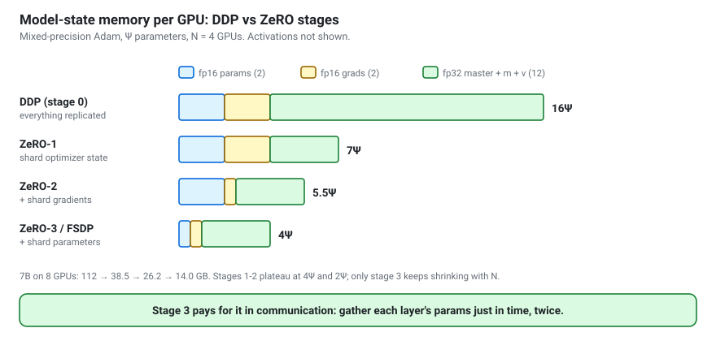
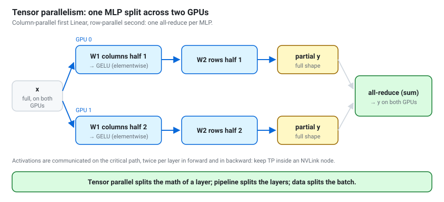
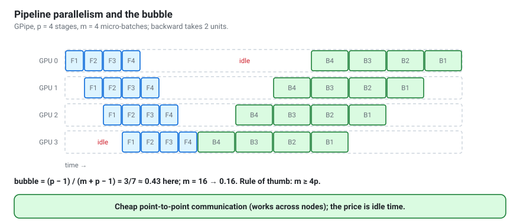
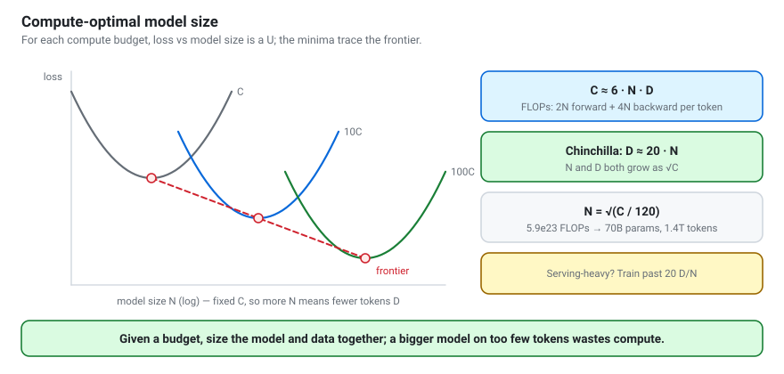
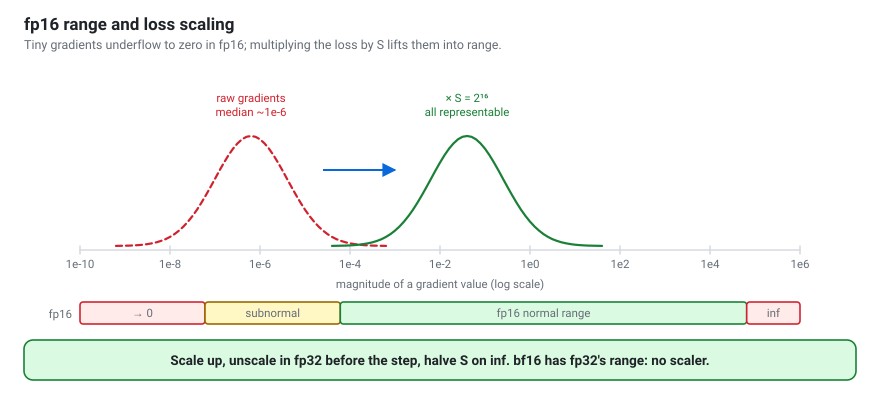

# Chapter 48 · Scaling to large models

*Part III · Prerequisites: Chapters 39, 40, 41, 47 · Estimated time: reading ~60 min, lab ~90 min · Compute: CPU (everything here is arithmetic, simulation and small CPU demos; a T4 runtime also works)*

 · [Lab: notebook.ipynb](notebook.ipynb) · [Solutions](solutions.md)

## Learning objectives

After this chapter you should be able to:

1. Compute model-state memory per GPU under data parallelism and ZeRO stages 1, 2 and 3 (FSDP), and explain what each stage costs in communication.
2. Explain tensor parallelism by splitting a linear layer and a transformer MLP across devices, and state where in a cluster it belongs.
3. Derive the pipeline bubble fraction and explain how micro-batches and schedules reduce it.
4. Budget a training run: FLOPs ≈ $6ND$, wall-clock time and GPU-days at a stated model FLOPs utilisation.
5. Use published scaling laws to size a compute-optimal model, and explain why production models are often trained past that point.
6. Choose a checkpoint interval from the failure rate with Young's formula, and name the measures that reduce the remaining waste.
7. Explain fp16 overflow and underflow, loss scaling, and why bf16 does not need loss scaling.

## 48.1 Introduction

Data parallelism (Chapter 47) assumes that a full copy of the model, its gradients and its optimiser state fits on every GPU. For a
7-billion-parameter model trained with Adam in mixed precision, that state is 112 GB, more than any single GPU holds, before a single
activation is stored. Training such a model requires dividing the work in other ways: sharding the training state across GPUs,
splitting individual layers, or assigning groups of layers to different devices. Planning a run also requires estimating how much
computation it needs, how large the model should be for a given budget, and how the run will cope with hardware failures over weeks.

This chapter treats these questions mainly with **arithmetic and simulation**, plus small demonstrations on CPU processes. No multi-GPU
measurement was made in this course: every number about clusters below is a calculation from stated assumptions (datasheet peak
throughputs, assumed utilisation and failure rates) or a figure reported in a cited paper. Measured results are limited to CPU
demonstrations of correctness: an FSDP training step on two processes, a tensor-parallel MLP on two simulated devices, a FLOP count, and a
numerical study of fp16 gradients.

The sections follow the decisions of a training plan: memory and sharding (48.2), splitting layers (48.3) and stages (48.4), combining
the three (48.5), compute budgets (48.6), model size (48.7), failures (48.8) and numerical precision (48.9).

## 48.2 Memory per GPU: data parallelism and ZeRO

The standard accounting for **mixed-precision Adam** (Rajbhandari et al., 2020), with $\Psi$ parameters, is:

| State | Bytes per parameter |
|---|---|
| fp16/bf16 parameters (used in forward and backward) | 2 |
| fp16/bf16 gradients | 2 |
| fp32 master weights and Adam's two fp32 moments (the optimiser state, "K") | 4 + 4 + 4 = 12 |
| **Total** | **16** |

Chapter 40 counted the PyTorch-autocast way (fp32 weights and gradients plus a cached fp16 copy, 18 bytes per parameter); the ZeRO stages are
defined on the 16-byte accounting, which is used here. Activations come on top.

Plain data parallelism (DDP) replicates all $16\Psi$ bytes on every GPU. The **Zero Redundancy Optimizer** (ZeRO) removes the redundancy by
partitioning the replicated state across the $N$ data-parallel GPUs, one category at a time:

$$
M_{\text{DDP}} = 16\Psi, \qquad M_{\text{Z1}} = 4\Psi + \frac{12\Psi}{N}, \qquad M_{\text{Z2}} = 2\Psi + \frac{14\Psi}{N}, \qquad M_{\text{Z3}} = \frac{16\Psi}{N} .
\qquad (48.1)
$$

Stage 1 shards the optimiser state, stage 2 also the gradients, stage 3 also the parameters. PyTorch's `FullyShardedDataParallel` (FSDP, and
FSDP2's `fully_shard`; Zhao et al., 2023) implements stage 3, and with `SHARD_GRAD_OP` stage 2; DeepSpeed implements all three.

*Figure 48.1 — Model-state bytes per parameter on each of 4 GPUs under DDP and ZeRO stages 1–3. The optimiser state is the largest block, so stage 1 alone removes most of the memory.*

**Worked example (arithmetic).** For a 7B model, DDP needs 112 GB per GPU at any GPU count. On 8 GPUs, ZeRO-1 needs 38.5 GB, ZeRO-2 26.25 GB and
ZeRO-3 14.0 GB; on 64 GPUs ZeRO-3 needs 1.75 GB. ZeRO-1 and ZeRO-2 approach a floor of $4\Psi$ and $2\Psi$ (28 and 14 GB for 7B) however many GPUs are
added, because the replicated fp16 parameters (and, for stage 1, gradients) remain. Only stage 3 keeps shrinking.

**What stage 3 costs.** With sharded parameters, every layer's full weights must be **all-gathered** just before they are used, in the forward
pass and again in the backward pass, and the gradients are reduce-scattered afterwards. The communication volume is about 1.5 times that of DDP,
spread over many smaller, latency-sensitive collectives, and the implementation must prefetch the next layer's parameters to hide the delay.
Stages 1 and 2 communicate the same volume as DDP (a reduce-scatter plus an all-gather is an all-reduce).

**Measured (CPU, 2 gloo processes).** The lab shards a small `TinyGPT` with `fully_shard` (one unit per transformer block, plus the root) and takes
three AdamW steps. The model has 118,528 parameters and rank 0 holds 59,264 of them (50%); its AdamW state is twice its *shard*, not twice the model.
The FSDP losses matched single-process training on the full batch to 1.1e-05 on losses near 5.55 (a relative difference of $2\times10^{-6}$; Adam's
division by $\sqrt{v}$ magnifies rounding differences in tiny gradients). Sharding changes *where* the state lives, not the mathematics.

## 48.3 Tensor parallelism: splitting a layer

ZeRO shards *storage*, but each layer is still computed on one GPU with its full, temporarily gathered weights. **Tensor parallelism** (Megatron-LM;
Shoeybi et al., 2019) splits the *computation* of each layer across devices. For a linear layer $y = xW^\top$ with $W$ of shape (out, in):

$$
\text{column-parallel: } y = \big[\, x W_1^\top,\; x W_2^\top \,\big] \;(\text{all-gather}), \qquad
\text{row-parallel: } y = x_1 W_1^\top + x_2 W_2^\top \;(\text{all-reduce}) .
\qquad (48.2)
$$

In the column-parallel form each device holds some of $W$'s output rows and computes a slice of $y$'s features from the full input. In the row-parallel
form each device holds some input columns, receives the matching slice of $x$, and computes a *partial sum* of the whole output; the partial sums are
added by an all-reduce.

A transformer MLP combines the two: the first linear layer is column-parallel and the second row-parallel. The GELU between them acts on each feature
separately, so each device applies it to its own slice without communication, and the only exchange is **one all-reduce of the output** per MLP. The
attention block is split by heads in the same way.

*Figure 48.2 — A tensor-parallel MLP on two GPUs. The GELU sits between the halves without communication; the only exchange is the final sum.*

**Measured (CPU, two simulated devices).** Column-parallel shards of shape (10, 128) concatenated to (10, 256) and matched the unsplit layer exactly (each
output is the same dot product); row-parallel partial sums of shape (10, 64) added up to the unsplit output up to rounding (2.7e-07, since the sum is split
in two); and the two-device MLP matched the unsplit MLP to 2.7e-07 with half the weights per device.

**Where it belongs.** Tensor parallelism all-reduces activations of size batch × sequence × hidden twice per layer in the forward pass and twice in the
backward pass, and this communication lies on the critical path: unlike DDP's gradient all-reduce, it cannot overlap with other work. It therefore needs
NVLink-class bandwidth and is kept **inside a node**, typically 2–8 GPUs. Sequence and context parallelism split the sequence dimension in a similar
spirit.

## 48.4 Pipeline parallelism and the bubble

**Pipeline parallelism** assigns consecutive groups of layers ("stages") to different devices. A batch is divided into $m$ micro-batches; stage $s$
works on micro-batch $i$ while stage $s+1$ works on micro-batch $i-1$. At the beginning and end of each batch some stages have nothing to do: this idle
time is the **bubble**. With $p$ stages, the schedule of one pass takes $m + p - 1$ time slots while each stage is busy in $m$ of them, so

$$
\text{bubble fraction} = \frac{p - 1}{m + p - 1} .
\qquad (48.3)
$$

The same fraction holds for GPipe (Huang et al., 2019), which runs all forward passes and then all backward passes, and for the 1F1B schedule, which
interleaves them and stores fewer activations.

*Figure 48.3 — A GPipe schedule for 4 stages and 4 micro-batches. The idle triangles have a fixed size; more micro-batches lengthen the busy part, so the bubble's share falls.*

**Measured (simulation).** For $p = m = 4$ the simulated schedule and Equation (48.3) both give 0.429 (3/7: almost half of the time idle); with $m = 16$ the
bubble falls to 0.158. A rule of thumb is $m \ge 4p$, which keeps the bubble under about 20%. More micro-batches require either a larger global batch or
smaller micro-batches, which use the GPU less efficiently, and every micro-batch in flight must keep its activations until its backward pass; 1F1B limits
this. *Interleaved* schedules, in which each device holds several non-consecutive stages, reduce the bubble further at the cost of more communication.

Communication between stages is only the activations at stage boundaries, sent point-to-point, so pipelines work well **across** nodes. Their costs are the
bubble and the complexity of micro-batch scheduling.

## 48.5 Combining the three: 3D parallelism

The three forms of parallelism split different things and have different communication patterns:

| | What is split | What is communicated | Where it belongs |
|---|---|---|---|
| Data (with ZeRO) | the batch (and the training state) | gradients once per step, overlappable; parameters per layer for ZeRO-3 | across nodes |
| Tensor | each layer's matrices | activations, twice per layer per pass, on the critical path | inside an NVLink node |
| Pipeline | the sequence of layers | activations at stage boundaries, point-to-point | across nodes |

Large runs combine them (Narayanan et al., 2021): tensor parallelism inside a node (for example 8-way), pipeline parallelism across a few nodes, and data
parallelism, often with ZeRO-1 or FSDP, across the resulting replicas. The total number of GPUs is the product TP × PP × DP. For a 13B model on 80 GB GPUs,
for example, sharding within each 8-GPU node and replicating across nodes (hybrid sharding), or 8-way tensor parallelism with ZeRO-1 across nodes, is usually
sufficient; pipeline parallelism becomes necessary for considerably larger models.

## 48.6 Compute budgets: FLOPs ≈ 6ND

Training a dense transformer with $N$ parameters on $D$ tokens costs approximately

$$
C \approx 6\,N D \ \text{FLOPs}, \qquad t \approx \frac{C}{n_{\text{GPU}} \cdot P_{\text{peak}} \cdot \text{MFU}}
\qquad (48.4)
$$

(Kaplan et al., 2020). The factor 6 has a simple origin. Every training token visits every weight three times: in the forward pass (activation × weight), and
in the backward pass once for the activation gradient and once for the weight gradient. Each visit is a multiply and an add, so $3 \times 2 = 6$ FLOPs per
parameter per token (Chapter 39 derived the 2 FLOPs per multiply-add). Attention over the context adds a term proportional to layers × context × width, which
is a few percent for large models.

**Measured (CPU).** For the 929,536-parameter `TinyGPT`, PyTorch's FLOP counter reported 3.01e9 FLOPs for a training step on 512 tokens: **6.33** FLOPs per token
per parameter. Kaplan's formula with the attention term predicts 6.42; the counter also counts the masked-out attention entries, and the embedding lookup costs no
FLOPs.

**Time.** In Equation (48.4), $P_{\text{peak}}$ is the GPU's peak throughput and the **model FLOPs utilisation** (MFU; Chowdhery et al., 2022) is the fraction of
it the run achieves: useful model FLOPs per second divided by peak. Well-tuned large-model training reaches roughly 30–50% MFU; small models, small batches and slow
interconnects reach much less.

**Worked examples (arithmetic; assumptions stated).** Peak dense throughput from NVIDIA datasheets (A100: 312 TFLOP/s in bf16/fp16; T4: 65 TFLOP/s in fp16), an
assumed MFU of 40% on A100 clusters and 25% for a single T4, and model and token counts from the cited papers:

| Run | FLOPs | Hardware (assumed) | Wall-clock time |
|---|---|---|---|
| GPT-3 size (175B, 300B tokens) | 3.15e23 (the paper reports 3.14e23) | 1,024 A100s, 40% MFU | about 29 days (a what-if; GPT-3 was trained on V100s) |
| Chinchilla (70B, 1.4T tokens) | 5.9e23 | 1,024 A100s, 40% MFU | about 53 days |
| 7B on 1T tokens | 4.2e22 | 256 A100s, 40% MFU | about 15 days (about 3,900 GPU-days) |
| 125M on 2.5B tokens | 1.9e18 | one T4, 25% MFU | about 1.3 days |

For the 7B case: $4.2\times10^{22} / (256 \cdot 312\times10^{12} \cdot 0.4) \approx 1.3\times10^6$ s, about 15 days. Multiplying GPU-days by an hourly price gives a cost.
The most uncertain input is usually the MFU, which can be 25% or 55% depending on parallelism, sequence length and kernels, followed by downtime from failures.

## 48.7 Scaling laws: how large a model for a given budget?

Empirical scaling laws describe how the loss of language models falls with model size, data and compute. They are published empirical results, valid in the ranges
studied, and should be cited as such rather than extrapolated without care.

* **Kaplan et al. (2020)** found that test loss falls as a power law in parameters $N$, data $D$ and compute $C$ over many orders of magnitude, with small exponents
  (about 0.076 for $N$ and 0.095 for $D$). Their compute-optimal recipe grew the model much faster than the data.
* **Hoffmann et al. (2022)** ("Chinchilla"), with learning-rate schedules matched to each run's length, found that compute-optimal $N$ and $D$ grow in **equal
  proportion**, each roughly as $C^{0.5}$, at about **20 tokens per parameter**. Chinchilla (70B parameters, 1.4T tokens) outperformed Gopher (280B parameters, 300B
  tokens), trained with about the same compute.

Combining $C = 6ND$ with $D = 20N$ gives the compute-optimal size

$$
D^{\star} \approx 20\, N^{\star} \;\;\Rightarrow\;\; C = 6 N^{\star} (20 N^{\star}) \;\;\Rightarrow\;\; N^{\star} = \sqrt{C / 120} .
\qquad (48.5)
$$

*Figure 48.4 — For each compute budget, loss against model size is U-shaped: a model too large sees too few tokens, one too small cannot use them. The optimum moves towards larger models as compute grows, but only as $\sqrt{C}$.*

**Worked examples (arithmetic).** $10^{21}$ FLOPs give about 2.9B parameters on 58B tokens; $5.9\times10^{23}$ (Chinchilla's budget) gives about 70B parameters on 1.4T
tokens, recovering the published configuration; $10^{25}$ gives about 289B parameters on 5.8T tokens.

**Training past the optimum.** "Compute-optimal" minimises *training* compute for a given loss. Models that will be served heavily are often trained far beyond 20 tokens
per parameter; LLaMA-1 7B, for example, was trained on 1T tokens (Touvron et al., 2023). The extra training compute buys a smaller model for the same quality, and a smaller
model is cheaper at every inference for the model's whole service life, a cost the compute-optimal recipe ignores.

## 48.8 Fault tolerance: how often to checkpoint?

If nodes fail independently, a job on $n$ nodes fails $n$ times as often as one node: $M_{\text{job}} = M_{\text{node}}/n$, where $M$ denotes the mean time between
failures (MTBF). Failures at scale are routine: the Llama 3 report (Dubey et al., 2024) describes 419 unexpected interruptions in a 54-day period of pre-training on up to
16,384 H100 GPUs, roughly one every three hours.

Every failure loses the work done since the last checkpoint plus the restart time $R$; every checkpoint costs its writing time $C$ (unless written asynchronously). With
checkpoint interval $\tau$, the expected fraction of time wasted is approximately

$$
\text{waste}(\tau) \approx \frac{C}{\tau} + \frac{\tau/2 + R}{M}, \qquad \tau^{\star} = \sqrt{2\,C\,M} \quad (\text{Daly: } \tau^\star \approx \sqrt{2CM} - C).
\qquad (48.6)
$$

The first term is the writing overhead; the second is, per failure, on average half an interval of lost work plus the restart. Setting the derivative $-C/\tau^2 + 1/(2M)$
to zero gives **Young's interval** $\tau^\star = \sqrt{2CM}$ (Young, 1974); Daly (2006) refined it for checkpoint costs that are not small compared with $M$.

**Worked example and simulation (assumptions stated).** Each 8-GPU node fails on average once every 50 days (an illustrative figure; one should measure one's own fleet), the
job uses 128 nodes, writing a checkpoint takes 5 minutes, restarting takes 10 minutes, and the job needs 30 days of uninterrupted computation; failures are exponential.
Then $M = 50 \cdot 24 / 128 \approx 9.4$ h and $\tau^\star = \sqrt{2 \cdot 300 \cdot 33{,}840}$ s ≈ 75 min (Daly: 70 min). The lab's seeded simulation found large overheads
for very frequent checkpoints (every 10 min: +55%, mostly writing) and for rare ones (every 480 min: +63%, mostly repeated work), and the smallest overhead at 60–80 minutes
(+17%). The curve is flat near the optimum, so an interval within a factor of two of $\tau^\star$ costs little. The first-order model of Equation (48.6) follows the simulation
but deviates at long intervals, where several failures can fall within one interval.

**Reducing the waste further.** *Asynchronous checkpointing* copies the state to CPU memory in seconds and writes it to storage in the background, which reduces $C$, and with
it both $\tau^\star$ and the waste. *Sharded checkpoints* let each rank write its own shard (`torch.distributed.checkpoint`). Other measures are redundancy in memory (checkpointing
to a peer's RAM), hot spare nodes to reduce $R$, and fast failure *detection*: a hang that waits 30 minutes for a timeout adds 30 minutes to $R$ (Chapter 47). The data loader's
state belongs in the checkpoint, so that resumption neither repeats nor skips data.

## 48.9 Numerical precision: fp16, bf16 and loss scaling

Half precision halves memory and speeds up matrix multiplication on Tensor Cores (Chapter 39), but the two 16-bit formats differ in range and precision:

| Format | Exponent / mantissa bits | Largest value | Smallest normal | Machine epsilon |
|---|---|---|---|---|
| fp16 | 5 / 10 | 65,504 | $6.1\times10^{-5}$ (subnormals to about $6\times10^{-8}$) | $9.8\times10^{-4}$ |
| bf16 | 8 / 7 | about $3.4\times10^{38}$ (as fp32) | as fp32 | $7.8\times10^{-3}$ |

The lab confirms the consequences on CPU: 70,000 overflows to `inf` in fp16; $10^{-8}$ underflows to 0 in fp16 but not in bf16; $1.0 + 10^{-4}$ stays 1.0 in fp16, which is why weight
updates are applied to an **fp32 master copy**; and $256 + 1 = 256$ in bf16.

**Loss scaling.** Gradients are often tiny. In fp16 many underflow to zero, and the corresponding weights stop learning. By the chain rule,

$$
\nabla_\theta (S \cdot \mathcal L) = S \cdot \nabla_\theta \mathcal L ,
\qquad (48.7)
$$

so multiplying the loss by a scale $S$ (for example $2^{16}$) multiplies every gradient by $S$ and lifts it into fp16's range; the optimiser divides by $S$ in fp32 before the update
(Micikevicius et al., 2018). A gradient of $10^{-8}$ becomes 0 in fp16, but $10^{-8} \cdot 2^{16} \approx 6.6\times10^{-4}$ is a normal fp16 number. Too large a scale overflows, so
`torch.amp.GradScaler` adapts $S$ dynamically: when a gradient is `inf` or NaN it skips the optimiser step and halves $S$; after 2,000 steps without overflow it doubles $S$.

*Figure 48.5 — fp16's zones on a logarithmic axis. Multiplying by $S$ is a shift on this axis: the gradient distribution keeps its shape and moves out of the underflow and subnormal zones.*

**Measured (CPU, simulated fp16).** The lab casts the real fp32 gradients of a small `TinyGPT`, after scaling, to fp16. The median gradient magnitude was about $10^{-6}$. Without
scaling, 10.2% of the gradient entries became 0 and the rest lost precision as subnormals (median relative error $8\times10^{-3}$); with $S = 2^8$ only 0.1% underflowed and the error fell
to fp16's normal level of about $2\times10^{-4}$; with $2^{16}$ to $2^{24}$ essentially nothing underflowed; at $2^{32}$ some gradients overflowed to `inf`. This is why the scaler starts high
($2^{16}$ by default) and reduces $S$ on overflow.

**bf16** has fp32's exponent range, so gradients do not underflow and no loss scaling is needed; its coarser precision is usually harmless for training, since accumulations happen in
fp32. A100 and H100 training therefore uses bf16. The T4 has no bf16 Tensor Cores, so on Colab one uses fp16 with a gradient scaler, which the course's `scaleml.train` does
automatically.

## Key terms

| Term | Definition |
|---|---|
| $\Psi$ | The number of model parameters, in memory formulas. |
| Model state | Weights, gradients and optimiser state, excluding activations; $16\Psi$ bytes for mixed-precision Adam. |
| ZeRO stage 1/2/3 | Sharding the optimiser state / also gradients / also parameters across data-parallel GPUs (Equation 48.1). |
| FSDP | PyTorch's fully sharded data parallelism, ZeRO stage 3 with parameters gathered layer by layer. |
| Hybrid sharding | Sharding within a node and replicating across nodes. |
| Tensor parallelism | Splitting each layer's matrices across devices (Equation 48.2). |
| Column- / row-parallel | Splitting a weight's output rows (all-gather) / input columns (all-reduce). |
| Pipeline parallelism | Placing consecutive groups of layers on different devices. |
| Micro-batch, bubble | A slice of the batch fed through the pipeline; the idle time while it fills and drains (Equation 48.3). |
| 3D parallelism | Tensor × pipeline × data parallelism combined. |
| MFU | Model FLOPs utilisation: useful model FLOP/s divided by peak FLOP/s. |
| Scaling law | An empirical power law relating loss to parameters, data and compute. |
| Compute-optimal (Chinchilla) | The model size and token count that minimise loss for a fixed FLOP budget; about 20 tokens per parameter. |
| MTBF | Mean time between failures; for a job, the node MTBF divided by the number of nodes. |
| Young's interval | The checkpoint interval $\sqrt{2CM}$ that minimises expected waste (Equation 48.6). |
| Loss scaling | Multiplying the loss so small fp16 gradients do not underflow (Equation 48.7). |
| bf16 | A 16-bit format with fp32's exponent range and fewer mantissa bits. |

## Summary

1. Mixed-precision Adam needs 16 bytes per parameter of model state; a 7B model needs 112 GB under plain data parallelism.
2. ZeRO stages 1, 2 and 3 shard optimiser state, gradients and parameters (Equation 48.1); only stage 3 keeps shrinking with more GPUs, at about 1.5 times DDP's communication. An FSDP step on two CPU processes matched single-process training.
3. Tensor parallelism splits layers and communicates activations on the critical path, so it stays inside an NVLink node.
4. Pipeline parallelism splits the layer stack, communicates little and works across nodes, but leaves a bubble of $(p-1)/(m+p-1)$; $m \ge 4p$ keeps it under about 20%.
5. Training costs about $6ND$ FLOPs (6.33 measured for a tiny model); time follows from the GPU count, peak throughput and an assumed MFU, which is the most uncertain input.
6. Chinchilla's scaling law gives about 20 tokens per parameter and $N^\star = \sqrt{C/120}$; models that will be served heavily are deliberately trained longer.
7. Job MTBF falls with the number of nodes; Young's interval $\sqrt{2CM}$ minimises the waste, the optimum is flat, and asynchronous sharded checkpoints and fast failure detection reduce the waste further.
8. fp16 needs loss scaling because small gradients underflow (10.2% of entries in the lab without scaling); bf16 has fp32's range and needs none, but the T4 lacks it.

## Exercises

The exercises are in the lab, [notebook.ipynb](notebook.ipynb); worked answers are in [solutions.md](solutions.md).

1. **`zero_memory_per_gpu`** (graded): model-state bytes per GPU for DDP and ZeRO stages 1–3.
2. **`train_flops_and_days`** (graded): training FLOPs ($6ND$) and wall-clock days at a given peak, MFU and GPU count.
3. **`optimal_checkpoint_interval`** (graded): Young's interval.
4. **Planning a 13B run** (open-ended): decide whether 260B tokens is compute-optimal, choose a sharding and parallelism strategy, estimate days and GPU-days on 512 A100s,
   and choose a checkpoint interval, stating every assumption.

The checkpoint questions cover 7B memory under ZeRO on 64 GPUs, the comparison of data, tensor and pipeline parallelism, the bubble derivation, a compute and time estimate for a 7B
run, the Chinchilla result and why production models train past it, and fp16 versus bf16.

## Further reading

- S. Rajbhandari, J. Rasley, O. Ruwase and Y. He (2020). "ZeRO: Memory Optimizations Toward Training Trillion Parameter Models." *SC20.*
- Y. Zhao et al. (2023). "PyTorch FSDP: Experiences on Scaling Fully Sharded Data Parallel." *Proceedings of the VLDB Endowment* 16(12).
- M. Shoeybi et al. (2019). "Megatron-LM: Training Multi-Billion Parameter Language Models Using Model Parallelism." arXiv:1909.08053; D. Narayanan et al. (2021). "Efficient Large-Scale Language Model Training on GPU Clusters Using Megatron-LM." *SC21.*
- Y. Huang et al. (2019). "GPipe: Efficient Training of Giant Neural Networks using Pipeline Parallelism." *NeurIPS 2019.*
- J. Kaplan et al. (2020). "Scaling Laws for Neural Language Models." arXiv:2001.08361.
- J. Hoffmann et al. (2022). "Training Compute-Optimal Large Language Models." arXiv:2203.15556 (*NeurIPS 2022*).
- J. W. Young (1974). "A First Order Approximation to the Optimum Checkpoint Interval." *Communications of the ACM* 17(9); J. T. Daly (2006). "A Higher Order Estimate of the Optimum Checkpoint Interval for Restart Dumps." *Future Generation Computer Systems* 22(3).
- P. Micikevicius et al. (2018). "Mixed Precision Training." *ICLR 2018.*

**Next:** [Chapter 49 · Quantisation & distillation](../ch49-quantization-and-distillation/README.md)
