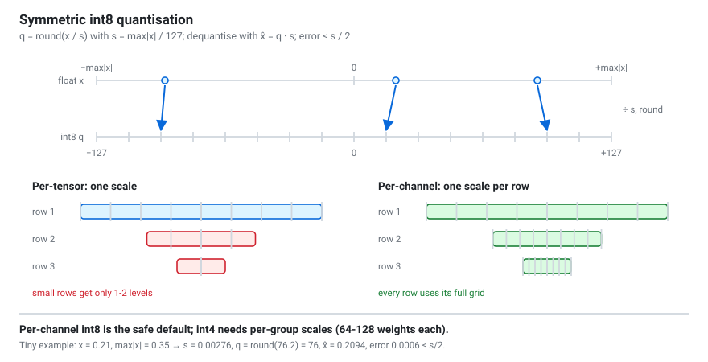
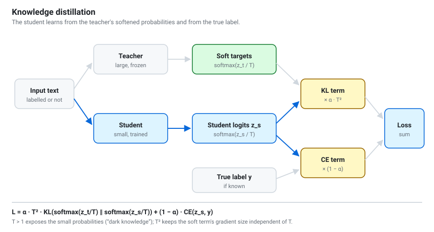

# Chapter 49 · Quantisation & distillation

*Part III · Prerequisites: Chapters 36, 42, 43 · Estimated time: reading ~40 min, lab ~90 min · Compute: T4 GPU (runs on CPU with a reduced budget)*

[](https://colab.research.google.com/github/berdakh/MLBOOTCAMP/blob/main/part3-deep-learning-systems/ch49-quantization-and-distillation/notebook.ipynb) · [Lab: notebook.ipynb](notebook.ipynb) · [Solutions](solutions.md)

## Learning objectives

After this chapter you should be able to:

1. Explain why the cost of running a trained network depends on the number of bits used to store and
   multiply its parameters, and compute the memory of a model at fp32, int8 and int4.
2. Derive symmetric linear quantisation, state its rounding-error bound, and explain why per-channel and
   group-wise scales reduce the error compared with a single per-tensor scale.
3. Distinguish dynamic, static (calibrated), weight-only and quantisation-aware approaches, and say
   which hardware and model types each suits.
4. Write the knowledge-distillation loss with temperature $T$ and weight $\alpha$, and explain the role
   of the $T^2$ factor.
5. Explain why a transfer set of teacher-labelled, unlabelled data is often the main source of a
   student's improvement.
6. Build an accuracy / latency / size table and choose a model for a given latency and cost budget.

## 49.1 Introduction

Most of this book so far has been concerned with making models more accurate. In production, accuracy
is one requirement among several: a model also has to answer within a latency budget (for example,
a 99th-percentile response time of 20 ms), at a given request rate, on hardware that someone has to
pay for. A fine-tuned transformer such as DistilBERT (67 million parameters) is accurate on a topic
classification task but takes tens of milliseconds per request on a single CPU thread. When the
service receives thousands of requests per second, that cost multiplies directly into the number of
machines required.

There are two standard ways to make a trained model cheaper without designing a new architecture:

* **Quantisation** stores the parameters, and possibly performs the arithmetic, with fewer bits:
  8-bit integers instead of 32-bit floating-point numbers, or even 4-bit integers. The model is the
  same function, approximated on a coarser numerical grid.
* **Knowledge distillation** trains a smaller *student* model to reproduce the outputs of the large
  *teacher* model. The student is a different function that has been taught to imitate the first one.

The two methods are complementary: a distilled student can itself be quantised. This chapter first
explains the arithmetic of quantisation (Sections 49.2–49.5), then the theory and practice of
distillation (Sections 49.6–49.7), and finally the procedure for choosing between models when
accuracy, latency and memory all matter (Section 49.8). The lab applies each method to a DistilBERT
teacher fine-tuned on the AG News topic classification data set (four classes: World, Sports, Business,
Sci/Tech) and builds the trade-off table from measurements.

A note on the numbers quoted below. All results in this chapter were **measured on a CPU** with the
lab's reduced budget (the teacher fine-tunes its top 3 of 6 layers on 1,500 examples for one epoch).
Statements about a T4 GPU are **expectations that were not measured** in the course's verification runs;
they are labelled as such.

## 49.2 Why bits determine cost

A neural network layer such as `nn.Linear` computes $y = Wx + b$. At inference time two resources are
consumed: arithmetic (the multiply-accumulate operations in $Wx$) and memory traffic (reading $W$ from
memory into the processor). Chapter 39 introduced the roofline model, which states that a kernel is
*compute-bound* if it performs many operations per byte read and *memory-bound* otherwise. Fewer bits
help in both regimes:

* **Memory.** The storage required by a tensor is

```math
\text{bytes} = \text{number of parameters} \times \frac{\text{bits per parameter}}{8}
\qquad (49.1)
```

  plus a small overhead for the scale factors (one floating-point number per row or per group). For
  the $3072 \times 768$ feed-forward matrix of one DistilBERT layer (2.36 million weights) this gives
  9.4 MB in fp32, 2.4 MB in int8 and 1.2 MB in int4. When a computation is memory-bound, as
  autoregressive decoding of large language models is, reading a quarter of the bytes can make it
  nearly four times faster.
* **Arithmetic.** Modern CPUs have vector instructions that perform more 8-bit integer
  multiply-accumulates per cycle than 32-bit floating-point ones (on x86, for example, the AVX-512 VNNI
  extension). Products of two int8 values are accumulated in 32-bit integers to avoid overflow, and the
  result is converted back to floating point at the end of the layer.

Neither benefit is automatic. A speed-up requires kernels that actually use integer instructions on the
target hardware, and the conversions between floating point and integers cost time of their own. For
this reason quantisation must always be evaluated by measurement, not by counting bits.

## 49.3 Symmetric linear quantisation

The simplest scheme maps each real number $x$ to an integer $q$ on a uniform grid symmetric around zero:

```math
q = \mathrm{clamp}\!\big(\mathrm{round}(x / s),\,-Q,\,Q\big), \qquad
s = \frac{\max_i \lvert x_i \rvert}{Q}, \qquad
\hat{x} = q\,s
\qquad (49.2)
```

Here $x_i$ are the real values covered by one scale, $s$ is the **scale** (the real-valued size of one
integer step), $Q$ is the largest integer used ($Q = 127$ for int8, $Q = 7$ for int4), $q$ is the stored
integer and $\hat{x}$ the **dequantised** approximation. The largest value maps exactly to $\pm Q$, so
nothing is clipped. Using $-127$ rather than $-128$ keeps the grid symmetric, so zero is represented
exactly and negating a value is safe.

Because rounding moves a value to the nearest grid point, the error of every element is bounded by half
a step:

```math
\lvert x - \hat{x} \rvert \le \frac{s}{2}
\qquad (49.3)
```

*Worked example.* Take $x = 0.21$ in a group whose largest magnitude is 0.35. Then
$s = 0.35/127 = 0.00276$, $x/s = 76.2$, $q = 76$ and $\hat{x} = 0.2094$. The error is
$0.0006$, below the bound $s/2 = 0.0014$.

### Granularity of the scale

Equation (49.3) shows that the error is proportional to $s$, and $s$ is set by the largest value that
shares the scale. This makes the choice of *which values share a scale* the most important design
decision:

* **Per-tensor**: one scale for the whole weight matrix. A single large weight anywhere makes the step
  coarse for every row.
* **Per-channel**: one scale per output row, $s_r = \max_j \lvert W_{rj} \rvert / Q$. Each row uses the
  whole integer range.
* **Group-wise**: one scale per block of, typically, 64–128 consecutive weights. This is needed at 4 bits,
  where only 15 levels exist and a single outlier in a row of thousands of weights would otherwise make
  the step very large.



*Figure 49.1 — Real values are rounded onto a grid of 255 integer levels. With a single per-tensor scale,
rows whose values are small use only one or two levels; per-channel scales give every row the full grid.*

The lab measures these effects on the first feed-forward matrix of DistilBERT ($3072 \times 768$, with
row maxima between 0.066 and 0.346). The relative weight error was $1.9 \times 10^{-2}$ per-tensor,
$8.0 \times 10^{-3}$ per-channel (2.4 times smaller) and $1.5 \times 10^{-1}$ for per-channel int4. The
relative error of the layer's *output* on real activations was of the same order
($1.2 \times 10^{-2}$, $5.3 \times 10^{-3}$, $9.6 \times 10^{-2}$). The output error is not larger than
the weight error because each output is a sum of many products, and independent rounding errors partly
cancel in such a sum.

### Asymmetric quantisation

Some tensors are not centred on zero; the outputs of a ReLU, for example, are all non-negative. For
such tensors a symmetric grid wastes half of its levels. **Asymmetric** (affine) quantisation adds an
integer **zero point** $z$ so that the grid covers $[x_{\min}, x_{\max}]$:

```math
q = \mathrm{clamp}\!\big(\mathrm{round}(x/s) + z,\,0,\,255\big), \qquad
s = \frac{x_{\max} - x_{\min}}{255}, \qquad
\hat{x} = (q - z)\,s
\qquad (49.4)
```

Weights are usually quantised symmetrically and activations asymmetrically.

## 49.4 Kinds of quantisation

Quantisation methods differ in what is quantised (weights only, or also activations), when the scales
are determined, and whether the model is trained with quantisation in the loop.

| Method | Weights | Activations | Needs data? | Typical use |
|---|---|---|---|---|
| Dynamic (post-training) | int8, offline | int8, scale computed per batch at run time | no | CPU inference of Linear- and LSTM-heavy models |
| Static (post-training, calibrated) | int8, offline | int8, ranges measured on calibration data | a few hundred examples | CPU and edge inference, CNNs |
| Weight-only | int8 / int4, often group-wise | stay fp16 / fp32 | optional (GPTQ, AWQ use calibration) | memory-bound LLM decoding on GPUs |
| Quantisation-aware training (QAT) | simulated low-bit during training | simulated | full training data | when post-training methods lose too much accuracy |

**Dynamic quantisation** (`torch.ao.quantization.quantize_dynamic`) converts the weights of every
`nn.Linear` to int8 once. At run time it computes a scale for each layer's input activations from the
current batch, performs an int8 × int8 matrix product with int32 accumulation, and converts the result
back to floating point. It needs no calibration data and no retraining, and it runs on CPUs only. Note
that `torch.ao.quantization` is deprecated in recent PyTorch releases in favour of the separate
`torchao` library; the lab's code handles both cases.

**Weight-only quantisation** keeps the arithmetic in floating point and stores only the weights in low
precision; the weights are dequantised just before (or inside) the matrix product. On a GPU, decoding a
large language model is limited by how fast weights can be read from memory, so this gives most of the
benefit. Loaders such as `bitsandbytes` (8-bit and 4-bit), GPTQ and AWQ implement it; GPTQ and AWQ also
use a small calibration set to choose roundings or scales that reduce the error on real activations.

**Quantisation-aware training** inserts "fake quantisation" (quantise followed by dequantise) into the
forward pass during training or fine-tuning, so that the weights adapt to the grid. Gradients pass through
the rounding with the *straight-through estimator* (the rounding is treated as the identity in the
backward pass). It costs a training run and is used when post-training methods lose too much accuracy.

## 49.5 What dynamic int8 did to DistilBERT

The lab applies `quantize_dynamic` to the fine-tuned teacher and measures size, accuracy, agreement
and latency. The CPU measurements were:

* **Size.** 38 Linear layers were quantised (six transformer layers with query, key, value, output and two
  feed-forward matrices each, plus the pre-classifier and classifier). The file shrank from 268 MB to
  139 MB, that is to 52%, not to 25%. The reason is that the embedding matrices (23.4 million of the
  67 million parameters) are not `nn.Linear` layers and remain in fp32.
* **Accuracy.** Unchanged in the final run (0.878 before and after).
* **Agreement.** The int8 and fp32 models gave the same prediction on only 95.6% of the evaluation
  examples. Some predictions changed from right to wrong and others from wrong to right, and the
  changes cancelled. Equal accuracy does not mean the same model: agreement, and if relevant
  calibration (Chapter 8), should also be checked before a quantised model replaces the original.
* **Latency.** For a single request on one thread, the fp32 forward pass took about 45–55 ms and the int8
  forward pass about 15–20 ms (2–3 times faster). At batch 32 the int8 model was 2.2–2.5 times faster.
  The speed-up depends on the CPU's integer instructions and on machine load; on a heavily loaded
  machine multi-threaded int8 runs were sometimes *slower* than fp32, which is why single requests are
  timed on one thread.

The lab then simulates weight-only quantisation of every Linear layer (quantise, dequantise, compute in
fp32). Per-channel int8 matched fp32 (0.880 against 0.878) and, perhaps surprisingly, per-channel int4
without groups also held up (0.876) despite a weight error of about 15%. This should not be generalised.
A four-class classifier with large decision margins tolerates noise in its weights; a generative language
model compounds small errors over many generated tokens and is far more sensitive. This is why 4-bit
LLM loaders use small groups and calibration, and why int8 is regarded as the safe default.

*On a T4 GPU (not measured):* dynamic quantisation does not run on CUDA. The comparable GPU experiment is
to load the teacher with `bitsandbytes` in 8-bit or 4-bit and compare memory and speed; the lab includes
this as an optional, flag-guarded extension.

## 49.6 Knowledge distillation

A classifier's output is a probability vector, not just a label. For a Business article a good teacher
might assign 84% to Business, 15% to Sci/Tech and 0.1% to Sports. The relative sizes of the small
probabilities encode which mistakes are reasonable; Hinton, Vinyals and Dean (2015) called this
information "dark knowledge". Distillation trains the student to reproduce the whole vector.

### Temperature

With logits $z$ (the inputs to the softmax), the softened distribution at temperature $T$ is

```math
p_i^{(T)} = \frac{\exp(z_i / T)}{\sum_j \exp(z_j / T)}
\qquad (49.5)
```

$T = 1$ gives the ordinary softmax; $T > 1$ flattens the distribution and makes the small probabilities
larger, so they carry more of the training signal. For logits $[4, 1, 0]$ the probabilities are
$[0.94, 0.05, 0.02]$ at $T = 1$ and $[0.54, 0.26, 0.20]$ at $T = 4$. If $T$ is too high the distribution
becomes nearly uniform and the information is lost again; values between 2 and 8 are usual.

### The loss

The student is trained on a weighted sum of a *soft* term, which compares its softened distribution with
the teacher's, and the ordinary *hard* cross-entropy with the true label $y$:

```math
\mathcal{L} = \alpha\, T^2\, \mathrm{KL}\!\left(p_t^{(T)} \,\Vert\, p_s^{(T)}\right) + (1 - \alpha)\, \mathrm{CE}(z_s, y)
\qquad (49.6)
```

Here $z_t$ and $z_s$ are the teacher's and student's logits, $p_t^{(T)}$ and $p_s^{(T)}$ the corresponding
softened distributions from Equation (49.5), $\mathrm{KL}(p \Vert q) = \sum_i p_i \log(p_i / q_i)$ the
Kullback–Leibler divergence, and $\alpha \in [0, 1]$ the weight of the soft term. Some papers place
$\alpha$ on the hard term instead, so the convention should always be stated. With $\alpha = 0$ the loss
reduces to ordinary cross-entropy.

**Why $T^2$?** The gradient of the soft term with respect to a student logit is

```math
\frac{\partial}{\partial z_{s,i}} \mathrm{KL}\!\left(p_t^{(T)} \Vert p_s^{(T)}\right) = \frac{1}{T}\left(p_{s,i}^{(T)} - p_{t,i}^{(T)}\right).
```

For large $T$ the softmax is approximately linear, $p_i^{(T)} \approx 1/K + z_i/(KT)$ for $K$ classes and
zero-mean logits, so the gradient is approximately $(z_{s,i} - z_{t,i})/(K T^2)$. It shrinks as $1/T^2$.
Multiplying by $T^2$ keeps the magnitude of the soft term's gradient roughly independent of $T$, so that
changing the temperature does not silently change the balance set by $\alpha$.

**Implementation detail.** In PyTorch, `F.kl_div(input, target)` expects the *student's
log-probabilities* as `input` and the teacher's probabilities as `target`, and computes
$\mathrm{KL}(\text{target} \Vert \text{input})$. The argument order is the opposite of the mathematical
notation and is a common source of negative or `nan` losses. `reduction="batchmean"` gives the
mathematically correct average over examples.



*Figure 49.2 — The student receives two training signals: the teacher's softened probabilities (weight
$\alpha T^2$) and the true label (weight $1 - \alpha$). For unlabelled examples only the KL term remains.*

## 49.7 Transfer sets and what actually helps

Distillation has a second advantage that is often more important than soft targets: the teacher can
label **unlabelled** data. A *transfer set* is a collection of in-domain inputs, without human labels,
on which the teacher's outputs serve as targets. Unlabelled text is usually plentiful, so the student can
be trained on far more examples than were ever annotated. Using only the teacher's top prediction as the
target is called **pseudo-labelling** (or self-training when teacher and student are the same model).

The lab trains one small student (TF-IDF features on unigrams and bigrams, 5,000 features, followed by
a one-hidden-layer MLP; about 640,000 parameters, roughly 100 times fewer than the teacher) in four ways,
three seeds each:

| Variant | Targets | Data | Mean accuracy (CPU run) |
|---|---|---|---|
| A | true labels | 1,500 labelled | 0.835 |
| B | distillation ($T = 4$, $\alpha = 0.7$) | 1,500 labelled | 0.827 |
| C | teacher's argmax (pseudo-labels) | labelled + 1,000 transfer | 0.849 |
| D | distillation, true labels where known | labelled + 1,000 transfer | 0.843 |

The seed-to-seed spread was about ±0.002–0.003, so differences of a few thousandths should not be
interpreted. Two conclusions are nevertheless consistent across runs (an earlier run gave A 0.836,
B 0.831, C 0.841, D 0.839):

1. The variants that used the transfer set (C, D) gained 1–1.5 points over the labelled-only baseline,
   because they saw 1.7 times as much text.
2. Soft targets on their own (B) did not help this student. Soft targets tend to matter more when the
   student is a smaller version of the teacher (the same tokenizer and a few transformer layers, as
   DistilBERT itself was distilled from BERT) than for a very different model such as a bag of n-grams.

The teacher itself was correct on about 90% (0.896) of the transfer set. Pseudo-labels inherit the
teacher's errors, so a better teacher gives a better ceiling for the student.

## 49.8 Choosing a model: the trade-off table

The lab collects the three quantities for each model (CPU, batch 1, final run):

| Model | Accuracy | Latency per request | Size on disk |
|---|---|---|---|
| Teacher, fp32 | 0.878 | ~53 ms | 268 MB |
| Teacher, dynamic int8 | 0.878 | ~16 ms | 139 MB |
| Student (TF-IDF + MLP), including featurisation | 0.849 | ~0.8 ms | 2.8 MB |

*On a T4 GPU (not measured):* full fine-tuning on 20,000 examples is expected to reach about 0.92–0.94
accuracy, with a few milliseconds per request in fp16. The GPU changes the latency column, not the
ordering of the sizes.

A table of this kind supports a decision procedure:

1. **Start from the budget**, not from the model: the latency target (usually a high percentile such as
   p99, which lies well above the median), the request rate, and the hardware that will be available.
2. **Take the most accurate model that fits.** If none fits, try the cheapest changes first: serving
   improvements such as batching on GPUs (Chapter 50) and optimised runtimes (Chapter 36), then int8
   quantisation, which is nearly free in accuracy and should be tried early.
3. **Distil when larger speed-ups are needed.** Distillation costs a training pipeline and a teacher
   that must be maintained, but it gives the largest reductions in cost. The student can then be
   quantised as well.
4. **Consider a cascade.** A cheap model answers confident cases and forwards uncertain ones to the
   expensive model. The cost is then the cheap model's cost plus the forwarded fraction times the
   expensive model's cost.
5. **Validate online.** A few points of offline accuracy may or may not change the product metric; an
   A/B test (Chapter 29) settles the question.

A simple capacity estimate links latency to cost. With single-threaded workers, the number of busy cores
needed is the request rate multiplied by the service time per request. At 2,000 requests per second, a
16 ms model needs about 32 cores busy at all times, before any headroom for peaks; a 1 ms model needs
about 2.

## Key terms

| Term | Definition |
|---|---|
| Quantisation | Representing parameters (and possibly activations) with fewer bits, e.g. int8 instead of fp32. |
| Scale $s$ | The real value of one integer step; a value is approximated as $`\hat{x} = q\,s`$. |
| Zero point | An integer offset that lets an asymmetric grid cover a range not centred on zero. |
| Per-tensor / per-channel / group-wise | One scale for a whole matrix / one per output row / one per block of 64–128 weights. |
| Dynamic quantisation | Weights quantised offline; activation scales computed per batch at run time; no calibration data. |
| Static quantisation | Activation ranges fixed in advance from calibration data, allowing fully integer computation. |
| Weight-only quantisation | Only the weights are stored in low precision; arithmetic stays in floating point. |
| Quantisation-aware training | Training with simulated quantisation so that the weights adapt to the integer grid. |
| Agreement | The fraction of inputs on which two models make the same prediction. |
| Knowledge distillation | Training a student model to reproduce a teacher model's output distribution. |
| Temperature $T$ | A divisor applied to logits before the softmax; $T > 1$ flattens the distribution. |
| Soft targets | The teacher's full (softened) probability vector used as a training target. |
| Transfer set | Unlabelled in-domain inputs labelled by the teacher to train the student. |
| Pseudo-label | The teacher's most probable class used as a hard training label. |

## Summary

1. Inference cost depends on the bits per parameter: memory scales linearly with bits (Equation 49.1),
   and integer arithmetic is faster than floating point on hardware that supports it.
2. Symmetric quantisation rounds $x/s$ to an integer; the error per element is at most $s/2$
   (Equations 49.2–49.3), so the scale should be shared only by values of similar magnitude.
3. Per-channel scales reduced the weight error 2.4 times compared with per-tensor scales on DistilBERT;
   int4 needs per-channel or group-wise scales to be usable.
4. Dynamic int8 quantisation halved DistilBERT's file size (embeddings remain fp32), kept accuracy
   unchanged and made CPU inference 2–3 times faster in the lab, but changed 4.4% of predictions.
5. Weight-only low-bit quantisation is the main GPU technique for memory-bound LLM decoding; generative
   models are more sensitive to quantisation error than small classifiers.
6. Distillation minimises a temperature-softened KL divergence to the teacher plus a cross-entropy on true
   labels (Equation 49.6); the $T^2$ factor keeps the soft term's gradient scale independent of $T$.
7. In the lab, more teacher-labelled data improved the student by 1–1.5 points, while soft targets alone did
   not help a student very different from the teacher.
8. Model choice starts from the latency and cost budget; quantisation is tried first, distillation when
   larger savings are needed, and the two can be combined.

## Exercises

The exercises are in the lab, [notebook.ipynb](notebook.ipynb); worked answers are in
[solutions.md](solutions.md).

* **Exercise 1 · `quantize_per_channel_int8`.** Implement per-channel symmetric int8 quantisation of a
  weight matrix, returning the integer tensor and one scale per row, with all-zero rows handled. The grader
  checks the error bound of Equation (49.3).
* **Exercise 2 · `kd_loss`.** Implement the distillation loss of Equation (49.6) using `F.kl_div` and
  `F.cross_entropy`, with attention to the argument order of `F.kl_div`.
* **Exercise 3 · Choosing a model for a 20 ms p99 on CPUs.** Using your own trade-off table, decide which
  models meet the budget at 2,000 requests per second, what you would measure before moving the teacher to
  GPUs, and how you would improve the student.
* **Checkpoint questions** at the end of the lab: symmetric quantisation and scale granularity; the four
  kinds of quantisation; why the file only halved; the distillation loss and the $T^2$ factor; the value of
  a transfer set; and a plan for a fourfold cost reduction with at most one point of accuracy loss.

## Further reading

* Hinton, G., Vinyals, O. & Dean, J. (2015). *Distilling the Knowledge in a Neural Network.* arXiv:1503.02531.
* Jacob, B. et al. (2018). *Quantization and Training of Neural Networks for Efficient
  Integer-Arithmetic-Only Inference.* CVPR 2018.
* Nagel, M. et al. (2021). *A White Paper on Neural Network Quantization.* arXiv:2106.08295.
* Sanh, V., Debut, L., Chaumond, J. & Wolf, T. (2019). *DistilBERT, a distilled version of BERT: smaller,
  faster, cheaper and lighter.* arXiv:1910.01108.
* Dettmers, T., Lewis, M., Belkada, Y. & Zettlemoyer, L. (2022). *LLM.int8(): 8-bit Matrix Multiplication
  for Transformers at Scale.* NeurIPS 2022.
* Frantar, E., Ashkboos, S., Hoefler, T. & Alistarh, D. (2023). *GPTQ: Accurate Post-Training Quantization
  for Generative Pre-trained Transformers.* ICLR 2023.
* PyTorch documentation: *Quantization* (`torch.ao.quantization`) and the `torchao` library.

**Next:** [Chapter 50 · High-throughput serving](../ch50-high-throughput-serving/README.md)
