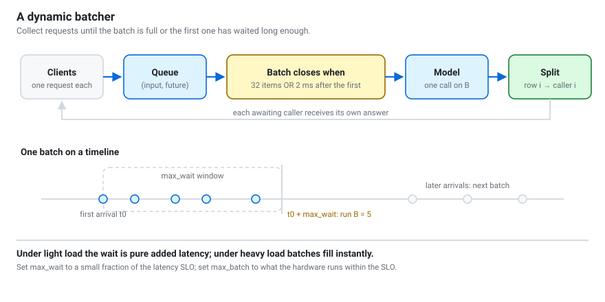
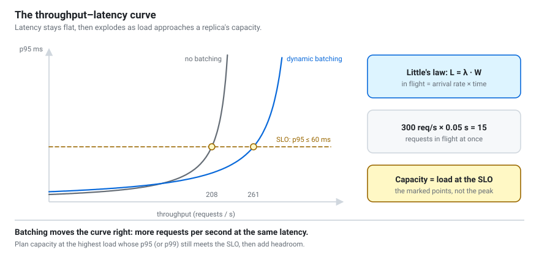
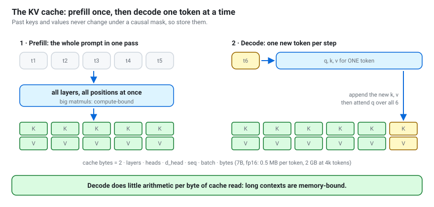
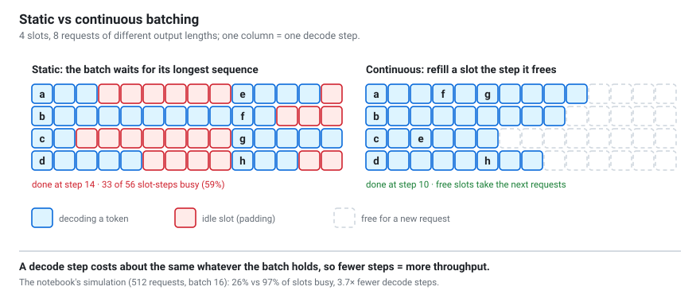
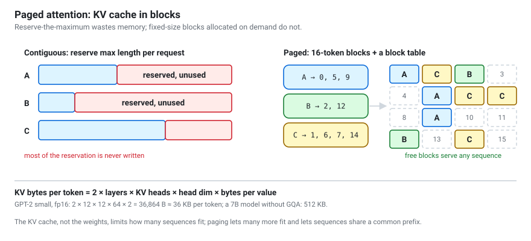

# Chapter 50 · High-throughput serving

*Part III · Prerequisites: Chapters 10, 14, 39, 41, 49 · Estimated time: reading ~45 min, lab ~90 min · Compute: T4 GPU (runs on CPU with a reduced budget)*

 · [Lab: notebook.ipynb](notebook.ipynb) · [Solutions](solutions.md)

## Learning objectives

After this chapter you should be able to:

1. Explain, using arithmetic intensity, why batching increases the throughput of neural network
   inference, and when it stops helping.
2. Design a dynamic batcher with a maximum batch size and a maximum waiting time, and set both from a
   latency objective.
3. Plan and interpret a load test: throughput, latency percentiles, the throughput–latency curve and
   Little's law.
4. Distinguish the prefill and decode phases of text generation, and explain what a KV cache saves and
   what it costs.
5. Explain static batching, continuous batching and paged attention, and quantify their effect on
   utilisation and memory.
6. Compute the cost per 1,000 requests from throughput, price and utilisation, and name the levers that
   reduce it.

## 50.1 Introduction

Chapter 49 reduced the cost of a single model call by quantisation and distillation. This chapter is
concerned with the *system* around the model: how requests from many clients are grouped, scheduled
and executed so that the hardware does as much useful work per second as possible without breaking a
latency objective. The central tension is simple. Grouping requests into batches makes each unit of
hardware time more productive, but a request that waits for others to join its batch is answered later.
Every serving system is a particular compromise between **throughput** (requests or tokens completed
per second) and **latency** (the time a single request takes).

The chapter proceeds from the hardware reason for batching (Section 50.2), through a dynamic batcher
behind a web API (Section 50.3) and the methodology of load testing (Sections 50.4–50.5), to text
generation, where the KV cache, continuous batching and paged attention determine how many users one
GPU can serve (Sections 50.6–50.8). It closes with a cost model (Section 50.9).

**Measured on CPU vs expected on a T4.** All numbers quoted from the lab were measured on a CPU, with
the HTTP server and the load generator sharing one machine. Absolute numbers are therefore pessimistic
and vary between runs; the *shapes* of the curves are what transfers to other hardware. Statements about
a T4 GPU are expectations that were not measured in the course's verification runs.

## 50.2 Why batching helps

Consider a linear layer $y = Wx$ with $W \in \mathbb{R}^{d_{\text{out}} \times d_{\text{in}}}$. For a single
input vector the computation is a matrix–vector product: each weight is read from memory once and used
for exactly one multiply–add (two floating-point operations). The ratio of arithmetic to memory traffic,
the **arithmetic intensity**, is therefore about one operation per two bytes in fp16. For a batch of $B$
inputs, each weight is read once and used $B$ times:

$$
I(B) \approx \frac{2\,B\,d_{\text{in}}\,d_{\text{out}}}{b\,d_{\text{in}}\,d_{\text{out}}} = \frac{2B}{b}\ \ \text{FLOPs per byte}
\qquad (50.1)
$$

where $b$ is the number of bytes per weight. The roofline model (Chapter 39) states that a computation is
memory-bound while $I$ is below the ratio of the processor's peak arithmetic rate to its memory
bandwidth, and compute-bound above it. A T4 GPU has about 65 TFLOP/s of fp16 compute and 320 GB/s of
memory bandwidth, a ratio of about 200 FLOPs per byte, so in fp16 the layer stays memory-bound up to a
batch of roughly 200. In the memory-bound regime the time of a call is set by reading the weights,
which does not depend on $B$, so a larger batch costs almost no extra time.

The throughput of batched calls and the latency of a request are

$$
\text{throughput}(B) = \frac{B}{t(B)}, \qquad \text{latency} \approx t_{\text{wait}} + t(B)
\qquad (50.2)
$$

where $t(B)$ is the time of one model call on a batch of $B$ and $t_{\text{wait}}$ the time a request spends
waiting for its batch to be formed. Throughput increases as long as $t(B)$ grows more slowly than $B$.

*Measured on CPU (two threads, a 33.9M-parameter MLP):* a batch of 1 took about 3 ms and a batch of 32
about 15 ms, so throughput rose from about 330 to about 2,100 examples per second, and to about 2,900 at
batch 128. *Expected on a T4 (not measured):* the same shape, more pronounced, with throughput rising
until batches of several hundred, because a batch-1 call is dominated by kernel launches and weight reads.

**A note on "GPU utilisation".** The "GPU-Util" figure reported by `nvidia-smi` is the fraction of time
during which *some* kernel was running. A server at batch 1 can report 100% while using about 1% of the
arithmetic capacity. Better measures are the achieved FLOP/s as a fraction of the peak (model FLOPs
utilisation, Chapter 48), the memory bandwidth used, and above all the throughput achieved at the
latency target.

## 50.3 Dynamic batching

In an online service requests arrive one at a time from independent clients. A **dynamic batcher** is a
component between the request handlers and the model that forms batches on the fly:

1. Each request handler places the pair (input, future) on a queue and waits on its future. A *future*
   is an object that will hold a result later; awaiting it suspends the handler without blocking others.
2. A single background task takes the first waiting request and continues to collect requests until the
   batch holds `max_batch_size` items **or** `max_wait_ms` milliseconds have passed since the first one
   arrived.
3. It calls the model once on the whole batch and sets each future's result, so every caller receives
   its own answer.

The two parameters bound different things. `max_batch_size` bounds the cost (and memory) of one call;
`max_wait_ms` bounds the extra delay that the first request of a batch can suffer while waiting for
company. Under heavy load batches fill immediately and the waiting time never expires; under light load
the wait is pure added latency.

*Figure 50.1 — A dynamic batcher closes a batch when it reaches 32 items or 2 ms after the first item,
calls the model once and returns each result to its own caller.*

Several implementation details matter in practice, and the course's `scaleml.serving.DynamicBatcher`
includes them:

* **Do not block the event loop.** In an `asyncio` server a synchronous model call inside the batching
  loop prevents new requests from being parsed while the model runs, so batches never grow. The model
  call should run in a worker thread (`asyncio.to_thread`) or a separate process.
* **Propagate errors.** If the model raises an exception, that exception must be set on every future
  of the batch; otherwise those callers wait forever.
* **Bound the queue.** A queue with a maximum size, and an HTTP 503 response when it is full, keeps
  latency bounded under overload (this is called *load shedding*).

In the lab the batcher is started in the FastAPI application's *lifespan* function, so that it runs in
the server's event loop, and each `/predict` handler simply awaits `batcher.submit(...)`. Production
inference servers (NVIDIA Triton Inference Server, TorchServe, Ray Serve) provide the same mechanism.

## 50.4 Load testing and the throughput–latency curve

A **load test** measures how a service behaves as the offered load increases. Two designs are common:

* In a **closed-loop** test a fixed number of simulated clients each send a request, wait for the
  answer, and immediately send the next. The load is controlled by the number of clients (the
  *concurrency*).
* In an **open-loop** test requests arrive at a fixed rate regardless of how fast the service responds.
  This is closer to real traffic from many independent users and reveals overload more clearly.

The quantities to report are the throughput, the latency **percentiles** (p50, p95, p99: the times below
which 50%, 95% and 99% of requests finish), the error rate and, for a batching server, the distribution of
batch sizes. Percentiles are used rather than means because users experience the tail, and because a
service that calls several back-ends is slowed by the slowest of them (Dean & Barroso, 2013). A
latency **service-level objective (SLO)** such as "p95 ≤ 60 ms" is stated in percentile terms.

**Little's law** relates the three averages of any stable queueing system:

$$
L = \lambda\, W
\qquad (50.3)
$$

where $L$ is the average number of requests in the system, $\lambda$ the arrival rate (requests per second)
and $W$ the average time a request spends in the system. In a closed-loop test the number of clients *is*
the number in flight, so throughput × mean latency ≈ concurrency. Once the server is saturated, adding
clients cannot raise throughput and can only raise latency. For example, 16 clients at 310 requests per
second imply a mean latency of about $16/310 = 52$ ms.

*Measured on CPU (one shared machine; numbers vary between runs):* the lab compared no batching
(`max_batch_size=1`) with dynamic batching (`max_batch_size=32`, `max_wait_ms=2`) at 1, 4, 16 and 32
clients, with the load generator in a separate process.

* At concurrency 1 a batch can hold only one request, so batching can only add latency (p50 5.6 → 8.4 ms
  on a quiet machine).
* Without batching, throughput reached a plateau from 4 clients on (about 240 requests/s on a quiet machine,
  about 110 on a busy one), and p50 grew in proportion to the number of clients (16 ms at 4 clients,
  65 ms at 16, 126 ms at 32 in the quiet run), as Little's law predicts.
* With dynamic batching the mean batch size grew with load (1 → 4 → about 7–8), throughput rose to about
  310 requests/s, and at 16–32 clients p50 was *lower* than without batching (quiet run: 48 against 65 ms
  and 73 against 126 ms).

The gain (1.3 times on a quiet machine, 2.8 times on a busy one) was limited by the Python HTTP layer:
parsing and answering a request costs a few milliseconds of event-loop time whether or not it is batched.
When the model call dominates, as for a transformer on a GPU, the gain approaches the factor measured in
Section 50.2.

*Figure 50.2 — Throughput–latency curves. Latency is flat at low load and rises steeply near saturation;
dynamic batching moves the curve to the right. The capacity of a configuration is the load at which its
curve crosses the SLO line, well before the vertical asymptote.*

**Capacity planning** reads the curve: the capacity of one replica is the highest throughput whose p95 (or
p99) latency still meets the SLO, minus headroom for bursts. The number of replicas is the peak load
divided by that capacity. A reliable load test runs the clients on separate machines, warms the service
up first and measures for long enough to estimate the tail percentiles.

## 50.5 Choosing the waiting time

The lab varied `max_wait_ms` from 0 to 25 ms at a fixed concurrency of 4 clients. *Measured on CPU:* the
mean batch size rose from 2.0 to 4.0 (at most four requests can ever be waiting), but p50 latency grew by
roughly the waiting time (about 15–18 → 52–55 ms) and throughput *fell* (about 215–255 → 70–76 requests/s),
because each closed-loop client waited longer per request. Even `max_wait_ms=0` produced batches of two
on average, since the batcher takes whatever accumulated while the previous batch was running.

The practical rule is therefore:

* set `max_batch_size` to the largest batch the hardware processes within the latency budget;
* set `max_wait_ms` to a small fraction of the SLO (a few milliseconds);
* let the load determine the actual batch size.

Some systems adapt the waiting time to the observed arrival rate.

## 50.6 Generation: prefill, decode and the KV cache

A decoder-only language model generates text one token at a time; each new token requires a forward pass.
Without a cache, step $t$ recomputes the attention keys and values of all $t$ previous tokens. A **KV
cache** (Chapter 41) stores the keys and values of earlier tokens, so each step processes only the newest
token; the per-step work of the projections and feed-forward layers falls from $O(t)$ to $O(1)$.

*Figure 50.3 — The KV cache stores the keys and values of earlier tokens, so each decode step computes
them only for the newest token.*

With a cache, generation splits into two phases with very different costs:

* **Prefill** processes the whole prompt in one parallel pass. It consists of large matrix products, is
  compute-bound, and determines the *time to first token*.
* **Decode** generates one token per step for each sequence. Each step reads all the weights and the whole
  KV cache to produce a single token per sequence, so it is memory-bound and benefits strongly from
  batching many sequences together. It determines the *inter-token latency*.

*Measured on CPU (GPT-2 small, 124M parameters, two threads; varies with load):* at batch 1, about 7–16
tokens/s without the cache and 10–34 tokens/s with it (1.4–2.1 times faster for 32 new tokens; the gap
grows with output length). At batch 8 with the cache, 57–119 tokens/s, 3.5–8 times batch 1, because the
weights are read once for all eight sequences. *Expected on a T4 (not measured):* hundreds of tokens per
second at batch 1 in fp16 and thousands at batch 8 or more.

The cache costs memory, linear in the number of tokens:

$$
\text{KV bytes per token} = 2 \cdot n_{\text{layers}} \cdot n_{\text{kv heads}} \cdot d_{\text{head}} \cdot b
\qquad (50.4)
$$

The factor 2 counts keys and values; $n_{\text{layers}}$ is the number of transformer layers,
$n_{\text{kv heads}}$ the number of key/value heads, $d_{\text{head}}$ the dimension of each head, and
$b$ the bytes per number. For GPT-2 small in fp16 this is $2 \cdot 12 \cdot 12 \cdot 64 \cdot 2 = 36{,}864$
bytes (36 KB) per token, or 75 MB for a 2,048-token sequence. A model shaped like Llama-2-7B (32 layers,
32 heads of 128, no grouped-query attention) needs 512 KB per token, about 1 GB per 2,048-token sequence.
For large models it is therefore the KV cache, not the weights, that limits how many sequences can be
processed at once. Grouped-query attention (fewer key/value heads than query heads) and quantised KV caches
reduce the per-token cost.

## 50.7 Static and continuous batching

With **static batching** a group of sequences starts together and the batch remains occupied until its
*longest* sequence finishes. Slots whose sequence has already ended perform useless work, and new requests
wait for the whole batch. Output lengths in practice vary widely (a one-word answer against a 500-token
essay), which is exactly when static batching wastes most.

**Continuous** (iteration-level) batching, introduced by the Orca system (Yu et al., 2022) and used by vLLM,
Text Generation Inference and TensorRT-LLM, re-forms the batch at *every decode step*: a finished sequence
leaves and a waiting request takes its slot immediately.

*Figure 50.4 — Four batch slots over time. Static batching leaves idle cells (red) until the longest
sequence ends; continuous batching refills each slot as soon as it frees and finishes the same eight
requests in 10 steps instead of 14.*

*Simulated (seeded, deterministic):* 512 requests with lognormal output lengths (median 57, mean 95, capped
at 1,024 tokens) and a batch size of 16. Static batching kept only 26% of the slots busy, continuous batching
97%, so it needed 3.7 times fewer decode steps (11,497 against 3,133) for the same tokens. Because a
memory-bound decode step costs about the same whatever the batch holds, fewer steps means proportionally
higher throughput. Sorting requests by length would help static batching (82%), but output lengths are not
known until generation ends.

A newly admitted request first needs a prefill pass over its prompt, which costs more than a decode step.
Real engines therefore schedule prefills and decodes carefully, for example by splitting long prompts into
chunks (*chunked prefill*) so that they do not stall the decoding sequences.

## 50.8 Paged attention

Continuous batching keeps many sequences in flight, and each needs memory for its KV cache. The simplest
allocator reserves contiguous memory for the *maximum* length of every sequence. Since most sequences are
much shorter, most of that memory is reserved but never used: in the lab's simulation only 24% held real
tokens. **Paged attention** (Kwon et al., 2023, the vLLM system) applies the idea of virtual-memory paging:

* the KV cache of each sequence is stored in fixed-size blocks (for example 16 tokens) anywhere in GPU
  memory;
* a per-sequence *block table* maps logical token positions to physical blocks;
* a special attention kernel reads keys and values through the block table.

Blocks are allocated as tokens are generated, so almost no memory is wasted (98% used in the lab's
simulation). The freed memory admits more concurrent sequences, hence larger batches and higher throughput.
Sequences that share a prefix (the same system prompt, or several samples from one prompt) can point to the
same physical blocks. The vLLM paper reports that the earlier systems it measured used only about 20–40%
of their KV-cache memory for actual tokens. Paged attention requires a CUDA GPU; the lab explains it and
simulates the allocation but does not run it.

*Figure 50.5 — Contiguous reservations of the maximum length leave most memory unused (left). Paging maps
each sequence to 16-token blocks through a block table (right), removing the reserved but unused tail.*

## 50.9 Cost per 1,000 requests

A server that completes $r$ requests per second when busy, rented at $p$ dollars per hour, and busy on
average for a fraction $u$ of the time costs

$$
\text{cost}_{1k} = \frac{1000 \cdot p}{3600 \cdot r \cdot u}
\qquad (50.5)
$$

dollars per 1,000 requests. Utilisation $u$ is below 1 because capacity is provisioned for the peak of the
traffic and paid for during the troughs.

*Worked example (assumed prices).* At an assumed $p = \$0.20$ per hour for a 4-vCPU machine and $u = 0.4$,
the lab's measured throughputs give \$0.00114 per 1,000 requests without batching (122 requests/s, busy
run) and \$0.00045 with dynamic batching (308 requests/s). The cost falls by the same factor as throughput
rose. The lab's GPU row is arithmetic on an assumed price and an assumed throughput, not a measurement.

Equation (50.5) identifies the three levers:

1. **Throughput** $r$: batching, quantisation and distillation (Chapter 49), compiled or fused kernels.
2. **Price** $p$: spot or reserved capacity, cheaper accelerators, CPUs for small models.
3. **Utilisation** $u$: autoscaling, serving several models on one machine, filling troughs with batch work.

For text generation, cost is quoted per 1,000 *tokens*, and output tokens cost more than prompt tokens
because decode is memory-bound and prefill is not.

## Key terms

| Term | Definition |
|---|---|
| Throughput | Requests (or tokens) completed per second. |
| Latency percentile | The time below which a given share (50%, 95%, 99%) of requests complete. |
| Arithmetic intensity | Floating-point operations performed per byte moved from memory. |
| Memory-bound | Limited by memory bandwidth rather than by arithmetic throughput. |
| Dynamic batching | Grouping requests that arrive close together into one model call, bounded by size and waiting time. |
| SLO | Service-level objective: a stated target for latency or availability, e.g. p95 ≤ 60 ms. |
| Closed-loop / open-loop test | Load generated by a fixed number of waiting clients / at a fixed arrival rate. |
| Little's law | $L = \lambda W$: average requests in a system equal arrival rate times average time in the system. |
| Prefill / decode | Processing the prompt in one pass / generating one token per step. |
| KV cache | Stored keys and values of earlier tokens, reused at each decode step. |
| Continuous batching | Re-forming the generation batch at every decode step. |
| Paged attention | Storing KV caches in fixed-size blocks located through a per-sequence block table. |
| Utilisation $u$ | The fraction of paid time during which the server is busy. |

## Summary

1. At small batch sizes neural network inference is memory-bound; a batch of $B$ reuses each weight $B$
   times (Equation 50.1), so throughput rises almost linearly until the computation becomes compute-bound.
2. A dynamic batcher closes a batch at a maximum size or a maximum wait; the size bounds the cost of a call
   and the wait bounds the extra latency.
3. Load tests report throughput and latency percentiles against offered load; capacity is the highest load
   whose tail latency meets the SLO.
4. Little's law (Equation 50.3) explains why, beyond saturation, more clients only raise latency.
5. A long `max_wait_ms` fills batches at low load but raises latency and can lower throughput; a few
   milliseconds is usually right.
6. Generation consists of a compute-bound prefill and a memory-bound decode; the KV cache removes
   recomputation at a memory cost linear in sequence length (Equation 50.4).
7. Continuous batching kept 97% of decode slots busy against 26% for static batching in the lab's
   simulation; paged attention raised KV-memory use from 24% to 98%.
8. Cost per 1,000 requests (Equation 50.5) falls with higher throughput, lower price and higher utilisation.

## Exercises

The exercises are in the lab, [notebook.ipynb](notebook.ipynb); worked answers are in
[solutions.md](solutions.md).

* **Exercise 1 · `DynamicBatcher`.** Complete an `asyncio` dynamic batcher with `submit` and `run`, closing
  each batch at `max_batch_size` items or `max_wait_ms` after the first item. The grader checks batch sizes,
  the waiting time and that each caller receives its own result.
* **Exercise 2 · `cost_per_1k`.** Implement Equation (50.5) and apply it to your own measured throughputs.
* **Exercise 3 · Why the 7B chat service is expensive.** Diagnose a GPU chat service that uses static
  batching with memory left empty, propose ordered changes with a metric for each, and analyse the effect of
  doubling the context length.
* **Checkpoint questions** at the end of the lab: why batching helps; the design of a dynamic batcher; what a
  load test should report; prefill and decode; continuous batching and paged attention; and the cost per
  1,000 requests.

## Further reading

* Williams, S., Waterman, A. & Patterson, D. (2009). Roofline: an insightful visual performance model for
  multicore architectures. *Communications of the ACM*, 52(4).
* Little, J. D. C. (1961). A proof for the queuing formula $L = \lambda W$. *Operations Research*, 9(3).
* Dean, J. & Barroso, L. A. (2013). The tail at scale. *Communications of the ACM*, 56(2).
* Yu, G.-I. et al. (2022). Orca: A Distributed Serving System for Transformer-Based Generative Models.
  OSDI 2022.
* Kwon, W. et al. (2023). Efficient Memory Management for Large Language Model Serving with PagedAttention.
  SOSP 2023.
* Huyen, C. (2022). *Designing Machine Learning Systems.* O'Reilly (chapter on model deployment and
  prediction service).
* FastAPI documentation (lifespan events) and NVIDIA Triton Inference Server documentation (dynamic batcher).

**Next:** [Chapter 51 · CTR prediction at scale](../ch51-ctr-prediction-at-scale/README.md)
