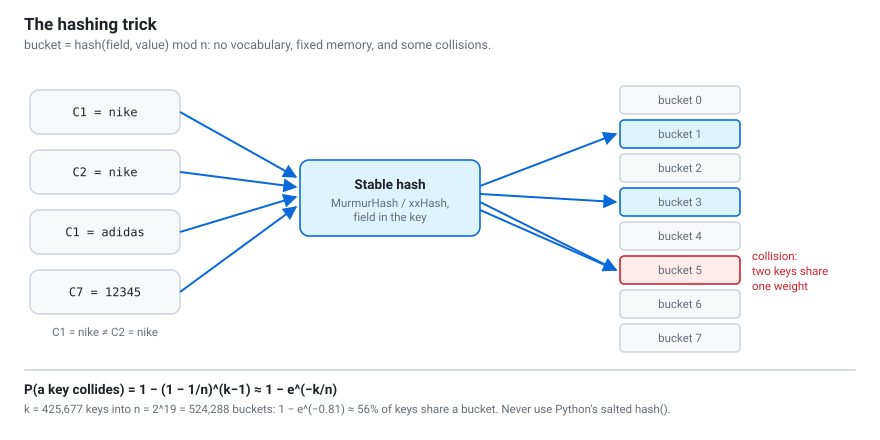
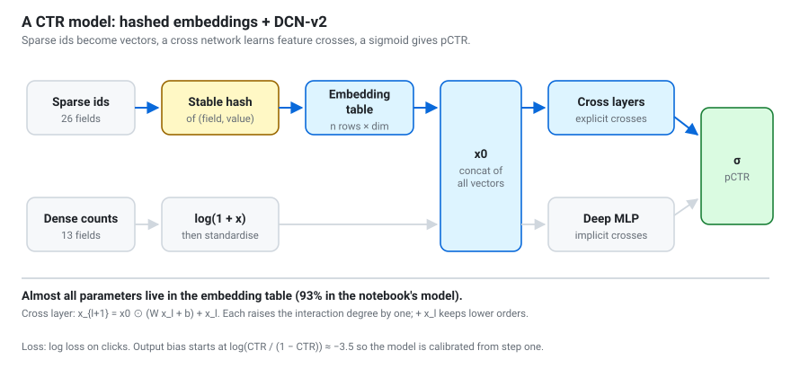
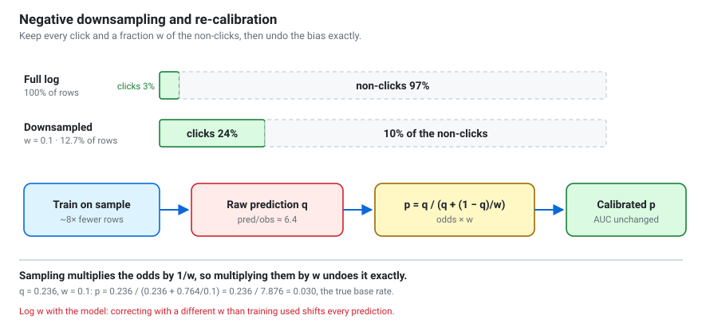
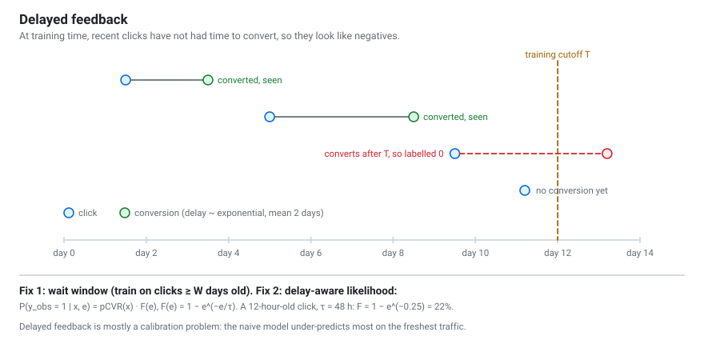

# Chapter 51 · CTR prediction at scale

*Part III · Prerequisites: Chapters 8, 23, 24, 27, 47 · Estimated time: reading ~45 min, lab ~90 min · Compute: T4 GPU (runs on CPU with a reduced budget)*

[](https://colab.research.google.com/github/berdakh/MLBOOTCAMP/blob/main/part3-deep-learning-systems/ch51-ctr-prediction-at-scale/notebook.ipynb) · [Lab: notebook.ipynb](notebook.ipynb) · [Solutions](solutions.md)

## Learning objectives

After this chapter you should be able to:

1. Describe the structure of an advertising impression log (dense counts, high-cardinality categorical
   fields, power-law popularity) and explain why most categorical values are seen too rarely to learn.
2. Compute log loss, normalised entropy (NE), AUC and calibration ratios, and explain why advertising
   systems weight calibration so heavily.
3. Implement a stable, field-aware hashing trick and predict its collision rate.
4. Estimate the memory of embedding tables and explain how they are sharded across GPUs.
5. Explain how a Deep & Cross Network (DCN-v2) learns feature interactions that logistic regression
   cannot.
6. Derive the re-calibration formula for negative downsampling, and correct the bias caused by delayed
   conversion labels.

## 51.1 Introduction

When a web page or app has space for an advertisement, an auction decides in tens of milliseconds which
ad to show. The auction ranks candidate ads by their expected value, which requires an estimate of the
probability that the user will click: the **predicted click-through rate (pCTR)**. Similar models
estimate the probability of a conversion (a purchase or an install) after a click, the **conversion
rate (CVR)**. These models are trained on logs of billions of *impressions* (one impression is one
showing of an ad), and they are among the largest and most economically important machine-learning
models in use.

The model architecture is comparatively simple. The difficulties lie elsewhere:

* the inputs are mostly **sparse categorical features** (advertiser, site, device, user segment) with
  millions of distinct values that appear and disappear daily;
* the **embedding tables** for those values do not fit on one GPU;
* the outputs are used as **probabilities** inside an auction, so they must be calibrated, not only
  well ranked;
* some labels, conversions in particular, arrive **late**.

The chapter treats these four problems in turn. The lab uses a synthetic generator with the shape of the
public Criteo display-advertising logs (13 integer features, 26 categorical features, one click label per
impression). Because the generator knows the *true* click probability of every impression, we can measure
how far each model is from the best possible one, which a real log never allows.

**Measured on CPU vs expected on a T4.** All numbers quoted from the lab come from the CPU budget
(500,000 training impressions). Statements about a T4 GPU are expectations that were not measured.

## 51.2 The data: sparse, high-cardinality, long-tailed

The generator's hidden logit contains a bias chosen so that the overall CTR is about 3%, non-linear effects
of the dense counts, a time-of-day effect, per-value effects in about half of the categorical fields, and
**feature crosses** (pairs of fields, and dense × categorical) that a linear model cannot represent. The
data are split **by time**: training on days 0–9, a validation day used only for calibration, and test days
10–13. This mirrors production, where models are trained on the past and serve the future (Chapter 5).

The measured properties of the training data illustrate why CTR modelling is hard:

* cardinalities (numbers of distinct possible values) range from 4 to 1,000,000 per field, but the largest
  field shows only about 68,000 distinct values in 500,000 impressions;
* in the high-cardinality fields the most popular 1% of values cover about 70% of impressions;
* 50–74% of the distinct values seen in training are seen **exactly once**;
* 4–10% of test impressions carry a value never seen in training.

This is a **power-law** (long-tailed) distribution. A small head of values is seen often enough to learn
from; the long tail is not, whatever the model. In total 425,677 distinct (field, value) pairs appear in
the training data.

## 51.3 Metrics: log loss, normalised entropy and calibration

A CTR model outputs a logit $z$ and a probability $p = \sigma(z) = 1/(1 + e^{-z})$. It is trained by
minimising the **log loss** over $N$ impressions with labels $`y_i \in \{0, 1\}`$:

```math
\mathrm{LL} = -\frac{1}{N} \sum_{i=1}^{N} \big[\, y_i \log p_i + (1 - y_i) \log (1 - p_i) \,\big]
\qquad (51.1)
```

Predicting 0.03 costs $-\ln 0.03 = 3.51$ on a click and $-\ln 0.97 = 0.030$ on a non-click. Log loss is a
*proper scoring rule*: it is minimised in expectation by the true probability, so it rewards both ranking
and calibration.

Raw log loss is hard to compare across products and days, because predicting a 3% CTR is easier than
predicting a 30% one. **Normalised entropy** (He et al., 2014) divides by the log loss of the best constant
predictor, which always predicts the base rate $\bar{p}$ (the mean of $y$):

```math
\mathrm{NE} = \frac{\mathrm{LL}}{H(\bar{p})}, \qquad
H(\bar{p}) = -\big[\, \bar{p} \log \bar{p} + (1 - \bar{p}) \log (1 - \bar{p}) \,\big]
\qquad (51.2)
```

$\mathrm{NE} = 1$ means "no better than predicting the average"; lower is better. For $\bar{p} = 0.03$,
$H = 0.1347$, so a model with $\mathrm{LL} = 0.115$ has $\mathrm{NE} = 0.854$. Teams report *relative* NE
changes; an improvement of 0.5% is usually considered significant.

Two further measures complete the picture:

* **AUC** measures ranking only. It is unchanged by any monotone transformation of the predictions:
  doubling every pCTR leaves AUC unchanged while ruining the probabilities.
* **Calibration**, reported as the ratio of the mean prediction to the observed rate (*pred/obs*), overall
  and per prediction bucket or segment. A well-calibrated model has pred/obs ≈ 1 everywhere.

*Measured:* the constant predictor had NE ≈ 1.00 and AUC 0.5. The **oracle**, which predicts the
generator's true probability, reached NE ≈ 0.73 and AUC ≈ 0.88. The oracle is a ceiling, not a perfect
score: clicks remain random even when their probability is known. Every model lies between these two rows.

### Why auctions care about calibration

An auction ranks ads by expected value per thousand impressions, $\text{eCPM} = \text{pCTR} \times
\text{bid} \times 1000$, and in a second-price auction the price paid also depends on the runner-up's pCTR
(Chapter 52). If pCTR is 20% too high for one advertiser, that advertiser wins auctions it should lose and
pays for clicks that do not happen. If pCTR is too high for every ad, comparisons with anything the model
does not score (reserve prices, organic content, other ad types) are distorted. For this reason a shift in
calibration is commonly treated as a reason not to launch a model, even when its AUC is better.

## 51.4 The hashing trick

A one-hot encoding needs a **vocabulary** that maps every value of every field to a row index. With
millions of values that change daily, maintaining that vocabulary, and keeping training and serving in
agreement about it, is a system of its own. The **hashing trick** (Weinberger et al., 2009) replaces the
vocabulary with a hash function:

```math
\text{bucket} = h(\text{field}, \text{value}) \bmod n
\qquad (51.3)
```

where $h$ is a hash function and $n$ the number of buckets. Unseen values require no special case, memory
is fixed in advance, and training and serving agree as long as they use the same hash. The cost is
**collisions**: unrelated values that land in the same bucket share a weight.

Two details are essential:

* **The hash must be stable.** Python's built-in `hash()` of a string is salted per process (controlled by
  `PYTHONHASHSEED`), so a trainer and a server would map the same value to different buckets. A stable hash
  such as MurmurHash, xxHash, CityHash or a `hashlib` digest must be used.
* **The field must be part of the key**, so that the value `123` in field C1 and in field C2 are different
  features that can share one large table.



*Figure 51.1 — Field-value keys are hashed into a fixed number of buckets. Including the field keeps
C1 = nike and C2 = nike apart; collisions between unrelated keys are unavoidable, but their rate is
predictable.*

**Collision rate.** With $k$ distinct keys hashed uniformly into $n$ buckets, the probability that a given
key shares its bucket with at least one other key is

```math
P(\text{collision}) = 1 - \left(1 - \tfrac{1}{n}\right)^{k - 1} \approx 1 - e^{-k/n}
\qquad (51.4)
```

For the lab's $k = 425{,}677$ keys and $n = 2^{19}$ buckets this is $1 - e^{-0.81} \approx 0.56$; the
simulated rate agrees.

*Measured on CPU:* hashed logistic regression (one weight per bucket, trained with Adagrad) reached
NE ≈ 0.92 and AUC ≈ 0.74 with 1,024 buckets, where every key collides. Quality improved quickly up to about
65,000–500,000 buckets (NE ≈ 0.88, AUC ≈ 0.78) and then flattened: at 4 million buckets, where only about
10% of keys collide, the remaining gap to the oracle is due to the long tail of rarely seen values and to the
crosses a linear model cannot express. The table should therefore be sized for the number of keys that
occur often enough to be learned, not for the raw cardinality.

Two training details from the lab are worth noting. **Adagrad**, with a per-coordinate learning rate that
shrinks as gradients accumulate, is the classic optimiser for sparse models because rare features retain
large steps. And the output bias should be initialised at the **log-odds of the base rate**,
$\log(0.03/0.97) \approx -3.5$, rather than at 0 (which corresponds to $p = 0.5$); otherwise Adagrad's
shrinking steps spend most of an epoch moving the bias, and the model ends badly calibrated.

## 51.5 Embedding tables and their memory

Deep CTR models replace each one-hot feature with a learned dense vector, an **embedding**, stored as one
row of a table of size rows × dimension. The memory during training is

```math
\text{bytes} = \text{rows} \times \text{dim} \times \text{bytes per value} \times (1 + \text{optimiser slots})
\qquad (51.5)
```

where Adagrad keeps one accumulator per value (one slot) and Adam two. The lab's CPU table ($2^{18}$ rows
× 8 dimensions) occupies about 0.01 GB. A production-scale table with $10^9$ rows of dimension 64 occupies
256 GB in fp32, and 768 GB with Adam's state. In such models the embeddings are almost all of the
parameters, while the dense layers amount to a few hundred megabytes.

Such tables are trained with **model parallelism for the embeddings and data parallelism for the dense
layers**, as in DLRM (Naumov et al., 2019), TorchRec and HugeCTR:

* **Table-wise sharding** places whole tables on different GPUs: simple, but unbalanced when one table is
  very large.
* **Row-wise sharding** gives each GPU a range of rows of a large table: memory is balanced, and each lookup
  becomes an *all-to-all* exchange of ids and vectors among GPUs.
* **Column-wise sharding** gives each GPU some of the dimensions, balancing computation for wide tables.

A training step therefore performs an all-to-all to send ids to the GPUs that own them, the lookups, a second
all-to-all to return the vectors, and the dense forward and backward passes with an all-reduce of the dense
gradients (Chapter 47). Further techniques reduce memory: fp16 or int8 tables; *row-wise* Adagrad (one
accumulator per row instead of per value); *admission* (a row is allocated only to ids seen at least $k$
times) and *eviction* of stale rows; and caching the frequently used rows in GPU memory while the long tail
lives in host memory or on SSD. The power-law distribution of Section 51.2 is what makes such a cache
effective.

## 51.6 Learning feature interactions: DCN-v2

Logistic regression adds per-feature weights. It can learn that sports sites have high CTR and that a
particular sneaker ad has high CTR, but not that *this sneaker ad on sports sites* has high CTR, unless an
engineer creates that cross feature by hand. Several model families learn such crosses automatically.
**Factorisation machines** (Rendle, 2010) model every pairwise interaction as the dot product of two
embeddings, $\langle \mathbf{v}_i, \mathbf{v}_j \rangle$; DeepFM adds an MLP. The **Deep & Cross Network**,
version 2 (Wang et al., 2021), uses *cross layers*:

```math
\mathbf{x}_{l+1} = \mathbf{x}_0 \odot \left( W_l\, \mathbf{x}_l + \mathbf{b}_l \right) + \mathbf{x}_l
\qquad (51.6)
```

Here $\mathbf{x}_0$ is the input vector (the concatenated embeddings and transformed dense features),
$\mathbf{x}_l$ the output of layer $l$, $W_l$ and $\mathbf{b}_l$ learned parameters, and $\odot$ the
element-wise product. Each cross layer multiplies the current representation by the original input, raising
the polynomial degree of the interactions by one, while the residual term $\mathbf{x}_l$ keeps the
lower-order terms; $L$ layers express crosses up to degree $L + 1$. An ordinary MLP runs in parallel to
capture interactions implicitly, and the two outputs are combined before the final sigmoid.



*Figure 51.2 — DCN-v2. Sparse ids are hashed and embedded, dense counts are log-transformed, and the
concatenation $\mathbf{x}_0$ feeds cross layers and an MLP in parallel. The embedding table holds almost
all of the parameters.*

*Measured on CPU:* the DCN had 2,245,767 parameters, 93% of them in the embedding table, and trained one
epoch of 489 steps in about 10–20 s. It reached NE ≈ 0.854 and AUC ≈ 0.80, against NE ≈ 0.878 and AUC ≈ 0.78
for logistic regression on the same hashed features: it recovers part of the crosses. Both remain far from
the oracle (NE 0.728), mainly because of the unlearnable tail. *Expected on a T4 (not measured):* the GPU
budget (2 million impressions, batch 4,096) trains in well under a minute and closes more of the gap, since
more data means more of the tail is seen often enough to learn.

More epochs do *not* help much: deep CTR models tend to overfit after a single pass over the data (the
"one-epoch phenomenon"), which is one reason production models train on each day's data once, in time order.

## 51.7 Calibration layers

*Measured:* both models were well calibrated on the test days: pred/obs ≈ 1.00 overall, within about ±10% per
prediction bucket (except the lowest buckets, which have only 20–40 clicks each and are noisy) and within
about ±3% per day. This was not automatic; in early runs without the base-rate bias initialisation the
models were badly under-confident.

When calibration is off, the standard remedy is a small **calibration layer** fitted after the model on recent
held-out data (Chapter 8):

* **Platt scaling** fits $q = \sigma(a \cdot \mathrm{logit}(p) + b)$, two parameters;
* **isotonic regression** fits any monotone map, which is more flexible but needs more data.

Both preserve the ranking (AUC is unchanged) and correct the probabilities. They are cheap, so they are
refitted often and, when segments drift differently, per segment. In the lab, Platt scaling fitted on the
validation day gave $a \approx 1.01$, $b \approx 0.04$: there was little to correct.

## 51.8 Negative downsampling and re-calibration

With a 3% CTR, 97% of training rows are non-clicks, most of which teach the model little. **Negative
downsampling** keeps every click and only a random fraction $w$ of the non-clicks. Training becomes roughly
$1/(\text{CTR} + w)$ times cheaper, with little loss in ranking quality. The model, however, now sees a click
rate of about $\text{CTR}/(\text{CTR} + w(1 - \text{CTR}))$ and over-predicts.

Because negatives are kept independently of $\mathbf{x}$ with probability $w$, for every $\mathbf{x}$ the
number of negatives is multiplied by $w$ and the odds learned by the model are $1/w$ times the true odds. If
$q$ is the downsampled model's prediction and $p$ the calibrated probability,

```math
\frac{q}{1 - q} = \frac{1}{w} \cdot \frac{p}{1 - p}
\quad\Longrightarrow\quad
p = \frac{q}{q + (1 - q)/w}
\qquad (51.7)
```

(He et al., 2014). For example, $q = 0.236$ and $w = 0.1$ give $p = 0.236 / (0.236 + 7.64) = 0.030$. The
correction is exact only if negatives were sampled independently of the features with a known $w$; the $w$
used in training must therefore be stored with the model. If sampling rates differ by segment, each segment's
own $w$ must be used.



*Figure 51.3 — Keeping 10% of non-clicks raises the click share from 3% to about 24%. The raw model
over-predicts; Equation (51.7) undoes the change in odds exactly, and the ranking is unaffected.*

*Measured:* 12.7% of rows were kept, with a training CTR of 0.236. The raw downsampled model over-predicted
heavily (pred/obs ≈ 6.4, NE ≈ 1.85, worse than the constant predictor), yet its AUC was as good as the
full-data model's (0.804 against 0.783). After Equation (51.7), NE fell to ≈ 0.86 and pred/obs to ≈ 0.91.
The remaining under-prediction was the model's own (pred/obs ≈ 0.97 on its downsampled distribution), and a
Platt layer fitted on the non-downsampled validation day removed it (pred/obs ≈ 1.01, NE ≈ 0.853). This
example shows clearly why NE and pred/obs, not AUC alone, are the headline offline metrics.

## 51.9 Delayed feedback

Clicks arrive within seconds of an impression, but conversions can arrive days after the click. A CVR model
trained at time $T$ sees recent clicks whose conversions have *not happened yet*, and treats them as
negatives. The learned CVR is then too low, and the bias is largest for the freshest data. If the delay has
cumulative distribution function $F$, the probability that a click with elapsed time $e$ shows a conversion is

```math
P(y_{\text{obs}} = 1 \mid \mathbf{x}, e) = \mathrm{pCVR}(\mathbf{x}) \cdot F(e), \qquad
F(e) = 1 - e^{-e/\tau}\ \ \text{(exponential delays)}
\qquad (51.8)
```

where $\tau$ is the mean delay. With $\tau = 48$ hours, a click from 12 hours ago has shown only
$`1 - e^{-0.25} = 22\%`$ of its eventual conversions.



*Figure 51.4 — Clicks and conversions around a training cutoff. A conversion that occurs after the cutoff
makes its click appear negative; the clicks closest to the cutoff are the most likely to be mislabelled.*

Three remedies are compared in the lab with a naive model and with an *oracle-label* model trained on the
eventual labels (impossible in production, but a useful reference):

* **Wait window**: train only on clicks at least $W$ days old, whose labels are mostly mature. Simple, but
  the model is $W$ days staler and loses the freshest data.
* **Delay-aware likelihood** (a simplified version of Chapelle, 2014): maximise the likelihood of
  Equation (51.8), with $F$ estimated from an older, fully matured batch of clicks. The model predicts
  $\mathrm{pCVR}(\mathbf{x})$ itself, and recent clicks count as "probably not yet" rather than "no".
* In streaming systems, **fake-negative weighting** (Ktena et al., 2019) re-ingests a click as a positive
  when its conversion arrives and corrects the weights accordingly.

*Measured:* the eventual CVR was 0.101, but only 0.087 was visible at the cutoff (14.5% of conversions
missing); for clicks less than a day old only about 17% of conversions were visible. On the test clicks the
oracle-label model had pred/obs ≈ 1.04, the naive model about 15% lower (≈ 0.88), and both the wait window
(≈ 1.06, using 71% of the rows) and the delay-aware model (≈ 1.02) were within 2–3% of the reference. AUCs
were similar (0.71–0.72): delayed feedback is mostly a calibration problem, which is precisely the kind of
error that auctions penalise. The *attribution window* (for example 7 days) after which a conversion is no
longer credited to a click is a business decision, not a modelling one.

## Key terms

| Term | Definition |
|---|---|
| Impression | One showing of an ad; one row of the log. |
| CTR, pCTR | Click-through rate (clicks ÷ impressions); pCTR is a model's predicted click probability. |
| CVR | Conversion rate: the probability of a conversion given a click. |
| Cardinality | The number of distinct values a categorical field can take. |
| Normalised entropy (NE) | Log loss divided by the log loss of always predicting the base rate. |
| Calibration (pred/obs) | The ratio of mean predicted probability to observed rate, overall or per segment. |
| Hashing trick | Mapping (field, value) pairs to a fixed number of buckets with a stable hash, instead of a vocabulary. |
| Collision | Two distinct keys hashed to the same bucket and therefore sharing a parameter. |
| Embedding table | A matrix with one learned vector per id, accessed by row lookup. |
| Sharding (table-, row-, column-wise) | Splitting embedding tables across devices by table, by rows or by dimensions. |
| Cross feature | A feature that responds to a combination of values, such as ad × site. |
| Negative downsampling | Keeping all positives but only a random fraction $w$ of negatives for training. |
| Platt scaling | A two-parameter logistic map applied to a model's logit to correct calibration. |
| Delayed feedback | Labels that arrive long after the event they describe. |

## Summary

1. Advertising logs are dominated by sparse categorical features with power-law popularity; a large fraction
   of values is seen once and cannot be learned from the available data.
2. Normalised entropy (Equation 51.2) makes log loss comparable across base rates; together with pred/obs it
   is the headline offline metric, because auctions use pCTR as a probability.
3. AUC is blind to calibration: a downsampled model in the lab had good AUC but NE ≈ 1.85 before correction.
4. The hashing trick removes the vocabulary at the cost of predictable collisions (Equation 51.4); the hash
   must be stable and include the field.
5. Embedding tables dominate model size (Equation 51.5) and are sharded across GPUs with all-to-all
   communication, while the dense part is trained data-parallel.
6. DCN-v2 cross layers (Equation 51.6) learn explicit feature interactions; in the lab they improved NE from
   0.878 to 0.854 over logistic regression.
7. Negative downsampling changes the odds by exactly $1/w$, which Equation (51.7) undoes; a calibration layer
   fitted on non-downsampled data removes any remaining error.
8. Delayed conversions bias CVR models downward on fresh data; a wait window or a delay-aware likelihood
   (Equation 51.8) removes most of the bias.

## Exercises

The exercises are in the lab, [notebook.ipynb](notebook.ipynb); worked answers are in
[solutions.md](solutions.md).

* **Exercise 1 · `normalized_entropy`.** Implement Equation (51.2) with clipped predictions and natural
  logarithms.
* **Exercise 2 · `recalibrate_downsampled`.** Implement Equation (51.7) and apply it to the downsampled model.
* **Exercise 3 · `hash_feature`.** Write a stable, field-aware hash that maps a (field, value) pair to a bucket,
  identical in every process and on every machine.
* **Exercise 4 · Calibration shift after changing the downsampling rate.** Diagnose a candidate model whose
  pred/obs moved from 1.00 to 1.08, describe the consequences for advertisers and revenue, and plan the fixes
  and the online metrics for an A/B test.
* **Checkpoint questions** at the end of the lab: NE and why it is preferred to AUC; the hashing trick; embedding
  memory and sharding; DCN cross layers and factorisation machines; the downsampling correction; and delayed
  feedback.

## Further reading

* He, X. et al. (2014). Practical lessons from predicting clicks on ads at Facebook. *ADKDD 2014*.
* McMahan, H. B. et al. (2013). Ad click prediction: a view from the trenches. *KDD 2013*.
* Weinberger, K. et al. (2009). Feature hashing for large scale multitask learning. *ICML 2009*.
* Rendle, S. (2010). Factorization machines. *ICDM 2010*.
* Wang, R. et al. (2021). DCN V2: Improved deep & cross network and practical lessons for web-scale learning to
  rank systems. *The Web Conference (WWW) 2021*.
* Naumov, M. et al. (2019). Deep learning recommendation model for personalization and recommendation systems.
  arXiv:1906.00091.
* Chapelle, O. (2014). Modeling delayed feedback in display advertising. *KDD 2014*.
* Ktena, S. I. et al. (2019). Addressing delayed feedback for continuous training with neural networks in CTR
  prediction. *RecSys 2019*.

**Next:** [Chapter 52 · Multi-task ranking & exploration](../ch52-multitask-ranking-and-exploration/README.md)
