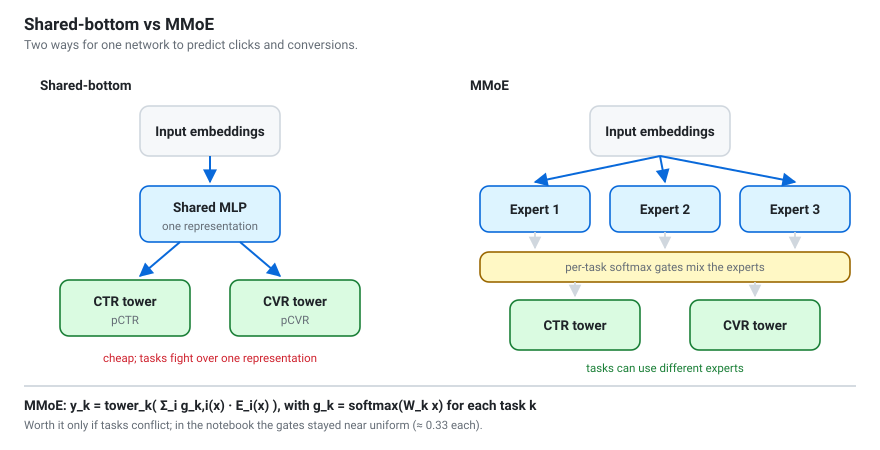
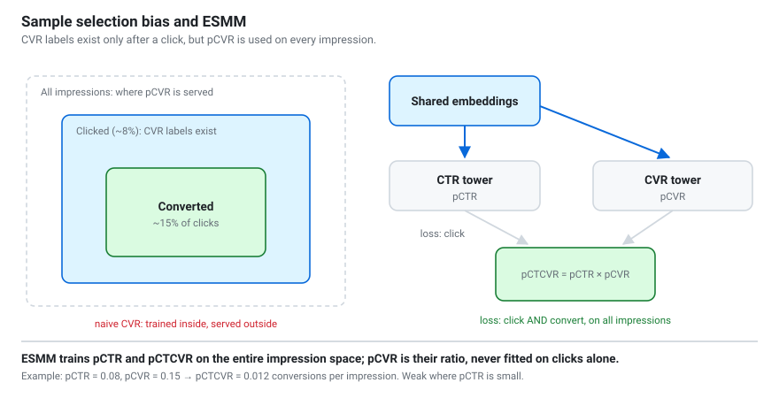
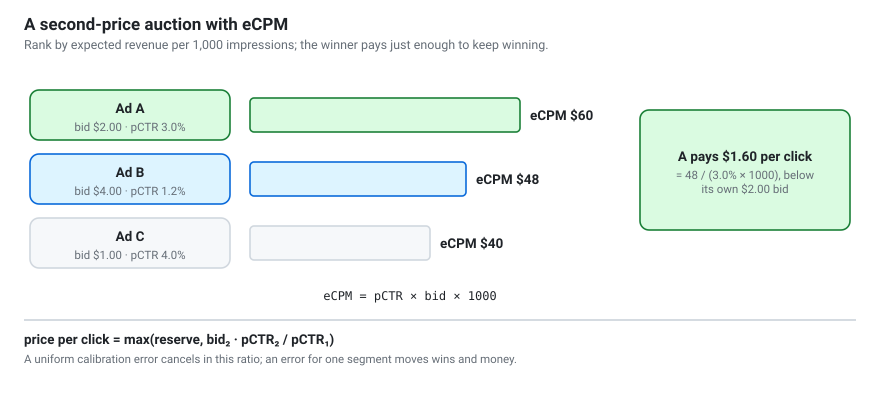
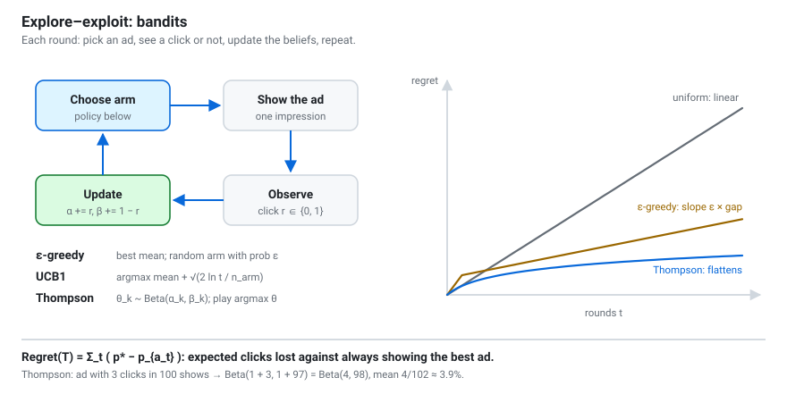

# Chapter 52 · Multi-task ranking & exploration

*Part III · Prerequisites: Chapters 23, 24, 29, 51 · Estimated time: reading ~45 min, lab ~90 min · Compute: T4 GPU (runs on CPU with a reduced budget)*

 · [Lab: notebook.ipynb](notebook.ipynb) · [Solutions](solutions.md)

## Learning objectives

After this chapter you should be able to:

1. Describe shared-bottom and multi-gate mixture-of-experts (MMoE) architectures for multi-task ranking,
   and explain negative transfer.
2. Define sample selection bias in conversion-rate modelling and explain the entire-space idea of ESMM,
   including its limitations.
3. Combine several predictions into one ranking score and reason about the resulting Pareto trade-off.
4. Compute the winner and price of a second-price auction with a reserve, state revenue equivalence, and
   explain how calibration errors change allocation and prices.
5. Implement ε-greedy, UCB1 and Thompson sampling, define regret, and apply bandits to cold-start ads.

## 52.1 Introduction

Chapter 51 built a model that predicts a single probability, the click-through rate. A production ranking
system needs more than one prediction. An advertising system predicts clicks and conversions, combines them
with advertisers' bids and the value of a conversion, sells each ad slot in an auction, and must keep
showing new ads about which it has little data. A content feed similarly predicts clicks, watch time,
likes and hides, and blends them into one ordering.

This chapter studies four connected problems:

* **Multi-task learning** (Sections 52.2–52.3): training one network for several related targets, and the
  bias that arises because conversions are only observed after clicks.
* **Objective blending** (Section 52.4): turning several predictions into a single ranking score.
* **Auctions** (Section 52.5): how the ranking score determines who wins and what they pay, and why
  calibration matters.
* **Exploration** (Section 52.6): how a system that always shows its current best guess can still learn
  about new options.

The lab uses Chapter 51's synthetic generator with higher base rates (CTR ≈ 8%; about 15% of clicks convert)
and a *negative* correlation (about −0.3) between the click and conversion logits: some of what makes people
click, such as eye-catching or misleading creatives, makes them less likely to buy. The two tasks therefore
partly disagree, which is the situation in which multi-task design choices matter. Because the simulator
knows the true conversion probability of every impression, including those that were never clicked, it can
measure biases that a real log cannot.

**Measured on CPU vs expected on a T4.** All numbers quoted from the lab come from the CPU budget (300,000
training impressions). The lab makes no T4 measurements; on a T4 the same experiments should simply run
faster and on more data (not measured).

## 52.2 Multi-task architectures

Multi-task learning (Caruana, 1997) trains one model for several targets, sharing parameters between them.
Sharing has two benefits: a data-poor task (conversions) can borrow the representation learned from a
data-rich task (clicks), and one model is cheaper to serve than several. It also has a cost, **negative
transfer**: when tasks conflict, training for one can hurt the other.

* **Shared-bottom.** All tasks share the embeddings and one MLP (the *bottom*); each task has a small
  *tower* on top. It is cheap and the usual default, but one representation must serve every task.
* **MMoE** (Ma et al., 2018, KDD). The single shared MLP is replaced by $E$ parallel *expert* networks
  $f_1, \dots, f_E$. Each task $k$ has its own **gate**, a softmax over the experts computed from the input,
  so that the input to task $k$'s tower is

$$
\mathbf{h}^{k}(\mathbf{x}) = \sum_{i=1}^{E} g^{k}_{i}(\mathbf{x})\, f_i(\mathbf{x}), \qquad
\mathbf{g}^{k}(\mathbf{x}) = \operatorname{softmax}\!\left(W_{g}^{k}\, \mathbf{x}\right)
\qquad (52.1)
$$

  where $W_{g}^{k}$ is the gate's weight matrix. Tasks can share experts where they agree and use different
  experts where they disagree, and the mixture can differ from one example to the next.

*Figure 52.1 — Shared-bottom (left) and MMoE (right). MMoE changes only what lies between the embeddings and
the towers; if its gates remain uniform it is a more expensive shared-bottom.*

Nothing forces the experts to specialise. With mild task conflict and little data they may remain
interchangeable. *Measured on CPU:* shared-bottom and MMoE (three experts) were nearly identical (MMoE ahead by
about 0.001 in NE), and the gate weights stayed close to uniform (each expert received 0.30–0.36 of the weight
for both tasks). The practical lesson is to measure the gain before paying MMoE's extra computation.

In the lab every model trains for one epoch. In development runs a second epoch made every model worse on
the test set (NE up by about 0.05–0.07): the one-epoch overfitting typical of embedding-heavy models,
discussed in Chapter 51.

## 52.3 Sample selection bias and ESMM

A conversion can only be observed after a click. The standard ("naive") conversion model is therefore trained
on clicked impressions only, with loss $\mathrm{BCE}(\mathrm{pCVR}, \text{conversion})$ on those rows. But the
ranker *uses* pCVR on every candidate impression, before anyone has clicked. The model is trained on one
population and applied to another; this is **sample selection bias (SSB)**. Real logs cannot measure it,
because nobody observes whether a non-clicked impression would have converted.

In the simulator the bias is visible directly. The mean true CVR was ≈ 0.22 on non-clicked impressions but
≈ 0.15 on clicked ones, because of the negative correlation between the tasks. *Measured:* the naive models'
pCVR was well calibrated on clicked impressions (predicted/true ≈ 1.00–1.02) but **under-predicted by 14–19%
on non-clicked impressions**, the population it never saw in training.

**ESMM** (Ma et al., 2018, SIGIR; the *entire space multi-task model*) changes the loss rather than the
network. It defines the probability that an impression is clicked *and* converts,

$$
\mathrm{pCTCVR}(\mathbf{x}) = \mathrm{pCTR}(\mathbf{x}) \times \mathrm{pCVR}(\mathbf{x}), \qquad
\mathcal{L} = \mathrm{BCE}(\mathrm{pCTR}, \text{click}) + \mathrm{BCE}(\mathrm{pCTCVR}, \text{click} \wedge \text{conversion})
\qquad (52.2)
$$

Both terms are defined on **all** impressions, so pCVR is never fitted to clicked rows alone, and it shares
embeddings with the data-rich click task. For example, $0.08 \times 0.15 = 0.012$ expected conversions per
impression.

*Figure 52.2 — Nested populations: all impressions, clicked impressions, conversions. The naive CVR model learns
inside the clicked subset but is used on all impressions; both ESMM losses are defined on all impressions.*

ESMM is not a guaranteed fix. *Measured on CPU:* ESMM slightly improved CTR (NE 0.850 against 0.855) because its
CTCVR loss adds signal to the shared layers, but its pCVR was *more* biased on non-clicked impressions (≈ 0.77 of
the truth) and ranked worse (CVR AUC ≈ 0.59 against ≈ 0.70), and its pCTCVR AUC was lower than the naive models'
(≈ 0.75 against ≈ 0.77). The reason is that pCVR receives gradient only through the product
$\mathrm{pCTR} \cdot \mathrm{pCVR}$, which is weak where pCTR is small, and one epoch on about 3,600 conversions
is not enough data. The original paper reported gains on billions of impressions. Later work adds explicit
corrections, such as inverse-propensity weighting and doubly robust estimators (for example ESCM², Wang et al.,
2022). As with any method, the benefit must be measured on the data at hand.

## 52.4 Blending objectives and the Pareto frontier

A ranker needs one score per candidate. A common form is a weighted product,

$$
\text{score} = \mathrm{pCTR}^{a} \cdot \mathrm{pCVR}^{b} \cdot \text{value}
\qquad (52.3)
$$

where *value* is the worth of a conversion (basket size, or the advertiser's bid per conversion), and $a$ and
$b$ are tuning parameters. With $b = 0$ the score ranks for clicks × value; with calibrated predictions and
$a = b = 1$ it is exactly the expected value per impression. For example, pCTR 0.1, pCVR 0.2 and value 50 give
$0.1 \cdot 0.2 \cdot 50 = 1.0$. Exponents other than 1 are tuning knobs and remove that interpretation.

No setting is "correct": each trades clicks against conversions and value. The useful object is the **Pareto
frontier**, the set of settings for which no metric can be improved without worsening another. The lab groups
test impressions into requests of 10 candidates, selects the top-scored candidate with MMoE's predictions for a
grid of $(a, b)$, and scores each choice with the *true* probabilities.

*Measured:* a random choice gave ≈ 77 clicks and ≈ 145 value per 1,000 requests. Ranking by value alone gave few
clicks (≈ 76); clicks peaked at ≈ 244 with $a = 2, b = 0$ but value fell to ≈ 441; value peaked near $a = 1,
b = 1.5$ (≈ 562). Moving along the frontier traded about 25% of value for about 40% more clicks. The choice among
frontier points is a product decision, usually made by running online experiments (Chapter 29) at a few points
and choosing according to an explicit objective, for example "maximise value subject to CTR not falling by more
than 2%".

## 52.5 Auctions

Advertisers typically bid per click, while the platform sells impressions. To compare ads, the auction ranks
by expected revenue per thousand impressions:

$$
\mathrm{eCPM}_i = \mathrm{pCTR}_i \cdot \text{bid}_i \cdot 1000
\qquad (52.4)
$$

### Second-price auctions

In a **second-price** auction (for a single slot this coincides with the generalised second-price (GSP) and
Vickrey–Clarke–Groves (VCG) auctions), the winner pays the *smallest* bid with which it would still have won. The
winner keeps winning as long as $\text{bid}_1 \mathrm{pCTR}_1 \ge \text{bid}_2 \mathrm{pCTR}_2$, so the price per
click is

$$
\text{price per click} = \max\!\left(\text{reserve},\ \frac{\text{bid}_2 \cdot \mathrm{pCTR}_2}{\mathrm{pCTR}_1}\right) \le \text{bid}_1
\qquad (52.5)
$$

where index 1 denotes the winner and 2 the runner-up. A **reserve price** is a floor: bids below it are not
eligible, and the winner pays at least the reserve. Charging Equation (52.5) only when a click occurs makes the
expected payment per impression equal to the runner-up's eCPM.

*Worked example.* Ad A bids \$2.00 with pCTR 3% (eCPM 60); ad B bids \$4.00 with pCTR 1.2% (eCPM 48). A wins and
pays $4.00 \times 0.012 / 0.03 = \$1.60$ per click, below its bid.

*Figure 52.3 — Three ads ranked by eCPM. Ad A wins and pays \$1.60 per click. The price depends on the runner-up's
eCPM and on the winner's own pCTR.*

In a second-price auction a bid only determines *whether* the bidder wins, not *what* it pays, so bidding one's
true value is a dominant strategy (Vickrey, 1961). In a **first-price** auction the winner pays its own bid, so
rational bidders shade their bids below their value. Display-advertising exchanges moved from second to first
price around 2019, largely for reasons of transparency between exchanges. With budgets, multiple slots and
repeated auctions, the truthfulness guarantee no longer holds exactly and real advertisers bid strategically.

### Two classical results

With $n$ bidders whose values are independent and uniform on $[0, 1]$, a second-price auction with truthful bids
and a first-price auction with the equilibrium bids $\tfrac{n-1}{n} v$ earn the same expected revenue,

$$
\mathbb{E}[\text{revenue}] = \frac{n - 1}{n + 1}
\qquad (52.6)
$$

(*revenue equivalence*). A reserve price raises revenue up to a point; for uniform values the optimal reserve is
0.5 regardless of $n$ (Myerson, 1981). *Simulated (seeded):* both formats earned ≈ 0.600 with $n = 4$ (theory
3/5); a reserve of 0.5 raised revenue to ≈ 0.613 with 6% of impressions unsold, while 0.75 overshot (≈ 0.538,
about 32% unsold).

### Calibration and the auction

Equation (52.5) shows how pCTR errors propagate. *Measured in the lab's simulation (5 ads per auction, true CTRs
from the test set, log-normal bids):*

* **Every** pCTR over-predicted by a factor 1.5 changed nothing: the factor cancels in the ratio
  $\mathrm{pCTR}_2/\mathrm{pCTR}_1$, so winners and per-click prices are identical. Only comparisons with
  quantities the model does not scale (reserves expressed per impression, other ad formats, organic content)
  would shift.
* **One** advertiser over-predicted raised its share of wins from 0.19 to 0.26: it won auctions it should have
  lost, while platform revenue and total advertiser value fell slightly. Its value per unit of cost *rose*
  (2.67 → 3.05), because its inflated pCTR is in the denominator of its own price; the other advertisers bore the
  cost.
* Unbiased noise in pCTR cost the most revenue: misranking is a loss even without bias.

This is why calibration is monitored *per segment* (format, placement, country, new versus old ads), not only
overall.

## 52.6 Exploration and bandits

A ranker that always shows its current best guess never learns about the alternatives, and a new ad without
history never gets the chance to show its quality. The **multi-armed bandit** formalises this
*exploration–exploitation* trade-off. At each round $t$ the policy chooses one of $K$ arms (ads) with unknown click
probabilities $p_k$, observes a reward $r_t \in \{0, 1\}$, and aims to minimise the **regret**, the expected clicks
lost relative to always playing the best arm:

$$
\mathrm{Regret}(T) = \sum_{t=1}^{T} \left( p^{*} - p_{a_t} \right)
\qquad (52.7)
$$

where $p^{*} = \max_k p_k$ and $a_t$ is the arm played at round $t$. Three standard policies are:

* **ε-greedy**: play the arm with the best empirical CTR, but a random arm with probability ε. It explores at a
  fixed rate forever, so its regret grows linearly.
* **UCB1** (Auer et al., 2002): play the arm with the highest upper confidence bound,

$$
a_t = \arg\max_k \left( \hat{p}_k + \sqrt{\frac{2 \ln t}{n_k}} \right)
\qquad (52.8)
$$

  where $\hat{p}_k$ and $n_k$ are arm $k$'s empirical CTR and number of plays. This is "optimism under
  uncertainty": rarely played arms receive a large bonus.
* **Thompson sampling**: keep a Beta posterior per arm, draw one sample from each, and play the largest:

$$
\theta_k \sim \mathrm{Beta}(\alpha_k, \beta_k), \quad a_t = \arg\max_k \theta_k, \qquad
\alpha_{a_t} \mathrel{+}= r_t, \quad \beta_{a_t} \mathrel{+}= 1 - r_t
\qquad (52.9)
$$

  It explores each arm in proportion to the probability that the arm is best, incorporates prior knowledge
  naturally, and tolerates delayed and batched feedback. It is usually the strongest in practice (Chapelle &
  Li, 2011).

*Worked example.* An ad with 3 clicks in 100 impressions and a Beta(1, 1) prior has posterior
$\mathrm{Beta}(4, 98)$ with mean $4/102 = 3.9\%$. Its UCB1 bonus at $t = 10{,}000$ is
$\sqrt{2 \ln 10^4 / 100} = 0.43$, very large next to a 3% CTR.

*Figure 52.4 — The bandit loop and the three policies. Regret that keeps growing linearly means the policy never
stops paying for exploration; a flattening curve means it has mostly found the best arm.*

*Simulated (10 ads with CTRs from 1% to 5%, 50,000 rounds, 20 seeds):* uniform play lost ≈ 999 clicks. Pure greedy
lost ≈ 900 on average with an enormous spread (standard deviation ≈ 581), because after one impression per ad most
estimates are zero and greedy often fixes on a mediocre ad. UCB1 performed poorly (≈ 763) because its bonus is
sized for rewards spread over $[0, 1]$ and is far too large for 1–5% CTRs (KL-UCB addresses this). ε-greedy and
Thompson sampling ended near the same total (≈ 185), but Thompson added less regret in the second half and was
much more consistent across runs (standard deviation ≈ 51 against ≈ 123).

### Cold-start ads

In production the set of arms changes: new ads launch daily with no history and old ones expire. The lab
simulates a pool in which three new ads arrive every 1,500 rounds and each lives 6,000 rounds, with CTRs drawn
from a long-tailed Beta(1.5, 48.5) distribution (mean 3%). Each new ad receives a prior equal to its category's
CTR, expressed as a Beta prior worth 10 impressions, Beta(0.3, 9.7). *Simulated:* Thompson sampling halved the
regret of a greedy ranker (≈ 344 against ≈ 690 over 30,000 rounds; ε-greedy ≈ 542) by giving young ads about 28%
of impressions instead of 11%. Greedy tries a new ad only when every incumbent looks worse than the prior mean,
so it misses the rare excellent new ads.

Production systems extend this in three ways: they use **context** (contextual bandits such as LinUCB, Li et al.,
2010, or Thompson sampling on a Bayesian last layer of the CTR model); they **cap the exploration budget** (for
example 1–5% of traffic, or a boost only for ads with fewer than $N$ impressions); and they **log the propensity**
(the probability of each decision), so that exploration traffic doubles as unbiased data for off-policy
evaluation (Chapter 23).

## Key terms

| Term | Definition |
|---|---|
| CVR, pCVR | Conversion rate among clicked impressions; pCVR is its prediction. |
| pCTCVR | The probability that an impression is clicked and converts, pCTR × pCVR. |
| Multi-task learning | Training one model with shared parameters for several targets. |
| Negative transfer | Degradation of one task caused by sharing parameters with a conflicting task. |
| Expert, gate (MMoE) | Parallel sub-networks, and a per-task softmax that mixes them for each input. |
| Sample selection bias | Training on a selected subpopulation (clicked rows) and applying the model to the whole population. |
| Pareto frontier | The settings for which no metric can be improved without worsening another. |
| eCPM | Expected revenue per thousand impressions, pCTR × bid × 1000. |
| Second-price auction | An auction in which the winner pays the smallest bid that would still have won. |
| Reserve price | A minimum price; bids below it are ineligible. |
| Revenue equivalence | Under standard assumptions, first- and second-price auctions yield equal expected revenue. |
| Multi-armed bandit | Sequential choice among options with unknown rewards, learning while choosing. |
| Regret | Expected reward lost relative to always choosing the best option. |
| Thompson sampling | Choosing the arm with the largest sample from each arm's posterior distribution. |
| Propensity | The probability with which a logging policy chose the action it took. |

## Summary

1. Multi-task models share parameters across targets; MMoE (Equation 52.1) lets tasks mix experts differently,
   but in the lab its gates stayed uniform and it matched shared-bottom.
2. A CVR model trained on clicked rows suffers sample selection bias; in the simulation it under-predicted by
   14–19% on non-clicked impressions.
3. ESMM (Equation 52.2) trains on the entire impression space, but pCVR receives weak gradient through the product
   and, on small data, did not reduce the bias.
4. Blended scores (Equation 52.3) trade clicks against value along a Pareto frontier; the operating point is a
   product decision tested online.
5. Second-price auctions charge the minimum winning bid (Equation 52.5); truthful bidding is dominant, and first-
   and second-price auctions are revenue-equivalent under standard assumptions (Equation 52.6).
6. A uniform calibration error leaves winners and prices unchanged; a segment-specific error changes allocation and
   shifts costs between advertisers, so calibration is monitored per segment.
7. Bandit policies balance exploration and exploitation; Thompson sampling (Equation 52.9) gave the lowest and most
   consistent regret in the lab and halved the regret of greedy ranking for cold-start ads.
8. Production exploration uses context, a capped budget and logged propensities.

## Exercises

The exercises are in the lab, [notebook.ipynb](notebook.ipynb); worked answers are in
[solutions.md](solutions.md).

* **Exercise 1 · `second_price_auction`.** Implement a single-slot second-price auction with a reserve price,
  returning the winner and the price per click of Equation (52.5).
* **Exercise 2 · `thompson_sampling`.** Implement Thompson sampling for a Bernoulli bandit with Beta(1, 1) priors
  and return the cumulative expected regret of Equation (52.7).
* **Exercise 3 · Segment miscalibration and the exploration budget.** Analyse a model that over-predicts CTR by 10%
  for video ads only: which auctions change, who pays more or less, the short- and long-term effects, detection and
  remedies; then decide how to set an exploration budget.
* **Checkpoint questions** at the end of the lab: shared-bottom versus MMoE; selection bias and ESMM; blending
  objectives; auctions and calibration; choosing a bandit policy for cold start; and the design of a "conversion
  value" objective.

## Further reading

* Caruana, R. (1997). Multitask learning. *Machine Learning*, 28(1), 41–75.
* Ma, J. et al. (2018). Modeling task relationships in multi-task learning with multi-gate mixture-of-experts.
  *KDD 2018*.
* Ma, X. et al. (2018). Entire space multi-task model: an effective approach for estimating post-click conversion
  rate. *SIGIR 2018*.
* Vickrey, W. (1961). Counterspeculation, auctions, and competitive sealed tenders. *Journal of Finance*, 16(1).
* Edelman, B., Ostrovsky, M. & Schwarz, M. (2007). Internet advertising and the generalized second-price auction.
  *American Economic Review*, 97(1).
* Auer, P., Cesa-Bianchi, N. & Fischer, P. (2002). Finite-time analysis of the multiarmed bandit problem.
  *Machine Learning*, 47.
* Chapelle, O. & Li, L. (2011). An empirical evaluation of Thompson sampling. *NeurIPS 2011*.
* Lattimore, T. & Szepesvári, C. (2020). *Bandit Algorithms.* Cambridge University Press.

**Next:** [Chapter 53 · Fairness, robustness & privacy](../ch53-fairness-robustness-and-privacy/README.md)
