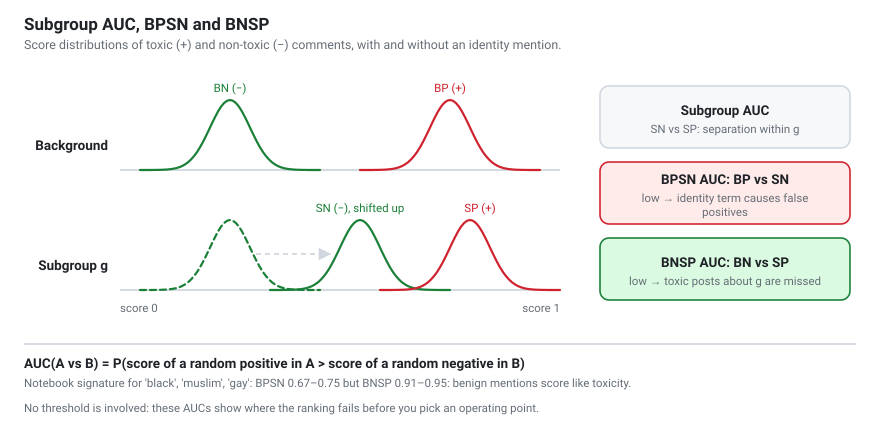
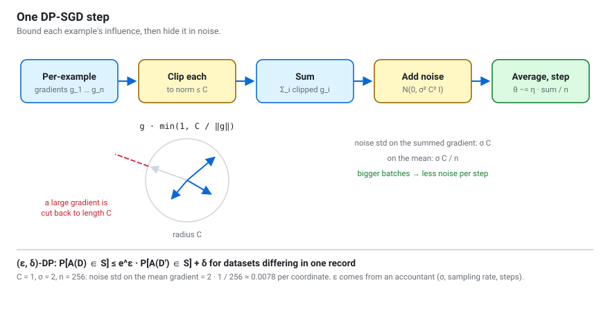

# Chapter 53 · Fairness, robustness & privacy

*Part III · Prerequisites: Chapters 8, 9, 15, 29 · Estimated time: reading ~45 min, lab ~90 min · Compute: T4 GPU (runs on CPU with a reduced budget)*

[](https://colab.research.google.com/github/berdakh/MLBOOTCAMP/blob/main/part3-deep-learning-systems/ch53-fairness-robustness-and-privacy/notebook.ipynb) · [Lab: notebook.ipynb](notebook.ipynb) · [Solutions](solutions.md)

> **Content note.** The lab trains on real online comments labelled for toxicity, some of which are
> offensive. It never prints comment text, only identifiers, counts and metrics.

## Learning objectives

After this chapter you should be able to:

1. Compute subgroup AUC, BPSN AUC and BNSP AUC, and false-positive and false-negative rate gaps, and explain
   which kind of bias each reveals.
2. Explain why a single threshold yields different error rates per group, what per-group thresholds trade,
   and why not all error rates can be equalised at once.
3. Design robustness tests for distribution shift (time, source) and for perturbations (typos,
   counterfactual identity swaps).
4. Describe good practice for personally identifiable information, and measure a membership-inference attack.
5. State the definition of differential privacy, implement a DP-SGD step, and describe the privacy–utility
   trade-off.

## 53.1 Introduction

The preceding chapters evaluated models mainly through aggregate metrics: one AUC, one log loss, one latency
percentile. Aggregate metrics can hide failures that matter a great deal to the people affected. This chapter
studies three such classes of failure, using a toxicity classifier for online comments as the running example:

* **Unfair errors.** A classifier with a high overall AUC may flag comments that merely *mention* an identity
  ("I am a gay man", "as a Muslim, I think…") as toxic, so that the very groups a moderation policy should
  protect have their ordinary speech removed.
* **Lack of robustness.** A model that performs well on a random test split may degrade when the data
  drift over time, come from a new source, or are deliberately perturbed (misspellings intended to evade the
  filter).
* **Privacy leakage.** A model can reveal information about its training records, for example whether a
  particular person's data was used.

Each of these has quantitative tools, and interviewers expect quantitative answers. The lab uses the Civil
Comments data set in its WILDS version (448,000 comments; Koh et al., 2021). Each comment has a toxicity score
(the fraction of about ten crowd raters who called it toxic) and, for this subset, identity scores (the fraction
of raters who said it *mentions* a given identity); both are binarised at 0.5. The classifier is TF-IDF on word
unigrams and bigrams followed by logistic regression: fast, strong for its cost, and transparent enough that its
biases are easy to diagnose.

**Measured on CPU vs expected on a T4.** Everything in the lab is CPU-friendly; numbers quoted below come from the
CPU-budget run (60,000 training and 40,000 test comments). Fine-tuning a transformer is the natural extension; on a
T4 it would typically raise overall AUC by a few points, but whether it closes the subgroup gaps must be measured
(not measured in our verification runs).

## 53.2 Subgroup metrics

*Measured baseline:* about 11% of comments are toxic overall, but 23–33% of those mentioning *black*, *white*,
*homosexual* or *muslim*. The model's test AUC was 0.893.

Overall AUC hides *where* the errors are. Recall that the AUC between a set of positives $P$ and a set of negatives
$N$ is the probability that a randomly chosen positive scores higher than a randomly chosen negative:

```math
\mathrm{AUC}(P, N) = \Pr\big(s(x^{+}) > s(x^{-})\big), \qquad x^{+} \sim P,\ x^{-} \sim N
\qquad (53.1)
```

with ties counted as one half. For an identity subgroup $g$, split the test set four ways: subgroup positives (SP,
toxic comments mentioning $g$), subgroup negatives (SN), background positives (BP, toxic comments not mentioning $g$)
and background negatives (BN). Borkan et al. (2019) define three AUCs:

```math
\begin{aligned}
\text{Subgroup AUC} &= \mathrm{AUC}(\text{SP},\ \text{SN}) \\
\text{BPSN AUC} &= \mathrm{AUC}(\text{BP},\ \text{SN}) \\
\text{BNSP AUC} &= \mathrm{AUC}(\text{SP},\ \text{BN})
\end{aligned}
\qquad (53.2)
```

* **Subgroup AUC** is low when the model separates toxic from non-toxic comments poorly *within* conversations
  about $g$.
* **BPSN** (background positive, subgroup negative) is low when benign comments mentioning $g$ score higher than
  genuinely toxic comments elsewhere: **false positives driven by the identity term**.
* **BNSP** (background negative, subgroup positive) is low when toxic comments about $g$ score lower than benign
  comments elsewhere: **false negatives**.

None of the three depends on a threshold. A BPSN of 0.70 means that in 30% of (toxic background, benign subgroup)
pairs the benign subgroup comment scores higher.



*Figure 53.1 — Score distributions for background and subgroup comments. When the subgroup's non-toxic scores
shift to the right, BPSN falls while BNSP stays high.*

The pattern of the three numbers is diagnostic. If a model adds a roughly constant amount to the score of every
comment that mentions the identity, the benign subgroup comments climb above toxic background comments (BPSN
falls) while toxic subgroup comments rise further above benign background ones (BNSP rises). A low BPSN combined
with a high BNSP is therefore the signature of the identity term itself acting as a toxicity signal. A low subgroup
AUC with normal BPSN and BNSP indicates instead that the model simply ranks poorly within that topic.

*Measured:* subgroup AUCs were 0.78–0.80 for *black*, *homosexual_gay_or_lesbian*, *muslim* and *white*; their
**BPSN AUCs were as low as 0.67–0.75**, while their BNSP AUCs were high (0.91–0.95). *christian* showed the opposite
pattern (BPSN 0.91, BNSP 0.86). The Jigsaw competition combined such per-group numbers into a summary with a
generalised (power) mean,

```math
M_p(m_1, \dots, m_G) = \Big(\frac{1}{G} \sum_{g=1}^{G} m_g^{\,p}\Big)^{1/p}, \qquad p = -5
\qquad (53.3)
```

A negative exponent pulls the mean towards the *worst* group: $M_{-5}(0.9, 0.7) = 0.765$, whereas the arithmetic
mean is 0.80. The lab's summary metric was ≈ 0.848.

**Uncertainty.** Subgroups are small (from 486 to about 5,000 test comments, with a few dozen to a few hundred
positives), so subgroup metrics vary between samples. Gaps should be reported with bootstrap confidence intervals
(Chapter 9), and no gap smaller than its interval should be acted on.

## 53.3 Thresholds and the impossibility results

A deployed classifier needs a threshold $t$. The per-group error rates at $t$ are

```math
\mathrm{FPR}_g(t) = \Pr(s \ge t \mid y = 0, g), \qquad \mathrm{FNR}_g(t) = \Pr(s < t \mid y = 1, g)
\qquad (53.4)
```

Because the score distributions of benign comments differ by group, one global threshold cuts them at different
quantiles. *Measured:* at $t = 0.5$ the FPR on benign comments mentioning *black* was 0.083 against 0.010 overall,
an eightfold ratio; at $t = 0.3$ benign comments mentioning *black*, *homosexual* or *muslim* were flagged 13–22% of
the time against 3.5% overall. (The overall FNR at 0.5 was 0.72: with an 11% base rate, logistic regression rarely
scores above 0.5, so a real deployment would choose a lower threshold.)

**Per-group thresholds** can equalise one error rate. In the lab, thresholds chosen so that every group has the
background's FPR (0.004) had to be 0.81–0.88 for the affected groups, and their FNR rose to 0.91–0.94: most toxic
comments about these groups would go unflagged. Equal FPR was obtained at the price of unequal, and worse, FNR.

This is not a peculiarity of the data. When base rates differ between groups, no non-trivial classifier can
simultaneously equalise false-positive rates, false-negative rates and calibration (Kleinberg et al., 2016;
Chouldechova, 2017). One must decide which error causes the greater harm in the application, state that choice,
and document it. Per-group thresholds also require the group attribute at prediction time, which is often
unavailable and may not be lawful to use.

## 53.4 Robustness to distribution shift

A random train/test split measures *interpolation*: test data come from the same distribution as the training data.
Production data come from the future and from new sources. A **shift test** trains on one slice and evaluates on
held-out data from the same slice and from a different one:

* **time:** train on 2016 comments; test on held-out 2016 comments and on comments from the last months of 2017;
* **source:** train on the largest publication; test on it and on all other publications.

*Measured:* both shifts cost a little ranking quality (AUC 0.868 → 0.855 for time, 0.866 → 0.859 for source) and
more **calibration**: the ratio of mean score to toxic rate fell from 0.89 to 0.82 on late-2017 comments, whose toxic
rate was higher (0.124 against 0.108). On a random split none of this is visible. Calibration under shift should
therefore be checked as routinely as ranking quality, and the post-launch monitoring of Chapter 15 should track it.

## 53.5 Robustness to perturbations and counterfactual fairness

Perturbation tests change inputs in controlled ways and measure the effect on predictions:

* **Typos.** Swapping two adjacent letters in about 20% of the words of toxic test comments reduced recall from 0.285
  to 0.254 (11% relative). A word-level TF-IDF model has never seen the misspelt tokens; character n-gram or subword
  models are more robust. Adversaries exploit this deliberately (for example "id1ot").
* **Counterfactual identity swaps.** Replacing one identity term with another in the same sentence ("muslim" ↔
  "christian") should not change the toxicity score, because the meaning of the comment, as far as toxicity is
  concerned, has not changed. This property is called **counterfactual fairness** in this context. It is tested with
  neutral templates (Dixon et al., 2018) and with real non-toxic comments that contain the term.

*Measured:* neutral template sentences scored 0.50 with "gay", 0.30 with "black" and 0.20 with "muslim", against
0.03–0.05 with "american", "straight", "christian" or "young". In real non-toxic comments, replacing "gay" by
"straight" lowered the mean score from 0.187 to 0.077 and the flag rate at 0.5 from 5.7% to 0.7%. The model's
decision depends on *who* is mentioned.

The likely causes are worth stating precisely, since they determine the remedy. In the training data an identity
term co-occurs disproportionately with toxic comments (attacks mention it more often than everyday conversation
does), so the model learns the word as a toxicity signal; annotators may also label comments mentioning some identities
more harshly; and a bag-of-words model cannot use context to distinguish "I am Muslim" from an insult. Remedies operate
on the data (adding or up-weighting benign comments that mention the identity, counterfactual augmentation), on the model
(contextual models, fairness-aware training objectives) and on the policy (routing uncertain identity-mentioning comments
to human review rather than removing them automatically). Each has a cost that should be measured.

## 53.6 Privacy: PII and membership inference

**Personally identifiable information (PII)** such as names, email addresses, phone numbers and postal addresses appears
in training data and in logs. Standard practice is to collect as little as possible, to redact or tokenise PII before it
reaches training data and logs, to restrict access, to set retention limits, and to honour deletion requests. Deletion is
difficult once a record has been used for training, which is a further reason to keep PII out. Regular expressions catch
structured PII (emails, phone numbers, card numbers); names and addresses require a named-entity recognition model. In the
lab, a regex redactor found no emails or phone numbers in 40,000 test comments (the data set was already filtered) but
about 1,100 URLs.

**Membership inference** (Shokri et al., 2017) asks whether an attacker who can query a model can tell if a given record
was in its training set. If the model behaves differently on training examples than on unseen ones (lower loss, higher
confidence), the answer is yes, which is a privacy leak even though no data are ever displayed. The simplest attack
thresholds the per-example loss; the AUC of this attack in distinguishing members from non-members measures the leak, with
0.5 meaning no leak.

*Measured (5,000 training comments):* with weak regularisation ($C = 100$) the model fitted its training set perfectly
(train AUC 1.000); members had mean loss 0.016 against 0.365 for non-members, and the attack reached AUC ≈ 0.64. Stronger
regularisation ($C = 0.1$) brought the attack down to ≈ 0.57 at a small cost in test AUC (0.785 → 0.774). The attack's
success tracks the gap between training and test loss, that is, memorisation. Small data sets, rare or outlying records and
large models increase the risk.

## 53.7 Differential privacy and DP-SGD

**Differential privacy** (Dwork & Roth, 2014) gives a guarantee that does not depend on what the attacker knows. A
randomised training algorithm $A$ is $(\varepsilon, \delta)$-differentially private if, for every pair of *neighbouring*
data sets $D$ and $D'$ (differing by one record) and every set of possible outputs $S$,

```math
\Pr[A(D) \in S] \le e^{\varepsilon}\, \Pr[A(D') \in S] + \delta
\qquad (53.5)
```

Adding or removing any one record changes the probability of any outcome by at most a factor $e^{\varepsilon}$, plus a
small slack $\delta$ (typically much smaller than one over the number of records). Smaller $\varepsilon$ means stronger
privacy; $\varepsilon = 1$ bounds the factor by $e \approx 2.7$. Under such a guarantee membership inference provably
cannot do much better than guessing.

**DP-SGD** (Abadi et al., 2016) makes stochastic gradient descent differentially private with two changes to each step.
For a batch of $n$ examples with per-example gradients $g_i$:

```math
\bar{g}_i = g_i \cdot \min\!\left(1, \frac{C}{\lVert g_i \rVert_2}\right), \qquad
\tilde{g} = \frac{1}{n}\left( \sum_{i=1}^{n} \bar{g}_i + \mathcal{N}(0, \sigma^2 C^2 I) \right), \qquad
\theta \leftarrow \theta - \eta\, \tilde{g}
\qquad (53.6)
```

1. **Clipping** each example's gradient to L2 norm at most $C$ bounds the contribution of any single record to the sum
   (the *sensitivity* of the sum is $C$).
2. **Gaussian noise** with standard deviation $\sigma C$, scaled to that bound, is added to the sum before averaging. Here
   $\sigma$ is the *noise multiplier* and $\eta$ the learning rate.

The noise on the averaged gradient has standard deviation $\sigma C / n$ per coordinate; for $C = 1$, $\sigma = 2$ and
$n = 256$ it is about 0.0078. Larger batches therefore reduce the relative effect of the noise, which is why DP-SGD
favours large batches. Clipping must be applied *per example*: clipping the averaged batch gradient bounds nothing about
an individual record. Per-example gradients are obtained in PyTorch with `torch.func.vmap` or the Opacus library.



*Figure 53.2 — One DP-SGD step. Clipping bounds each record's contribution to at most $C$; noise scaled to that bound
hides any single record's contribution.*

Training repeats this step many times on overlapping samples, and privacy loss accumulates. The total $\varepsilon$ is
computed from $\sigma$, the sampling rate and the number of steps by a **privacy accountant** (as in Opacus or TensorFlow
Privacy). An informal bound is not a privacy claim.

*Measured:* the lab trains logistic regression with DP-SGD on 96-dimensional SVD features of the TF-IDF matrix (for
logistic regression the per-example gradient is simply $`(p - y)\,\mathbf{x}`$). Non-private training reached test AUC
≈ 0.72 on these features; clipping alone changed little; noise then cost accuracy smoothly: $\sigma = 1$
($\varepsilon \le 9.6$ by the lab's loose bound) ≈ 0.72, $\sigma = 2$ ($\varepsilon \le 4.4$) ≈ 0.71, $\sigma = 4$
($\varepsilon \le 2.1$) ≈ 0.68, $\sigma = 8$ ($\varepsilon \le 1.0$) ≈ 0.63. Strong guarantees cost real accuracy unless
much more data or a pretrained model is available. The $\varepsilon$ values come from a simplified bound; a proper
accountant with Poisson sampling would report smaller values for the same $\sigma$.

## 53.8 A launch review

The tools of this chapter combine into a launch checklist for a model that affects people:

* **Fairness:** subgroup AUC, BPSN, BNSP and FPR/FNR per relevant group, with confidence intervals, on recent labelled
  data from the deployment population; a documented threshold choice; template and counterfactual tests in continuous
  integration.
* **Robustness:** evaluation on later data and other sources; perturbation and adversarial tests; calibration under shift.
* **Privacy:** PII redaction in training data and logs; data minimisation and retention per applicable law; a
  membership-inference audit or DP training when user content is trained on; access control.
* **Operations:** an appeal path for affected users, per-group monitoring dashboards, and explicit rollback criteria
  (Chapter 15).

## Key terms

| Term | Definition |
|---|---|
| Subgroup / background | Test examples that mention a given identity / all other test examples. |
| Subgroup AUC | AUC computed only within the subgroup. |
| BPSN AUC | AUC of background positives against subgroup negatives; low values indicate identity-driven false positives. |
| BNSP AUC | AUC of subgroup positives against background negatives; low values indicate missed positives in the subgroup. |
| FPR / FNR | Fraction of negatives flagged / fraction of positives missed, at a threshold. |
| Impossibility results | With different base rates, FPR, FNR and calibration cannot all be equal across groups. |
| Distribution shift | A difference between the training distribution and the data on which a model is used. |
| Counterfactual identity swap | Replacing one identity term by another and checking that the prediction does not change. |
| PII | Personally identifiable information, such as names, emails and phone numbers. |
| Membership inference | Inferring whether a record was in the training set from the model's behaviour on it. |
| Differential privacy | A guarantee that one record changes the probability of any training outcome by at most $e^{\varepsilon}$ (plus $\delta$). |
| DP-SGD | SGD with per-example gradient clipping and Gaussian noise added to the summed gradient. |
| Privacy accountant | A procedure that composes per-step privacy losses into a total $(\varepsilon, \delta)$. |

## Summary

1. Overall metrics hide subgroup failures; subgroup, BPSN and BNSP AUCs (Equation 53.2) locate them without a threshold.
2. Low BPSN with high BNSP is the signature of an identity term acting as a toxicity signal; the lab measured BPSN of
   0.67–0.75 for several groups against an overall AUC of 0.893.
3. A single threshold produces different FPRs per group (eightfold at 0.5 in the lab); per-group thresholds can equalise
   one error rate only by worsening another.
4. With different base rates, FPR, FNR and calibration cannot all be equalised; the choice must be justified by the harm.
5. Shift tests on time and source revealed small AUC losses and larger calibration losses invisible on a random split.
6. Template and counterfactual swap tests showed that the model's scores depend on which identity is mentioned.
7. Membership-inference attacks exploit memorisation; their success tracks the train–test loss gap and falls with
   regularisation.
8. DP-SGD (Equation 53.6) provides differential privacy (Equation 53.5) by per-example clipping and calibrated noise, at a
   measurable cost in accuracy; the total $\varepsilon$ requires an accountant.

## Exercises

The exercises are in the lab, [notebook.ipynb](notebook.ipynb); worked answers are in
[solutions.md](solutions.md).

* **Exercise 1 · `bpsn_bnsp_auc`.** Compute BPSN and BNSP AUC (Equation 53.2) from labels, scores and a subgroup mask.
* **Exercise 2 · `clip_and_noise`.** Implement the clipping and noising of one DP-SGD step (Equation 53.6).
* **Exercise 3 · Explaining and mitigating a subgroup gap.** Explain a low BPSN to a product manager, give likely causes,
  propose mitigations with their trade-offs, and specify post-launch monitoring and rollback criteria.
* **Checkpoint questions** at the end of the lab: the three bias AUCs; thresholds and impossibility; robustness tests;
  membership inference; DP-SGD and the meaning of $\varepsilon$; and a launch review for a moderation model in a new
  country.

## Further reading

* Borkan, D., Dixon, L., Sorensen, J., Thain, N. & Vasserman, L. (2019). Nuanced metrics for measuring unintended bias
  with real data for text classification. *Companion Proceedings of The Web Conference 2019*.
* Dixon, L., Li, J., Sorensen, J., Thain, N. & Vasserman, L. (2018). Measuring and mitigating unintended bias in text
  classification. *AIES 2018*.
* Kleinberg, J., Mullainathan, S. & Raghavan, M. (2017). Inherent trade-offs in the fair determination of risk scores.
  *ITCS 2017* (arXiv:1609.05807, 2016).
* Chouldechova, A. (2017). Fair prediction with disparate impact: a study of bias in recidivism prediction instruments.
  *Big Data*, 5(2).
* Barocas, S., Hardt, M. & Narayanan, A. (2023). *Fairness and Machine Learning: Limitations and Opportunities.* MIT Press.
* Koh, P. W. et al. (2021). WILDS: a benchmark of in-the-wild distribution shifts. *ICML 2021*.
* Shokri, R., Stronati, M., Song, C. & Shmatikov, V. (2017). Membership inference attacks against machine learning models.
  *IEEE Symposium on Security and Privacy 2017*.
* Dwork, C. & Roth, A. (2014). *The Algorithmic Foundations of Differential Privacy.* Foundations and Trends in
  Theoretical Computer Science, 9(3–4).
* Abadi, M. et al. (2016). Deep learning with differential privacy. *ACM CCS 2016*.

**Next:** [Chapter 54 · Evaluating LLM systems & guardrails](../ch54-evaluating-llm-systems-and-guardrails/README.md)
