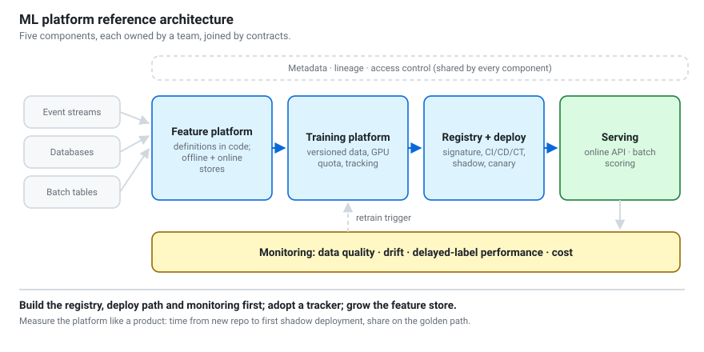

# Chapter 55 · ML platform design

*Part III · Prerequisites: Chapters 15, 18, 21, 22, 29, 37, 48 · Estimated time: reading ~45 min, lab ~90 min · Compute: CPU*

[](https://colab.research.google.com/github/berdakh/MLBOOTCAMP/blob/main/part3-deep-learning-systems/ch55-ml-platform-design/notebook.ipynb) · [Lab: notebook.ipynb](notebook.ipynb) · [Solutions](solutions.md)

## Learning objectives

After this chapter you should be able to:

1. Structure the design of an ML platform around its users, the contracts between teams and its service levels.
2. Design a feature platform (one definition, offline and online stores, point-in-time correctness, streaming,
   backfills, ownership) and estimate its storage and cost.
3. Design a training platform (data versioning, scheduling and quotas, experiment tracking, reproducibility) and
   estimate the cost of a workload, including idle capacity.
4. Describe the path from model registry to production (CI/CD/CT, shadow, canary, A/B test, rollback) and compute
   how long a canary must run to detect a regression.
5. Design platform-level monitoring that copes with delayed labels.
6. Argue organisational trade-offs (build or buy, golden paths, cost governance) and record a decision as an
   architecture decision record with a risk register.

## 55.1 Introduction

Chapter 18 designed a single model, and Chapter 37 a single product (a feed, a search engine). In an organisation
with many such products, the same problems recur in every team: computing features consistently for training and
serving, scheduling GPU jobs, versioning data and models, deploying safely, monitoring. An **ML platform** is the
shared infrastructure that solves these problems once, so that, say, fifty teams can build, deploy and monitor their
models without each re-implementing it.

A platform design differs from a product design in one essential respect: its **users are other engineers and
scientists**, and the platform succeeds only if they choose to use it. The difficult parts are therefore not only
algorithms but **contracts** (the interfaces that let teams work independently), **cost** (who pays for shared
hardware, and how idle capacity is avoided) and **adoption** (why a team would migrate). These are the topics of
"staff-level" design interviews, and of the corresponding work.

The lab contains no measurements of a real platform. Every number is computed by small, documented functions in
`src/scaleml/design.py` from inputs printed as explicit `ASSUMPTIONS`, with placeholder prices. Changing the inputs may
change the conclusions; making the assumptions explicit is the skill being practised. All computations run on a CPU.

## 55.2 Structuring a platform design

A platform answer is organised around users, requirements and contracts rather than around boxes. A workable skeleton
for a 45-minute discussion is:

| Step | Content | Minutes |
|---|---|---|
| 1. Users and use cases | Which teams, how many models, which kinds (ranking, forecasting, LLM applications); batch or online; current pain points | 4 |
| 2. Requirements and SLOs | Freshness, latency (p99), availability, scale (entities, queries per second, jobs per day), compliance (deletion, audit) | 4 |
| 3. Components | Feature, training, registry and deployment, serving, monitoring; drawn once, then two examined in depth | 10 |
| 4. Contracts | Feature definitions, model signatures, ownership, on-call responsibilities | 6 |
| 5. Trade-offs | For each deep dive: two options, the criterion that decides between them, what would change the decision | 8 |
| 6. Adoption and migration | The golden path, what is built first, how the first teams are onboarded, what is deliberately not built | 5 |
| 7. Cost and governance | Storage, compute, GPU quotas, who pays, idle capacity | 4 |
| 8. Risks | A short register with likelihood, impact, mitigation and owner | 4 |



*Figure 55.1 — The components of an ML platform. Every arrow is a contract between teams: feature definitions, data
snapshots, model signatures. A metadata layer records lineage across all components.*

What distinguishes a senior-level from a staff-level answer, in the generic terms interviewers commonly use, is scope:
a senior answer designs each component correctly; a staff answer also states which component to build first and which
to buy or postpone, defines the contracts that let many teams move independently, attaches numbers to cost and to the
platform's own success (for example the time from a new idea to its first online experiment), and names the
organisational failure modes, such as a platform that no team adopts or a feature store that nobody owns. Sculley et
al. (2015) remains the classic account of why the code around a model, rather than the model, dominates the cost of
ML systems.

## 55.3 The feature platform

Chapters 21 and 22 built point-in-time joins and streaming features for one project. At platform scale the questions
concern **guarantees and ownership**:

* **One definition, two stores.** A feature is defined once in code (a transformation, an entity key, an event
  timestamp). The platform materialises it to an **offline** columnar store, which keeps history for training, and to
  an **online** key-value store, which serves the latest value at low latency. Without a single definition,
  training/serving skew is the default; with it, every feature must fit the platform's definition language, and unusual
  features need an escape hatch.
* **Point-in-time correctness.** The offline store keeps history with event timestamps, and training sets are built by
  *as-of joins* on (entity, label time): each training row sees only feature values known at its label's time. Snapshot
  stores are cheaper but leak the future (Chapter 5).
* **Streaming.** Windowed aggregates (counts and sums over 5 minutes, 1 hour, 1 day) are computed from event streams and
  written to the online store; the same logic is run in batch for history. Two code paths tend to drift apart; one
  engine for both is simpler but may limit latency or throughput.
* **Freshness SLOs** are set per feature group ("last 10 clicks within 60 s", "30-day spend within 24 h"). Freshness is
  expensive, and most features do not need it.
* **Backfills** compute a new feature's history over the training window with the *same* code, as a new version rather
  than an overwrite. A backfill that joins today's dimension tables to past events leaks information.
* **Ownership.** Every feature group has an owning team, an on-call rota, a freshness SLO, a deprecation path, and
  tracked consumers (lineage). Without owners, a store of thousands of features becomes impossible to maintain.
* **Privacy and deletion.** Entity-keyed storage makes "delete user X" a keyed delete, which the offline history must
  also honour.

A consistency check completes the design: a **skew monitor** compares logged online feature values with an offline
recomputation for a sample of requests.

### Sizing the stores

The online store is usually the expensive one, because it lives in memory or on fast SSD and is replicated. With $E$
entities, key size $k$ bytes, $F$ features of $b$ bytes each, a storage overhead factor $o$ and $r$ replicas,

```math
\text{online GB} = \frac{E \cdot (k + F \cdot b) \cdot o \cdot r}{10^9}
\qquad (55.1)
```

For $E = 2 \times 10^8$ users, $k = 16$, $F = 400$, $b = 4$, $o = 1.5$ and $r = 3$, this gives about 1,454 GB. The lab's
offline history for the same features is about 29.2 TB compressed. With the placeholder prices the online store costs
roughly ten times as much as the offline store while holding about one twentieth of the bytes. The levers for reducing it
each have a cost: serve only features that a production model reads (requires a usage-based clean-up process); store
values in fp16, int8 or buckets (costs precision); keep a hot tier for active users and defaults or a slower tier for
dormant ones (costs quality for those users); or use fewer replicas (costs availability).

## 55.4 The training platform

The training platform turns code, data and configuration into registered model versions:

* **Data versioning.** Training sets are immutable, content-addressed snapshots: a manifest of files and hashes, plus the
  feature and label query and its as-of time. Every run records the snapshot identifier.
* **Scheduling.** A queue with **quotas per team** (a guaranteed share plus borrowable burst capacity), priorities,
  **gang scheduling** for multi-GPU jobs (all workers start together or none do), and preemption of low-priority jobs,
  which requires checkpoint and resume (Chapter 48). Strict quotas waste idle GPUs; a fully shared pool lets one team
  starve others; "guaranteed + borrow + preempt" is the usual compromise.
* **Experiment tracking.** Every run logs the code version, configuration, data snapshot, environment (container image
  digest), metrics and artefacts. Logging is cheap; consistency is not, so tracking should be the default in the
  project template rather than a recommendation in a wiki.
* **Reproducibility** is defined as agreement *within a stated tolerance*, not bit-identical results, since some GPU
  kernels are non-deterministic. Full determinism costs speed and is reserved for jobs that need it, such as audited
  models.

### Costing a workload

GPU-hours are best estimated from a measured step time (Chapters 39–40, 47–48). Before anything can be measured, a
dense transformer's training compute can be estimated as about six floating-point operations per parameter per token
(two for the forward pass, four for the backward pass; Kaplan et al., 2020):

```math
\text{FLOPs} \approx 6\, N\, D, \qquad
\text{GPU-hours} = \frac{6\, N\, D}{\text{peak FLOP/s} \cdot \mathrm{MFU} \cdot 3600}
\qquad (55.2)
```

where $N$ is the number of parameters, $D$ the number of training tokens and MFU the model FLOPs utilisation, the
fraction of peak throughput actually achieved (Chapter 48). For $N = 10^9$, $D = 2 \times 10^9$, a peak of
65 TFLOP/s and MFU 0.3, this gives $1.2 \times 10^{19}$ FLOPs and about 171 GPU-hours. A training-platform answer should
ask both questions: does the job fit in memory (this one does not fit on a single T4), and how long does it take?

### The price of idle capacity

For a platform, the surprising number is usually **idle capacity**: reserved GPUs waiting for data, for a notebook left
open, or for a job queued behind a gang-scheduled one. If a GPU with hourly price $p$ is usefully busy a fraction $u$ of
the time,

```math
\text{cost per useful GPU-hour} = \frac{p}{u}
\qquad (55.3)
```

A \$2 card used 20% of the time costs \$10 per useful hour. In the lab's illustrative four-team table, 48% of the monthly
GPU spend was idle. "Utilisation" must itself be defined: allocated versus idle (the scheduler's view) is not the same as
streaming-multiprocessor activity or MFU (the hardware's view); a job can hold a GPU at 100% allocation and 15% MFU because
it is limited by input loading. The remedies, in increasing order of effort, are showback dashboards (each team sees its
spend), automatic reaping of idle interactive sessions, a shared preemptible burst pool for checkpointed jobs, and
right-sizing (small fine-tuning jobs on small cards). Each requires a policy agreed between teams, which is why cost
governance is an organisational problem.

## 55.5 Registry, CI/CD/CT and safe rollout

A **model registry** stores versions together with their contracts: the artefact, its input/output **signature**, the
training snapshot and code version, the evaluation report, the model card, and the approval state with its approver.
Around it run three automated processes:

* **Continuous integration (CI)**, on every code change: unit tests on feature code, schema and signature tests, a tiny
  training run that must reach a sanity loss, a serving smoke test (Chapter 12 and Chapter 13).
* **Continuous delivery (CD)**, on every candidate model: offline evaluation against the current champion on the *same*
  snapshot with confidence intervals and slice checks (Chapter 38), latency and memory tests in the serving image, then
  staged rollout.
* **Continuous training (CT)**: retraining on a schedule or a trigger (drift, new data), producing a *candidate* that
  passes through the same CD gates. Automating retraining without automating evaluation lets bad models reach
  production unattended.

Each rollout stage proves some things and not others:

| Stage | What it shows | What it cannot show |
|---|---|---|
| Shadow (scores live traffic, results discarded) | It runs at production load, latency and error rate; its prediction distribution versus the champion | Any effect on users |
| Canary (1–5% of traffic) | No *large* regression in errors, latency or guardrail metrics | Small effects (too little traffic and time) |
| A/B test (days to weeks) | The business effect, with an interval | Long-term effects; interference between units |
| Rollback | A single command restores the previous, still-warm version | Rolling back *data* (a bad backfill) is harder; features must be versioned too |

### How long must a canary run?

A canary comparison of error rates is a two-proportion test like any A/B test (Chapter 29). With baseline rate $p_1$,
degraded rate $p_2$, two-sided significance $\alpha$ and power $1 - \beta$, the sample size per arm is

```math
n = \frac{\left( z_{1-\alpha/2} \sqrt{2 \bar{p} (1 - \bar{p})} + z_{1-\beta} \sqrt{p_1 (1 - p_1) + p_2 (1 - p_2)} \right)^2}{(p_2 - p_1)^2},
\qquad \bar{p} = \frac{p_1 + p_2}{2}
\qquad (55.4)
```

where $z_q$ is the standard normal quantile. For an error rate rising from 0.5% to 0.6% (+20%), with $z = 1.96$ and $0.84$,
$n \approx 85{,}900$ requests per arm: about 72 minutes of a 1% canary at a peak of 2,000 requests per second. A doubling
of the error rate needs only about 4,700 requests, a few minutes. The required sample grows as $1/\Delta^2$ in the effect
$\Delta = p_2 - p_1$, so halving the detectable effect quadruples the canary's duration. Hence the usual pattern: a short
canary catches crashes and large regressions, and small effects are left to the A/B test.

## 55.6 The monitoring platform

Chapter 15 built drift checks and a rollback for one model. A platform offers monitoring as a **service** that every model
receives by registering:

| Layer | Signals | Response |
|---|---|---|
| Data quality | Schema violations, null rates, ranges, feature freshness against its SLO, late upstream jobs | Page if a production model is affected; otherwise a ticket to the owner |
| Prediction health | Score distribution drift, fallback rate, latency, error rate | Page on fallbacks and errors; ticket on drift alone |
| Delayed-label performance | Metrics on labels as they mature, compared at equal maturity | Ticket; page only for large, confirmed drops |
| Business guardrails | Product metrics the model can harm | Owned by the product team, linked from the model page |
| Cost | GPU-hours, replicas, storage per model | Weekly showback |

**Delayed labels** are the main difficulty. A fraud chargeback or a subscription cancellation may arrive weeks after the
prediction. If the delay is roughly exponential with mean $\tau$, the fraction of eventual labels visible after time $t$ is

```math
F(t) = 1 - e^{-t/\tau}
\qquad (55.5)
```

With $\tau = 20$ days, 5%, 30%, 50%, 78%, 95% and 99% of labels are visible after 1, 7, 14, 30, 60 and 90 days. Two
consequences must be built into the platform. First, model versions must be compared **at equal label maturity**: last week's
predictions have fewer observed positives than last month's, which looks like a drop in recall but is not. Second, while labels
mature, the platform relies on **leading indicators**: input and score drift, early proxy labels (a disputed transaction before
the chargeback) and a small human-reviewed sample. The same delayed-feedback problem appeared for conversions in Chapter 51.

## 55.7 Organisational trade-offs

**Build or buy** is decided per component, not for the platform as a whole:

| Criterion | Favours buying (managed service or open source) | Favours building |
|---|---|---|
| Differentiation | Commodity functions: experiment tracking, object storage, schedulers | Functions that make the organisation's models better |
| Scale and latency | Within the product's documented limits | Far beyond them |
| Team capacity | No capacity to staff an on-call rota | A similar system is already operated |
| Cost curve | Cost grows gently with use | Per-unit pricing becomes a top cost line |
| Compliance | The vendor meets data-residency and audit requirements | It does not |

A thin API in front of a bought component keeps the decision reversible.

**Adoption.** A platform nobody adopts is pure cost. The pattern that tends to work is a single **golden path** (or paved road):
a project template with feature definitions, a training job, a registry entry, deployment configuration and dashboards already
connected, which takes a new model from repository to shadow traffic in days. Teams with unusual needs get escape hatches, and the
first two or three teams receive migration help, chosen because they are influential and have a real problem that the platform
removes. The platform is measured like a product: time from new repository to first shadow deployment, share of production models
on the golden path, pages per model per month.

**Cost governance** combines showback per team and per model, quotas with borrowable burst, idle reaping, a monthly review of the
largest cost lines, and the rule that every production model has an owner who can be asked whether it is still worth its cost.

**What to build first.** A common sequence: the registry, deployment path and monitoring hooks first (every model needs them, and
they make rollback safe); an existing experiment tracker and scheduler adopted rather than built; and the feature platform built
incrementally, starting from the offline store and point-in-time training sets, adding the online store when the first
latency-sensitive model needs it.

## 55.8 Risk registers and decision records

Design work at this level is written down. A **risk register** lists what could go wrong with the programme, not only with a model,
and scores each risk as likelihood × impact on 1–5 scales (in the lab, a score of at least 15 is high and at least 8 medium), with a
mitigation and an owner. In the lab's register, training/serving skew (16) and unhonoured deletion requests (15) were high; GPU
spend, adoption and an automatically deployed regression scored 12. The scores are judgements, not data; their value is that they
force a discussion of mitigations and owners.

An **architecture decision record (ADR)** records one decision: its context, the options considered, the decision, its
consequences and the conditions under which it should be revisited. The lab generates ADR-001 for the online feature store. A useful
ADR contains a genuine alternative rather than a straw man, states the deciding criterion before the decision, includes at least one
number with its assumptions, and gives measurable "revisit when" triggers (for example "idle GPU share above 30% for two months").

## Key terms

| Term | Definition |
|---|---|
| ML platform | Shared infrastructure that many teams use to build, deploy and monitor models. |
| Feature store | A system that defines features once and serves them offline (training) and online (serving). |
| Point-in-time correctness | Each training row uses only feature values known at its label's time. |
| Backfill | Computing a feature's history over past data with the same code that computes it going forward. |
| Freshness SLO | A bound on how old a served feature value may be. |
| Gang scheduling | Starting all workers of a distributed job together, or none of them. |
| MFU | Model FLOPs utilisation: achieved useful FLOP/s divided by the hardware's peak. |
| Showback / chargeback | Reporting each team's cost to it / actually billing it. |
| Model registry | A store of model versions with their signature, data snapshot, evaluation and approval. |
| CI / CD / CT | Continuous integration, delivery and training: automated testing, rollout and retraining. |
| Shadow / canary | A new model scoring live traffic without effect / serving a small share of real traffic. |
| Label maturity | The fraction of eventual labels already observed. |
| Golden path | A supported, pre-configured route from a new project to production. |
| ADR | Architecture decision record: one decision with options, consequences and revisit triggers. |

## Summary

1. A platform's users are engineers; its design is organised around users, requirements, contracts, cost and adoption.
2. A feature platform defines each feature once, materialises it offline and online, guarantees point-in-time correctness and
   assigns ownership; the online store dominates storage cost (Equation 55.1).
3. Training cost can be estimated from $6ND$ FLOPs and an assumed MFU (Equation 55.2); idle capacity raises the cost per useful
   GPU-hour to $p/u$ (Equation 55.3).
4. CI, CD and CT automate tests, rollout and retraining; automated retraining requires automated evaluation gates.
5. A 1% canary detects crashes and large regressions within minutes, but a +20% change in a 0.5% error rate needs about 85,900
   requests per arm (Equation 55.4).
6. With delayed labels, versions are compared at equal maturity (Equation 55.5) and leading indicators are used meanwhile.
7. Build-or-buy is decided per component; adoption is driven by a golden path and measured like a product.
8. Risk registers and ADRs make assumptions, mitigations and revisit conditions explicit.

## Exercises

The exercises are in the lab, [notebook.ipynb](notebook.ipynb); worked answers are in
[solutions.md](solutions.md).

* **Exercise 1 · `feature_store_storage_gb`.** Compute raw feature-store storage in decimal GB from entities, features, bytes per
  value, versions and replicas, and give the answer for 200M × 400 × 4 B × 2 × 3 mentally.
* **Exercise 2 · `gpu_cost`.** Compute the cost of a GPU reservation.
* **Exercise 3 · `utilization_waste`.** Split a reservation's cost into useful and wasted parts and compute the cost per useful
  GPU-hour (Equation 55.3).
* **Exercise 4 · Written ADR.** Write ADR-002 for one platform decision, with options, a deciding criterion, a number from the lab's
  calculators and measurable revisit triggers.
* **Checkpoint questions** at the end of the lab: a feature platform for 50 teams; online-store sizing; a doubled GPU bill; the
  path of a retrained model to full traffic; delayed labels; and buying versus building a feature store.

## Further reading

* Sculley, D. et al. (2015). Hidden technical debt in machine learning systems. *NeurIPS 2015*.
* Baylor, D. et al. (2017). TFX: A TensorFlow-based production-scale machine learning platform. *KDD 2017*.
* Breck, E., Cai, S., Nielsen, E., Salib, M. & Sculley, D. (2017). The ML test score: a rubric for ML production readiness and
  technical debt reduction. *IEEE Big Data 2017*.
* Kaplan, J. et al. (2020). Scaling laws for neural language models. arXiv:2001.08361.
* Kleppmann, M. (2017). *Designing Data-Intensive Applications.* O'Reilly.
* Huyen, C. (2022). *Designing Machine Learning Systems.* O'Reilly.
* Kohavi, R., Tang, D. & Xu, Y. (2020). *Trustworthy Online Controlled Experiments.* Cambridge University Press.
* Beyer, B., Jones, C., Petoff, J. & Murphy, N. R. (eds.) (2016). *Site Reliability Engineering.* O'Reilly.

**Next:** [Chapter 56 · Large-scale design cases](../ch56-large-scale-design-cases/README.md)
