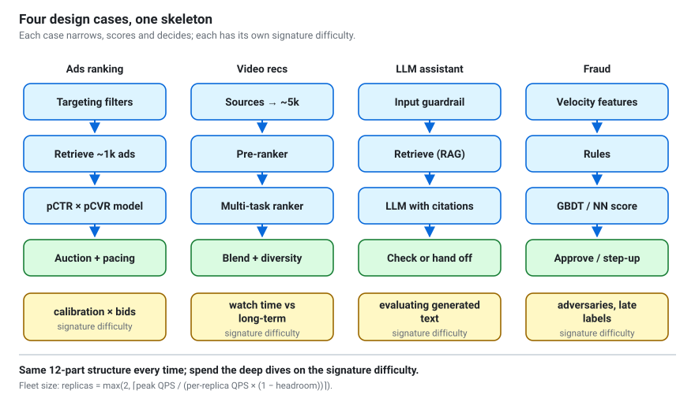

# Chapter 56 · Large-scale design cases

*Part III · Prerequisites: Chapters 18, 37, 50, 51, 52, 54, 55 · Estimated time: reading ~50 min, lab ~90 min · Compute: CPU*

 · [Lab: notebook.ipynb](notebook.ipynb) · [Solutions](solutions.md)

## Learning objectives

After this chapter you should be able to:

1. Work through any ML system design problem with a fixed twelve-part structure, stating numbers as assumptions.
2. Explain, with a small simulation, why advertising predictions must be calibrated and why budgets must be paced.
3. Explain why a raw watch-time objective favours long videos, and how recommendation systems counter it.
4. Estimate the cost of an LLM assistant per conversation, including re-sent history, and compare it with a human
   fallback.
5. Split a latency budget across stages, compute the effect of fan-out on tail latency, and size a serving fleet with
   headroom and zone redundancy.
6. Describe what a staff-level design adds to a senior-level one in each case.

## 56.1 Introduction

Chapter 37 introduced a framework for designing recommendation and search systems, and Chapter 55 designed the platform
underneath many such systems. This chapter applies both to four design problems that, between them, cover most of what
large consumer technology companies ask in senior and staff-level ML system design interviews:

1. **ads ranking**, whose signature difficulty is calibration and the auction;
2. **video recommendations**, whose signature difficulty is optimising long-term value rather than raw watch time;
3. **an LLM-powered support assistant**, whose signature difficulty is evaluating generated text;
4. **real-time payment fraud detection**, whose signature difficulty is adversaries combined with delayed and selective
   labels.

Each case shares a generic shape (narrow the candidates, score them, decide), and a generic "retrieve, rank, serve" answer
covers that shape. What distinguishes a strong answer is the treatment of the case's *signature difficulty*. The chapter
therefore presents each case in the same twelve-part structure, then examines its signature difficulty with numbers and,
where possible, a small simulation.

The lab's simulations are small synthetic models built to demonstrate a *mechanism*; their numbers are not estimates of any
real system. All traffic figures, prices and latencies are explicit assumptions. Everything runs on a CPU.

## 56.2 One structure for every case

Each case is described by twelve parts:

| Part | Question it answers |
|---|---|
| Requirements | Who uses it, what decision is made, scale, latency, constraints (policy, money, regulation) |
| Metrics | **Online** (the business outcome, from experiments), **offline** (computable on logs), **guardrails** (must not worsen) |
| Data and labels | Where labels come from, how late they arrive, how the current system biases them |
| Candidate generation | How the space of options is narrowed, or an explicit statement that it is not needed |
| Ranking / model | Model family and objective; what is predicted and how predictions are combined |
| Serving and latency | Queries per second, stages, per-stage milliseconds, fallbacks |
| Training cadence | Batch, incremental or online, and why |
| Experimentation | Randomisation unit, metrics, duration, interference |
| Monitoring | What pages an engineer, what creates a ticket |
| Failure modes | What breaks, and what the system does then |
| Senior answer | Generic signals of a strong senior-level answer |
| Staff additions | What a staff-level answer adds |

The "senior" and "staff" rows describe signals that interviewers commonly look for, not any particular company's career
ladder.

*Figure 56.1 — The four cases share the shape narrow → score → decide. The highlighted box in each column is the case's
signature difficulty, where the deep dives belong.*

### Two calculators

Two calculations recur in every case. The first is **capacity**. Peak load in queries per second (QPS) follows from daily
active users (DAU):

$$
\text{QPS}_{\text{peak}} = \frac{\text{DAU} \times \text{requests per user per day}}{86{,}400} \times \frac{\text{peak}}{\text{average}}
\qquad (56.1)
$$

and the number of replicas, with a headroom fraction $h$ kept free for spikes, a lost replica or a deployment, is

$$
\text{replicas} = \max\!\left(2,\ \left\lceil \frac{\text{QPS}_{\text{peak}}}{\text{QPS}_{\text{replica}} \cdot (1 - h)} \right\rceil \right)
\qquad (56.2)
$$

The minimum of two removes the single point of failure. $\text{QPS}_{\text{replica}}$ must be *measured* by load-testing the
real serving image at the target latency (Chapter 50): a replica that handles 50 requests per second at a p99 of 300 ms may
handle only 30 at a p99 of 100 ms. If the system must survive the loss of one of $z$ availability zones, each zone is sized for
$1/(z - 1)$ of the load.

The second is the **latency budget**. The end-to-end limit $T_{\text{total}}$ is divided among the stages, and what remains is
headroom:

$$
\text{headroom} = T_{\text{total}} - \sum_{\text{stages}} t_s
\qquad (56.3)
$$

Budgets are set on high percentiles, and percentiles do not add: the sum of stage p99s is an upper bound on the end-to-end p99 of
a sequential chain. Parallel stages count once, at their slowest member. The largest stage is where optimisation effort goes first;
headroom is not waste, since it absorbs garbage-collection pauses, retries and the next feature.

## 56.3 Case A: ads ranking

*Prompt: "Design the system that chooses which ads to show in a feed with 300 million daily users."*

| Part | Summary |
|---|---|
| Requirements | About 3 ad slots per feed request; ad server p99 ≤ 100 ms within the feed's budget; advertisers set bids and daily budgets; policy review before serving |
| Metrics | Online: revenue per thousand impressions, advertiser value (conversions per unit spend, advertiser retention), feed engagement. Offline: normalised entropy, **calibration** by bucket and segment, AUC. Guardrails: ad load, hide/report rate, latency |
| Data and labels | Clicks (seconds) and conversions (hours to days); labels only for ads the current system showed; negative downsampling for training |
| Candidates | Eligibility, remaining budget and policy filters; retrieval of about 1,000 ads by a two-tower model plus rules |
| Ranking | Multi-task pCTR/pCVR model with sparse embeddings and cross features (Chapter 51); score = bid × pCTR (× pCVR); an auction sets prices (Chapter 52) |
| Serving | About 139,000 peak requests/s, about 200 ads scored per request; precomputed ad embeddings; "no ad" as the fallback, never a broken feed |
| Cadence | Incremental updates every few hours; daily full retrains; recalibration after downsampling |
| Experimentation | User-level A/B tests for ranking; budget-split or advertiser-side designs for auction changes, because budgets are shared across arms |
| Failure modes | Miscalibration shifts money between advertisers; budgets exhausted by noon; delayed conversions under-train new campaigns; click spam |
| Staff additions | The marketplace view (advertiser ROI and retention as long-term metrics), contracts between ranking, auction and pacing teams, budget-split experiments, ownership of calibration incidents, privacy constraints on conversion data |

**Numbers.** With 300 million DAU, 20 feed requests per user per day and a peak-to-average ratio of 2, Equation (56.1) gives
$3 \times 10^8 \times 20 / 86{,}400 \times 2 \approx 138{,}889$ requests per second, or 27.8 million ad scores per second at 200
ads per request. At an assumed 50 requests per second per ranker replica with 30% headroom, Equation (56.2) gives 3,969 replicas.
That number is the signal that the ranker must be batched and probably distilled or cascaded, with a light pre-ranker on the
1,000 candidates and the heavy model on 200 (Chapters 49–50).

**Deep dive: calibration.** In a ranking-only system a model that is wrong by a constant factor still orders items correctly. In an
auction, the prediction is *multiplied by a bid* (eCPM = pCTR × bid × 1000) and the price depends on the ratio of pCTRs (Chapter 52),
so a model that over-predicts one segment's CTR gives that segment auctions it should lose. *Simulated (seeded):* the calibrated
model gave segment B 50% of auctions, as it should; over-predicting segment B by a factor 1.5 raised its share to about 69%, and both
platform revenue (3,172 → 3,057) and advertiser value (5,019 → 4,893) fell, because auctions went to ads that were not actually better.
AUC barely registers a per-segment scale error; calibration plots by segment do. Hence ads teams monitor predicted/observed ratios
per segment and recalibrate after negative downsampling (Chapter 51).

**Deep dive: budget pacing.** An advertiser whose daily budget would be spent in a few hours at full participation should not
disappear for the rest of the day. The simplest pacer participates in only a fraction of eligible auctions, chosen so that spend
tracks the remaining traffic. *Simulated:* greedy spending exhausted the budget during hour 13, leaving ten hours without ads,
whereas a pacer participating at a constant rate of 0.40 spent about 109 in the last six hours instead of 0. Production pacers are
feedback controllers that correct forecast errors every few minutes and interact with bidding.

**Deep dive: delayed feedback.** Conversions arriving days after an impression make recent impressions look negative. The options
are a fixed attribution window (a staler model), a delay model that corrects early labels, or re-labelling when the conversion
arrives (Chapter 51, Section 51.9).

## 56.4 Case B: video recommendations

*Prompt: "Design the 'up next' and home recommendations for a video platform with 200 million daily users and 1 billion videos."*

| Part | Summary |
|---|---|
| Requirements | Home feed and "up next"; p99 ≤ 200 ms; new uploads recommendable within an hour; creator ecosystem health matters |
| Metrics | Online: *satisfied* watch time, return visits, surveys. Offline: recall@K per source, NDCG on held-out sessions, calibration of watch-time predictions. Guardrails: creator diversity, new-creator exposure, policy violations, latency |
| Data and labels | Impressions, clicks, watch time, completion, likes, "not interested", surveys; watch time biased towards long videos and towards what the current system shows |
| Candidates | Several sources merged to about 5,000: two-tower retrieval, co-watch item-to-item, subscriptions, fresh uploads, trending, exploration |
| Ranking | Pre-ranker → multi-task ranker (click, expected watch time, like, dislike, survey score) → blended value function → re-ranking for diversity and policy |
| Cadence | Streaming or incremental updates for freshness plus periodic full retrains; content-based embeddings for new videos |
| Experimentation | User-level A/B tests; long-running holdouts for long-term effects; separate analysis of creator-side metrics (a two-sided marketplace) |
| Failure modes | Clickbait, length bias, feedback loops (popular items become more popular), creator cold start, amplification of harmful content |
| Staff additions | Long-term value against short-term watch time, creator health as a first-class objective, ownership of the value function's weights, cost per recommendation |

**Numbers.** The lab's assumptions give about 144,676 requests per second at peak, 128 GB of fp16 video embeddings (to be sharded or
compressed, for example with product quantisation) and about 72 million heavy-ranker scores per second. Most of the billion videos
have almost no views, so retrieval indexes usually cover the eligible, recently active subset, and the tail is reached through content
features and exploration.

A published design is Covington et al. (2016), which describes a two-stage candidate-generation and ranking system for video and trains
the ranker with *weighted logistic regression*: positive impressions are weighted by watch time, so that the learned odds approximate the
expected watch time. It describes a design published in 2016, not anyone's current practice.

**Deep dive: the watch-time objective.** Ranking by expected watch time ranks by video *length* as much as by quality. *Simulated* (a
synthetic catalogue in which click probability does not depend on length and completion falls with length): the top 100 videos by
expected watch minutes had a median length of about 27 minutes, against 6 for the catalogue and 6–7 for click or completion objectives,
and the lowest mean quality of the four objectives. No single objective is right: completion favours short clips and watch minutes
favours long ones. Production systems blend several predicted quantities with weights chosen by experiment (Chapter 52), monitor the
length distribution of what they serve, reserve a few percent of slots for exploration (bandits, Chapter 52), and guard new-creator
exposure so that the feedback loop does not only feed what has already succeeded.

## 56.5 Case C: an LLM-powered support assistant

*Prompt: "Design an assistant that answers customer-support chats for a company with one million support conversations a day,
handing off to humans when needed."*

| Part | Summary |
|---|---|
| Requirements | Answers grounded in help content and the customer's account data; time to first token ≤ 1.5 s; no irreversible account actions without confirmation; hand-off to a human with a summary |
| Metrics | Online: resolution without a human (verified by no re-contact within 7 days), satisfaction, handle time saved. Offline: correctness and groundedness on a labelled evaluation set, retrieval recall@k, guardrail precision and recall (Chapter 54). Guardrails: wrong-action rate, policy violations, cost per conversation |
| Data and labels | Historical conversations, versioned help articles, a human-graded evaluation set stratified by intent; an LLM judge only after its agreement with humans is measured |
| Candidates | Retrieval-augmented generation (Lewis et al., 2020): hybrid lexical and dense retrieval over help articles (Chapters 45–46); account data through access-controlled tools |
| Model | Re-ranker over passages; an instruction model generates answers with citations; intent and risk classifiers choose between answering, asking for clarification and handing off |
| Serving | Streaming generation; retrieval ≤ 150 ms; input and output guardrails; per-turn timeouts with graceful hand-off |
| Cadence | Index updates when articles change; prompt changes pass the same evaluation gates as model changes; fine-tuning only when evaluation shows that prompting and retrieval are not enough |
| Failure modes | Invented policies (a refund that does not exist), prompt injection through user text or retrieved content, stale articles, loops that never hand off, cost growth on long chats |
| Staff additions | Evaluation as a product (who labels, agreement, refresh), rollout by intent risk, help content as an owned dependency, vendor versus self-hosted cost curves, an incident process for harmful answers |

**Deep dive: cost per conversation.** A language model keeps no memory between calls, so each turn re-sends the system prompt, the
retrieved passages *and the conversation so far*. With $S$ system-prompt tokens, $R$ retrieved tokens, $U$ user tokens and $A$ answer
tokens per turn, the prompt at turn $t$ and the cost of an $n$-turn conversation are

$$
P_t = S + R + U + (t - 1)(U + A), \qquad
\text{cost} = \sum_{t=1}^{n} \big( P_t\, p_{\text{in}} + A\, p_{\text{out}} \big)
\qquad (56.4)
$$

where $p_{\text{in}}$ and $p_{\text{out}}$ are prices per input and output token. With the lab's assumptions ($S = 800$, $R = 1{,}500$,
$U = 60$, $A = 200$), prompts grow from 2,360 tokens at turn 1 to 3,660 at turn 6; at placeholder prices of \$0.50 and \$2 per million
input and output tokens a six-turn conversation costs about \$0.0114. A human-handled conversation, at a placeholder \$4.00, costs about
350 times as much. With deflection rate $d$ (the share of conversations resolved without a human), the blended cost is

$$
c = c_{\text{LLM}} + (1 - d)\, c_{\text{human}}
\qquad (56.5)
$$

so at $d = 0.5$ it is about \$2.01, dominated by the human term. The **quality of hand-off decisions** (resolving correctly, or handing off
early with a good summary) therefore matters far more than shaving tokens; a wrong answer that causes a re-contact costs more than any token
saving. Token costs still matter at scale, and the levers are summarising history after a few turns, capping retrieved context, caching
the static prompt prefix where the provider supports it, and routing easy intents to a smaller model.

**Evaluation** is the signature difficulty (Chapter 54): a versioned evaluation set stratified by intent and risk, with human labels for
correctness, groundedness (every claim supported by a cited passage) and correct hand-off; retrieval evaluated separately so that failures
can be attributed; an LLM judge used only where its agreement with humans is measured; adversarial sets for prompt injection; and every
prompt, retrieval or model change passing the same gate, because a prompt edit is a model change.

## 56.6 Case D: real-time payment fraud

*Prompt: "Design fraud detection for card payments: 5,000 transactions per second at peak, decision within 100 ms."*

| Part | Summary |
|---|---|
| Requirements | Approve, decline or step up (extra verification) within p99 ≤ 100 ms; explainable reasons for declines; regulatory and card-network constraints |
| Metrics | Online: fraud loss (amount), false-decline rate, step-up rate, approval rate. Offline: recall at a fixed false-positive rate, PR-AUC, **amount-weighted** recall, calibration. Guardrails: latency, decline rate by segment, complaints |
| Data and labels | Chargebacks arrive weeks later; declined transactions are never labelled (**selective labels**); analysts' labels are biased towards cases that rules flagged |
| Candidates | Not applicable: every transaction is scored, and this should be stated |
| Model | Rules for known patterns and compliance (editable the same day) plus gradient-boosted trees or a neural model on velocity features (counts and sums per card, device and merchant over 1 minute to 30 days) and graph features; cost-based thresholds (Chapter 8) |
| Serving | Synchronous call on the payment path; streaming velocity counters; strict per-stage timeouts; fail-open or fail-closed decided per risk tier, never by accident |
| Cadence | Weekly retrains on mature labels; fast rule updates; a small random holdout of approvals to keep unbiased labels |
| Experimentation | Shadow scoring first; A/B tests with loss measured after label maturity; champion/challenger thresholds on a small share |
| Failure modes | Adversarial drift (attackers adapt within days), label delay that hides it, a timing-out feature service that silently declines or approves everyone, false declines that lose good customers |
| Staff additions | Selective-label bias and the exploration holdout that corrects it, the analyst–model feedback loop, fail-open/closed policy by tier with sign-off, red-teaming cadence, regulatory explainability |

**Deep dive: the 100 ms budget and fan-out.** The lab's stages (network and authentication 10, parsing and in-process rules 5, parallel feature
fetch 30, model inference 8, decision and reason codes 4, asynchronous logging 3 ms; all assumptions) sum to 60 ms, leaving 40 ms (40%) of headroom, with the feature fetch the largest stage. The feature fetch calls
$k$ services in parallel and waits for all of them. If each is independently slow with probability $p$, the probability that the request
waits on at least one slow call is

$$
P(\text{some call slow}) = 1 - (1 - p)^{k}
\qquad (56.6)
$$

For $p = 0.01$ this is 5.9% with $k = 6$ and 18.2% with $k = 20$: a request is as slow as its slowest dependency (Dean & Barroso, 2013). In
practice slowness is often correlated (one overloaded cache slows several calls), which can make the tail better or much worse. Fraud
systems therefore keep the hottest features in one low-latency store, set per-call timeouts with **default values** for missing features
(and train the model to expect them), and page on the missing-feature rate.

**Fleet.** At an assumed 400 transactions per second per replica with 30% headroom, Equation (56.2) gives 18 replicas in one zone; across
three zones that must survive the loss of one, 9 per zone, 27 in total. For a scorer on the payment path, that redundancy is a deliberate and
usually justified cost.

**Deep dive: selective labels and adversaries.** Transactions the model declines are never observed as fraud or not, so the next model is
trained only on approved traffic and under-represents the risky region (Lakkaraju et al., 2017). The remedy is a small, randomised approval
holdout below an exposure cap, an explicit and costed exploration policy, with propensity weighting in training and evaluation. Unlike ads or
video, the data-generating process also adapts against the system. The defences are features that are costly for attackers to fake (velocity,
graph structure), fast analyst-editable rules, frequent retrains on the freshest mature labels plus early signals such as customer disputes,
monitoring of score and rule-hit distributions by merchant and channel to detect probing, and regular red-team exercises.

## 56.7 Comparing the cases and the 45-minute format

| | Ads | Video | LLM assistant | Fraud |
|---|---|---|---|---|
| Signature difficulty | Calibration × bids; marketplace | Long-term value against watch time | Evaluating generated text | Adversaries; delayed, selective labels |
| Latency (p99) | ~100 ms within the feed | ~200 ms | Time to first token ~1.5 s, streaming | ≤ 100 ms on the payment path |
| Label delay | Seconds (click) to days (conversion) | Seconds to days (return visits) | Days (re-contact) and human grading | Weeks (chargebacks) |
| Fallback | No ad | Popular or precomputed list | Hand-off to a human | Rules-only decision, per-tier fail-open/closed |
| Likely staff probe | Budget-split experiments, advertiser ROI | Holdouts, creator ecosystem | Evaluation programme, rollout by intent risk | Exploration holdout, fail-open policy |

A 45-minute design discussion can be timed as follows: 0–5 minutes clarifying users, decision, scale, latency and constraints, with assumptions
written down; 5–9 metrics; 9–14 data and labels; 14–24 architecture with numbers (stages, QPS, latency, fleet, memory); 24–34 two deep dives,
one of which should be the signature difficulty; 34–40 experimentation, rollout, monitoring, failure modes and fallbacks; 40–45 trade-offs,
what to build first and what would change the design. A common failure is to spend too long on clarification and to run out of time before the
architecture.

## Key terms

| Term | Definition |
|---|---|
| DAU | Daily active users. |
| Peak QPS | Requests per second at the busiest time: the average multiplied by a peak factor. |
| Headroom | Spare capacity or time reserved for spikes, failures and deployments. |
| Replica | One copy of a serving process; a fleet consists of many replicas. |
| Latency budget | An end-to-end time limit divided into per-stage allowances. |
| Fan-out | One request calling many services in parallel and waiting for all of them. |
| Tail latency | The latency of the slowest requests (for example p99). |
| Budget pacing | Spreading an advertiser's daily budget over the day by controlling participation in auctions. |
| Weighted logistic regression | Logistic regression with positives weighted by a value (such as watch time), so that the odds approximate its expectation. |
| Deflection | The share of conversations resolved without a human. |
| Selective labels | Labels available only for cases the current system allowed through. |
| Fail-open / fail-closed | Allowing / blocking by default when a dependency fails. |

## Summary

1. A fixed twelve-part structure keeps a design complete; the deep dives belong to the case's signature difficulty.
2. Capacity follows from Equations (56.1)–(56.2); per-replica throughput must be measured at the target latency, and zone redundancy is sized
   explicitly.
3. In ads, predictions are multiplied by bids, so a per-segment calibration error moved win share from 50% to about 69% and lowered both revenue
   and advertiser value in the lab's simulation; budgets must be paced.
4. In video, a raw watch-time objective selects long videos (median 27 minutes against 6 in the simulation); objectives are blended and the served
   length distribution is monitored.
5. In an LLM assistant, re-sent history makes prompt tokens grow each turn (Equation 56.4), but the human fallback dominates blended cost
   (Equation 56.5), so hand-off quality matters most.
6. In fraud, fan-out makes tail latency grow quickly with the number of dependencies (Equation 56.6); timeouts with defaults and a single
   low-latency feature store are the remedies.
7. Selective labels bias fraud models towards approved traffic; a costed random holdout restores unbiased labels.
8. Staff-level answers add marketplace and long-term metrics, ownership and contracts, experimental designs that respect interference, and explicit
   policies for failure.

## Exercises

The exercises are in the lab, [notebook.ipynb](notebook.ipynb); worked answers are in
[solutions.md](solutions.md).

* **Exercise 1 · `latency_budget_split`.** Return the remaining milliseconds, each stage's share and the largest stage of a latency budget,
  validating the inputs (Equation 56.3).
* **Exercise 2 · `serving_fleet_size`.** Compute the number of replicas with headroom and a minimum of two (Equation 56.2).
* **Exercise 3 · A full 45-minute design.** Choose one of the four cases or a variation, and write a timed design in the twelve-part structure with
  capacity numbers, a checked latency budget, two deep dives, three failure modes with fallbacks and a staff-level paragraph; then present it aloud.
* **Checkpoint questions** at the end of the lab: calibration in ads; a doubled median video length; the cost of a six-turn conversation; a sudden
  rise in fraud declines; selective labels; and what a staff-level answer adds.

## Further reading

* Covington, P., Adams, J. & Sargin, E. (2016). Deep neural networks for YouTube recommendations. *RecSys 2016*.
* He, X. et al. (2014). Practical lessons from predicting clicks on ads at Facebook. *ADKDD 2014*.
* Lewis, P. et al. (2020). Retrieval-augmented generation for knowledge-intensive NLP tasks. *NeurIPS 2020*.
* Dean, J. & Barroso, L. A. (2013). The tail at scale. *Communications of the ACM*, 56(2).
* Lakkaraju, H. et al. (2017). The selective labels problem: evaluating algorithmic predictions in the presence of unobservables. *KDD 2017*.
* Bolton, R. J. & Hand, D. J. (2002). Statistical fraud detection: a review. *Statistical Science*, 17(3).
* Huyen, C. (2022). *Designing Machine Learning Systems.* O'Reilly.
* Kohavi, R., Tang, D. & Xu, Y. (2020). *Trustworthy Online Controlled Experiments.* Cambridge University Press.

**Next:** [Chapter 57 · ML depth & research discussion](../ch57-ml-depth-and-research-discussion/README.md)
