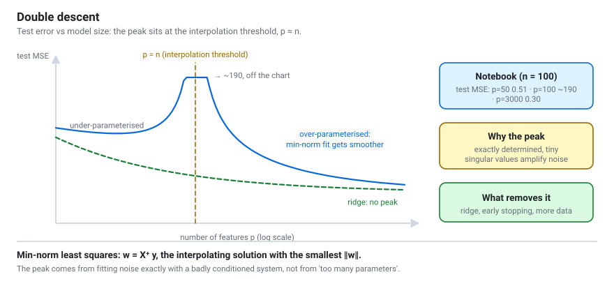

# Chapter 57 · ML depth & research discussion

*Part III · Prerequisites: Chapters 27, 40, 41, 47 · Estimated time: reading ~50 min, lab ~90 min · Compute: T4 GPU (runs on CPU; every experiment is CPU-sized)*

 · [Lab: notebook.ipynb](notebook.ipynb) · [Solutions](solutions.md)

## Learning objectives

After this chapter you should be able to:

1. Answer depth questions on optimisation, generalisation, transformers, recommender systems, evaluation and LLMs at the
   level of mechanism, evidence and stated uncertainty.
2. Explain, with measurements, why learning-rate warmup widens the range of stable learning rates for Adam.
3. Explain how the learning rate should scale with batch size, and where the linear scaling rule breaks down.
4. Explain why deep networks memorise noisy labels and why early stopping is a noise-robustness tool.
5. Explain double descent with the minimum-norm least-squares solution, and the role of regularisation.
6. Critique a paper with a structured template, and present a research-to-production account of one's own work.

## 57.1 Introduction

Many interview loops include a round devoted to depth: "ML fundamentals", "ML breadth and depth" or "research
discussion". The interviewer selects a topic, often one the candidate listed on the CV, and asks *what*, then *why*, then
*what happens if*, then *how would you know*, until the limit of the candidate's knowledge is reached. Researchers usually
know more theory than they can demonstrate in such a conversation. What interviewers commonly look for (as generic signals,
not any company's rubric) is:

* **mechanism rather than vocabulary:** "warmup helps because Adam's second-moment estimate is noisy in the first steps, so
  the effective step size is large" is better than "warmup stabilises training";
* **evidence:** a number from an experiment one has run, or a description of the experiment that would settle the question;
* **calibrated uncertainty:** "I am not sure; my guess is X because of Y; I would check Z" is better than a confident wrong
  answer;
* **connection to practice:** what the answer changes in a production system.

This chapter treats four classical depth topics through small, reproducible experiments: warmup (Section 57.3), learning
rate and batch size (Section 57.4), memorisation of noisy labels (Section 57.5) and double descent (Section 57.6). It then
summarises other frequent questions (Section 57.7), presents a template for critiquing papers (Section 57.8) and a structure
for describing research-to-production experience (Section 57.9).

**Measured on CPU vs expected on a T4.** All experiments are small and were run on a CPU with two threads; they use fixed
sizes so that CPU and GPU runs show the same effects. On a T4 they run faster, and exact losses may differ slightly because
GPU kernels are not bit-identical to CPU ones (not measured).

## 57.2 Adam, learning-rate schedules and warmup

Adam (Kingma & Ba, 2015) maintains exponential moving averages of the gradient $g_t$ and of its element-wise square:

$$
m_t = \beta_1 m_{t-1} + (1 - \beta_1) g_t, \qquad
v_t = \beta_2 v_{t-1} + (1 - \beta_2) g_t^2, \qquad
\theta_t = \theta_{t-1} - \eta_t \frac{\hat{m}_t}{\sqrt{\hat{v}_t} + \epsilon}
\qquad (57.1)
$$

where $\hat{m}_t = m_t/(1 - \beta_1^t)$ and $\hat{v}_t = v_t/(1 - \beta_2^t)$ are bias-corrected estimates, $\beta_1 \approx 0.9$,
$\beta_2 \approx 0.999$, $\eta_t$ is the learning rate at step $t$ and $\epsilon$ a small constant. Dividing by $\sqrt{\hat{v}_t}$
gives every parameter a step of roughly size $\eta_t$, regardless of the scale of its gradient. This makes Adam robust to badly
scaled gradients and sparse features, and it is the default for transformers. SGD with momentum often generalises as well or
better in vision with a tuned schedule and uses less optimiser memory (one state per parameter instead of two). With adaptive
steps, adding an L2 penalty to the loss is *not* equivalent to weight decay; AdamW (Loshchilov & Hutter, 2019) decouples the
decay from the adaptive step.

**Why warmup helps.** With $\beta_2 = 0.999$, $\hat{v}_t$ in the first steps is an average of very few squared gradients and
therefore a poor estimate of their scale; when it is too small, the step $\hat{m}_t/\sqrt{\hat{v}_t}$ is too large. This happens
exactly when the freshly initialised network is least robust (Liu et al., 2020, analyse this variance). Warmup raises the learning
rate linearly over the first $t_w$ steps, so that early updates stay small until the statistics settle. Warmup also matters for
reasons unrelated to Adam: post-LayerNorm transformers have large gradients near the output at initialisation (Xiong et al., 2020),
and large-batch SGD benefits from it too (Section 57.4).

A standard schedule combines warmup with a cosine decay:

$$
\eta(t) =
\begin{cases}
\eta_{\max} \dfrac{t + 1}{t_w} & t < t_w \\[2ex]
\eta_{\min} + \tfrac12 (\eta_{\max} - \eta_{\min}) \big(1 + \cos(\pi\, \pi_t)\big) & t \ge t_w
\end{cases},
\qquad \pi_t = \min\!\left(1, \frac{t - t_w}{t_{\text{total}} - t_w}\right)
\qquad (57.2)
$$

where $t$ is the step, $t_w$ the number of warmup steps and $\pi_t \in [0, 1]$ the progress through the decay. For
$\eta_{\max} = 10^{-3}$, $t_w = 100$, $t_{\text{total}} = 1{,}000$ and $\eta_{\min} = 0$: $\eta(49) = 5 \times 10^{-4}$,
$\eta(550) = 5 \times 10^{-4}$ (half-way down the cosine), and $\eta(1{,}000) = 0$. The `(t + 1)` ensures that the first step does not
use a learning rate of zero and that the last warmup step reaches $\eta_{\max}$; the clipping of $\pi_t$ keeps the rate at $\eta_{\min}$
if training runs past $t_{\text{total}}$. Large steps early make fast progress; decaying the rate lowers the noise floor so that the
model settles in a region of lower loss. The final learning rate and the length of the schedule usually matter more than its shape.

## 57.3 Experiment: warmup widens the stable range

The lab trains a two-layer, 64-wide character-level `TinyGPT` (Chapter 41) on the Shakespeare corpus with plain Adam, without gradient
clipping so that instability is visible, for 300 steps at three peak learning rates, with and without a 100-step linear warmup.

*Measured on CPU (one seed per cell):*

| Peak learning rate | Final validation loss, no warmup | With warmup |
|---|---|---|
| 3e-3 | ≈ 2.27–2.31 | ≈ 2.27–2.31 |
| 1e-2 | ≈ 2.53 | ≈ 2.24 |
| 3e-2 | ≈ 2.75 | ≈ 2.26 |

Without warmup the best usable learning rate was about 3e-3; with warmup, rates ten times larger trained as well. With a single seed
per cell, differences of a few hundredths (at 3e-3) are within seed noise; gaps of 0.3–0.5 at high learning rates are not.

## 57.4 Experiment: learning rate and batch size

A larger batch $kB$ gives a gradient estimate with about $k$ times smaller variance, so larger steps become affordable; but within a
fixed number of epochs, $k$ times fewer steps are taken. The **linear scaling rule** multiplies the learning rate by $k$, which keeps
the distance travelled per epoch roughly constant; a more conservative alternative scales by $\sqrt{k}$:

$$
\eta(kB) = k\, \eta(B) \ \ \text{(linear)}, \qquad \eta(kB) = \sqrt{k}\, \eta(B) \ \ \text{(square root)}
\qquad (57.3)
$$

Goyal et al. (2017) showed that linear scaling with warmup trains ImageNet with very large batches for SGD. The rule holds only up to a
**critical batch size** (McCandlish et al., 2018): once gradient noise is already small, larger steps overshoot the curvature of the loss
rather than average out noise, and returns diminish. For Adam, square-root scaling is a common starting heuristic. In every case the
learning rate must be re-tuned.

*Measured on CPU:* a two-hidden-layer MLP on a synthetic 40-feature classification task, SGD with momentum 0.9 and a fixed budget of three
epochs, with batch 32 at learning rate 0.01 as the reference (accuracy ≈ 0.97); three seeds per setting.

* With the **same learning rate**, accuracy fell as the batch grew (≈ 0.92 at batch 512, ≈ 0.77 at 2,048): too few, too small steps.
* **Linear scaling** held ≈ 0.97 up to batch 512 (warmup reduced the seed spread there).
* At batch **2,048** (learning rate 0.64, only 24 steps in total) linear scaling became unstable and seed-dependent (0.55–0.75); warmup
  rescued some seeds but not reliably (0.61–0.94), and $\sqrt{k}$ scaling (learning rate 0.08, ≈ 0.92, consistent across seeds) was the most
  reliable.

This is the critical-batch-size phenomenon in miniature. It matters directly for data-parallel training (Chapter 47): moving from batch 64 on
one GPU to batch 2,048 on 32 GPUs requires scaling the learning rate, adding or lengthening warmup, keeping the number of *examples* (not steps)
fixed, and checking whether doubling the batch still roughly halves the number of steps needed to reach a target loss.

## 57.5 Experiment: noisy labels and memorisation

Deep networks can fit random labels perfectly (Zhang et al., 2017). They do not, however, fit everything at the same rate: patterns shared by many
examples are learned first, and individual noisy labels are memorised later (Arpit et al., 2017). This ordering is why early stopping and other
regularisers act as tools for robustness to label noise.

*Measured on CPU:* a wide MLP (two hidden layers of 384 units, about 160,000 parameters) on 2,000 training examples, with 0%, 20% or 40% of training
labels flipped at random and clean test labels.

* Training accuracy reached **1.000 at every noise level**: the network memorised the flipped labels.
* Clean test accuracy after 100 epochs fell from ≈ 0.96 (no noise) to ≈ 0.81 (20%) and ≈ 0.62 (40%).
* The model selected by early stopping on an *equally noisy* validation set (at epoch 5–15) kept ≈ 0.93 at 20% noise and ≈ 0.67 at 40%.

Noisy validation labels still rank checkpoints usefully, although they understate true accuracy. For heavy noise, further remedies are measuring the
noise by relabelling a sample, noise-robust losses, and label cleaning (for example removing examples whose loss stays high). The point is directly
relevant to EEG and BCI research, where trial labels come from cues the subject may not have followed.

## 57.6 Experiment: double descent

Classical learning theory describes a U-shaped curve: test error falls and then rises as model capacity grows. Modern over-parameterised models do
not follow it. **Double descent** (Belkin et al., 2019; Nakkiran et al., 2019) describes test error that falls, rises to a peak at the
**interpolation threshold**, where the number of parameters $p$ is about equal to the number of training points $n$, and then falls again.

The mechanism is clearest in least squares. Let $X \in \mathbb{R}^{n \times p}$ be a feature matrix and $y$ the targets. When $p > n$, infinitely many
weight vectors fit the training data exactly; the pseudo-inverse $X^{+}$ selects the one with the smallest norm. Ridge regression instead adds a penalty
$\lambda \lVert w \rVert^2$:

$$
\hat{w}_{\text{min-norm}} = X^{+} y = \arg\min_w \lVert w \rVert_2 \ \text{ subject to } Xw = y, \qquad
\hat{w}_{\text{ridge}} = (X^\top X + \lambda I)^{-1} X^\top y
\qquad (57.4)
$$

In terms of the singular values $\sigma_i$ of $X$, the min-norm solution divides by $\sigma_i$ while ridge divides by $(\sigma_i^2 + \lambda)/\sigma_i$.
Near $p = n$ the smallest singular value $\sigma_{\min}$ is tiny, so $\lVert \hat{w} \rVert$ grows like $1/\sigma_{\min}$: the fit passes exactly
through the noisy targets with enormous weights, which is the peak. With $p \gg n$, the many interpolating solutions include smooth ones, and the minimum-norm
solution (which gradient descent from a small initialisation also tends to find) becomes smoother as $p$ grows. Ridge keeps $1/(\sigma^2 + \lambda)$ bounded
and removes the peak (Hastie et al., 2022, analyse this precisely).

*Measured on CPU (median over 5 random feature draws):* regression with 100 training points, 20 inputs and a non-linear target, using $p$ random ReLU features.
The min-norm test MSE fell from ≈ 0.89 ($p = 10$) to ≈ 0.51 ($p = 50$), **rose** to about 190 at $p = n = 100$, and **fell again** to ≈ 0.30 at $p = 3{,}000$,
better than any under-parameterised model. The ridge fit had no spike and fell almost monotonically from ≈ 0.88 to ≈ 0.30.

*Figure 57.1 — Test error against the number of random features. The minimum-norm fit falls, peaks exactly at $p = n$, and falls again below its earlier
minimum; the ridge fit has no peak.*

The peak therefore lies at the interpolation threshold, not at "too many parameters", and explicit or implicit regularisation (ridge, early stopping, the
implicit bias of SGD, more data) removes it. The height of the peak is very sensitive to the data, because it is governed by division by tiny singular values.

## 57.7 Other frequent depth questions

The lab contains a question bank with, for each question, the points a strong answer covers and a common wrong answer. A selection, with the mechanism in brief:

* **Regularisers.** L2 shrinks weights (a Gaussian prior); dropout trains an implicit ensemble and discourages co-adaptation; data augmentation encodes
  invariances believed to hold and is the most powerful when correct. All trade bias for variance and are compared on validation data.
* **Self-attention cost.** Compute is $O(T^2 d)$ per layer for sequence length $T$ and width $d$, and the score matrices need $O(T^2)$ memory per head; the MLP
  costs $O(T d^2)$, so attention dominates when $T \gtrsim d$. Materialising all score matrices needs

$$
\text{bytes} = L \cdot H \cdot T^2 \cdot b
\qquad (57.5)
$$

  for $L$ layers, $H$ heads and $b$ bytes per value: for a 12-layer, 12-head model in fp16, 1.2 GB per sequence at $T = 2{,}048$ and 19.3 GB at $8{,}192$, beyond
  a T4's 16 GB. Fused kernels such as FlashAttention (Dao et al., 2022) compute the same result in tiles without storing the $T \times T$ matrix (memory $O(T)$,
  compute still $O(T^2)$, much less memory traffic). At inference the KV cache grows linearly in $T$ (Chapter 50).
* **Positional information.** Attention is permutation-invariant, so position must be injected. Learned absolute positions do not extrapolate beyond the trained
  length; relative schemes such as rotary embeddings or ALiBi-style biases encode distances and extrapolate better.
* **Pre- and post-LayerNorm.** Post-LN (the original transformer) normalises after the residual addition and needs warmup in deep stacks; pre-LN keeps an identity
  path through the residual stream, trains stably, and is common in GPT-style models (Chapter 41's `TinyGPT` is pre-LN).
* **Recommender systems.** Position bias is corrected with propensities estimated from randomised traffic and inverse-propensity weighting (Chapter 23). In-batch
  negatives for two-tower models are popularity-biased and need a log-Q correction (Chapters 26 and 46). Two-tower models cannot model fine feature crosses, which is
  why they retrieve and a ranker ranks.
* **Evaluation.** When offline NDCG improves but an A/B test is flat, candidate explanations include logged-data bias, a misaligned proxy metric, distribution shift,
  novelty effects and an underpowered test; each can be checked with data. Off-policy evaluation estimates a new policy's value from logs of an old one by IPS,
  self-normalised IPS or doubly robust estimators, and requires the logging policy to explore.
* **LLMs.** Retrieval-augmented generation suits knowledge that changes or must be cited and access-controlled; fine-tuning (or parameter-efficient fine-tuning,
  Chapter 44) suits format, style, behaviour and shorter prompts; often both are used, and both are compared with a strong prompted baseline. Hallucination is
  evaluated operationally, with claim-level groundedness checks on a labelled set (Chapter 54).

## 57.8 Critiquing a paper

Research discussions often include "tell me about a paper you read recently" or "here is an abstract: what would you ask the authors?". A fixed template prevents
stopping at the first flaw:

| # | Question | What to look for |
|---|---|---|
| 1 | Claim | What exactly is claimed, and for which population (new users, new sites, a new time period)? |
| 2 | Split | Does the split match the claim? Group (subject, user, session) and temporal leakage |
| 3 | Selection | Were hyperparameters, checkpoints, seeds or features chosen on the test set? |
| 4 | Baselines | Strong, tuned with the same budget, on the same data and preprocessing? |
| 5 | Uncertainty | Intervals, multiple seeds, paired tests, the number of independent units (subjects, not trials) |
| 6 | Preprocessing | Anything fitted on all the data before splitting (normalisation, feature selection, ICA)? |
| 7 | Metric | Does it match the use (class balance, cost of errors, calibration)? |
| 8 | Ablations | Which component causes the gain? |
| 9 | Practicality | Latency, data needs, calibration time, robustness to shift |
| 10 | Decisive experiment | The single experiment that would most change one's belief |

The lab applies the template to a **fictional** abstract, written for the exercise, that claims calibration-free motor-imagery decoding for new BCI users. The abstract
contains planted flaws of exactly the kinds in rows 2–6: a split that does not match the claim, selection on the test set, unequally tuned baselines, an unreliable
summary of seeds, and preprocessing fitted before splitting. It also offers plausible-sounding "flaws" that are matters of opinion rather than errors in the study.
Distinguishing the two is part of the exercise; the answers are in the solutions.

Two general lessons apply well beyond this example. First, in EEG and other data with repeated measurements per subject, the **independent unit is the subject**, not the
trial: a random trial split places every subject in both training and test, and cross-subject performance is usually far lower than within-subject performance (Chapter 5
discussed group leakage). Second, selecting the best of many configurations or seeds by test performance reports a *maximum* of noisy estimates, which is biased upward;
selection must happen inside the training data, for example with nested cross-validation (Chapter 6).

## 57.9 Research to production

Interviewers frequently ask researchers how their work would function in a product. The question probes whether the candidate knows what changes. A two-minute structure:

1. **The research result** (about 20 s): task, data, metric and the number, *with the split named* ("leave-subjects-out across N subjects").
2. **What would break in production** (about 40 s): for a BCI, new users (cross-subject shift), new sessions for the same user (electrode placement, impedance, fatigue),
   different hardware and sampling rates, artefacts (blinks, muscle activity, line noise), latency limits for closed-loop use, and the absence of labels online.
3. **What would be built** (about 40 s): a light calibration path (a short calibration block, per-session re-centring of covariance or feature statistics, or a small
   adapted head, Chapter 44), a signal-quality gate that refuses to predict on bad signal, a streaming inference loop with a latency budget (Chapter 56), input-drift
   monitoring per session, and a fallback.
4. **How success would be known** (about 20 s): an online evaluation with *new users*, pre-registered, with intervals over users, and the post-launch monitoring plan.

The rules of Chapter 18 still apply: describe real projects only, state one's own role, quote only numbers that were actually measured, and make no claims about products one
did not build.

## Key terms

| Term | Definition |
|---|---|
| Depth round | An interview round that probes one topic with successive "why?" questions. |
| Warmup | Raising the learning rate linearly from a small value over the first steps of training. |
| Cosine decay | Lowering the learning rate along half a cosine to a minimum value. |
| Linear scaling rule | Multiplying the learning rate by $k$ when the batch size grows by $k$. |
| Critical batch size | The batch size beyond which larger batches stop giving proportionally faster progress. |
| Memorisation | Fitting training labels that carry no generalisable signal, such as flipped labels. |
| Early stopping | Keeping the checkpoint with the best validation score rather than the last one. |
| Interpolation threshold | The model size at which the model can just fit every training point ($p \approx n$). |
| Double descent | Test error that falls, peaks at the interpolation threshold, then falls again as capacity grows. |
| Minimum-norm solution | Among all weight vectors that fit the data exactly, the one with the smallest Euclidean norm. |
| Independent unit | The entity (for example a subject) whose samples are independent and over which uncertainty is computed. |
| Nested cross-validation | Model selection carried out inside each training fold, keeping the outer test fold untouched. |

## Summary

1. Depth rounds reward mechanism, evidence, calibrated uncertainty and connection to practice.
2. Adam's early second-moment estimates are unreliable (Equation 57.1); warmup (Equation 57.2) kept training stable at learning rates ten times larger in the lab.
3. Linear learning-rate scaling with batch size (Equation 57.3) works up to a critical batch size; at batch 2,048 in the lab it became unstable while square-root scaling
   was reliable.
4. Networks memorised flipped labels to 100% training accuracy, but learned clean structure first; early stopping on a noisy validation set retained most of the clean
   accuracy (0.93 against 0.81 at 20% noise).
5. Double descent arises because the minimum-norm interpolant is badly conditioned at $p = n$ (Equation 57.4); in the lab the test MSE peaked near 190 at $p = 100$ and fell to
   0.30 at $p = 3{,}000$, while ridge had no peak.
6. Attention score memory grows quadratically in sequence length (Equation 57.5); fused kernels avoid materialising it.
7. A ten-row template structures paper critiques; split, selection, baselines, uncertainty and preprocessing are where most inflated results originate.
8. A research-to-production account names the split, the specific failure modes in production, what would be built, and how success would be measured.

## Exercises

The exercises are in the lab, [notebook.ipynb](notebook.ipynb); worked answers are in
[solutions.md](solutions.md).

* **Exercise 1 · `warmup_cosine_lr`.** Implement the schedule of Equation (57.2), with input validation, matching the course's training library step for step.
* **Exercise 2 · `critique_flags`.** Identify which of the listed statements are real flaws in the fictional abstract.
* **Exercise 3 · The full critique.** Apply all ten rows of the template, estimate the direction and size of each flaw's effect, design the decisive experiment, and choose the
  first question for the authors.
* **Exercise 4 · Research-to-production story.** Write and rehearse a two-minute account of one of your own research projects in the four-part structure of Section 57.9.
* **Checkpoint questions** at the end of the lab: warmup; scaling to batch 2,048; memorisation of noisy labels; double descent; attention complexity; and a 90-second critique.

## Further reading

* Goodfellow, I., Bengio, Y. & Courville, A. (2016). *Deep Learning.* MIT Press (chapters 7 and 8 on regularisation and optimisation).
* Kingma, D. P. & Ba, J. (2015). Adam: a method for stochastic optimization. *ICLR 2015*.
* Loshchilov, I. & Hutter, F. (2019). Decoupled weight decay regularization. *ICLR 2019*.
* Liu, L. et al. (2020). On the variance of the adaptive learning rate and beyond. *ICLR 2020*.
* Goyal, P. et al. (2017). Accurate, large minibatch SGD: training ImageNet in 1 hour. arXiv:1706.02677.
* McCandlish, S., Kaplan, J., Amodei, D. & the OpenAI Dota Team (2018). An empirical model of large-batch training. arXiv:1812.06162.
* Zhang, C., Bengio, S., Hardt, M., Recht, B. & Vinyals, O. (2017). Understanding deep learning requires rethinking generalization. *ICLR 2017*.
* Belkin, M., Hsu, D., Ma, S. & Mandal, S. (2019). Reconciling modern machine-learning practice and the classical bias–variance trade-off. *PNAS*, 116(32).
* Nakkiran, P. et al. (2020). Deep double descent: where bigger models and more data hurt. *ICLR 2020*.

**Next:** [Chapter 58 · Full interview loop & portfolio](../ch58-full-interview-loop-and-portfolio/README.md)
