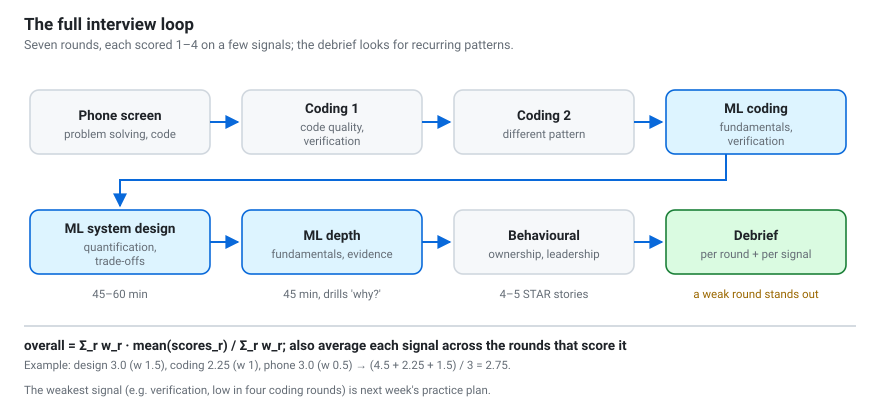

# Chapter 58 · Full interview loop & portfolio

*Part III · Prerequisites: Chapters 18, 38, 55, 56, 57 · Estimated time: reading ~35 min, lab ~90 min (plus the loop itself, about 5 hours, ideally on a separate day) · Compute: CPU*

 · [Lab: notebook.ipynb](notebook.ipynb) · [Solutions](solutions.md)

## Learning objectives

After this chapter you should be able to:

1. Describe the rounds of a typical ML engineering interview loop and what each one tests.
2. Run each round from a script on a timer, and score it against rubrics expressed as recurring signals.
3. Describe, in generic terms, what distinguishes mid-level, senior and staff answers in each round.
4. Combine round scores into an overall and a per-signal summary, keep a progress log, and use it to plan practice.
5. Structure project READMEs and one-page briefs in which every number is tied to the data split it was measured on.
6. Audit readiness across Parts I–III, and prepare a two-minute introduction.

## 58.1 Introduction

Part I ended with a 45-minute mock interview (Chapter 18) and Part II with a four-round loop (Chapter 38). This final chapter of Part III
assembles a complete loop, as large technology companies commonly run it for ML engineers, and turns the work of the whole book into a
portfolio that a hiring manager can read in a few minutes.

Two caveats frame the chapter. First, interview formats, levels and compensation differ between companies and change over time; nothing
here describes a specific company's process or career ladder. The rubrics are generic descriptions of signals that interviewers commonly
look for, intended to calibrate practice. Second, practice is only informative if it is honest: scores should be assigned strictly, and a
portfolio should contain only numbers that one has actually produced, each with the split it was measured on.

The lab contains scripts, timers, a scoring function and a portfolio generator. It runs on a CPU; the loop itself is meant to be run as a
separate, timed exercise, ideally with a practice partner.

## 58.2 The loop

A typical loop has a phone screen followed by an onsite day:

| Round | Minutes | Format | Where the book prepares it |
|---|---|---|---|
| Phone screen · coding | 45 | One or two algorithm and data-structure problems in a shared editor | Chapters 17, 33–34 |
| Onsite 1 · coding | 45 | A medium problem plus a follow-up that changes a constraint | Chapters 33–34 |
| Onsite 2 · coding | 45 | A different pattern (graphs, intervals, heaps, designing a class) | Chapters 33–34 |
| Onsite 3 · ML coding | 45 | Implementing a model component, loss or metric from scratch, with tests | Chapters 31–32, 41, 44, 46 |
| Onsite 4 · ML system design | 45–60 | An open product or platform design prompt | Chapters 18, 37, 55–56 |
| Onsite 5 · ML depth | 45 | Probing of the CV's topics, and a paper or research discussion | Chapter 57 |
| Onsite 6 · behavioural / leadership | 45 | Four or five structured stories with follow-ups; scope and influence | Chapter 18 |

The total interview time is 320 minutes; a real onsite spreads it over a day with breaks, and a practice loop should do the same.
Common variations exist: some loops replace one coding round with a second design round at senior and staff levels, some merge depth
into design, and some add a project deep dive or a presentation. The components can be practised separately; their arrangement varies.

*Figure 58.1 — The rounds of a loop and the signals each mainly scores, followed by a debrief. Because the same signals recur across
rounds, the debrief can see patterns, such as weak verification in every coding round.*

In each round the interviewer has an opening prompt, a ladder of follow-ups to escalate through, and time cues. The lab draws an opening
prompt for every round at random and prints the interviewer's script. When practising alone, the follow-ups should be read only after a
first answer has been given; when practising with a partner, the partner holds the script.

## 58.3 Signals and rubrics

Every round is scored on a few **signals**, qualities that recur across rounds, on a 1–4 scale (the same scale as in Chapter 38). The
signals and their generic anchors at three levels are:

| Signal | Mid-level | Senior | Staff |
|---|---|---|---|
| Problem solving | Reaches a working approach with hints | Finds the efficient approach independently and explains why | Reframes and generalises the problem; anticipates the follow-up |
| Code quality | Correct, readable code | Clean decomposition, idiomatic, edge cases handled unprompted | Code another team could own: interfaces, invariants, failure behaviour |
| Verification | Tests the main case when asked | Chooses tests that would catch real bugs; checks against a reference | Designs a verification strategy, including properties and production monitoring |
| ML fundamentals | Correct definitions and standard methods | Mechanisms and failure modes, with evidence | Knows where intuitions break and which experiment settles a question |
| Quantification | Numbers when asked | Load, latency, memory and cost estimated unprompted, with assumptions | Numbers drive sizing, phasing and priorities |
| Trade-offs | Names alternatives | Compares them with explicit criteria and chooses | States what evidence would change the choice; weighs reversibility and organisational cost |
| Operations | Mentions monitoring | Rollout, rollback, alerting, fallbacks, delayed labels | Ownership, on-call load, cost governance, incident process |
| Communication | Understandable, sometimes unstructured | Structured, signposted, checks in with the interviewer | Adapts depth to the audience, drives the conversation, summarises decisions |
| Ownership | Describes own tasks | Owns outcomes end to end, including mistakes | Takes on problems nobody assigned, across team boundaries |
| Leadership | Helps peers when asked | Mentors; influences decisions in the team | Sets direction across teams, builds consensus |

The levels differ mostly in **scope**: what the candidate takes responsibility for without being asked. Two candidates who both reach a
working coding solution are distinguished by whether one of them found the efficient approach without hints, handled edge cases unprompted,
tested with cases chosen to break the code, and adapted the design to a changed constraint rather than restarting. In design rounds, a staff
answer adds the marketplace or platform view, organisational contracts and numbers that drive decisions (Chapters 55–56).

**Behavioural stories** are usually structured as STAR: *situation*, *task*, *action*, *result*. Four or five prepared stories, each with the
candidate's own role made explicit and a measured result, cover most behavioural questions (conflict, failure, influence without authority,
ambiguity, a decision with incomplete data).

## 58.4 Scoring a loop and logging progress

A loop is not judged by an average of everything. Interviewers write feedback per round, and the hiring discussion examines each round *and*
signals that recur across rounds: weak communication in four rounds is a pattern, not noise. A useful summary therefore reports both. Let
$x_{r,s} \in \{1, 2, 3, 4\}$ be the score of signal $s$ in round $r$, $S_r$ the set of signals scored in round $r$, $R_s$ the set of rounds that
score signal $s$, and $w_r \ge 0$ a weight for round $r$. Then

$$
m_r = \frac{1}{\lvert S_r \rvert} \sum_{s \in S_r} x_{r,s}, \qquad
\text{overall} = \frac{\sum_r w_r\, m_r}{\sum_r w_r}, \qquad
\bar{x}_s = \frac{1}{\lvert R_s \rvert} \sum_{r \in R_s} x_{r,s}
\qquad (58.1)
$$

$m_r$ is the mean of round $r$, the overall score is a weighted mean of round means (so that a round with five signals does not outweigh one
with three), and $\bar{x}_s$ is the mean of signal $s$ across the rounds that score it. The **weakest signal**, the one with the smallest
$\bar{x}_s$, is the most useful output for planning practice.

*Worked example (the lab's labelled EXAMPLE attempt, illustrative weights: design 1.5, phone screen 0.5, others 1).* The round means are 2.75,
2.5, 2.25, 2.75, 2.8, 3.33 and 3.0, so the overall score is $(0.5 \cdot 2.75 + 2.5 + 2.25 + 2.75 + 1.5 \cdot 2.8 + 3.33 + 3.0)/7 = 19.41/7 = 2.77$.
The weakest signal is *verification*, at 2.0 in all four coding rounds, so the next practice plan follows directly: in every coding round, write
tests before being asked.

The weighted overall score is a summary for tracking trends, not a decision rule. In real hiring discussions a single very weak round, or a
strong negative signal on a core skill, can outweigh a high average, and interviewers calibrate differently. The per-round and per-signal views
should be read first.

The lab records each practice round as one line in a **JSON Lines** file (`progress.jsonl`): one JSON record per round, appended and never
rewritten, so that the history of attempts is preserved and progress can be measured over weeks. Scores are whole numbers; half points hide
indecision.

## 58.5 Packaging the portfolio

A hiring manager spends minutes, not hours, on a portfolio. Each project README (Part I's churn prediction service, Part II's ranking
cascade, a Part III project and the capstones of Part IV) should answer, in order: the problem and its user; the results, with every number
naming its split; the data; the approach; the main trade-offs; the limitations; and the next steps. Results come second, immediately after the
problem, because they are what readers look for first.

| Project | What it demonstrates | The number to quote (from one's own run) |
|---|---|---|
| Part I · churn service | Leakage-safe evaluation, a tested API, monitoring and rollback | Test PR-AUC with its interval, and p95 latency |
| Part II · ranking cascade | Retrieval and learning to rank at scale, position-bias correction, pre-registered evaluation | Held-out NDCG or IPS metric with a grouped-bootstrap interval; cascade p99 |
| Part III · a deep-learning project | Deep models under a compute budget, efficiency, evaluation of LLM systems | Accuracy or recall against a baseline on the named split; latency or cost per 1,000 requests |
| Capstones | Applying all of the above to a new public data set | The capstone's pre-registered primary metric |

A **project brief** is the one-page version of a README. The lab's generator collects result files written by earlier chapters in the same
artifact directory and turns them into structured project descriptions. It quotes numbers only from files it finds; everything else is
marked "TBD — fill from your run", and every number it finds is marked "name the split" until that is done. The rendering function of
Exercise 2 refuses a result that has a value but no split.

The rule behind this is the most important lesson of the chapter, and of the book: **a number without its split does not support a claim**.
"94% accuracy" means nothing until it is known whether it was measured per trial on subjects seen in training or per new user on a held-out
month. The split encodes the claim (new users? a later time period?), and choosing the wrong one changes both the number and what it proves
(Chapters 5 and 57).

## 58.6 Readiness and the two-minute introduction

The lab's readiness checklist lists twenty skills that a loop will test, one line each, and counts a skill as ready only if it has been
done **unaided, from a blank file, within interview time**, which is level 3 of the course's
[readiness rubric](../../appendices/readiness-rubric.md). Readiness is then simply the fraction of skills marked ready,

$$
\text{readiness} = \frac{\#\{\text{skills done unaided}\}}{\#\{\text{skills}\}}
\qquad (58.2)
$$

and it should be tracked weekly, not measured once. Recognising a method when reading about it is level 1, not level 3; strict self-assessment is
the only kind that predicts interview performance.

Most loops begin with "tell me about yourself", and the answer frames everything that follows. A two-minute answer has four parts:

1. **Identity in one line**, as the role sees it (for example, "an ML engineer with a background in time-series modelling and signal processing").
2. **Two proof points**, one from research and one from engineering, each with one's own role and a measured number with its split.
3. **Strengths** tied to the needs in the job description (for example rigorous evaluation, deep models under compute limits, ranking systems).
4. **Why this role, now**, in one or two sentences, without criticism of current or past environments.

Interviewers usually probe the most impressive number first ("how was that evaluated?") and the transition ("why leave research?"); a prepared
30-second answer to each is worthwhile.

## 58.7 A capacity question, revisited

A frequent closing question is "what would your model cost to serve at 1,000 queries per second?". The answer combines the fleet formula of
Chapter 56 with the cost arithmetic of Chapter 50. With measured per-replica throughput $\text{QPS}_{\text{replica}}$ at the target latency,
headroom $h$, a price $p$ per replica-hour, 730 hours per month and an average load $\overline{\text{QPS}}$,

$$
n = \max\!\left(2, \left\lceil \frac{\text{QPS}_{\text{peak}}}{\text{QPS}_{\text{replica}}\,(1 - h)} \right\rceil\right), \qquad
\text{cost}_{1k} = \frac{n \cdot p \cdot 730}{\overline{\text{QPS}} \cdot 3600 \cdot 730 / 1000}
\qquad (58.3)
$$

*Worked example (assumptions stated):* a peak of 1,000 QPS, 100 QPS per replica (measured), $h = 0.3$: $n = \lceil 14.3 \rceil = 15$ replicas. At
\$0.50 per hour this is \$5,475 per month; at an average of 500 QPS (1.31 billion requests per month) it is about \$0.0042 per 1,000 requests. The
answer should then name the levers: batching, quantisation and distillation (Chapter 49), caching, and autoscaling towards the average rather than
the peak.

## Key terms

| Term | Definition |
|---|---|
| Loop | The full set of interview rounds for one candidate. |
| Phone screen | A first, shorter round that decides whether the candidate proceeds to the onsite. |
| Signal | A quality that interviewers score and that recurs across rounds, such as verification or communication. |
| Rubric anchor | A short description of what a given score or level looks like for a signal. |
| Mid / senior / staff | Generic levels of scope and independence, not any company's career ladder. |
| STAR | Situation, task, action, result: a structure for behavioural answers. |
| Weighted overall | A weighted mean of per-round mean scores. |
| Weakest signal | The signal with the lowest mean across the rounds that score it. |
| JSON Lines log | A text file with one JSON record per line, appended and never rewritten. |
| Project brief | A one-page project summary in which every number is tied to its split. |
| Split | The data on which a number was measured, such as held-out users or the last two weeks. |
| Readiness | Whether a skill can be performed unaided, from a blank file, within interview time. |

## Summary

1. A typical ML engineering loop has a phone screen and six onsite rounds: two coding, ML coding, ML system design, ML depth and behavioural.
2. Rounds are scored on recurring signals; level differences are mostly differences in scope and in what is done unprompted.
3. A loop summary reports per-round means, per-signal means and a weighted overall (Equation 58.1); the weakest signal guides practice, and a
   single weak round can matter more than the average.
4. Practice rounds are logged in an append-only file so that progress over weeks is measurable.
5. Portfolio READMEs and briefs put results second, and every number names its split; numbers that were not produced are marked TBD, never
   guessed.
6. Readiness (Equation 58.2) counts only skills performed unaided within interview time, and is tracked weekly.
7. A two-minute introduction gives identity, two proof points with splits, relevant strengths and a forward-looking reason.
8. Capacity and cost questions are answered with explicit assumptions and the fleet and cost formulas (Equation 58.3).

## Exercises

The exercises are in the lab, [notebook.ipynb](notebook.ipynb); worked answers are in
[solutions.md](solutions.md).

* **Exercise 1 · `loop_score`.** Implement Equation (58.1) with input validation, returning the overall score, per-round and per-signal means
  and the weakest signal.
* **Exercise 2 · `project_brief`.** Render a project description as a Markdown brief with a results table, refusing any result that has a value
  but no split.
* **Exercise 3 · "Tell me about yourself".** Write, record and time a two-minute introduction in the four-part structure, using only measured
  numbers, and log it as a behavioural round.
* **Checkpoint questions** at the end of the lab: the introduction; mid versus senior signals in coding; staff additions in design; a practice plan
  for the weakest signal; the strongest portfolio project in three minutes; and the cost of serving a model at 1,000 QPS.

## Further reading

* Huyen, C. (2021). *Introduction to Machine Learning Interviews.* Self-published online book.
* Huyen, C. (2022). *Designing Machine Learning Systems.* O'Reilly.
* McDowell, G. L. (2015). *Cracking the Coding Interview* (6th ed.). CareerCup.
* Larson, W. (2021). *Staff Engineer: Leadership Beyond the Management Track.* Self-published.
* Kleppmann, M. (2017). *Designing Data-Intensive Applications.* O'Reilly.
* The course's [readiness rubric](../../appendices/readiness-rubric.md) and [interview question bank](../../appendices/interview-questions.md).

**Next:** [Part IV · Capstones](../../part4-capstones/README.md)
